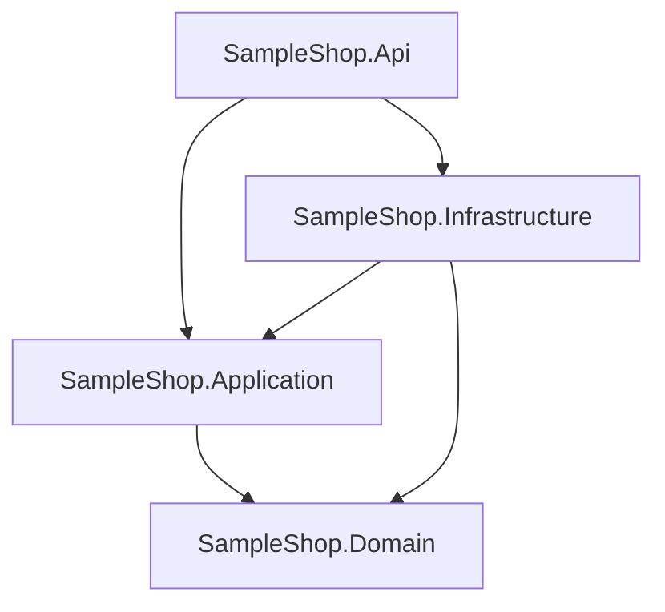
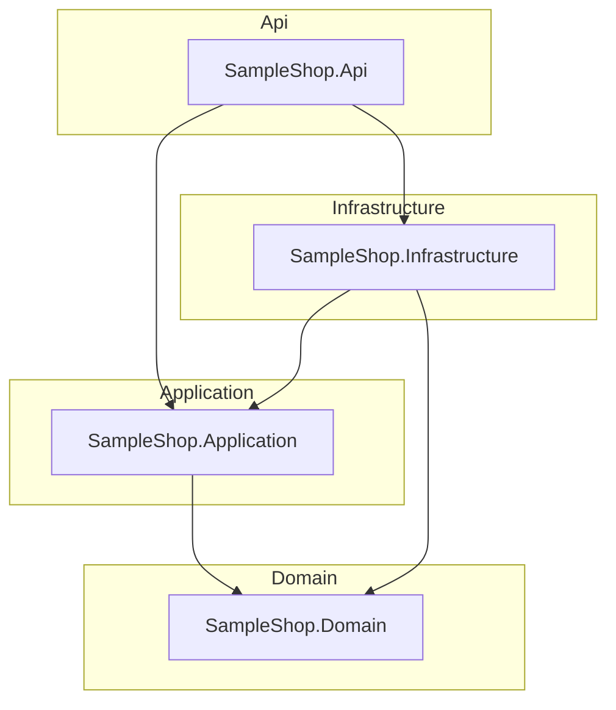
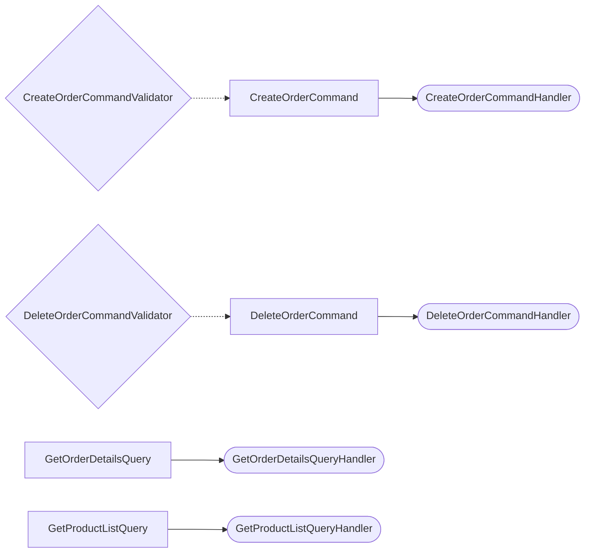

# CqrsLens

**See your MediatR codebase: every command, its handler, and its validators — drawn.**

CqrsLens is a .NET CLI tool that statically scans a solution — **without building it** —
and generates an `ARCHITECTURE.md` report with Mermaid diagrams: your project dependency
graph, your Clean Architecture layers, a full CQRS map (requests → handlers, validators),
your pipeline behaviors, and your EF Core DbContexts.

Point it at a codebase you just inherited, or your own six months later, and get the
map nobody wrote down.

## Install

```bash
dotnet tool install -g CqrsLens
```

## Usage

```bash
cqrslens <path-to-solution-folder> [-o OUTPUT.md]
```

- The folder is searched recursively for `.csproj` and `.cs` files (`bin`, `obj`, `.git` are skipped).
- Default output: `ARCHITECTURE.md` in the current directory.
- Exit codes: `0` ok · `1` usage error · `2` path not found · `3` no projects found.

Try it on the bundled sample:

```bash
cqrslens samples/SampleShop -o docs/sample-output/ARCHITECTURE.md
```

## What you get

Everything below is **actual output** generated from [`samples/SampleShop`](samples/SampleShop),
a small Clean Architecture solution (full report: [`docs/sample-output/ARCHITECTURE.md`](docs/sample-output/ARCHITECTURE.md)).

### Project dependency graph

Parsed from every `.csproj`'s `ProjectReference`s:



### Layers

Projects grouped by Clean Architecture naming convention (Domain / Application /
Infrastructure / Api / Web / UI) — projects matching no convention fall back to
their top-level folder:



### CQRS map

Every request, the handler that answers it, and the validators guarding it
(dashed = validation):



…plus the same information as a table:

| Request | Type | Response | Handler | Validators | Project |
| --- | --- | --- | --- | --- | --- |
| CreateOrderCommand | Command | Guid | CreateOrderCommandHandler | CreateOrderCommandValidator | SampleShop.Application |
| DeleteOrderCommand | Command | — | DeleteOrderCommandHandler | DeleteOrderCommandValidator | SampleShop.Application |
| GetOrderDetailsQuery | Query | OrderDetailsDto | GetOrderDetailsQueryHandler | — | SampleShop.Application |
| GetProductListQuery | Query | List<ProductDto> | GetProductListQueryHandler | — | SampleShop.Application |

### …and the rest of the report

- **Pipeline behaviors** — every `IPipelineBehavior<...>` implementation, listed by project.
- **Data access** — every `DbContext` with its `DbSet<T>` properties mapped to their entities
  (e.g. `ShopDbContext`: Orders → Order, Products → Product, Customers → Customer).

## What it detects

| Shape | How |
| --- | --- |
| Projects & references | `.csproj` XML (`ProjectReference` Include/Update) |
| Requests | classes/records/structs implementing `IRequest` or `IRequest<T>` |
| Handlers | `IRequestHandler<TRequest>` / `IRequestHandler<TRequest, TResponse>` |
| Validators | `AbstractValidator<T>` or `IValidator<T>` (FluentValidation) |
| Pipeline behaviors | `IPipelineBehavior<...>` implementations |
| DbContexts | classes deriving from `DbContext` (incl. `IdentityDbContext`), with their `DbSet<T>`s |

## How it works / v1 limitations

CqrsLens reads source text with targeted pattern matching — no Roslyn, no build,
no restoring the target's packages. That makes it fast and able to map solutions
that don't even compile, at the cost of some precision:

- Requests hidden behind custom marker interfaces (e.g. your own `ICommand<T>` that
  extends `IRequest<T>`) are not followed in v1.
- Handlers/validators are linked to requests by type name; two requests with the
  same name in different namespaces will share links.
- Declarations written in unusual formatting can be missed. When in doubt, the
  report errs toward showing less, not inventing more.

## Roadmap

- ER diagrams generated from the EF Core model (relationships, keys)
- HTML output with an interactive diagram viewer
- A GitHub Action that comments the architecture diff on pull requests
- Custom abstraction support (`ICommand` / `IQuery` markers) via configuration
- Roslyn-based analysis mode for exact results

## Development

```bash
dotnet build CqrsLens.sln
dotnet test  CqrsLens.sln
dotnet pack  src/CqrsLens/CqrsLens.csproj -c Release
```

## License

MIT — see [LICENSE](LICENSE). Built by [Abdullah Hakim](https://github.com/AbdullahHakima).
