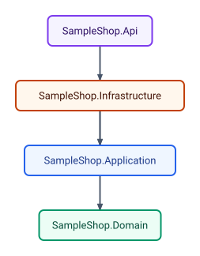
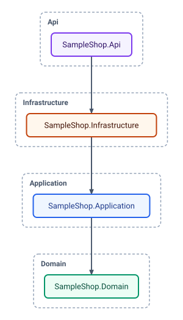
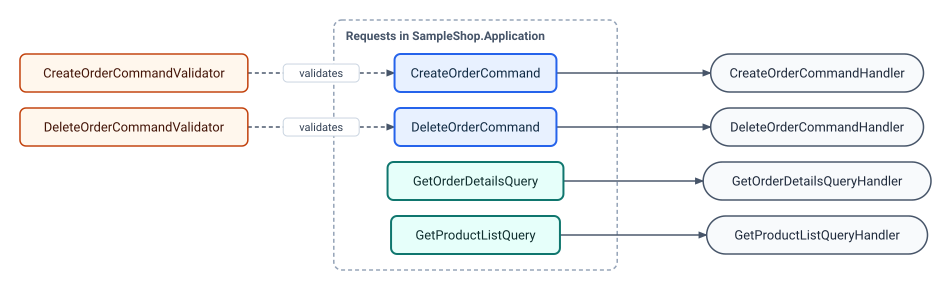
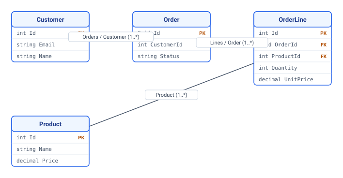
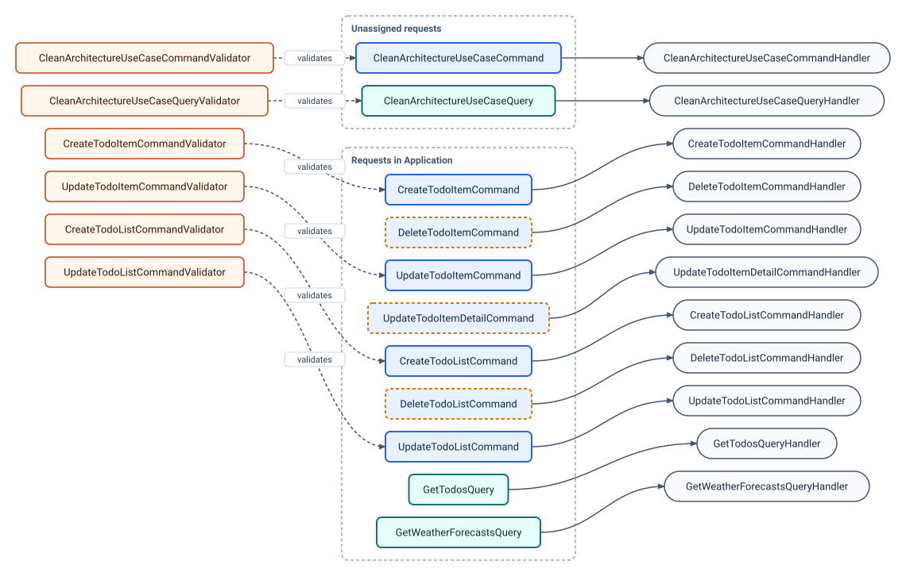
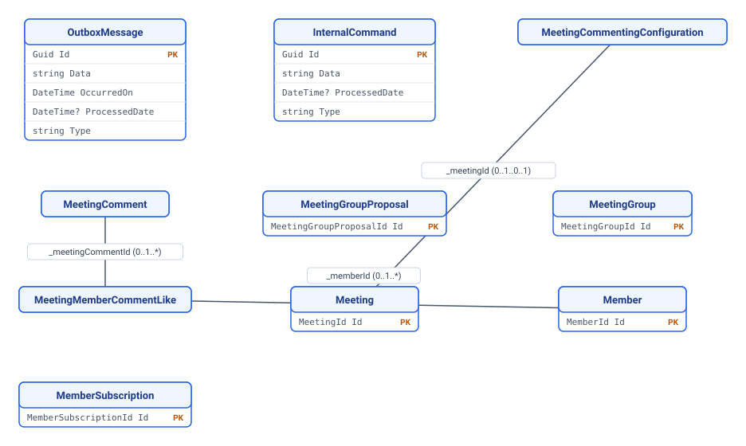

# CqrsLens

**See your MediatR codebase: every command, its handler, and its validators — drawn.**

CqrsLens is a .NET CLI tool that statically scans a solution, **without building it**,
and generates an `ARCHITECTURE.md` report with Mermaid diagrams: your project dependency
graph, your Clean Architecture layers, a full CQRS map (requests → handlers, validators),
your pipeline behaviors, and your EF Core DbContexts.

Point it at a codebase you just inherited, or your own six months later, and get the
map nobody wrote down.

```text
$ cqrslens samples/SampleShop

██       ██    ██▄     ██  ▄██████▄   ▄██████▄  ▄████████▄ ██      ██   ▄████▄
▄█▀▀▀█▀▀▀█▄    ██▀█▄   ██ ██▀    ▀██ ██▀    ▀▀▀ ▀▀  ██  ▀▀ ██      ██ ▄█▀    ▀█▄
██ █ █ █ ██    ██  ▀█▄ ██ ██      ██ ██             ██     ██      ██ ██▄▄▄▄▄▄██
██  ▄▄▄  ██    ██    ▀███ ██▄    ▄██ ██▄    ▄▄▄     ██     ██▄    ▄██ ██▀▀▀▀▀▀██
 ███ █ ███     ██      ██  ▀██████▀   ▀██████▀      ██      ▀██████▀  ██      ██
  ▀▀▀▀▀▀▀

          ── ◆ A lens for the CQRS codebase you already have. · v1.0.0

╭────────────────────────────────────────────────╮
│  NOCTUA · ARCHITECTURE SUMMARY                 │
│  SampleShop                                    │
├────────────────────────────────────────────────┤
│  Projects                                   4  │
│  Requests (Commands / Queries)              4  │
│  Handlers                                   4  │
│  Validators                                 2  │
│  Pipeline Behaviors                         1  │
│  EF Core DbContexts                         1  │
│  Scanner · Timing               text · 327 ms  │
├────────────────────────────────────────────────┤
│  ▲ 4 warning(s) · no errors                    │
╰────────────────────────────────────────────────╯

Report written to samples/SampleShop/ARCHITECTURE.md
```

## Install

```bash
dotnet tool install -g CqrsLens
```

## Usage

```bash
cqrslens <path-to-solution-folder> [-o OUTPUT] [--format md|html|json] [--render mermaid|svg] [--cqrs-map-split count|feature|unsplit] [--config FILE] [--baseline FILE] [--write-baseline FILE] [--diff PATH_OR_JSON] [--diff-output FILE] [--sarif FILE] [--summary FILE] [--github-annotations] [--ci-root DIR] [--analysis text|roslyn] [--generated-at ISO8601] [--markers ICommand,IQuery] [--handler-markers ICommandHandler,IQueryHandler] [--ascii] [--profile] [--strict]
```

- The folder is searched recursively for `.csproj` and `.cs` files (`bin`, `obj`, `.git` are skipped).
  Files are scanned in parallel; the report ends with a timing footer
  (`Generated by CqrsLens 1.0.0 in N ms — M files scanned.`).
- Default output: `ARCHITECTURE.md` in the current directory
  (`ARCHITECTURE.html` when `--format html`, `ARCHITECTURE.json` when `--format json`).
- `--diff PATH_OR_JSON`, `--diff-output FILE`, `--sarif FILE`, `--summary FILE`,
  `--github-annotations`, and `--ci-root DIR` add CI and architecture diff outputs
  without changing the primary report; see [docs/ci.md](docs/ci.md).
- `--export-svg DIR` and `--export-mermaid DIR` write every diagram in the
  report as standalone `.svg` / `.mmd` files: project graph, layers, CQRS map,
  flow, notifications, behavior chain, ER diagrams, and one sequence diagram
  per handled request.
- `--mcp` starts the MCP server for agent workflows instead of scanning;
  see [MCP server](#mcp-server).
- `--generated-at` pins the report timestamp (and reports 0 ms elapsed) for
  byte-reproducible golden files.
- `--ascii` swaps the box-drawing and block characters for single-width
  equivalents. Use it on a terminal with a CJK font, where those code points
  render two cells wide and shear the card and banner apart; `CQRSLENS_ASCII=1`
  does the same without the flag. `--unicode` restores the default.
- Exit codes: `0` ok · `1` usage error · `2` path not found · `3` no projects found ·
  `4` strict check failure (see [Architecture checks](#architecture-checks)).

Try it on the bundled sample:

```bash
cqrslens samples/SampleShop -o docs/sample-output/ARCHITECTURE.md
```

### HTML and JSON output

```bash
cqrslens <path> --format html
cqrslens <path> --format html --render svg
cqrslens <path> --format json
```

- **HTML (`--format html`)**: A single portable `ARCHITECTURE.html` with summary
  stat cards, the same diagrams and tables as the Markdown report, an **Interactive
  CQRS Explorer** (clickable requests, filter pills for `All` / `Commands` /
  `Queries` / `With Findings`, live search, and expandable inspector cards showing
  every request's contract, handlers, validators, `File:Line:Col` source locations,
  and architecture check findings), and two diagram rendering modes:
  - `--render mermaid` (default): emits `<pre class="mermaid">` blocks rendered in
    the browser by Mermaid `12.2.0` (loaded with a SHA-384 SRI check from jsDelivr;
    the first view needs network access, while the Mermaid source blocks remain
    readable offline).
  - `--render svg`: compiles every diagram (`flowchart TD`, `flowchart LR`, and
    `erDiagram`) to deterministic inline `<svg>` ahead of time and omits all
    `<script>` tags, producing a 100% zero-JavaScript, offline-ready HTML report.
- **CQRS map splitting (`--cqrs-map-split`, or `"cqrsMapSplit"` in
  `.cqrslens.json`)** controls how the CQRS map is split into diagrams:
  - `count` (default): group by declaring project, then balance each project's
    requests into bounded parts that stay within GitHub's Mermaid limits.
  - `feature`: one diagram per feature (the namespace segment the requests live in).
  - `unsplit`: one diagram per project, split further only when a project's map
    would exceed the renderer's safety limit. Every request still appears exactly
    once; the CLI flag overrides the config key. JSON output is unaffected by this
    setting.
- **JSON (`--format json`)**: A deterministic, schema-versioned `ARCHITECTURE.json`
  document containing summary counts, projects, requests, handlers, validators,
  pipeline behaviors, DbContexts (with entities and relationships), architecture
  checks, and diagnostics for external dashboards and custom tooling.

(A `.html` or `.json` path passed to `-o` also implies that format.)

### Analysis modes

Text analysis remains the default:

```bash
cqrslens <path> --analysis text
```

It is build-free and tolerant of incomplete solutions. The opt-in Roslyn
backend can be selected with:

```bash
cqrslens <path> --analysis roslyn
```

Roslyn mode resolves source-defined symbols, aliases and declaration namespaces
instead of matching declaration text. It compiles all source groups together so
cross-project request/handler types bind, evaluates `.csproj` and ancestor
`Directory.Build.props`/`targets` `<Using>` directives per project, and injects
minimal MediatR, FluentValidation and EF Core contracts only when the source does
not define them. It still does not build or restore the target solution. Text
mode remains the default and fallback. Parity with text mode is enforced on
`samples/SampleShop` by the test suite.

Reports record the scanner, a single generation timestamp, source locations and a
diagnostics section for skipped files, unresolved contracts and ambiguous links.
`--strict` only exits with code 4 when the scan is complete enough to trust its
architecture errors; on an incomplete scan it reports the diagnostics instead.

### Profiling and benchmarks

Every analysis records wall time and allocated bytes for each stage. Add `--profile`
to print the breakdown to stderr without changing the report:

```bash
cqrslens samples/SampleShop --profile -o ARCHITECTURE.md
```

```text
Profile (text): 11 ms, 0.7 MB allocated
  Read sources                           ...
  Parse sources                          ...
  Scan shapes                            ...
  Scan: ApplyScan                        ...
  Scan: EF model                         ...
  Deep: handler slices                   ...
  Deep: api entrypoints                  ...
```

`Scan:` and `Deep:` rows break their parent phase down further; they are not
additive with the parent. `--generated-at` intentionally reports `0 ms` for
reproducible golden files, but the allocation numbers remain available.

For repeatable warm and cold-process measurements, use the benchmark script:

```powershell
# SampleShop, both scanners
powershell -NoProfile -ExecutionPolicy Bypass -File scripts/benchmark.ps1

# More stable warm numbers, plus five cold processes
powershell -NoProfile -ExecutionPolicy Bypass -File scripts/benchmark.ps1 `
  -Mode both -Warmup 3 -Iterations 20 -Cold 5

# Deterministic 400-slice synthetic solution
powershell -NoProfile -ExecutionPolicy Bypass -File scripts/benchmark.ps1 `
  -Generate 400 -Mode text -Iterations 10 -Cold 3
```

The script builds the harness once, writes a timestamped JSON result under
`artifacts/bench/results/`, and reports:

- **warm**: one process, JIT and caches warmed, then `-Iterations` measurements;
- **cold process**: a fresh process per sample with no warmup, so first-call JIT is
  included (host startup is not).

`-Generate N` creates a deterministic four-project solution under
`artifacts/bench/synth-N` with requests, handlers, validators, notifications,
endpoints, entities and one `DbContext`. `-Force` regenerates it. The harness also
validates that repeated runs produce the same shape counts.

The harness can be run directly when scripting CI or a profiler:

```bash
dotnet run --project benchmarks/CqrsLens.Benchmarks -c Release -- \
  samples/SampleShop --mode both --warmup 3 --iterations 10

dotnet run --project benchmarks/CqrsLens.Benchmarks -c Release -- \
  --generate 400 --mode text --json
```

Representative Release results from one Windows machine (.NET SDK 10.0.400):

| Fixture | Mode | Warm median | Warm allocation | Cold process |
| --- | --- | ---: | ---: | ---: |
| SampleShop | text | 10.4 ms | 0.65 MB | 148 ms |
| SampleShop | roslyn | 28.9 ms | 1.56 MB | 805 ms |
| Synthetic 200 slices | text | 222.7 ms | 37.0 MB | 353 ms |
| Synthetic 400 slices | text | 319.3 ms | 74.1 MB | 559 ms |

For the 400-slice fixture used during this optimization pass, repeated warm runs
improved from roughly 610 ms / 190 MB to about 270–400 ms / 74–77 MB (best observed
median 272 ms). Absolute numbers vary with hardware, GC state and concurrent load;
use the script rather than comparing single ad-hoc runs. Roslyn remains the heavier
opt-in backend because it parses syntax trees and builds an in-memory compilation.

### Configuration

For larger or noisy repositories, put settings in `.cqrslens.json` at the scan
root (`--config FILE` selects another file):

```json
{
  "$schema": "https://raw.githubusercontent.com/AbdullahHakima/cqrslens/main/cqrslens.schema.json",
  "analysis": "text",
  "render": "mermaid",
  "cqrsMapSplit": "count",
  "watermark": "CONTOSO ARCHITECTURE",
  "markers": ["ICommand", "IQuery"],
  "include": ["src/**"],
  "exclude": ["**/Migrations/**", "**/Generated/**"],
  "layers": { "Contoso.Domain": "Domain" },
  "rules": { "AmbiguousProjectName": "off", "CommandWithoutValidator": "warning" }
}
```

`include`/`exclude` are case-insensitive root-relative globs (`**`, `*`, `?`).
`layers` overrides project classification, and `rules` accepts `off`, `warning`
or `error` for any architecture rule. Unknown keys and invalid values are usage
errors. Explicit `--analysis`, `--render`, `--markers` and `--handler-markers`
flags override the config values. See [`docs/configuration.md`](docs/configuration.md)
for the full reference.

### Console ASCII artwork, TrueColor gradients & watermarks

Interactive terminal runs render a 24-bit ANSI TrueColor gradient **CqrsLens** ASCII art banner, a live progress bar while scanning, and a Unicode box-drawing summary card (`--banner` / `--no-banner` and `--color` / `--no-color` control this explicitly, and `NO_COLOR` or redirected CI pipes automatically fall back to clean plain text).

Pass `--watermark "ACME CORP"` (or `"watermark": "ACME CORP"` in `.cqrslens.json`) to render a custom 5-row block ASCII art watermark stamp in the console and embed the watermark across Markdown (`ARCHITECTURE.md`), HTML (`ARCHITECTURE.html` with both a floating watermark overlay and an ASCII art header card), and JSON (`ARCHITECTURE.json`) reports:

```bash
cqrslens <path> --watermark "ACME CORP" -o ARCHITECTURE.html --render svg
```

### Custom marker interfaces

Many codebases wrap MediatR in their own abstractions. CqrsLens follows interface
inheritance automatically: a class implementing `ICommand<T>` is a request when
`ICommand<T>` (transitively) derives from `IRequest<T>`. It also follows
source-declared base classes such as `CommandBase` / `QueryBase<T>`, substituting
concrete generic response types along the chain. For marker hierarchies that do
**not** derive from `IRequest`, name the roots explicitly:

```bash
cqrslens <path> --markers ICommand,IQuery,IMessage
```

Configured markers count as request roots, and interfaces inheriting them count too.
Requests are classified by name suffix first (`…Command` / `…Query`), then by the
marker they were reached through, and are marked with their marker in the analysis.

### External handler wrappers

Handler wrappers declared in the scanned source are followed automatically. If the
wrapper comes from a package — for example
`Ardalis.SharedKernel.ICommandHandler<TCommand, TResult>` — name it as a handler
root so handlers can link back to their requests:

```bash
cqrslens <path> --handler-markers ICommandHandler,IQueryHandler
```

```json
{
  "markers": ["ICommand", "IQuery"],
  "handlerMarkers": ["ICommandHandler", "IQueryHandler"]
}
```

The first generic argument is treated as the request type, matching MediatR's
`IRequestHandler<TRequest, TResponse>` convention. This is opt-in: without the
option, an external wrapper remains opaque and is surfaced as an informational
scan diagnostic instead of being guessed.

### Mediator and Wolverine

CqrsLens is not limited to MediatR. Two other libraries are detected
automatically from package references or `using` directives — no flags needed:

| Library | Detected by | What is recognised |
| --- | --- | --- |
| [Mediator](https://github.com/martinothamar/Mediator) | `Mediator.Abstractions` / `Mediator.SourceGenerator`, `using Mediator;` | `ICommand`, `IQuery`, `IStream*` requests and `ICommandHandler`, `IQueryHandler`, `IStream*Handler` handlers |
| [Wolverine](https://wolverinefx.net) | `WolverineFx*` packages, `using Wolverine;` | `*Handler` / `*Consumer` classes whose `Handle`, `HandleAsync`, `Consume` or `ConsumeAsync` method takes a message declared in the scanned source |

Detected conventions are listed in the report header and in the JSON report.

### Architecture checks

Every report ends with an **Architecture Checks** section:

| Check | Severity | Meaning |
| --- | --- | --- |
| `MissingHandler` | error | A request has no handler |
| `MultipleHandlers` | error | A request has more than one handler |
| `LayerViolation` | error | A Domain project references an Infrastructure / Api / Web / UI project |
| `ApplicationLayerViolation` | error | An Application project references an Infrastructure / Api / Web / UI project |
| `CircularProjectDependency` | error | A cycle exists in the resolved `.csproj` dependency graph |
| `CommandWithoutValidator` | warning | A command has no FluentValidation / FastEndpoints validator |
| `OrphanValidator` | warning | A validator targets a type that does not match any discovered CQRS request |
| `OrphanNotification` | warning | A notification / domain event (`INotification` / `IDomainEvent`) has no handler |
| `UnreachableRequest` | warning | A request has a handler but no production call site sends it |
| `UnpublishedNotification` | warning | A notification / domain event has handlers but no production call site publishes it |
| `AmbiguousProjectName` | warning | Duplicate project names make reference resolution ambiguous |


Add `--strict` to fail (exit code `4`) when any **error** is found and the scan
is complete enough to trust its architecture errors — built for CI gates. An
incomplete or ambiguous scan reports diagnostics instead of failing on
low-confidence data. The report is still written.

### Existing codebases: baselines

Adopt `--strict` incrementally by recording current findings once:

```bash
cqrslens . --write-baseline cqrslens-baseline.json
cqrslens . --baseline cqrslens-baseline.json --strict
```

Findings are matched by rule + target + relative file, not line number, so
unrelated edits and moved lines stay known. With a baseline, `--strict` fails
only on **new** errors, and the report separates new from known findings. See
[`docs/baseline.md`](docs/baseline.md) for the workflow and file format.

### Comparing two scans (`--diff`)

Compare a scan against a saved `ARCHITECTURE.json` snapshot or a base checkout
directory to see what changed in projects, layers, CQRS requests/handlers/validators,
pipeline behaviors, EF Core `DbContext`s, and architecture checks:

```bash
# Compare against a base JSON report or base checkout directory
cqrslens src --diff base-architecture.json --diff-output cqrslens-diff.md
cqrslens src --diff ../base-checkout/src --diff-output cqrslens-diff.json
```

When `--diff-output` ends with `.md`, CqrsLens writes a pull-request-ready
Markdown diff (including the `<!-- cqrslens-architecture-diff -->` sticky-comment
marker and a Mermaid CQRS delta diagram of added, modified, and removed requests).
When it ends with `.json`, CqrsLens writes a deterministic, schema-versioned
JSON diff.

## Use in CI

CqrsLens ships as a GitHub Action (this repo's `action.yml`):

```yaml
permissions:
  contents: read
  pull-requests: write     # only needed when comment-pr is true
  security-events: write   # only needed when upload-sarif is true

- uses: AbdullahHakima/cqrslens@v1.0.0
  with:
    path: src                    # folder to scan (default: .)
    output: ARCHITECTURE.md
    format: md                   # md, html, or json
    render: ''                   # mermaid, svg, or empty to use config/default
    watermark: ''                # optional custom watermark stamp for console & reports
    strict: 'true'               # fail on errors (new-only with a baseline)
    config: .cqrslens.json       # optional, or auto-discovered at path
    baseline: cqrslens-baseline.json
    diff-base: ''                # optional base JSON/folder; auto-scanned on PRs when comment-pr is true
    diff-output: ''              # defaults to cqrslens-diff.md when diffing
    comment-pr: 'true'           # post/update sticky architecture diff comment on PRs
    sarif-output: cqrslens-results.sarif
    upload-sarif: 'false'        # true requires security-events: write
    annotations: 'true'          # file/line annotations for new findings
    markers: ''                  # optional: ICommand,IQuery,IMessage
    handler-markers: ''          # optional external wrapper roots
    analysis: ''                 # text, roslyn, or empty to use config/default
    version: '1.0.0'             # tool version installed by the action
```

The report, diff, and SARIF files are uploaded as `cqrslens-architecture-report`,
`cqrslens-architecture-diff`, and `cqrslens-sarif` artifacts. When
`comment-pr: 'true'` runs on a `pull_request`, the Action automatically scans the
PR base branch and posts or updates a sticky pull request comment with the
architecture diff. See [`docs/ci.md`](docs/ci.md) for permissions and CLI
equivalents.

### Real-world validation

A nightly, non-blocking [validation workflow](.github/workflows/real-world-validation.yml)
scans a pinned public MediatR / Clean Architecture corpus and publishes counts,
diagnostics, reports and SARIF. The current snapshot and known static-analysis
limitations are in [`docs/validation.md`](docs/validation.md); run the same
corpus locally with `bash scripts/validate-real-world.sh` after a Release build.
A separate non-gating workflow parses and renders the generated Mermaid with
Mermaid `12.2.0` in Chromium; see [`docs/validation.md`](docs/validation.md#render-check).

## MCP server

`cqrslens --mcp` starts a Model Context Protocol server over stdio
(JSON-RPC 2.0). Point any MCP client at the installed tool:

```json
{
  "mcpServers": {
    "cqrslens": { "command": "cqrslens", "args": ["--mcp"] }
  }
}
```

The server scans on demand and caches per solution path. Every tool is
read-only: tools report and verify, they never change code.

| Tool | What it does |
| --- | --- |
| `get_architecture_dna` | Compact orientation summary: layer and project topology, CQRS conventions, DbContexts, counts. |
| `trace_slice` | End-to-end vertical slices for a keyword (request, route, entity, event) with File:Line locations; `format: "json"` returns the structured slice. |
| `trace_entity_impact` | An entity's schema plus every request, handler and endpoint that touches it. |
| `trace_request_impact` | What one request touches and what touches it: handler, validators, behaviors in registered order, dispatching endpoints, published notifications, DbContext edges, reverse references. |
| `check_architecture` | The architecture checks with File:Line locations; filter by rule, severity or target, or group the counts by project. |
| `verify_claim` | Checks one structured claim (subject / relation / object) against the scan and answers `supported`, `not supported` or `not determinable`, with the evidence it used. It fails closed: anything the scan cannot settle is `not determinable`, never a guess. |
| `diff_architecture` | Diffs the current scan against a saved report JSON or a second folder, with the same semantics as `--diff`. |

## What you get

Everything below is **actual output** generated from [`samples/SampleShop`](samples/SampleShop),
a small Clean Architecture solution (full report: [`docs/sample-output/ARCHITECTURE.md`](docs/sample-output/ARCHITECTURE.md)).

### Project dependency graph

Parsed from every `.csproj`'s `ProjectReference`s:



### Layers

Projects grouped by Clean Architecture naming convention (Domain / Application /
Infrastructure / Api / Web / UI) — projects matching no convention fall back to
their top-level folder:



### CQRS map

Every request, the handler that answers it, and the validators guarding it.
The dashed boundary contains only the requests declared in that project; handlers
and validators stay outside and are shown where linked:



Red dashed request borders mark `MissingHandler` findings; amber dashed borders
mark `CommandWithoutValidator` findings. Both styles are added only when the
corresponding check is enabled and has a finding. Large solutions are split by
project and balanced into parts of at most 15 requests, so each diagram stays
readable and every request appears exactly once.

…plus the same information as a table:

| Request | Type | Response | Handler | Validators | Project |
| --- | --- | --- | --- | --- | --- |
| CreateOrderCommand | Command | Guid | CreateOrderCommandHandler | CreateOrderCommandValidator | SampleShop.Application |
| DeleteOrderCommand | Command | — | DeleteOrderCommandHandler | DeleteOrderCommandValidator | SampleShop.Application |
| GetOrderDetailsQuery | Query | OrderDetailsDto | GetOrderDetailsQueryHandler | — | SampleShop.Application |
| GetProductListQuery | Query | List&lt;ProductDto&gt; | GetProductListQueryHandler | — | SampleShop.Application |

### Data access and EF Core ER diagram

A class counts as a context when it derives from a data-context base - `DbContext`
for EF Core, or the provider equivalent for MongoDB and in-memory contexts - through
any number of intermediate base classes. Only concrete classes are listed: abstract
base contexts are not counted on their own.

Every `DbContext` is listed with its `DbSet<T>` properties, followed by a Mermaid
`erDiagram` built from root `DbSet<T>` entities, transitive keyed entities reached
through navigation properties, primary/foreign keys, data annotations (`[Key]`,
`[ForeignKey]`, `[InverseProperty]`, `[Required]`, `[NotMapped]`), and common
Fluent API calls (`HasKey`, `HasOne`/`HasMany`, `WithOne`/`WithMany`,
`HasForeignKey`, `IsRequired`) in `OnModelCreating` or `IEntityTypeConfiguration<T>`:



### …and the rest of the report

- **Flow diagram** — the dispatch flow drawn from the call sites the scan
  found: endpoint → request → handler → DbContext. Dispatches it cannot
  resolve are counted in the caption, never drawn as edges.
- **Notifications** — a fan-out map from each publisher to the notification
  and its handlers.
- **Request sequences** — one sequence diagram per request with a resolved
  handler: endpoint → mediator → pipeline behaviors (registered order) →
  handler → DbContext → published notifications.
- **Pipeline behaviors** — every `IPipelineBehavior<...>` implementation, listed by project.
- **Data access** — every `DbContext` with its `DbSet<T>` properties mapped to their entities
  (e.g. `ShopDbContext`: Orders → Order, Products → Product, Customers → Customer) and its
  ER diagram. Several contexts in one file are attributed per class.
- **Architecture checks** — missing handlers, layer violations, and commands without
  validators (see below), plus a timing footer with the scan duration and file count.

## On a real codebase

Sample projects are tidy. Real ones are not, so I run CqrsLens on my own
production backend (the API behind my blog, El-Hakim: 8 projects, 295 files).
Full report: [`docs/elhakim-output/ARCHITECTURE.md`](docs/elhakim-output/ARCHITECTURE.md).

| Metric | Count |
| --- | ---: |
| Projects | 8 |
| Requests (commands + queries) | 63 |
| Handlers | 63 |
| Validators | 9 |
| Pipeline behaviors | 1 |
| DbContexts | 1 (21 DbSets) |

The scan caught a case I cared about: two different features each define a
`TogglePostLikeCommand` (Likes and Posts). They are separate requests with
separate handlers, and the report keeps them separate:

| Request | Type | Response | Handler | Project |
| --- | --- | --- | --- | --- |
| TogglePostLikeCommand | Command | LikeStatusDto | TogglePostLikeCommandHandler | ElHakim.Application |
| TogglePostLikeCommand | Command | bool | TogglePostLikeCommandHandler | ElHakim.Application |

And the checks section told me the truth about my own code: **0 errors,
38 warnings** — 33 of them commands without a validator, plus an orphan
validator and 4 requests nothing in the codebase dispatches:

```text
- ⚠️ Warning **CommandWithoutValidator** — Command `ElHakim.Application.Features.Likes.Commands.TogglePostLike.TogglePostLikeCommand` has no validator.
- ⚠️ Warning **CommandWithoutValidator** — Command `ElHakim.Application.Features.Auth.Commands.RefreshToken.RefreshTokenCommand` has no validator.
```

The whole scan took 508 ms.

### Public open-source benchmark gallery

CqrsLens is also tested against 4 well-known open-source .NET repositories (**105 projects**, **154 requests**, **154 handlers**) with **100% shape and check parity between `--analysis text` and `--analysis roslyn`**:

| Repository | Projects | Requests | Handlers | Validators | Behaviors | DbContexts | Checks (E/W) | Generated Report |
| --- | ---: | ---: | ---: | ---: | ---: | ---: | ---: | --- |
| [jasontaylordev/CleanArchitecture](https://github.com/jasontaylordev/CleanArchitecture) | 13 | 11 | 11 | 6 | 4 | 1 | `0 / 6` | [`jasontaylor-ARCHITECTURE.md`](docs/sample-output/real-world/jasontaylor-ARCHITECTURE.md) |
| [ardalis/CleanArchitecture](https://github.com/ardalis/CleanArchitecture) | 22 | 23 | 23 | 21 | 3 | 3 | `0 / 38` | [`ardalis-ARCHITECTURE.md`](docs/sample-output/real-world/ardalis-ARCHITECTURE.md) |
| [kgrzybek/modular-monolith-with-ddd](https://github.com/kgrzybek/modular-monolith-with-ddd) | 46 | 105 | 105 | 5 | 0 | 4 | `0 / 205` | [`kgrzybek-ddd-ARCHITECTURE.md`](docs/sample-output/real-world/kgrzybek-ddd-ARCHITECTURE.md) |
| [martinothamar/Mediator](https://github.com/martinothamar/Mediator) (`samples`) | 24 | 15 | 15 | 1 | 9 | 0 | `0 / 12` | [`mediator-ARCHITECTURE.md`](docs/sample-output/real-world/mediator-ARCHITECTURE.md) |

#### Example: `jasontaylordev/CleanArchitecture` CQRS Map (11 Requests, 11 Handlers, 6 Validators)



#### Example: `kgrzybek/modular-monolith-with-ddd` `MeetingsContext` ER Diagram (10 Entities, 3 Backing-Field Relationships)



## What it detects

| Shape | How |
| --- | --- |
| Projects & references | `.csproj` XML (`ProjectReference` Include/Update) |
| Requests | classes/records/structs implementing `IRequest` or `IRequest<T>` — directly, through custom interfaces deriving from it, through source-declared base classes, or through `--markers` roots |
| Handlers | `IRequestHandler<TRequest>` / `IRequestHandler<TRequest, TResponse>`, including source-declared wrappers and external wrappers named with `--handler-markers`; generic and non-generic overloads are resolved by arity |
| Validators | `AbstractValidator<T>` or `IValidator<T>` (FluentValidation) and `Validator<T>` (FastEndpoints), including source-declared wrappers |
| Pipeline behaviors | `IPipelineBehavior<...>` implementations |
| Notifications & domain events | classes/records/structs implementing `INotification` or `IDomainEvent` (directly or through source-declared base classes/interfaces) and their 1-to-many `INotificationHandler<T>` / `IDomainEventHandler<T>` handlers |
| DbContexts | concrete classes deriving from a `DbContext` base (incl. `IdentityDbContext`) — abstract base contexts are not listed on their own, with their `DbSet<T>`s attributed per class, plus entity properties, keys (`Id`, `<Entity>Id`, `[Key]`, `HasKey`) and relationships (`[ForeignKey]`, `[InverseProperty]`, navigation properties, `OnModelCreating`, `IEntityTypeConfiguration<T>`) |

## How it works / limitations

CqrsLens defaults to targeted source-text matching with no build or package
restore. That makes text mode fast and able to map solutions that do not compile,
at the cost of some precision. Opt-in `--analysis roslyn` uses Roslyn symbols for
source-shape discovery while keeping the same no-build workflow. It shims known
MediatR/FluentValidation/FastEndpoints/EF Core contracts that are not present in
the source:

- Requests are followed through custom marker interfaces (anything deriving from
  `IRequest`, plus `--markers` roots) and through base *classes* declared in the
  scanned source, including generic response substitution. A chain that leaves
  the scanned source cannot be continued; that gap is reported as an
  informational diagnostic instead of being guessed.
- Same-named contracts are resolved from the declaration's namespace and using
  directives, including project-level MSBuild `<Using>` items, `.cs` global
  usings, and namespace aliases. Generic and non-generic overloads are
  distinguished by arity. Handlers/validators link by fully-qualified name first,
  then an imported namespace, then a unique simple name. Genuinely ambiguous or
  unresolved CQRS contracts are reported as informational diagnostics instead of
  being guessed.
- External handler wrappers are opaque by default unless their inheritance is
  present in the scanned source. Name them with `--handler-markers` /
  `handlerMarkers` to link handlers through them. Source-declared wrappers such
  as `ICommandHandler<T> : IRequestHandler<T>` are followed automatically.
- FastEndpoints `Validator<T>` is recognized by name. Other external validator
  wrappers and manual validation are not modeled.
- Declarations written in unusual formatting can be missed. When in doubt, the
  report errs toward showing less, not inventing more.

## Roadmap

Short version (full list in [ROADMAP.md](ROADMAP.md)):

- ✅ Console ASCII artwork, 24-bit TrueColor gradients, live progress bar & custom watermarks (`v0.6.0`)
- ✅ Built-in Mediator (`martinothamar/Mediator`) and Wolverine (`WolverineFx`) conventions (`v0.7.0`)
- ✅ Architecture diff CLI (`--diff` / `--diff-output`) and GitHub Action PR comment mode (`comment-pr: 'true'`) (`v0.7.0`)
- ✅ Interactive HTML explorer (click a request, see its handler, validators, source files, and findings)
- ✅ Domain events & notifications (`INotification`, `IDomainEvent`, 1-to-many `INotificationHandler<T>` fan-out diagrams)
- ✅ Expanded architecture rules (`MultipleHandlers`, `ApplicationLayerViolation`, `CircularProjectDependency`, `OrphanValidator`, `OrphanNotification`)
- ✅ Dispatch call-site tracking & flow graph (`Send`/`Publish` sites across MediatR, Mediator and Wolverine; `flowEdges`, `dispatchCallSites` and `unresolvedDispatches` in JSON output) (`v0.8.0`)
- ✅ Reachability checks (`UnreachableRequest`, `UnpublishedNotification`) (`v0.8.0`)
- ✅ Flow diagrams in Markdown and HTML reports (endpoint → request → handler → DbContext, Mermaid and inline SVG) (`v0.9.0`)
- ✅ Behavior chain visual for the request pipeline (`v0.9.0`)
- ✅ CQRS map splitting by feature (`--cqrs-map-split count|feature|unsplit`) (`v0.9.0`)
- ✅ Standalone SVG export (`--export-svg <directory>`): every report diagram as its own .svg file (`v0.9.0`)
- ✅ Per-request sequence diagrams (endpoint → mediator → behaviors → handler → DbContext → notifications) (`v1.0.0`)
- ✅ MCP tools for agents (`verify_claim`, `diff_architecture`, filtered and grouped `check_architecture`, `trace_request_impact`) — read-only (`v1.0.0`)
- ✅ Standalone Mermaid export (`--export-mermaid <directory>`); sequence diagrams included in `--export-svg` (`v1.0.0`)

## Development

```bash
dotnet build CqrsLens.sln -c Release
dotnet test  CqrsLens.sln -c Release
dotnet pack  src/CqrsLens.Cli/CqrsLens.Cli.csproj -c Release

# warm/cold benchmarks and synthetic solutions
powershell -NoProfile -ExecutionPolicy Bypass -File scripts/benchmark.ps1 -Generate 400
```

Production code is split into `Core`, `Analysis`, `Reporting` and `Cli`; the
dependency direction, scan pipeline and correctness policy are documented in
[`docs/architecture.md`](docs/architecture.md). Architecture boundaries and the
golden corpus are enforced by the test suite.

## License

MIT — see [LICENSE](LICENSE). Built by [Abdullah Hakim](https://github.com/AbdullahHakima).
