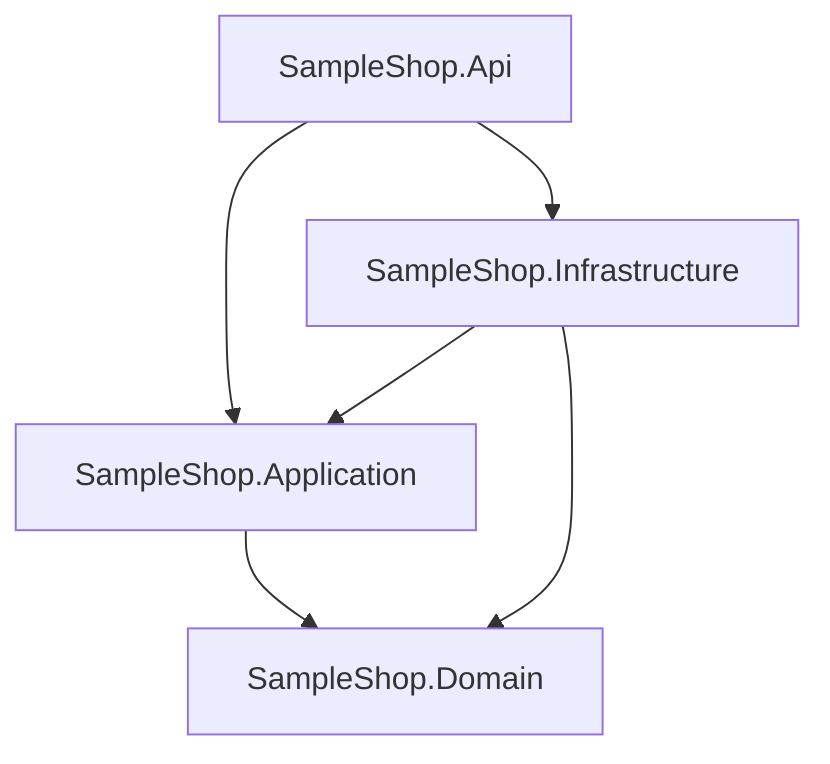
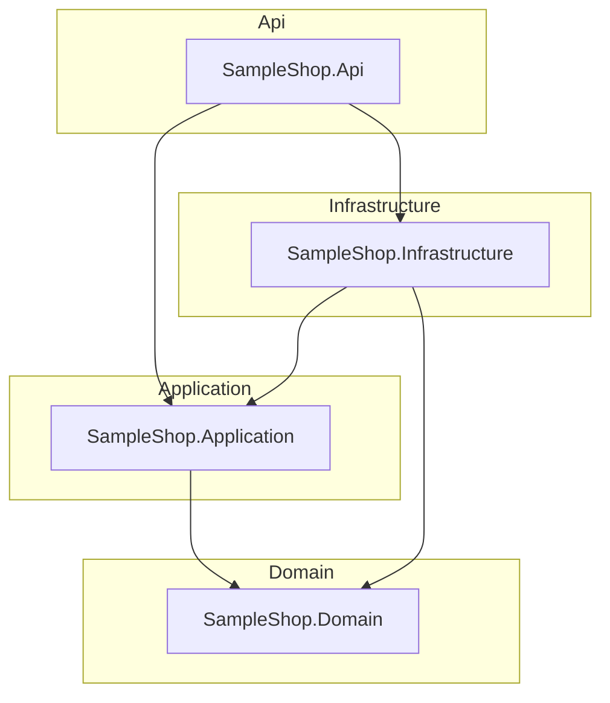

# CqrsLens

**See your MediatR codebase: every command, its handler, and its validators — drawn.**

CqrsLens is a .NET CLI tool that statically scans a solution, **without building it**,
and generates an `ARCHITECTURE.md` report with Mermaid diagrams: your project dependency
graph, your Clean Architecture layers, a full CQRS map (requests → handlers, validators),
your pipeline behaviors, and your EF Core DbContexts.

Point it at a codebase you just inherited, or your own six months later, and get the
map nobody wrote down.

## Install

```bash
dotnet tool install -g CqrsLens
```

## Usage

```bash
cqrslens <path-to-solution-folder> [-o OUTPUT] [--format md|html] [--config FILE] [--baseline FILE] [--write-baseline FILE] [--sarif FILE] [--summary FILE] [--github-annotations] [--ci-root DIR] [--analysis text|roslyn] [--generated-at ISO8601] [--markers ICommand,IQuery] [--handler-markers ICommandHandler,IQueryHandler] [--strict]
```

- The folder is searched recursively for `.csproj` and `.cs` files (`bin`, `obj`, `.git` are skipped).
  Files are scanned in parallel; the report ends with a timing footer
  (`Generated by CqrsLens 0.5.0 in N ms — M files scanned.`).
- Default output: `ARCHITECTURE.md` in the current directory
  (`ARCHITECTURE.html` when `--format html`).
- `--sarif FILE`, `--summary FILE`, `--github-annotations`, and `--ci-root DIR`
  add CI outputs without changing the primary report; see [docs/ci.md](docs/ci.md).
- `--generated-at` pins the report timestamp (and reports 0 ms elapsed) for
  byte-reproducible golden files.
- Exit codes: `0` ok · `1` usage error · `2` path not found · `3` no projects found ·
  `4` strict check failure (see [Architecture checks](#architecture-checks)).

Try it on the bundled sample:

```bash
cqrslens samples/SampleShop -o docs/sample-output/ARCHITECTURE.md
```

### HTML output

```bash
cqrslens <path> --format html
```

A single portable `ARCHITECTURE.html`: summary stat cards, the same diagrams and
tables as the Markdown report, and Mermaid rendered in the browser. Mermaid is
pinned to `10.9.4` and loaded with a SHA-384 SRI check from jsDelivr; the first
view needs network access, while the Mermaid source blocks remain readable
offline. (A `.html` path passed to `-o` also implies HTML.)

### Analysis modes

Text analysis remains the default:

```bash
cqrslens <path> --analysis text
```

It is build-free and tolerant of incomplete solutions. The opt-in Roslyn
backend can be selected with:

```bash
cqrslens <path> --analysis roslyn
```

Roslyn mode resolves source-defined symbols, aliases and declaration namespaces
instead of matching declaration text. It compiles all source groups together so
cross-project request/handler types bind, and injects minimal MediatR,
FluentValidation and EF Core contracts only when the source does not define them.
It still does not build or restore the target solution, and it does not evaluate
the target project's full MSBuild/package reference graph. Text mode remains the
default and fallback. Parity with text mode is enforced on `samples/SampleShop`
by the test suite.

Reports record the scanner, a single generation timestamp, source locations and a
diagnostics section for skipped files, unresolved contracts and ambiguous links.
`--strict` only exits with code 4 when the scan is complete enough to trust its
architecture errors; on an incomplete scan it reports the diagnostics instead.

### Configuration

For larger or noisy repositories, put settings in `.cqrslens.json` at the scan
root (`--config FILE` selects another file):

```json
{
  "$schema": "https://raw.githubusercontent.com/AbdullahHakima/cqrslens/main/cqrslens.schema.json",
  "analysis": "text",
  "markers": ["ICommand", "IQuery"],
  "include": ["src/**"],
  "exclude": ["**/Migrations/**", "**/Generated/**"],
  "layers": { "Contoso.Domain": "Domain" },
  "rules": { "AmbiguousProjectName": "off", "CommandWithoutValidator": "warning" }
}
```

`include`/`exclude` are case-insensitive root-relative globs (`**`, `*`, `?`).
`layers` overrides project classification, and `rules` accepts `off`, `warning`
or `error` for any architecture rule. Unknown keys and invalid values are usage
errors. Explicit `--analysis`, `--markers` and `--handler-markers` flags override
the config values. See [`docs/configuration.md`](docs/configuration.md) for the
full reference.

### Custom marker interfaces

Many codebases wrap MediatR in their own abstractions. CqrsLens follows interface
inheritance automatically: a class implementing `ICommand<T>` is a request when
`ICommand<T>` (transitively) derives from `IRequest<T>`. It also follows
source-declared base classes such as `CommandBase` / `QueryBase<T>`, substituting
concrete generic response types along the chain. For marker hierarchies that do
**not** derive from `IRequest`, name the roots explicitly:

```bash
cqrslens <path> --markers ICommand,IQuery,IMessage
```

Configured markers count as request roots, and interfaces inheriting them count too.
Requests are classified by name suffix first (`…Command` / `…Query`), then by the
marker they were reached through, and are marked with their marker in the analysis.

### External handler wrappers

Handler wrappers declared in the scanned source are followed automatically. If the
wrapper comes from a package — for example
`Ardalis.SharedKernel.ICommandHandler<TCommand, TResult>` — name it as a handler
root so handlers can link back to their requests:

```bash
cqrslens <path> --handler-markers ICommandHandler,IQueryHandler
```

```json
{
  "markers": ["ICommand", "IQuery"],
  "handlerMarkers": ["ICommandHandler", "IQueryHandler"]
}
```

The first generic argument is treated as the request type, matching MediatR's
`IRequestHandler<TRequest, TResponse>` convention. This is opt-in: without the
option, an external wrapper remains opaque and is surfaced as an informational
scan diagnostic instead of being guessed.

### Architecture checks

Every report ends with an **Architecture Checks** section:

| Check | Severity | Meaning |
| --- | --- | --- |
| `MissingHandler` | error | A request has no handler |
| `LayerViolation` | error | A Domain project references an Infrastructure / Api / Web project |
| `CommandWithoutValidator` | warning | A command has no FluentValidation validator |

Add `--strict` to fail (exit code `4`) when any **error** is found and the scan
is complete enough to trust its architecture errors — built for CI gates. An
incomplete or ambiguous scan reports diagnostics instead of failing on
low-confidence data. The report is still written.

### Existing codebases: baselines

Adopt `--strict` incrementally by recording current findings once:

```bash
cqrslens . --write-baseline cqrslens-baseline.json
cqrslens . --baseline cqrslens-baseline.json --strict
```

Findings are matched by rule + target + relative file, not line number, so
unrelated edits and moved lines stay known. With a baseline, `--strict` fails
only on **new** errors, and the report separates new from known findings. See
[`docs/baseline.md`](docs/baseline.md) for the workflow and file format.

## Use in CI

CqrsLens ships as a GitHub Action (this repo's `action.yml`):

```yaml
permissions:
  contents: read
  security-events: write   # only needed when upload-sarif is true

- uses: AbdullahHakima/cqrslens@v0.5.0
  with:
    path: src                    # folder to scan (default: .)
    output: ARCHITECTURE.md
    format: md                   # or html
    strict: 'true'               # fail on errors (new-only with a baseline)
    config: .cqrslens.json       # optional, or auto-discovered at path
    baseline: cqrslens-baseline.json
    sarif-output: cqrslens-results.sarif
    upload-sarif: 'false'        # true requires security-events: write
    annotations: 'true'          # file/line annotations for new findings
    markers: ''                  # optional: ICommand,IQuery,IMessage
    handler-markers: ''          # optional external wrapper roots
    analysis: ''                 # text, roslyn, or empty to use config/default
    version: '0.5.0'             # tool version installed by the action
```

The report and SARIF file are uploaded as `cqrslens-architecture-report` and
`cqrslens-sarif` artifacts. The Action writes a job summary with counts and top
findings, and emits GitHub annotations for new findings. See
[`docs/ci.md`](docs/ci.md) for SARIF upload permissions and CLI equivalents.

### Real-world validation

A nightly, non-blocking [validation workflow](.github/workflows/real-world-validation.yml)
scans a pinned public MediatR / Clean Architecture corpus and publishes counts,
diagnostics, reports and SARIF. The current snapshot and known static-analysis
limitations are in [`docs/validation.md`](docs/validation.md); run the same
corpus locally with `bash scripts/validate-real-world.sh` after a Release build.

## What you get

Everything below is **actual output** generated from [`samples/SampleShop`](samples/SampleShop),
a small Clean Architecture solution (full report: [`docs/sample-output/ARCHITECTURE.md`](docs/sample-output/ARCHITECTURE.md)).

### Project dependency graph

Parsed from every `.csproj`'s `ProjectReference`s:



### Layers

Projects grouped by Clean Architecture naming convention (Domain / Application /
Infrastructure / Api / Web / UI) — projects matching no convention fall back to
their top-level folder:



### CQRS map

Every request, the handler that answers it, and the validators guarding it
(dashed = validation):


…plus the same information as a table:

| Request | Type | Response | Handler | Validators | Project |
| --- | --- | --- | --- | --- | --- |
| CreateOrderCommand | Command | Guid | CreateOrderCommandHandler | CreateOrderCommandValidator | SampleShop.Application |
| DeleteOrderCommand | Command | — | DeleteOrderCommandHandler | DeleteOrderCommandValidator | SampleShop.Application |
| GetOrderDetailsQuery | Query | OrderDetailsDto | GetOrderDetailsQueryHandler | — | SampleShop.Application |
| GetProductListQuery | Query | List<ProductDto> | GetProductListQueryHandler | — | SampleShop.Application |

### …and the rest of the report

- **Pipeline behaviors** — every `IPipelineBehavior<...>` implementation, listed by project.
- **Data access** — every `DbContext` with its `DbSet<T>` properties mapped to their entities
  (e.g. `ShopDbContext`: Orders → Order, Products → Product, Customers → Customer).
  Several contexts in one file are attributed per class.
- **Architecture checks** — missing handlers, layer violations, and commands without
  validators (see below), plus a timing footer with the scan duration and file count.

## On a real codebase

Sample projects are tidy. Real ones are not, so I run CqrsLens on my own
production backend (the API behind my blog, El-Hakim: 5 projects, 278 files).
Full report: [`docs/elhakim-output/ARCHITECTURE.md`](docs/elhakim-output/ARCHITECTURE.md).

| Metric | Count |
| --- | ---: |
| Projects | 5 |
| Requests (commands + queries) | 62 |
| Handlers | 63 |
| Validators | 9 |
| Pipeline behaviors | 1 |
| DbContexts | 1 (21 DbSets) |

The scan caught a case I cared about: two different features each define a
`TogglePostLikeCommand` (Likes and Posts). They are separate requests with
separate handlers, and the report keeps them separate:

| Request | Type | Response | Handler | Project |
| --- | --- | --- | --- | --- |
| TogglePostLikeCommand | Command | LikeStatusDto | TogglePostLikeCommandHandler | ElHakim.Application |
| TogglePostLikeCommand | Command | bool | TogglePostLikeCommandHandler | ElHakim.Application |

And the checks section told me the truth about my own code: **0 errors,
32 warnings**, all of them commands without a validator:

```text
- ⚠️ Warning **CommandWithoutValidator** — Command `ElHakim.Application.Features.Likes.Commands.TogglePostLike.TogglePostLikeCommand` has no validator.
- ⚠️ Warning **CommandWithoutValidator** — Command `ElHakim.Application.Features.Auth.Commands.RefreshToken.RefreshTokenCommand` has no validator.
```

The whole scan took 145 ms.

## What it detects

| Shape | How |
| --- | --- |
| Projects & references | `.csproj` XML (`ProjectReference` Include/Update) |
| Requests | classes/records/structs implementing `IRequest` or `IRequest<T>` — directly, through custom interfaces deriving from it, through source-declared base classes, or through `--markers` roots |
| Handlers | `IRequestHandler<TRequest>` / `IRequestHandler<TRequest, TResponse>`, including source-declared wrappers and external wrappers named with `--handler-markers`; generic and non-generic overloads are resolved by arity |
| Validators | `AbstractValidator<T>` or `IValidator<T>` (FluentValidation) and `Validator<T>` (FastEndpoints), including source-declared wrappers |
| Pipeline behaviors | `IPipelineBehavior<...>` implementations |
| DbContexts | classes deriving from `DbContext` (incl. `IdentityDbContext`), with their `DbSet<T>`s attributed per class |

## How it works / limitations

CqrsLens defaults to targeted source-text matching with no build or package
restore. That makes text mode fast and able to map solutions that do not compile,
at the cost of some precision. Opt-in `--analysis roslyn` uses Roslyn symbols for
source-shape discovery while keeping the same no-build workflow. It shims known
MediatR/FluentValidation/FastEndpoints/EF Core contracts that are not present in
the source:

- Requests are followed through custom marker interfaces (anything deriving from
  `IRequest`, plus `--markers` roots) and through base *classes* declared in the
  scanned source, including generic response substitution. A chain that leaves
  the scanned source cannot be continued; that gap is reported as an
  informational diagnostic instead of being guessed.
- Same-named contracts are resolved from the declaration's namespace and using
  directives, including global usings and namespace aliases. Generic and
  non-generic overloads are distinguished by arity. Handlers/validators link by
  fully-qualified name first, then an imported namespace, then a unique simple
  name. Genuinely ambiguous or unresolved CQRS contracts are reported as
  informational diagnostics instead of being guessed.
- External handler wrappers are opaque by default unless their inheritance is
  present in the scanned source. Name them with `--handler-markers` /
  `handlerMarkers` to link handlers through them. Source-declared wrappers such
  as `ICommandHandler<T> : IRequestHandler<T>` are followed automatically.
- FastEndpoints `Validator<T>` is recognized by name. Other external validator
  wrappers and manual validation are not modeled.
- Declarations written in unusual formatting can be missed. When in doubt, the
  report errs toward showing less, not inventing more.

## Roadmap

Short version (full list in [ROADMAP.md](ROADMAP.md)):

- Finish Roslyn project/reference resolution and parity work (#1)
- EF Core ER diagrams (relationships, keys)
- Pre-rendered SVG diagrams, so HTML reports need no JavaScript
- `--format json` output
- A GitHub Action that comments the architecture diff on pull requests

## Development

```bash
dotnet build CqrsLens.sln
dotnet test  CqrsLens.sln
dotnet pack  src/CqrsLens/CqrsLens.csproj -c Release
```

## License

MIT — see [LICENSE](LICENSE). Built by [Abdullah Hakim](https://github.com/AbdullahHakima).
