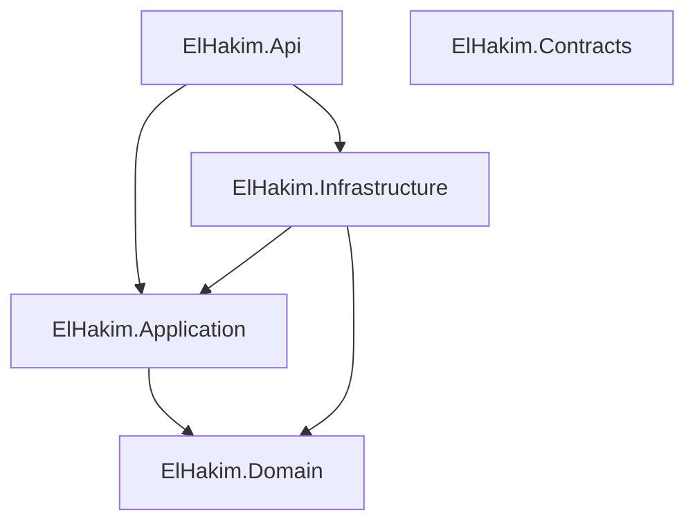
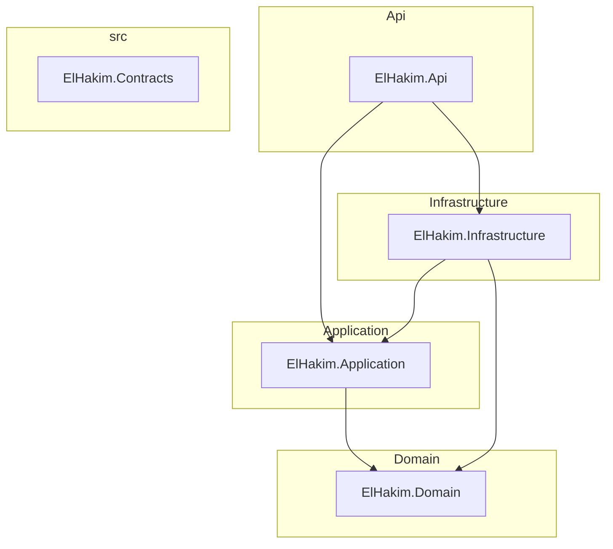

# Architecture Report

Generated by **CqrsLens 0.1.0** on 2026-10-21 · Source: `backend-build`

## Overview

| Metric | Count |
| --- | ---: |
| Projects | 5 |
| Requests (commands + queries) | 62 |
| Handlers | 63 |
| Validators | 9 |
| Pipeline behaviors | 1 |
| DbContexts | 1 |

## Project Dependency Graph

## Layers

Projects are grouped by Clean Architecture naming convention (Domain / Application / Infrastructure / Api / Web / UI); projects matching no convention are grouped by their top-level folder.

## CQRS Map

```mermaid
flowchart LR
    AutoApplyJobCommand["AutoApplyJobCommand"]
    AutoApplyJobCommandHandler(["AutoApplyJobCommandHandler"])
    CreateGuestbookEntryCommand["CreateGuestbookEntryCommand"]
    CreateGuestbookEntryCommandHandler(["CreateGuestbookEntryCommandHandler"])
    CreateManualJobCommand["CreateManualJobCommand"]
    CreateManualJobCommandHandler(["CreateManualJobCommandHandler"])
    CreatePostCommand["CreatePostCommand"]
    CreatePostCommandHandler(["CreatePostCommandHandler"])
    CreatePostCommandValidator{"CreatePostCommandValidator"}
    CreatePostRevisionCommand["CreatePostRevisionCommand"]
    CreatePostRevisionCommandHandler(["CreatePostRevisionCommandHandler"])
    CreateProjectCommand["CreateProjectCommand"]
    CreateProjectCommandHandler(["CreateProjectCommandHandler"])
    CreateSocialLinkCommand["CreateSocialLinkCommand"]
    CreateSocialLinkCommandHandler(["CreateSocialLinkCommandHandler"])
    CreateSocialLinkCommandValidator{"CreateSocialLinkCommandValidator"}
    CreateTagCommand["CreateTagCommand"]
    CreateTagCommandHandler(["CreateTagCommandHandler"])
    DeleteMediaCommand["DeleteMediaCommand"]
    DeleteMediaCommandHandler(["DeleteMediaCommandHandler"])
    DeletePostCommand["DeletePostCommand"]
    DeletePostCommandHandler(["DeletePostCommandHandler"])
    DeleteProjectCommand["DeleteProjectCommand"]
    DeleteProjectCommandHandler(["DeleteProjectCommandHandler"])
    DeleteSocialLinkCommand["DeleteSocialLinkCommand"]
    DeleteSocialLinkCommandHandler(["DeleteSocialLinkCommandHandler"])
    DeleteSocialLinkCommandValidator{"DeleteSocialLinkCommandValidator"}
    DeleteTagCommand["DeleteTagCommand"]
    DeleteTagCommandHanlder(["DeleteTagCommandHanlder"])
    GetAdminCommentsQuery["GetAdminCommentsQuery"]
    GetAdminCommentsQueryHandler(["GetAdminCommentsQueryHandler"])
    GetAdminRecentActivityQuery["GetAdminRecentActivityQuery"]
    GetAdminRecentActivityQueryHandler(["GetAdminRecentActivityQueryHandler"])
    GetAdminUsersQuery["GetAdminUsersQuery"]
    GetAdminUsersQueryHandler(["GetAdminUsersQueryHandler"])
    GetCommentStatsQuery["GetCommentStatsQuery"]
    GetCommentStatsQueryHandler(["GetCommentStatsQueryHandler"])
    GetDashboardAnalyticsQuery["GetDashboardAnalyticsQuery"]
    GetDashboardAnalyticsQueryHandler(["GetDashboardAnalyticsQueryHandler"])
    GetInternalSearchQuery["GetInternalSearchQuery"]
    GetInternalSearchQueryHandler(["GetInternalSearchQueryHandler"])
    GetJobApplicationsQuery["GetJobApplicationsQuery"]
    GetJobApplicationsQueryHandler(["GetJobApplicationsQueryHandler"])
    GetMediaFilesQuery["GetMediaFilesQuery"]
    GetMediaFilesQueryHandler(["GetMediaFilesQueryHandler"])
    GetPageBySlugQuery["GetPageBySlugQuery"]
    GetPageBySlugQueryHandler(["GetPageBySlugQueryHandler"])
    GetPostBySlugQuery["GetPostBySlugQuery"]
    GetPostBySlugQueryHandler(["GetPostBySlugQueryHandler"])
    GetPostBySlugQueryValidator{"GetPostBySlugQueryValidator"}
    GetPostCommentsQuery["GetPostCommentsQuery"]
    GetPostCommentsQueryHandler(["GetPostCommentsQueryHandler"])
    GetPostLikeStatusQuery["GetPostLikeStatusQuery"]
    GetPostLikeStatusQueryHandler(["GetPostLikeStatusQueryHandler"])
    GetPostRevisionsQuery["GetPostRevisionsQuery"]
    GetPostRevisionsQueryHandler(["GetPostRevisionsQueryHandler"])
    GetPostSlugsQuery["GetPostSlugsQuery"]
    GetPostSlugsQueryHandler(["GetPostSlugsQueryHandler"])
    GetPostsQuery["GetPostsQuery"]
    GetPostsQueryHandler(["GetPostsQueryHandler"])
    GetPostsQueryValidator{"GetPostsQueryValidator"}
    GetProjectBySlugQuery["GetProjectBySlugQuery"]
    GetProjectBySlugQueryHandler(["GetProjectBySlugQueryHandler"])
    GetProjectLikeStatusQuery["GetProjectLikeStatusQuery"]
    GetProjectLikeStatusQueryHandler(["GetProjectLikeStatusQueryHandler"])
    GetProjectsQuery["GetProjectsQuery"]
    GetProjectsQueryHandler(["GetProjectsQueryHandler"])
    GetSettingsQuery["GetSettingsQuery"]
    GetSettingsQueryHandler(["GetSettingsQueryHandler"])
    GetSocialActivityQuery["GetSocialActivityQuery"]
    GetSocialActivityQueryHandler(["GetSocialActivityQueryHandler"])
    GetSocialLinksQuery["GetSocialLinksQuery"]
    GetSocialLinksQueryHandler(["GetSocialLinksQueryHandler"])
    GetTagBySlugQuery["GetTagBySlugQuery"]
    GetTagBySlugQueryHandler(["GetTagBySlugQueryHandler"])
    GetTagsCommand["GetTagsCommand"]
    GetTagsCommandHandler(["GetTagsCommandHandler"])
    GetWakaTimeStatsQuery["GetWakaTimeStatsQuery"]
    GetWakaTimeStatsQueryHandler(["GetWakaTimeStatsQueryHandler"])
    ListGuestbookEntriesQuery["ListGuestbookEntriesQuery"]
    ListGuestbookEntriesQueryHandler(["ListGuestbookEntriesQueryHandler"])
    LoginCommand["LoginCommand"]
    LoginCommandHandler(["LoginCommandHandler"])
    LoginCommandValidator{"LoginCommandValidator"}
    MarkAppliedCommand["MarkAppliedCommand"]
    MarkAppliedCommandHandler(["MarkAppliedCommandHandler"])
    PublishPostCommand["PublishPostCommand"]
    PublishPostCommandHandler(["PublishPostCommandHandler"])
    QuickCreateTagCommand["QuickCreateTagCommand"]
    QuickCreateTagCommandHandler(["QuickCreateTagCommandHandler"])
    RefreshTokenCommand["RefreshTokenCommand"]
    RefreshTokenCommandHandler(["RefreshTokenCommandHandler"])
    SendDirectMailCommand["SendDirectMailCommand"]
    SendDirectMailCommandHandler(["SendDirectMailCommandHandler"])
    ToggleCommentVoteCommand["ToggleCommentVoteCommand"]
    ToggleCommentVoteCommandHandler(["ToggleCommentVoteCommandHandler"])
    ToggleGuestbookPinCommand["ToggleGuestbookPinCommand"]
    ToggleGuestbookPinCommandHandler(["ToggleGuestbookPinCommandHandler"])
    TogglePostLikeCommand["TogglePostLikeCommand"]
    TogglePostLikeCommandHandler(["TogglePostLikeCommandHandler"])
    TogglePostLikeCommand["TogglePostLikeCommand"]
    ToggleProjectLikeCommand["ToggleProjectLikeCommand"]
    ToggleProjectLikeCommandHandler(["ToggleProjectLikeCommandHandler"])
    ToggleUserBlockCommand["ToggleUserBlockCommand"]
    ToggleUserBlockCommandHandler(["ToggleUserBlockCommandHandler"])
    TrackPageViewCommand["TrackPageViewCommand"]
    TrackPageViewCommandHandler(["TrackPageViewCommandHandler"])
    UpdateCommentStatusCommand["UpdateCommentStatusCommand"]
    UpdateCommentStatusCommandHandler(["UpdateCommentStatusCommandHandler"])
    UpdatePageCommand["UpdatePageCommand"]
    UpdatePageCommandHandler(["UpdatePageCommandHandler"])
    UpdatePostCommand["UpdatePostCommand"]
    UpdatePostCommandHandler(["UpdatePostCommandHandler"])
    UpdatePostStatusCommand["UpdatePostStatusCommand"]
    UpdatePostStatusCommandHandler(["UpdatePostStatusCommandHandler"])
    UpdateProjectCommand["UpdateProjectCommand"]
    UpdateProjectCommandHandler(["UpdateProjectCommandHandler"])
    UpdateProjectStatusCommand["UpdateProjectStatusCommand"]
    UpdateProjectStatusCommandHandler(["UpdateProjectStatusCommandHandler"])
    UpdateSettingsCommand["UpdateSettingsCommand"]
    UpdateSettingsCommandHandler(["UpdateSettingsCommandHandler"])
    UpdateSocialLinkCommand["UpdateSocialLinkCommand"]
    UpdateSocialLinkCommandHandler(["UpdateSocialLinkCommandHandler"])
    UpdateSocialLinkCommandValidator{"UpdateSocialLinkCommandValidator"}
    UpdateTagCommand["UpdateTagCommand"]
    UpdateTagCommandHandler(["UpdateTagCommandHandler"])
    UploadMediaCommand["UploadMediaCommand"]
    UploadMediaCommandHandler(["UploadMediaCommandHandler"])
    UploadMediaCommandValidator{"UploadMediaCommandValidator"}
    UploadSmartMediaCommand["UploadSmartMediaCommand"]
    UploadSmartMediaCommandHandler(["UploadSmartMediaCommandHandler"])
    AutoApplyJobCommand --> AutoApplyJobCommandHandler
    CreateGuestbookEntryCommand --> CreateGuestbookEntryCommandHandler
    CreateManualJobCommand --> CreateManualJobCommandHandler
    CreatePostCommand --> CreatePostCommandHandler
    CreatePostCommandValidator -.-> CreatePostCommand
    CreatePostRevisionCommand --> CreatePostRevisionCommandHandler
    CreateProjectCommand --> CreateProjectCommandHandler
    CreateSocialLinkCommand --> CreateSocialLinkCommandHandler
    CreateSocialLinkCommandValidator -.-> CreateSocialLinkCommand
    CreateTagCommand --> CreateTagCommandHandler
    DeleteMediaCommand --> DeleteMediaCommandHandler
    DeletePostCommand --> DeletePostCommandHandler
    DeleteProjectCommand --> DeleteProjectCommandHandler
    DeleteSocialLinkCommand --> DeleteSocialLinkCommandHandler
    DeleteSocialLinkCommandValidator -.-> DeleteSocialLinkCommand
    DeleteTagCommand --> DeleteTagCommandHanlder
    GetAdminCommentsQuery --> GetAdminCommentsQueryHandler
    GetAdminRecentActivityQuery --> GetAdminRecentActivityQueryHandler
    GetAdminUsersQuery --> GetAdminUsersQueryHandler
    GetCommentStatsQuery --> GetCommentStatsQueryHandler
    GetDashboardAnalyticsQuery --> GetDashboardAnalyticsQueryHandler
    GetInternalSearchQuery --> GetInternalSearchQueryHandler
    GetJobApplicationsQuery --> GetJobApplicationsQueryHandler
    GetMediaFilesQuery --> GetMediaFilesQueryHandler
    GetPageBySlugQuery --> GetPageBySlugQueryHandler
    GetPostBySlugQuery --> GetPostBySlugQueryHandler
    GetPostBySlugQueryValidator -.-> GetPostBySlugQuery
    GetPostCommentsQuery --> GetPostCommentsQueryHandler
    GetPostLikeStatusQuery --> GetPostLikeStatusQueryHandler
    GetPostRevisionsQuery --> GetPostRevisionsQueryHandler
    GetPostSlugsQuery --> GetPostSlugsQueryHandler
    GetPostsQuery --> GetPostsQueryHandler
    GetPostsQueryValidator -.-> GetPostsQuery
    GetProjectBySlugQuery --> GetProjectBySlugQueryHandler
    GetProjectLikeStatusQuery --> GetProjectLikeStatusQueryHandler
    GetProjectsQuery --> GetProjectsQueryHandler
    GetSettingsQuery --> GetSettingsQueryHandler
    GetSocialActivityQuery --> GetSocialActivityQueryHandler
    GetSocialLinksQuery --> GetSocialLinksQueryHandler
    GetTagBySlugQuery --> GetTagBySlugQueryHandler
    GetTagsCommand --> GetTagsCommandHandler
    GetWakaTimeStatsQuery --> GetWakaTimeStatsQueryHandler
    ListGuestbookEntriesQuery --> ListGuestbookEntriesQueryHandler
    LoginCommand --> LoginCommandHandler
    LoginCommandValidator -.-> LoginCommand
    MarkAppliedCommand --> MarkAppliedCommandHandler
    PublishPostCommand --> PublishPostCommandHandler
    QuickCreateTagCommand --> QuickCreateTagCommandHandler
    RefreshTokenCommand --> RefreshTokenCommandHandler
    SendDirectMailCommand --> SendDirectMailCommandHandler
    ToggleCommentVoteCommand --> ToggleCommentVoteCommandHandler
    ToggleGuestbookPinCommand --> ToggleGuestbookPinCommandHandler
    TogglePostLikeCommand --> TogglePostLikeCommandHandler
    ToggleProjectLikeCommand --> ToggleProjectLikeCommandHandler
    ToggleUserBlockCommand --> ToggleUserBlockCommandHandler
    TrackPageViewCommand --> TrackPageViewCommandHandler
    UpdateCommentStatusCommand --> UpdateCommentStatusCommandHandler
    UpdatePageCommand --> UpdatePageCommandHandler
    UpdatePostCommand --> UpdatePostCommandHandler
    UpdatePostStatusCommand --> UpdatePostStatusCommandHandler
    UpdateProjectCommand --> UpdateProjectCommandHandler
    UpdateProjectStatusCommand --> UpdateProjectStatusCommandHandler
    UpdateSettingsCommand --> UpdateSettingsCommandHandler
    UpdateSocialLinkCommand --> UpdateSocialLinkCommandHandler
    UpdateSocialLinkCommandValidator -.-> UpdateSocialLinkCommand
    UpdateTagCommand --> UpdateTagCommandHandler
    UploadMediaCommand --> UploadMediaCommandHandler
    UploadMediaCommandValidator -.-> UploadMediaCommand
    UploadSmartMediaCommand --> UploadSmartMediaCommandHandler
```

| Request | Type | Response | Handler | Validators | Project |
| --- | --- | --- | --- | --- | --- |
| AutoApplyJobCommand | Command | AutoApplyJobResult | AutoApplyJobCommandHandler | — | ElHakim.Application |
| CreateGuestbookEntryCommand | Command | Guid | CreateGuestbookEntryCommandHandler | — | ElHakim.Application |
| CreateManualJobCommand | Command | Guid | CreateManualJobCommandHandler | — | ElHakim.Application |
| CreatePostCommand | Command | Guid | CreatePostCommandHandler | CreatePostCommandValidator | ElHakim.Application |
| CreatePostRevisionCommand | Command | PostRevisionDto | CreatePostRevisionCommandHandler | — | ElHakim.Application |
| CreateProjectCommand | Command | Guid | CreateProjectCommandHandler | — | ElHakim.Application |
| CreateSocialLinkCommand | Command | Guid | CreateSocialLinkCommandHandler | CreateSocialLinkCommandValidator | ElHakim.Application |
| CreateTagCommand | Command | string | CreateTagCommandHandler | — | ElHakim.Application |
| DeleteMediaCommand | Command | bool | DeleteMediaCommandHandler | — | ElHakim.Application |
| DeletePostCommand | Command | — | DeletePostCommandHandler | — | ElHakim.Application |
| DeleteProjectCommand | Command | — | DeleteProjectCommandHandler | — | ElHakim.Application |
| DeleteSocialLinkCommand | Command | — | DeleteSocialLinkCommandHandler | DeleteSocialLinkCommandValidator | ElHakim.Application |
| DeleteTagCommand | Command | bool | DeleteTagCommandHanlder | — | ElHakim.Application |
| GetAdminCommentsQuery | Query | List<CommentAdminDto> | GetAdminCommentsQueryHandler | — | ElHakim.Application |
| GetAdminRecentActivityQuery | Query | AdminActivityListDto | GetAdminRecentActivityQueryHandler | — | ElHakim.Application |
| GetAdminUsersQuery | Query | List<AdminUserDto> | GetAdminUsersQueryHandler | — | ElHakim.Application |
| GetCommentStatsQuery | Query | CommentStatsDto | GetCommentStatsQueryHandler | — | ElHakim.Application |
| GetDashboardAnalyticsQuery | Query | AnalyticsDashboardDto | GetDashboardAnalyticsQueryHandler | — | ElHakim.Application |
| GetInternalSearchQuery | Query | List<InternalSearchResultDto> | GetInternalSearchQueryHandler | — | ElHakim.Application |
| GetJobApplicationsQuery | Query | List<JobApplicationDto> | GetJobApplicationsQueryHandler | — | ElHakim.Application |
| GetMediaFilesQuery | Query | List<MediaFileDto> | GetMediaFilesQueryHandler | — | ElHakim.Application |
| GetPageBySlugQuery | Query | ContentPageDto? | GetPageBySlugQueryHandler | — | ElHakim.Application |
| GetPostBySlugQuery | Query | PostDetailDto? | GetPostBySlugQueryHandler | GetPostBySlugQueryValidator | ElHakim.Application |
| GetPostCommentsQuery | Query | List<CommentDto> | GetPostCommentsQueryHandler | — | ElHakim.Application |
| GetPostLikeStatusQuery | Query | LikeStatusDto | GetPostLikeStatusQueryHandler | — | ElHakim.Application |
| GetPostRevisionsQuery | Query | List<PostRevisionDto> | GetPostRevisionsQueryHandler | — | ElHakim.Application |
| GetPostSlugsQuery | Query | List<string> | GetPostSlugsQueryHandler | — | ElHakim.Application |
| GetPostsQuery | Query | PostListDto | GetPostsQueryHandler | GetPostsQueryValidator | ElHakim.Application |
| GetProjectBySlugQuery | Query | ProjectDetailDto? | GetProjectBySlugQueryHandler | — | ElHakim.Application |
| GetProjectLikeStatusQuery | Query | LikeStatusDto | GetProjectLikeStatusQueryHandler | — | ElHakim.Application |
| GetProjectsQuery | Query | List<ProjectSummaryDto> | GetProjectsQueryHandler | — | ElHakim.Application |
| GetSettingsQuery | Query | SettingsDto | GetSettingsQueryHandler | — | ElHakim.Application |
| GetSocialActivityQuery | Query | List<SocialActivityDto> | GetSocialActivityQueryHandler | — | ElHakim.Application |
| GetSocialLinksQuery | Query | List<SocialLinkDto> | GetSocialLinksQueryHandler | — | ElHakim.Application |
| GetTagBySlugQuery | Query | TagDetail | GetTagBySlugQueryHandler | — | ElHakim.Application |
| GetTagsCommand | Command | List<GetTagDto> | GetTagsCommandHandler | — | ElHakim.Application |
| GetWakaTimeStatsQuery | Query | WakaTimeStatsDto | GetWakaTimeStatsQueryHandler | — | ElHakim.Application |
| ListGuestbookEntriesQuery | Query | List<GuestbookEntryDto> | ListGuestbookEntriesQueryHandler | — | ElHakim.Application |
| LoginCommand | Command | LoginResponse | LoginCommandHandler | LoginCommandValidator | ElHakim.Application |
| MarkAppliedCommand | Command | — | MarkAppliedCommandHandler | — | ElHakim.Application |
| PublishPostCommand | Command | bool | PublishPostCommandHandler | — | ElHakim.Application |
| QuickCreateTagCommand | Command | QuickTagDto | QuickCreateTagCommandHandler | — | ElHakim.Application |
| RefreshTokenCommand | Command | LoginResponse | RefreshTokenCommandHandler | — | ElHakim.Application |
| SendDirectMailCommand | Command | SendDirectMailResult | SendDirectMailCommandHandler | — | ElHakim.Application |
| ToggleCommentVoteCommand | Command | bool | ToggleCommentVoteCommandHandler | — | ElHakim.Application |
| ToggleGuestbookPinCommand | Command | bool | ToggleGuestbookPinCommandHandler | — | ElHakim.Application |
| TogglePostLikeCommand | Command | LikeStatusDto | TogglePostLikeCommandHandler | — | ElHakim.Application |
| TogglePostLikeCommand | Command | bool | — | — | ElHakim.Application |
| ToggleProjectLikeCommand | Command | LikeStatusDto | ToggleProjectLikeCommandHandler | — | ElHakim.Application |
| ToggleUserBlockCommand | Command | — | ToggleUserBlockCommandHandler | — | ElHakim.Application |
| TrackPageViewCommand | Command | — | TrackPageViewCommandHandler | — | ElHakim.Application |
| UpdateCommentStatusCommand | Command | — | UpdateCommentStatusCommandHandler | — | ElHakim.Application |
| UpdatePageCommand | Command | — | UpdatePageCommandHandler | — | ElHakim.Application |
| UpdatePostCommand | Command | Guid | UpdatePostCommandHandler | — | ElHakim.Application |
| UpdatePostStatusCommand | Command | — | UpdatePostStatusCommandHandler | — | ElHakim.Application |
| UpdateProjectCommand | Command | — | UpdateProjectCommandHandler | — | ElHakim.Application |
| UpdateProjectStatusCommand | Command | — | UpdateProjectStatusCommandHandler | — | ElHakim.Application |
| UpdateSettingsCommand | Command | — | UpdateSettingsCommandHandler | — | ElHakim.Application |
| UpdateSocialLinkCommand | Command | — | UpdateSocialLinkCommandHandler | UpdateSocialLinkCommandValidator | ElHakim.Application |
| UpdateTagCommand | Command | bool | UpdateTagCommandHandler | — | ElHakim.Application |
| UploadMediaCommand | Command | string | UploadMediaCommandHandler | UploadMediaCommandValidator | ElHakim.Application |
| UploadSmartMediaCommand | Command | SmartMediaResultDto | UploadSmartMediaCommandHandler | — | ElHakim.Application |

## Pipeline Behaviors

- `ValidationBehavior` — ElHakim.Application

## Data Access (DbContexts)

| DbContext | Project | DbSets (property → entity) |
| --- | --- | --- |
| AppDbContext | ElHakim.Infrastructure | Posts → Post, Tags → Tag, PostTranslations → PostTranslation, TagTranslations → TagTranslation, PageViews → PageView, AdminUsers → AdminUser, PostTags → PostTag, Projects → Project, ProjectTags → ProjectTag, ContentPages → ContentPage, ContentPageTranslations → ContentPageTranslation, AppUsers → AppUser, Comments → Comment, CommentVotes → CommentVote, PostLikes → PostLike, ProjectLikes → ProjectLike, JobApplications → JobApplication, GuestbookEntries → GuestbookEntry, SocialLinks → SocialLink, PostRevisions → PostRevision, MediaFiles → MediaFile |

---
_Report generated by [CqrsLens](https://github.com/AbdullahHakima/cqrslens) — static analysis only; the target solution was not built._
