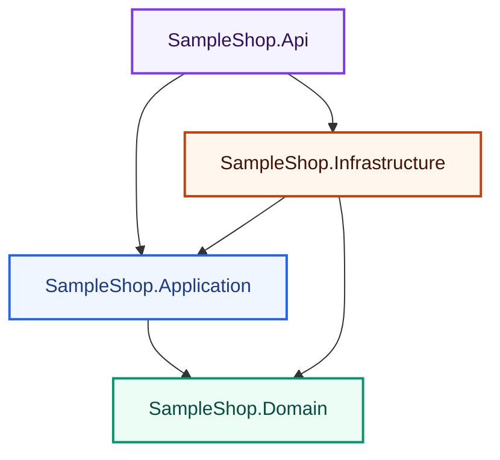
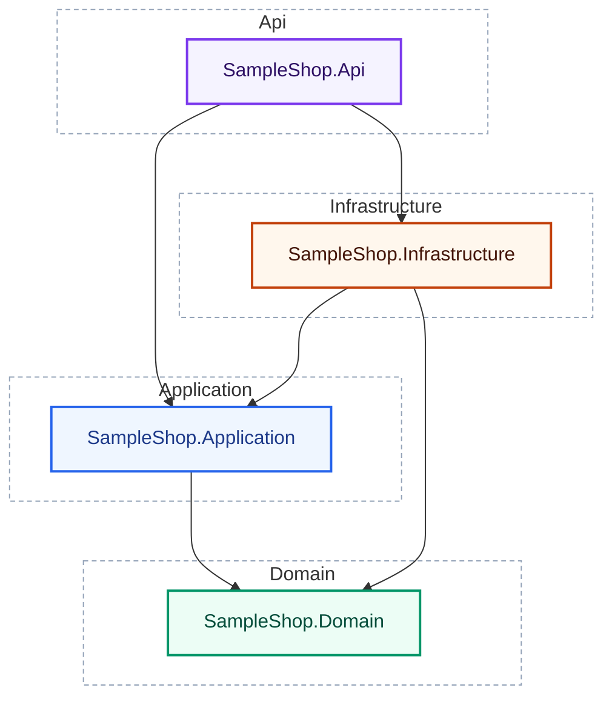
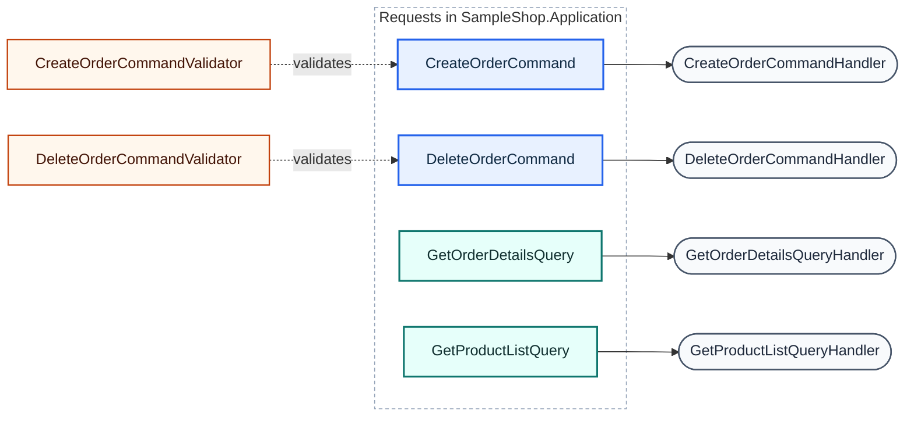
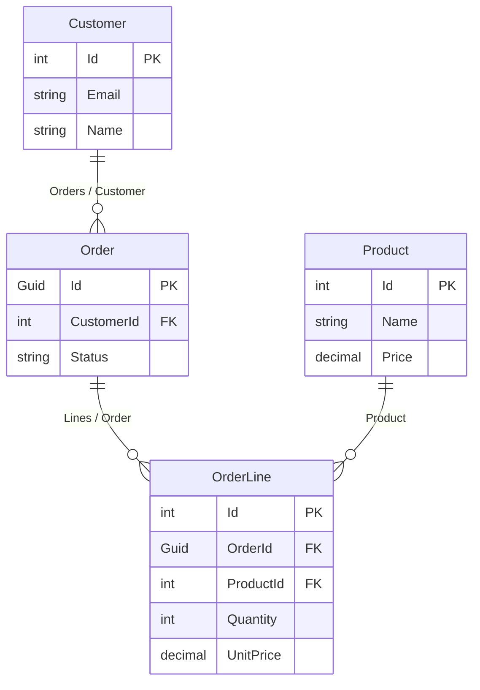

# Architecture Report

Generated by **CqrsLens 0.5.0** on 2026-10-22 00:00:00 UTC · text scanner · Source: `SampleShop`

## Overview

| Metric | Count |
| --- | ---: |
| Projects | 4 |
| Requests (commands + queries) | 4 |
| Handlers | 4 |
| Validators | 2 |
| Pipeline behaviors | 1 |
| DbContexts | 1 |

## Project Dependency Graph

**Layer colors:** green = Domain · blue = Application · amber = Infrastructure · purple = Api/Web/UI · gray = Tests/other.

## Layers

_Dashed boundaries group projects into layers. Projects are grouped by Clean Architecture naming convention (Domain / Application / Infrastructure / Api / Web / UI); projects matching no convention are grouped by their top-level folder._

## CQRS Map

**Legend:** blue = command · teal = query · violet = other request · gray stadium = handler · amber = validator.

_Requests are grouped by declaring project. Handler and validator nodes are shown where linked and may be declared in a different project._

_4 requests · 4 handlers · 2 validators_

### Requests

| Request | Type | Response | Handler | Validators | Project |
| --- | --- | --- | --- | --- | --- |
| CreateOrderCommand | Command | Guid | CreateOrderCommandHandler | CreateOrderCommandValidator | SampleShop.Application |
| DeleteOrderCommand | Command | — | DeleteOrderCommandHandler | DeleteOrderCommandValidator | SampleShop.Application |
| GetOrderDetailsQuery | Query | OrderDetailsDto | GetOrderDetailsQueryHandler | — | SampleShop.Application |
| GetProductListQuery | Query | List&lt;ProductDto&gt; | GetProductListQueryHandler | — | SampleShop.Application |

## Pipeline Behaviors

- `LoggingBehavior` — SampleShop.Application

## Data Access (DbContexts)

| DbContext | Project | DbSets (property → entity) |
| --- | --- | --- |
| ShopDbContext | SampleShop.Infrastructure | Orders → Order, Products → Product, Customers → Customer |

### ShopDbContext ER Diagram

## Analysis Diagnostics

No scan diagnostics.

## Architecture Checks

All checks passed.

---
_Generated by CqrsLens 0.5.0 in 0 ms — 8 files scanned._
_Report generated by [CqrsLens](https://github.com/AbdullahHakima/cqrslens) — static analysis only; the target solution was not built._
