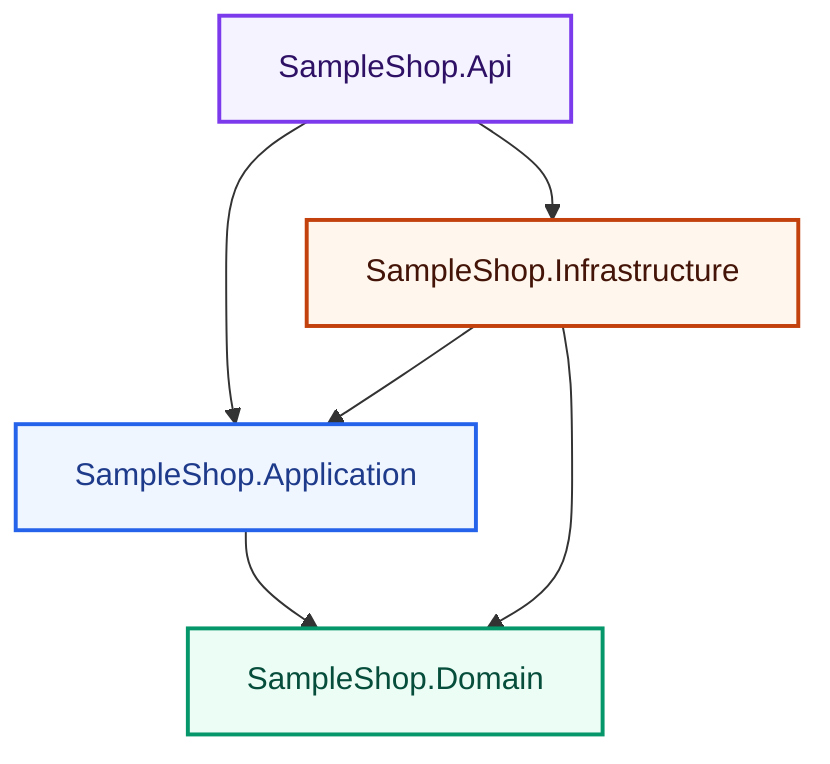
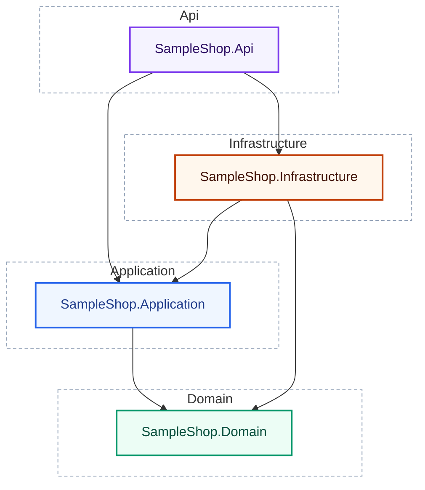
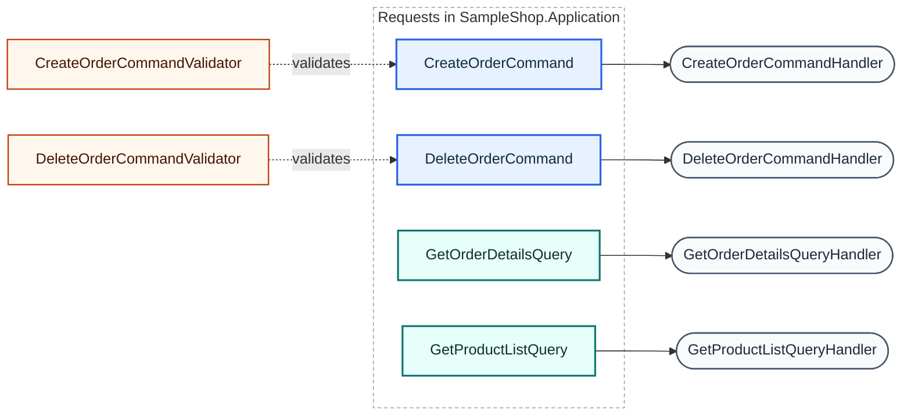
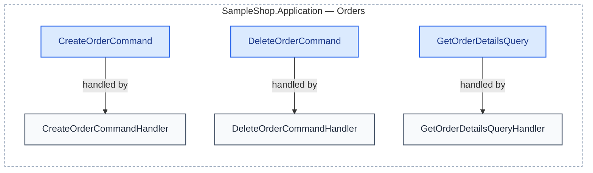
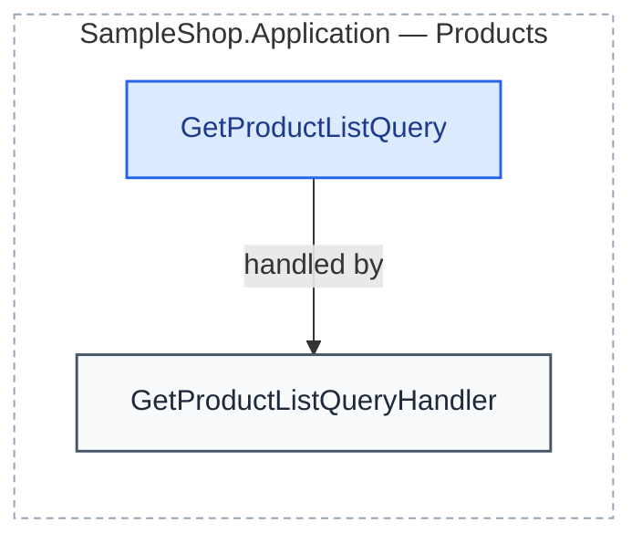
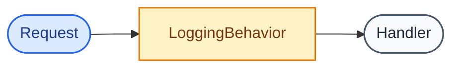
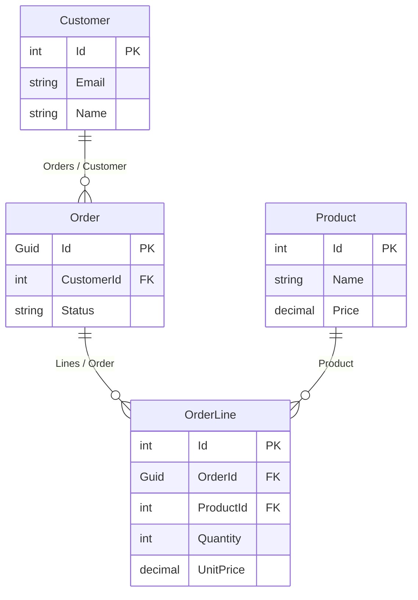

# Architecture Report

Generated by **CqrsLens 0.9.0** on 2026-11-02 00:00:00 UTC · text scanner · Source: `SampleShop`

## Overview

| Metric | Count |
| --- | ---: |
| Projects | 4 |
| Requests (commands + queries) | 4 |
| Handlers | 4 |
| Validators | 2 |
| Pipeline behaviors | 1 |
| DbContexts | 1 |
| Architecture checks | 0 error(s), 4 warning(s) |

## Project Dependency Graph

**Layer colors:** green = Domain · blue = Application · amber = Infrastructure · purple = Api/Web/UI · gray = Tests/other.

## Layers

_Dashed boundaries group projects into layers. Projects are grouped by Clean Architecture naming convention (Domain / Application / Infrastructure / Api / Web / UI); projects matching no convention are grouped by their top-level folder._

## CQRS Map

**Legend:** blue = command · teal = query · violet = other request · gray stadium = handler · amber = validator.

_Requests are grouped by declaring project. Handler and validator nodes are shown where linked and may be declared in a different project._

_4 requests · 4 handlers · 2 validators_

## Flow

_4 resolved flow edges across 2 feature/project diagrams (endpoint → request → handler and onward; DbContext nodes appear only when a handler directly references a discovered DbContext type; every flow edge appears in exactly one diagram)._

**Legend:** blue stadium = endpoint · blue = request · gray = handler · fuchsia = notification · green = DbContext.

### SampleShop.Application — Orders — flow

_3 edges · 3 connected flows_

### SampleShop.Application — Products — flow

_1 edge · 1 connected flow_

## Requests

| Request | Type | Response | Handler | Validators | Dispatched by | Project |
| --- | --- | --- | --- | --- | --- | --- |
| CreateOrderCommand | Command | Guid | CreateOrderCommandHandler | CreateOrderCommandValidator | — | SampleShop.Application |
| DeleteOrderCommand | Command | — | DeleteOrderCommandHandler | DeleteOrderCommandValidator | — | SampleShop.Application |
| GetOrderDetailsQuery | Query | OrderDetailsDto | GetOrderDetailsQueryHandler | — | — | SampleShop.Application |
| GetProductListQuery | Query | List&lt;ProductDto&gt; | GetProductListQueryHandler | — | — | SampleShop.Application |
## Pipeline Behaviors

_Behaviors wrap every request that flows through the pipeline. The diagram lists them in the order the model recorded them (scan order, not resolved execution order)._

| Behavior | Project | Source |
| --- | --- | --- |
| LoggingBehavior | SampleShop.Application | `SampleShop.Application/Common/Behaviors/LoggingBehavior.cs:6:21` |

## Data Access (DbContexts)

| DbContext | Project | DbSets (property → entity) |
| --- | --- | --- |
| ShopDbContext | SampleShop.Infrastructure | Orders → Order, Products → Product, Customers → Customer |

### ShopDbContext ER Diagram

## Analysis Diagnostics

No analysis diagnostics.

## Architecture Checks

0 error(s), 4 warning(s):

### ⚠️ UnreachableRequest (4)

- ⚠️ Warning **UnreachableRequest** — Request `SampleShop.Application.Orders.CreateOrder.CreateOrderCommand` has 1 handler(s) but no production call site. `SampleShop.Application/Orders/CreateOrder/CreateOrderCommand.cs:8:22`
- ⚠️ Warning **UnreachableRequest** — Request `SampleShop.Application.Orders.DeleteOrder.DeleteOrderCommand` has 1 handler(s) but no production call site. `SampleShop.Application/Orders/DeleteOrder/DeleteOrderCommand.cs:6:22`
- ⚠️ Warning **UnreachableRequest** — Request `SampleShop.Application.Orders.GetOrderDetails.GetOrderDetailsQuery` has 1 handler(s) but no production call site. `SampleShop.Application/Orders/GetOrderDetails/GetOrderDetailsQuery.cs:7:22`
- ⚠️ Warning **UnreachableRequest** — Request `SampleShop.Application.Products.GetProductList.GetProductListQuery` has 1 handler(s) but no production call site. `SampleShop.Application/Products/GetProductList/GetProductListQuery.cs:7:22`

---
_Generated by CqrsLens 0.9.0 in 0 ms — 8 files scanned._
_Report generated by [CqrsLens](https://github.com/AbdullahHakima/cqrslens) — static analysis only; the target solution was not built._
