# Architecture Report

Generated by **CqrsLens 0.9.0** on 2026-11-07 18:29:27 UTC · text scanner · Source: `ardalis-clean-architecture` · Conventions: Mediator

## Overview

| Metric | Count |
| --- | ---: |
| Projects | 22 |
| Requests (commands + queries) | 23 |
| Handlers | 23 |
| Validators | 21 |
| Pipeline behaviors | 3 |
| DbContexts | 3 |
| Notifications (domain events) | 5 |
| Notification handlers | 7 |
| Architecture checks | 0 error(s), 38 warning(s) |

## Configuration & Conventions

_The settings this scan ran under (declared) and what it found under them (actual). Declared values are the resolved configuration; actual values are the scan outcome._

### Declared

| Setting | Value |
| --- | --- |
| Config file | No config file found |
| Request markers | IBaseCommand, IBaseQuery, ICommand, IQuery, IStreamCommand, IStreamQuery, IStreamRequest |
| Handler markers | ICommandHandler, IQueryHandler, IStreamCommandHandler, IStreamQueryHandler, IStreamRequestHandler |
| Layer overrides | none declared |
| Include globs | none declared |
| Exclude globs | none declared |
| Rule severity overrides | none declared |

### Actual

| Fact | Value |
| --- | --- |
| Layer-model status | name-guessed |
| Layer checks | The layer model is name-guessed, so layer rules are reported at warning severity instead of errors. No layer findings. |
| Requests discovered | 23 |
| Conventions detected | Mediator |

## Project Dependency Graph

```mermaid
flowchart TD
    accTitle: Project dependency graph
    accDescr: 22 projects, 32 references.
    prj_Clean_Architecture_AspireHost["Clean.Architecture.AspireHost"]:::clsLayerOther
    prj_Clean_Architecture_AspireTests["Clean.Architecture.AspireTests"]:::clsLayerTests
    prj_Clean_Architecture_Core["Clean.Architecture.Core"]:::clsLayerOther
    prj_Clean_Architecture_FunctionalTests["Clean.Architecture.FunctionalTests"]:::clsLayerTests
    prj_Clean_Architecture_Infrastructure["Clean.Architecture.Infrastructure"]:::clsLayerInfrastructure
    prj_Clean_Architecture_IntegrationTests["Clean.Architecture.IntegrationTests"]:::clsLayerTests
    prj_Clean_Architecture_ServiceDefaults["Clean.Architecture.ServiceDefaults"]:::clsLayerOther
    prj_Clean_Architecture_UnitTests["Clean.Architecture.UnitTests"]:::clsLayerTests
    prj_Clean_Architecture_UseCases["Clean.Architecture.UseCases"]:::clsLayerOther
    prj_Clean_Architecture_Web["Clean.Architecture.Web"]:::clsLayerApi
    prj_MinimalClean_Architecture_AspireHost["MinimalClean.Architecture.AspireHost"]:::clsLayerOther
    prj_MinimalClean_Architecture_ServiceDefaults["MinimalClean.Architecture.ServiceDefaults"]:::clsLayerOther
    prj_MinimalClean_Architecture_Web["MinimalClean.Architecture.Web"]:::clsLayerApi
    prj_NimblePros_SampleToDo_AspireHost["NimblePros.SampleToDo.AspireHost"]:::clsLayerOther
    prj_NimblePros_SampleToDo_Core["NimblePros.SampleToDo.Core"]:::clsLayerOther
    prj_NimblePros_SampleToDo_FunctionalTests["NimblePros.SampleToDo.FunctionalTests"]:::clsLayerTests
    prj_NimblePros_SampleToDo_Infrastructure["NimblePros.SampleToDo.Infrastructure"]:::clsLayerInfrastructure
    prj_NimblePros_SampleToDo_IntegrationTests["NimblePros.SampleToDo.IntegrationTests"]:::clsLayerTests
    prj_NimblePros_SampleToDo_ServiceDefaults["NimblePros.SampleToDo.ServiceDefaults"]:::clsLayerOther
    prj_NimblePros_SampleToDo_UnitTests["NimblePros.SampleToDo.UnitTests"]:::clsLayerTests
    prj_NimblePros_SampleToDo_UseCases["NimblePros.SampleToDo.UseCases"]:::clsLayerOther
    prj_NimblePros_SampleToDo_Web["NimblePros.SampleToDo.Web"]:::clsLayerApi
    prj_Clean_Architecture_AspireHost --> prj_Clean_Architecture_ServiceDefaults
    prj_Clean_Architecture_AspireHost --> prj_Clean_Architecture_Web
    prj_Clean_Architecture_AspireTests --> prj_Clean_Architecture_AspireHost
    prj_Clean_Architecture_FunctionalTests --> prj_Clean_Architecture_Infrastructure
    prj_Clean_Architecture_FunctionalTests --> prj_Clean_Architecture_UseCases
    prj_Clean_Architecture_FunctionalTests --> prj_Clean_Architecture_Web
    prj_Clean_Architecture_Infrastructure --> prj_Clean_Architecture_Core
    prj_Clean_Architecture_Infrastructure --> prj_Clean_Architecture_UseCases
    prj_Clean_Architecture_IntegrationTests --> prj_Clean_Architecture_Infrastructure
    prj_Clean_Architecture_UnitTests --> prj_Clean_Architecture_Core
    prj_Clean_Architecture_UnitTests --> prj_Clean_Architecture_UseCases
    prj_Clean_Architecture_UseCases --> prj_Clean_Architecture_Core
    prj_Clean_Architecture_Web --> prj_Clean_Architecture_Infrastructure
    prj_Clean_Architecture_Web --> prj_Clean_Architecture_ServiceDefaults
    prj_Clean_Architecture_Web --> prj_Clean_Architecture_UseCases
    prj_MinimalClean_Architecture_AspireHost --> prj_MinimalClean_Architecture_ServiceDefaults
    prj_MinimalClean_Architecture_AspireHost --> prj_MinimalClean_Architecture_Web
    prj_MinimalClean_Architecture_Web --> prj_MinimalClean_Architecture_ServiceDefaults
    prj_NimblePros_SampleToDo_AspireHost --> prj_NimblePros_SampleToDo_ServiceDefaults
    prj_NimblePros_SampleToDo_AspireHost --> prj_NimblePros_SampleToDo_Web
    prj_NimblePros_SampleToDo_FunctionalTests --> prj_NimblePros_SampleToDo_UnitTests
    prj_NimblePros_SampleToDo_FunctionalTests --> prj_NimblePros_SampleToDo_Web
    prj_NimblePros_SampleToDo_Infrastructure --> prj_NimblePros_SampleToDo_Core
    prj_NimblePros_SampleToDo_Infrastructure --> prj_NimblePros_SampleToDo_UseCases
    prj_NimblePros_SampleToDo_IntegrationTests --> prj_NimblePros_SampleToDo_Infrastructure
    prj_NimblePros_SampleToDo_IntegrationTests --> prj_NimblePros_SampleToDo_UnitTests
    prj_NimblePros_SampleToDo_UnitTests --> prj_NimblePros_SampleToDo_Core
    prj_NimblePros_SampleToDo_UnitTests --> prj_NimblePros_SampleToDo_UseCases
    prj_NimblePros_SampleToDo_UseCases --> prj_NimblePros_SampleToDo_Core
    prj_NimblePros_SampleToDo_Web --> prj_NimblePros_SampleToDo_Infrastructure
    prj_NimblePros_SampleToDo_Web --> prj_NimblePros_SampleToDo_ServiceDefaults
    prj_NimblePros_SampleToDo_Web --> prj_NimblePros_SampleToDo_UseCases
    classDef clsLayerDomain fill:#ecfdf5,stroke:#059669,stroke-width:2px,color:#064e3b
    classDef clsLayerApplication fill:#eff6ff,stroke:#2563eb,stroke-width:2px,color:#1e3a8a
    classDef clsLayerInfrastructure fill:#fff7ed,stroke:#c2410c,stroke-width:2px,color:#431407
    classDef clsLayerApi fill:#f5f3ff,stroke:#7c3aed,stroke-width:2px,color:#2e1065
    classDef clsLayerTests fill:#f8fafc,stroke:#64748b,stroke-width:1.5px,color:#1e293b
    classDef clsLayerOther fill:#f8fafc,stroke:#64748b,stroke-width:1.5px,color:#1e293b
```

**Layer colors:** green = Domain · blue = Application · amber = Infrastructure · purple = Api/Web/UI · gray = Tests/other.

## Layers

```mermaid
flowchart TD
    accTitle: Layer diagram
    accDescr: 22 projects, 6 layers, 32 references.
    subgraph lyr_Tests["Tests"]
        prj_Clean_Architecture_AspireTests["Clean.Architecture.AspireTests"]:::clsLayerTests
        prj_Clean_Architecture_FunctionalTests["Clean.Architecture.FunctionalTests"]:::clsLayerTests
        prj_Clean_Architecture_IntegrationTests["Clean.Architecture.IntegrationTests"]:::clsLayerTests
        prj_Clean_Architecture_UnitTests["Clean.Architecture.UnitTests"]:::clsLayerTests
        prj_NimblePros_SampleToDo_FunctionalTests["NimblePros.SampleToDo.FunctionalTests"]:::clsLayerTests
        prj_NimblePros_SampleToDo_IntegrationTests["NimblePros.SampleToDo.IntegrationTests"]:::clsLayerTests
        prj_NimblePros_SampleToDo_UnitTests["NimblePros.SampleToDo.UnitTests"]:::clsLayerTests
    end
    subgraph lyr_Web["Web"]
        prj_Clean_Architecture_Web["Clean.Architecture.Web"]:::clsLayerApi
        prj_MinimalClean_Architecture_Web["MinimalClean.Architecture.Web"]:::clsLayerApi
        prj_NimblePros_SampleToDo_Web["NimblePros.SampleToDo.Web"]:::clsLayerApi
    end
    subgraph lyr_MinimalClean["MinimalClean"]
        prj_MinimalClean_Architecture_AspireHost["MinimalClean.Architecture.AspireHost"]:::clsLayerOther
        prj_MinimalClean_Architecture_ServiceDefaults["MinimalClean.Architecture.ServiceDefaults"]:::clsLayerOther
    end
    subgraph lyr_sample["sample"]
        prj_NimblePros_SampleToDo_AspireHost["NimblePros.SampleToDo.AspireHost"]:::clsLayerOther
        prj_NimblePros_SampleToDo_Core["NimblePros.SampleToDo.Core"]:::clsLayerOther
        prj_NimblePros_SampleToDo_ServiceDefaults["NimblePros.SampleToDo.ServiceDefaults"]:::clsLayerOther
        prj_NimblePros_SampleToDo_UseCases["NimblePros.SampleToDo.UseCases"]:::clsLayerOther
    end
    subgraph lyr_src["src"]
        prj_Clean_Architecture_AspireHost["Clean.Architecture.AspireHost"]:::clsLayerOther
        prj_Clean_Architecture_Core["Clean.Architecture.Core"]:::clsLayerOther
        prj_Clean_Architecture_ServiceDefaults["Clean.Architecture.ServiceDefaults"]:::clsLayerOther
        prj_Clean_Architecture_UseCases["Clean.Architecture.UseCases"]:::clsLayerOther
    end
    subgraph lyr_Infrastructure["Infrastructure"]
        prj_Clean_Architecture_Infrastructure["Clean.Architecture.Infrastructure"]:::clsLayerInfrastructure
        prj_NimblePros_SampleToDo_Infrastructure["NimblePros.SampleToDo.Infrastructure"]:::clsLayerInfrastructure
    end
    prj_Clean_Architecture_AspireHost --> prj_Clean_Architecture_ServiceDefaults
    prj_Clean_Architecture_AspireHost --> prj_Clean_Architecture_Web
    prj_Clean_Architecture_AspireTests --> prj_Clean_Architecture_AspireHost
    prj_Clean_Architecture_FunctionalTests --> prj_Clean_Architecture_Infrastructure
    prj_Clean_Architecture_FunctionalTests --> prj_Clean_Architecture_UseCases
    prj_Clean_Architecture_FunctionalTests --> prj_Clean_Architecture_Web
    prj_Clean_Architecture_Infrastructure --> prj_Clean_Architecture_Core
    prj_Clean_Architecture_Infrastructure --> prj_Clean_Architecture_UseCases
    prj_Clean_Architecture_IntegrationTests --> prj_Clean_Architecture_Infrastructure
    prj_Clean_Architecture_UnitTests --> prj_Clean_Architecture_Core
    prj_Clean_Architecture_UnitTests --> prj_Clean_Architecture_UseCases
    prj_Clean_Architecture_UseCases --> prj_Clean_Architecture_Core
    prj_Clean_Architecture_Web --> prj_Clean_Architecture_Infrastructure
    prj_Clean_Architecture_Web --> prj_Clean_Architecture_ServiceDefaults
    prj_Clean_Architecture_Web --> prj_Clean_Architecture_UseCases
    prj_MinimalClean_Architecture_AspireHost --> prj_MinimalClean_Architecture_ServiceDefaults
    prj_MinimalClean_Architecture_AspireHost --> prj_MinimalClean_Architecture_Web
    prj_MinimalClean_Architecture_Web --> prj_MinimalClean_Architecture_ServiceDefaults
    prj_NimblePros_SampleToDo_AspireHost --> prj_NimblePros_SampleToDo_ServiceDefaults
    prj_NimblePros_SampleToDo_AspireHost --> prj_NimblePros_SampleToDo_Web
    prj_NimblePros_SampleToDo_FunctionalTests --> prj_NimblePros_SampleToDo_UnitTests
    prj_NimblePros_SampleToDo_FunctionalTests --> prj_NimblePros_SampleToDo_Web
    prj_NimblePros_SampleToDo_Infrastructure --> prj_NimblePros_SampleToDo_Core
    prj_NimblePros_SampleToDo_Infrastructure --> prj_NimblePros_SampleToDo_UseCases
    prj_NimblePros_SampleToDo_IntegrationTests --> prj_NimblePros_SampleToDo_Infrastructure
    prj_NimblePros_SampleToDo_IntegrationTests --> prj_NimblePros_SampleToDo_UnitTests
    prj_NimblePros_SampleToDo_UnitTests --> prj_NimblePros_SampleToDo_Core
    prj_NimblePros_SampleToDo_UnitTests --> prj_NimblePros_SampleToDo_UseCases
    prj_NimblePros_SampleToDo_UseCases --> prj_NimblePros_SampleToDo_Core
    prj_NimblePros_SampleToDo_Web --> prj_NimblePros_SampleToDo_Infrastructure
    prj_NimblePros_SampleToDo_Web --> prj_NimblePros_SampleToDo_ServiceDefaults
    prj_NimblePros_SampleToDo_Web --> prj_NimblePros_SampleToDo_UseCases
    style lyr_Tests fill:none,stroke:#94a3b8,stroke-dasharray:4 3
    style lyr_Web fill:none,stroke:#94a3b8,stroke-dasharray:4 3
    style lyr_MinimalClean fill:none,stroke:#94a3b8,stroke-dasharray:4 3
    style lyr_sample fill:none,stroke:#94a3b8,stroke-dasharray:4 3
    style lyr_src fill:none,stroke:#94a3b8,stroke-dasharray:4 3
    style lyr_Infrastructure fill:none,stroke:#94a3b8,stroke-dasharray:4 3
    classDef clsLayerDomain fill:#ecfdf5,stroke:#059669,stroke-width:2px,color:#064e3b
    classDef clsLayerApplication fill:#eff6ff,stroke:#2563eb,stroke-width:2px,color:#1e3a8a
    classDef clsLayerInfrastructure fill:#fff7ed,stroke:#c2410c,stroke-width:2px,color:#431407
    classDef clsLayerApi fill:#f5f3ff,stroke:#7c3aed,stroke-width:2px,color:#2e1065
    classDef clsLayerTests fill:#f8fafc,stroke:#64748b,stroke-width:1.5px,color:#1e293b
    classDef clsLayerOther fill:#f8fafc,stroke:#64748b,stroke-width:1.5px,color:#1e293b
```

_Dashed boundaries group projects into layers. Projects are grouped by Clean Architecture naming convention (Domain / Application / Infrastructure / Api / Web / UI); projects matching no convention are grouped by their top-level folder._

## CQRS Map

**Legend:** blue = command · teal = query · violet = other request · gray stadium = handler · amber = validator. Amber dashed request = `CommandWithoutValidator` finding.

_Requests are grouped by declaring project. Handler and validator nodes are shown where linked and may be declared in a different project._

_23 requests across 3 projects. Diagrams are split by project and balanced so each stays within GitHub's rendering limits; every request appears exactly once._

### Clean.Architecture.UseCases — 5 requests

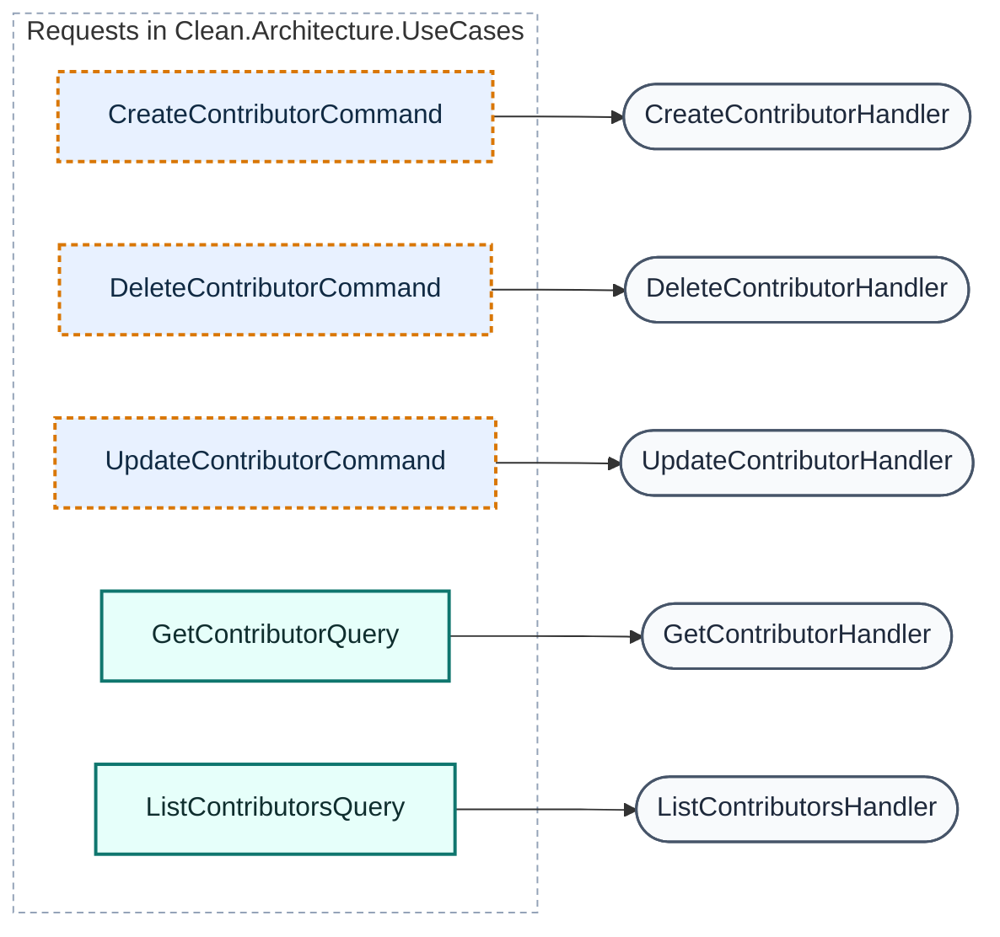

_5 requests · 5 handlers · 0 validators · 3 CommandWithoutValidator findings_

### MinimalClean.Architecture.Web — 5 requests

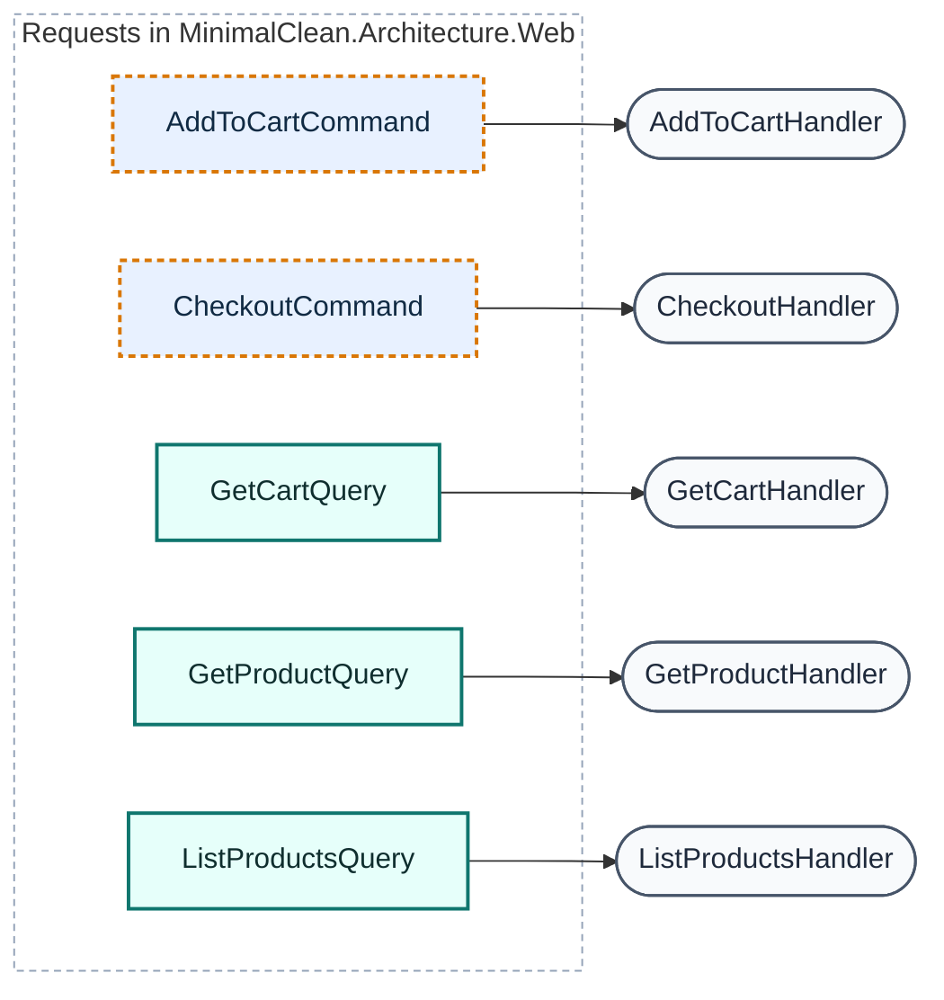

_5 requests · 5 handlers · 0 validators · 2 CommandWithoutValidator findings_

### NimblePros.SampleToDo.UseCases — 13 requests

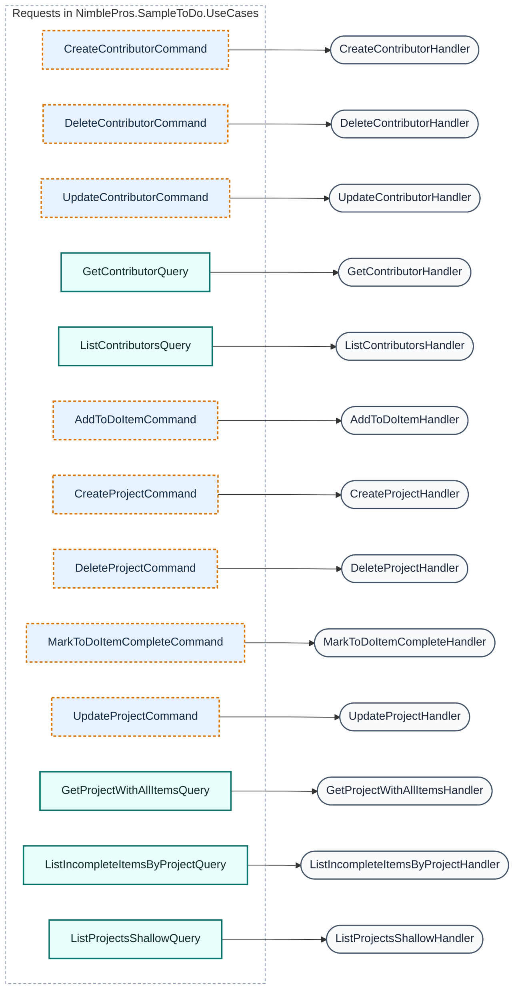

_13 requests · 13 handlers · 0 validators · 8 CommandWithoutValidator findings_


## Validation Coverage

_The share of requests with a linked validator (the model's request→validator linkage). A request with no linked validator is also reported individually by the command-without-validator check._

| Project | Requests | With linked validator | Coverage | Validators |
| --- | ---: | ---: | ---: | ---: |
| Clean.Architecture.UseCases | 5 | 0 | 0.0% | 0 |
| Clean.Architecture.Web | 0 | 0 | no requests | 5 |
| MinimalClean.Architecture.Web | 5 | 0 | 0.0% | 5 |
| NimblePros.SampleToDo.UseCases | 13 | 0 | 0.0% | 0 |
| NimblePros.SampleToDo.Web | 0 | 0 | no requests | 11 |
| **All projects** | **23** | **0** | **0.0%** | **21** |

## Flow

_45 resolved flow edges across 5 feature/project diagrams (endpoint → request → handler and onward; DbContext nodes appear only when a handler directly references a discovered DbContext type; every flow edge appears in exactly one diagram)._

**Legend:** blue stadium = endpoint · blue = request · gray = handler · fuchsia = notification · green = DbContext.

### Clean.Architecture.UseCases — Contributors — flow

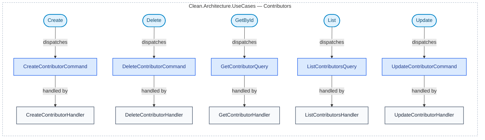

_10 edges · 5 connected flows_

### MinimalClean.Architecture.Web — CartFeatures — flow

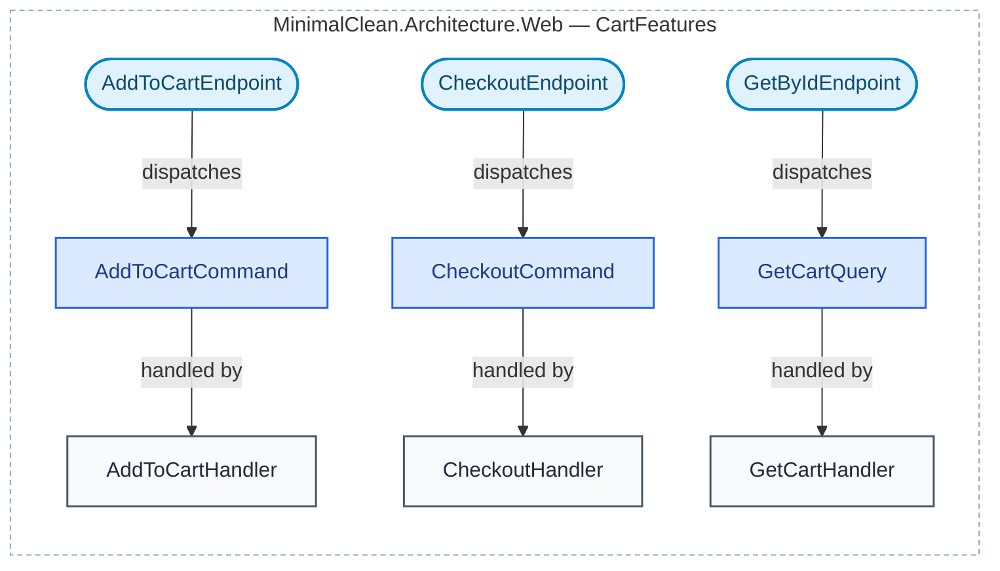

_6 edges · 3 connected flows_

### MinimalClean.Architecture.Web — ProductFeatures — flow

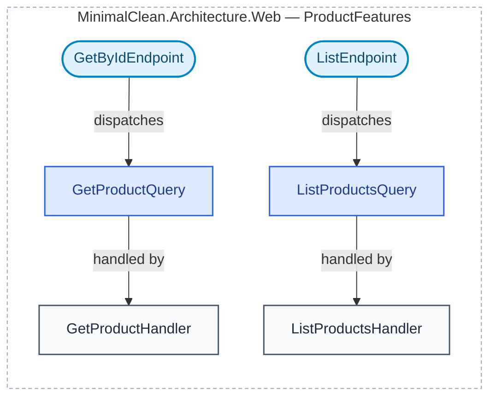

_4 edges · 2 connected flows_

### NimblePros.SampleToDo.UseCases — Contributors — flow

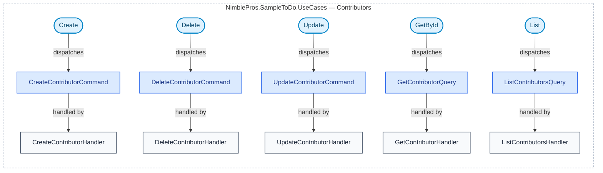

_10 edges · 5 connected flows_

### NimblePros.SampleToDo.UseCases — Projects — flow

```mermaid
flowchart LR
    accTitle: Flow map
    accDescr: 15 edges, 22 nodes.
    subgraph flow["NimblePros.SampleToDo.UseCases — Projects"]
        ep_Create(["Create"]):::clsFlowEndpoint
        req_AddToDoItemCommand["AddToDoItemCommand"]:::clsFlowRequest
        req_CreateProjectCommand["CreateProjectCommand"]:::clsFlowRequest
        ep_Delete(["Delete"]):::clsFlowEndpoint
        req_DeleteProjectCommand["DeleteProjectCommand"]:::clsFlowRequest
        ep_GetById(["GetById"]):::clsFlowEndpoint
        req_GetProjectWithAllItemsQuery["GetProjectWithAllItemsQuery"]:::clsFlowRequest
        ep_ListIncompleteItems(["ListIncompleteItems"]):::clsFlowEndpoint
        req_ListIncompleteItemsByProjectQuery["ListIncompleteItemsByProjectQuery"]:::clsFlowRequest
        ep_MarkItemComplete(["MarkItemComplete"]):::clsFlowEndpoint
        req_MarkToDoItemCompleteCommand["MarkToDoItemCompleteCommand"]:::clsFlowRequest
        ep_Update(["Update"]):::clsFlowEndpoint
        req_UpdateProjectCommand["UpdateProjectCommand"]:::clsFlowRequest
        hdl_AddToDoItemHandler["AddToDoItemHandler"]:::clsFlowHandler
        hdl_CreateProjectHandler["CreateProjectHandler"]:::clsFlowHandler
        hdl_DeleteProjectHandler["DeleteProjectHandler"]:::clsFlowHandler
        hdl_GetProjectWithAllItemsHandler["GetProjectWithAllItemsHandler"]:::clsFlowHandler
        hdl_ListIncompleteItemsByProjectHandler["ListIncompleteItemsByProjectHandler"]:::clsFlowHandler
        req_ListProjectsShallowQuery["ListProjectsShallowQuery"]:::clsFlowRequest
        hdl_ListProjectsShallowHandler["ListProjectsShallowHandler"]:::clsFlowHandler
        hdl_MarkToDoItemCompleteHandler["MarkToDoItemCompleteHandler"]:::clsFlowHandler
        hdl_UpdateProjectHandler["UpdateProjectHandler"]:::clsFlowHandler
    end
    ep_Create -->|dispatches| req_AddToDoItemCommand
    ep_Create -->|dispatches| req_CreateProjectCommand
    ep_Delete -->|dispatches| req_DeleteProjectCommand
    ep_GetById -->|dispatches| req_GetProjectWithAllItemsQuery
    ep_ListIncompleteItems -->|dispatches| req_ListIncompleteItemsByProjectQuery
    ep_MarkItemComplete -->|dispatches| req_MarkToDoItemCompleteCommand
    ep_Update -->|dispatches| req_UpdateProjectCommand
    req_AddToDoItemCommand -->|handled by| hdl_AddToDoItemHandler
    req_CreateProjectCommand -->|handled by| hdl_CreateProjectHandler
    req_DeleteProjectCommand -->|handled by| hdl_DeleteProjectHandler
    req_GetProjectWithAllItemsQuery -->|handled by| hdl_GetProjectWithAllItemsHandler
    req_ListIncompleteItemsByProjectQuery -->|handled by| hdl_ListIncompleteItemsByProjectHandler
    req_ListProjectsShallowQuery -->|handled by| hdl_ListProjectsShallowHandler
    req_MarkToDoItemCompleteCommand -->|handled by| hdl_MarkToDoItemCompleteHandler
    req_UpdateProjectCommand -->|handled by| hdl_UpdateProjectHandler
    classDef clsFlowEndpoint fill:#e0f2fe,stroke:#0284c7,stroke-width:2px,color:#0c4a6e
    classDef clsFlowRequest fill:#dbeafe,stroke:#2563eb,stroke-width:1.5px,color:#1e3a8a
    classDef clsFlowHandler fill:#f8fafc,stroke:#475569,stroke-width:1.5px,color:#1e293b
    classDef clsFlowNotification fill:#fdf4ff,stroke:#a21caf,stroke-width:2px,color:#4a044e
    classDef clsFlowDbContext fill:#ecfdf5,stroke:#059669,stroke-width:2px,color:#064e3b
    style flow fill:none,stroke:#94a3b8,stroke-dasharray:4 3
```

_15 edges · 8 connected flows_

## Request sequences

_One sequence diagram per request with a resolved handler, built only from data the scan model holds. Participants: endpoint → mediator → pipeline behaviors (registered order) → handler → DbContext → published notifications. A DbContext participant appears only when the model holds a handler → DbContext edge; behavior order is registered order, not execution order._

### AddToCartCommand

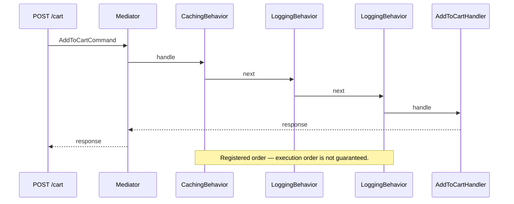

_Sequence for AddToCartCommand: POST /cart → mediator → handler. Behaviors shown in registered order (3); execution order is not guaranteed._

### AddToDoItemCommand

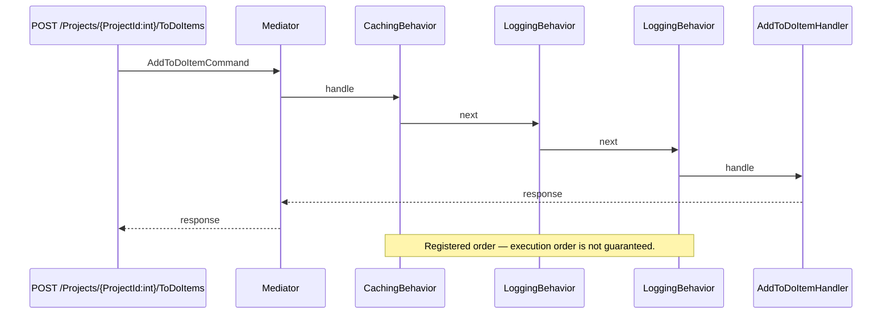

_Sequence for AddToDoItemCommand: POST /Projects/{ProjectId:int}/ToDoItems → mediator → handler. Behaviors shown in registered order (3); execution order is not guaranteed._

### CheckoutCommand

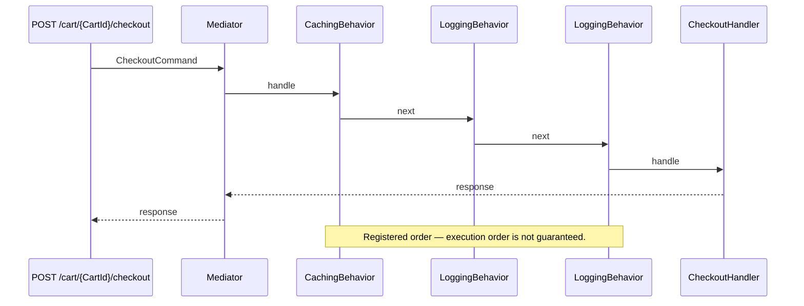

_Sequence for CheckoutCommand: POST /cart/{CartId}/checkout → mediator → handler. Behaviors shown in registered order (3); execution order is not guaranteed._

### CreateContributorCommand

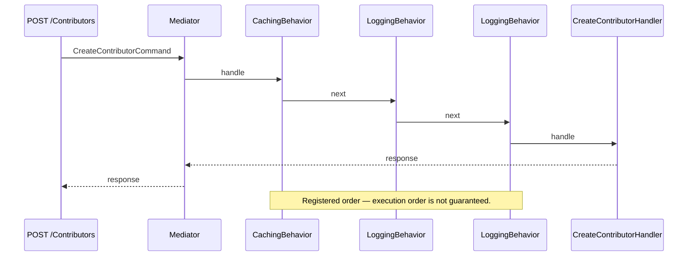

_Sequence for CreateContributorCommand: POST /Contributors → mediator → handler. Behaviors shown in registered order (3); execution order is not guaranteed._

### CreateContributorCommand


_Sequence for CreateContributorCommand: POST /Contributors → mediator → handler. Behaviors shown in registered order (3); execution order is not guaranteed._

### CreateProjectCommand

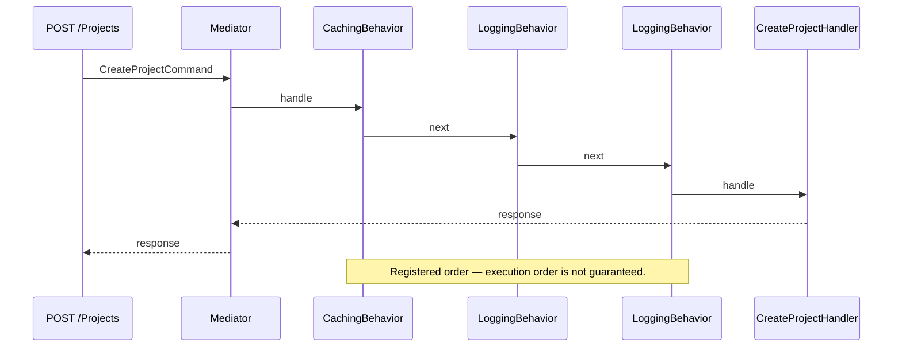

_Sequence for CreateProjectCommand: POST /Projects → mediator → handler. Behaviors shown in registered order (3); execution order is not guaranteed._

### DeleteContributorCommand

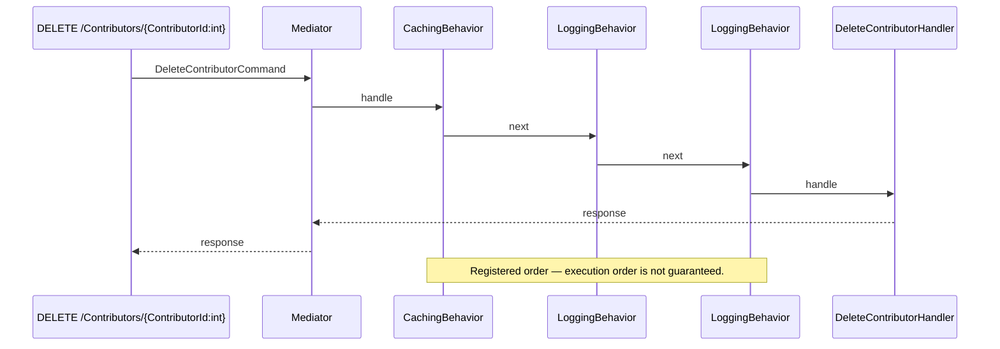

_Sequence for DeleteContributorCommand: DELETE /Contributors/{ContributorId:int} → mediator → handler. Behaviors shown in registered order (3); execution order is not guaranteed._

### DeleteContributorCommand


_Sequence for DeleteContributorCommand: DELETE /Contributors/{ContributorId:int} → mediator → handler. Behaviors shown in registered order (3); execution order is not guaranteed._

### DeleteProjectCommand

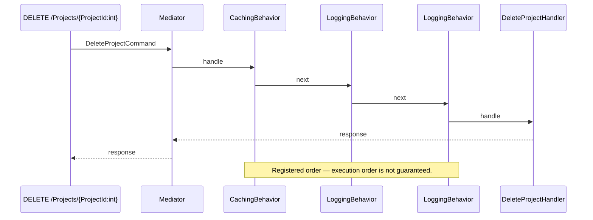

_Sequence for DeleteProjectCommand: DELETE /Projects/{ProjectId:int} → mediator → handler. Behaviors shown in registered order (3); execution order is not guaranteed._

### GetCartQuery

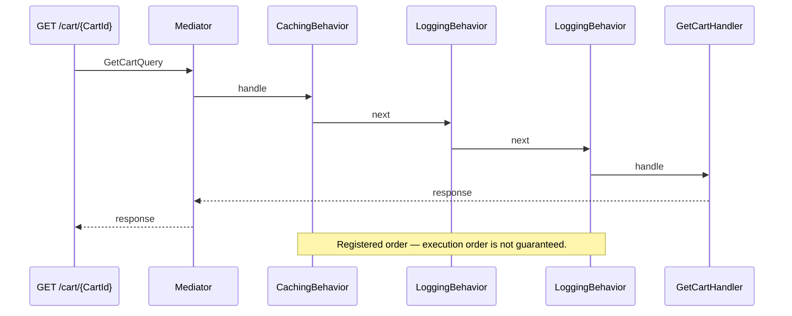

_Sequence for GetCartQuery: GET /cart/{CartId} → mediator → handler. Behaviors shown in registered order (3); execution order is not guaranteed._

### GetContributorQuery

```mermaid
sequenceDiagram
    %% Request sequence: GetContributorQuery
    participant ep as GET /Contributors/{ContributorId:int}
    participant m as Mediator
    participant b1 as CachingBehavior
    participant b2 as LoggingBehavior
    participant b3 as LoggingBehavior
    participant h1 as GetContributorHandler
    ep->>m: GetContributorQuery
    m->>b1: handle
    b1->>b2: next
    b2->>b3: next
    b3->>h1: handle
    h1-->>m: response
    m-->>ep: response
    Note over b1,b3: Registered order — execution order is not guaranteed.
```

_Sequence for GetContributorQuery: GET /Contributors/{ContributorId:int} → mediator → handler. Behaviors shown in registered order (3); execution order is not guaranteed._

### GetContributorQuery

```mermaid
sequenceDiagram
    %% Request sequence: GetContributorQuery
    participant ep as GET /Contributors/{ContributorId:int}
    participant m as Mediator
    participant b1 as CachingBehavior
    participant b2 as LoggingBehavior
    participant b3 as LoggingBehavior
    participant h1 as GetContributorHandler
    ep->>m: GetContributorQuery
    m->>b1: handle
    b1->>b2: next
    b2->>b3: next
    b3->>h1: handle
    h1-->>m: response
    m-->>ep: response
    Note over b1,b3: Registered order — execution order is not guaranteed.
```

_Sequence for GetContributorQuery: GET /Contributors/{ContributorId:int} → mediator → handler. Behaviors shown in registered order (3); execution order is not guaranteed._

### GetProductQuery

```mermaid
sequenceDiagram
    %% Request sequence: GetProductQuery
    participant ep as GET /Products/{ProductId}
    participant m as Mediator
    participant b1 as CachingBehavior
    participant b2 as LoggingBehavior
    participant b3 as LoggingBehavior
    participant h1 as GetProductHandler
    ep->>m: GetProductQuery
    m->>b1: handle
    b1->>b2: next
    b2->>b3: next
    b3->>h1: handle
    h1-->>m: response
    m-->>ep: response
    Note over b1,b3: Registered order — execution order is not guaranteed.
```

_Sequence for GetProductQuery: GET /Products/{ProductId} → mediator → handler. Behaviors shown in registered order (3); execution order is not guaranteed._

### GetProjectWithAllItemsQuery

```mermaid
sequenceDiagram
    %% Request sequence: GetProjectWithAllItemsQuery
    participant ep as GET /Projects/{ProjectId:int}
    participant m as Mediator
    participant b1 as CachingBehavior
    participant b2 as LoggingBehavior
    participant b3 as LoggingBehavior
    participant h1 as GetProjectWithAllItemsHandler
    ep->>m: GetProjectWithAllItemsQuery
    m->>b1: handle
    b1->>b2: next
    b2->>b3: next
    b3->>h1: handle
    h1-->>m: response
    m-->>ep: response
    Note over b1,b3: Registered order — execution order is not guaranteed.
```

_Sequence for GetProjectWithAllItemsQuery: GET /Projects/{ProjectId:int} → mediator → handler. Behaviors shown in registered order (3); execution order is not guaranteed._

### ListContributorsQuery

```mermaid
sequenceDiagram
    %% Request sequence: ListContributorsQuery
    participant ep as GET /Contributors
    participant m as Mediator
    participant b1 as CachingBehavior
    participant b2 as LoggingBehavior
    participant b3 as LoggingBehavior
    participant h1 as ListContributorsHandler
    ep->>m: ListContributorsQuery
    m->>b1: handle
    b1->>b2: next
    b2->>b3: next
    b3->>h1: handle
    h1-->>m: response
    m-->>ep: response
    Note over b1,b3: Registered order — execution order is not guaranteed.
```

_Sequence for ListContributorsQuery: GET /Contributors → mediator → handler. Behaviors shown in registered order (3); execution order is not guaranteed._

### ListContributorsQuery

```mermaid
sequenceDiagram
    %% Request sequence: ListContributorsQuery
    participant ep as GET /Contributors
    participant m as Mediator
    participant b1 as CachingBehavior
    participant b2 as LoggingBehavior
    participant b3 as LoggingBehavior
    participant h1 as ListContributorsHandler
    ep->>m: ListContributorsQuery
    m->>b1: handle
    b1->>b2: next
    b2->>b3: next
    b3->>h1: handle
    h1-->>m: response
    m-->>ep: response
    Note over b1,b3: Registered order — execution order is not guaranteed.
```

_Sequence for ListContributorsQuery: GET /Contributors → mediator → handler. Behaviors shown in registered order (3); execution order is not guaranteed._

### ListIncompleteItemsByProjectQuery

```mermaid
sequenceDiagram
    %% Request sequence: ListIncompleteItemsByProjectQuery
    participant ep as GET /Projects/{ProjectId}/IncompleteItems
    participant m as Mediator
    participant b1 as CachingBehavior
    participant b2 as LoggingBehavior
    participant b3 as LoggingBehavior
    participant h1 as ListIncompleteItemsByProjectHandler
    ep->>m: ListIncompleteItemsByProjectQuery
    m->>b1: handle
    b1->>b2: next
    b2->>b3: next
    b3->>h1: handle
    h1-->>m: response
    m-->>ep: response
    Note over b1,b3: Registered order — execution order is not guaranteed.
```

_Sequence for ListIncompleteItemsByProjectQuery: GET /Projects/{ProjectId}/IncompleteItems → mediator → handler. Behaviors shown in registered order (3); execution order is not guaranteed._

### ListProductsQuery

```mermaid
sequenceDiagram
    %% Request sequence: ListProductsQuery
    participant ep as GET /Products
    participant m as Mediator
    participant b1 as CachingBehavior
    participant b2 as LoggingBehavior
    participant b3 as LoggingBehavior
    participant h1 as ListProductsHandler
    ep->>m: ListProductsQuery
    m->>b1: handle
    b1->>b2: next
    b2->>b3: next
    b3->>h1: handle
    h1-->>m: response
    m-->>ep: response
    Note over b1,b3: Registered order — execution order is not guaranteed.
```

_Sequence for ListProductsQuery: GET /Products → mediator → handler. Behaviors shown in registered order (3); execution order is not guaranteed._

### ListProjectsShallowQuery

```mermaid
sequenceDiagram
    %% Request sequence: ListProjectsShallowQuery
    participant m as Mediator
    participant b1 as CachingBehavior
    participant b2 as LoggingBehavior
    participant b3 as LoggingBehavior
    participant h1 as ListProjectsShallowHandler
    m->>b1: handle
    b1->>b2: next
    b2->>b3: next
    b3->>h1: handle
    h1-->>m: response
    Note over b1,b3: Registered order — execution order is not guaranteed.
```

_Sequence for ListProjectsShallowQuery: mediator → handler (no endpoint edge in the model). Behaviors shown in registered order (3); execution order is not guaranteed._

### MarkToDoItemCompleteCommand

```mermaid
sequenceDiagram
    %% Request sequence: MarkToDoItemCompleteCommand
    participant ep as POST /Projects/{ProjectId:int}/ToDoItems/{ToDoItemId:int}
    participant m as Mediator
    participant b1 as CachingBehavior
    participant b2 as LoggingBehavior
    participant b3 as LoggingBehavior
    participant h1 as MarkToDoItemCompleteHandler
    ep->>m: MarkToDoItemCompleteCommand
    m->>b1: handle
    b1->>b2: next
    b2->>b3: next
    b3->>h1: handle
    h1-->>m: response
    m-->>ep: response
    Note over b1,b3: Registered order — execution order is not guaranteed.
```

_Sequence for MarkToDoItemCompleteCommand: POST /Projects/{ProjectId:int}/ToDoItems/{ToDoItemId:int} → mediator → handler. Behaviors shown in registered order (3); execution order is not guaranteed._

### UpdateContributorCommand

```mermaid
sequenceDiagram
    %% Request sequence: UpdateContributorCommand
    participant ep as PUT /Contributors/{ContributorId:int}
    participant m as Mediator
    participant b1 as CachingBehavior
    participant b2 as LoggingBehavior
    participant b3 as LoggingBehavior
    participant h1 as UpdateContributorHandler
    ep->>m: UpdateContributorCommand
    m->>b1: handle
    b1->>b2: next
    b2->>b3: next
    b3->>h1: handle
    h1-->>m: response
    m-->>ep: response
    Note over b1,b3: Registered order — execution order is not guaranteed.
```

_Sequence for UpdateContributorCommand: PUT /Contributors/{ContributorId:int} → mediator → handler. Behaviors shown in registered order (3); execution order is not guaranteed._

### UpdateContributorCommand

```mermaid
sequenceDiagram
    %% Request sequence: UpdateContributorCommand
    participant ep as PUT /Contributors/{ContributorId:int}
    participant m as Mediator
    participant b1 as CachingBehavior
    participant b2 as LoggingBehavior
    participant b3 as LoggingBehavior
    participant h1 as UpdateContributorHandler
    ep->>m: UpdateContributorCommand
    m->>b1: handle
    b1->>b2: next
    b2->>b3: next
    b3->>h1: handle
    h1-->>m: response
    m-->>ep: response
    Note over b1,b3: Registered order — execution order is not guaranteed.
```

_Sequence for UpdateContributorCommand: PUT /Contributors/{ContributorId:int} → mediator → handler. Behaviors shown in registered order (3); execution order is not guaranteed._

### UpdateProjectCommand

```mermaid
sequenceDiagram
    %% Request sequence: UpdateProjectCommand
    participant ep as PUT /Projects/{ProjectId:int}
    participant m as Mediator
    participant b1 as CachingBehavior
    participant b2 as LoggingBehavior
    participant b3 as LoggingBehavior
    participant h1 as UpdateProjectHandler
    ep->>m: UpdateProjectCommand
    m->>b1: handle
    b1->>b2: next
    b2->>b3: next
    b3->>h1: handle
    h1-->>m: response
    m-->>ep: response
    Note over b1,b3: Registered order — execution order is not guaranteed.
```

_Sequence for UpdateProjectCommand: PUT /Projects/{ProjectId:int} → mediator → handler. Behaviors shown in registered order (3); execution order is not guaranteed._

## API Endpoints

_The HTTP surface and the request each endpoint dispatches to. `inferred` marks a route or verb guessed from naming rather than read from source; an `unresolved` target has no matching request in the model._

**22 endpoint(s)** across 3 project(s).

| Method | Route | Endpoint | Project | Target request | Handler | Inferred |
| --- | --- | --- | --- | --- | --- | :---: |
| POST | /Contributors | Create | Clean.Architecture.Web | CreateContributorCommand | CreateContributorHandler | — |
| GET | /Contributors | List | Clean.Architecture.Web | ListContributorsQuery | ListContributorsHandler | — |
| DELETE | /Contributors/{ContributorId:int} | Delete | Clean.Architecture.Web | DeleteContributorCommand | DeleteContributorHandler | — |
| GET | /Contributors/{ContributorId:int} | GetById | Clean.Architecture.Web | GetContributorQuery | GetContributorHandler | — |
| PUT | /Contributors/{ContributorId:int} | Update | Clean.Architecture.Web | UpdateContributorCommand | UpdateContributorHandler | — |
| GET | /Products | ListEndpoint | MinimalClean.Architecture.Web | ListProductsQuery | ListProductsHandler | — |
| GET | /Products/{ProductId} | GetByIdEndpoint | MinimalClean.Architecture.Web | GetProductQuery | GetProductHandler | — |
| POST | /cart | AddToCartEndpoint | MinimalClean.Architecture.Web | AddToCartCommand | AddToCartHandler | — |
| GET | /cart/{CartId} | GetByIdEndpoint | MinimalClean.Architecture.Web | GetCartQuery | GetCartHandler | — |
| POST | /cart/{CartId}/checkout | CheckoutEndpoint | MinimalClean.Architecture.Web | CheckoutCommand | CheckoutHandler | — |
| POST | /Contributors | Create | NimblePros.SampleToDo.Web | CreateContributorCommand | CreateContributorHandler | — |
| GET | /Contributors | List | NimblePros.SampleToDo.Web | ListContributorsQuery | ListContributorsHandler | — |
| DELETE | /Contributors/{ContributorId:int} | Delete | NimblePros.SampleToDo.Web | DeleteContributorCommand | DeleteContributorHandler | — |
| GET | /Contributors/{ContributorId:int} | GetById | NimblePros.SampleToDo.Web | GetContributorQuery | GetContributorHandler | — |
| PUT | /Contributors/{ContributorId:int} | Update | NimblePros.SampleToDo.Web | UpdateContributorCommand | UpdateContributorHandler | — |
| POST | /Projects | Create | NimblePros.SampleToDo.Web | CreateProjectCommand | CreateProjectHandler | — |
| DELETE | /Projects/{ProjectId:int} | Delete | NimblePros.SampleToDo.Web | DeleteProjectCommand | DeleteProjectHandler | — |
| GET | /Projects/{ProjectId:int} | GetById | NimblePros.SampleToDo.Web | GetProjectWithAllItemsQuery | GetProjectWithAllItemsHandler | — |
| PUT | /Projects/{ProjectId:int} | Update | NimblePros.SampleToDo.Web | UpdateProjectCommand | UpdateProjectHandler | — |
| POST | /Projects/{ProjectId:int}/ToDoItems | Create | NimblePros.SampleToDo.Web | AddToDoItemCommand | AddToDoItemHandler | — |
| POST | /Projects/{ProjectId:int}/ToDoItems/{ToDoItemId:int} | MarkItemComplete | NimblePros.SampleToDo.Web | MarkToDoItemCompleteCommand | MarkToDoItemCompleteHandler | — |
| GET | /Projects/{ProjectId}/IncompleteItems | ListIncompleteItems | NimblePros.SampleToDo.Web | ListIncompleteItemsByProjectQuery | ListIncompleteItemsByProjectHandler | — |

## Requests

| Request | Type | Response | Handler | Validators | Dispatched by | Project |
| --- | --- | --- | --- | --- | --- | --- |
| AddToCartCommand | Command | Result&lt;CartDto&gt; | AddToCartHandler | — | AddToCartEndpoint | MinimalClean.Architecture.Web |
| AddToDoItemCommand | Command | Result&lt;ToDoItemId&gt; | AddToDoItemHandler | — | Create | NimblePros.SampleToDo.UseCases |
| CheckoutCommand | Command | Result&lt;CheckoutResult&gt; | CheckoutHandler | — | CheckoutEndpoint | MinimalClean.Architecture.Web |
| CreateContributorCommand | Command | Result&lt;ContributorId&gt; | CreateContributorHandler | — | Create | Clean.Architecture.UseCases |
| CreateContributorCommand | Command | Result&lt;int&gt; | CreateContributorHandler | — | Create | NimblePros.SampleToDo.UseCases |
| CreateProjectCommand | Command | Result&lt;ProjectId&gt; | CreateProjectHandler | — | Create | NimblePros.SampleToDo.UseCases |
| DeleteContributorCommand | Command | Result | DeleteContributorHandler | — | Delete | Clean.Architecture.UseCases |
| DeleteContributorCommand | Command | Result | DeleteContributorHandler | — | Delete | NimblePros.SampleToDo.UseCases |
| DeleteProjectCommand | Command | Result | DeleteProjectHandler | — | Delete | NimblePros.SampleToDo.UseCases |
| GetCartQuery | Query | Result&lt;CartDto&gt; | GetCartHandler | — | GetByIdEndpoint | MinimalClean.Architecture.Web |
| GetContributorQuery | Query | Result&lt;ContributorDto&gt; | GetContributorHandler | — | GetById | Clean.Architecture.UseCases |
| GetContributorQuery | Query | Result&lt;ContributorDto&gt; | GetContributorHandler | — | GetById | NimblePros.SampleToDo.UseCases |
| GetProductQuery | Query | Result&lt;ProductDto&gt; | GetProductHandler | — | GetByIdEndpoint | MinimalClean.Architecture.Web |
| GetProjectWithAllItemsQuery | Query | Result&lt;ProjectWithAllItemsDto&gt; | GetProjectWithAllItemsHandler | — | GetById | NimblePros.SampleToDo.UseCases |
| ListContributorsQuery | Query | Result&lt;PagedResult&lt;ContributorDto&gt;&gt; | ListContributorsHandler | — | List | Clean.Architecture.UseCases |
| ListContributorsQuery | Query | Result&lt;PagedResult&lt;ContributorDto&gt;&gt; | ListContributorsHandler | — | List | NimblePros.SampleToDo.UseCases |
| ListIncompleteItemsByProjectQuery | Query | Result&lt;IEnumerable&lt;ToDoItemDto&gt;&gt; | ListIncompleteItemsByProjectHandler | — | ListIncompleteItems | NimblePros.SampleToDo.UseCases |
| ListProductsQuery | Query | Result&lt;PagedResult&lt;ProductDto&gt;&gt; | ListProductsHandler | — | ListEndpoint | MinimalClean.Architecture.Web |
| ListProjectsShallowQuery | Query | Result&lt;IEnumerable&lt;ProjectDto&gt;&gt; | ListProjectsShallowHandler | — | List | NimblePros.SampleToDo.UseCases |
| MarkToDoItemCompleteCommand | Command | Result | MarkToDoItemCompleteHandler | — | MarkItemComplete | NimblePros.SampleToDo.UseCases |
| UpdateContributorCommand | Command | Result&lt;ContributorDto&gt; | UpdateContributorHandler | — | Update | Clean.Architecture.UseCases |
| UpdateContributorCommand | Command | Result&lt;ContributorDto&gt; | UpdateContributorHandler | — | Update | NimblePros.SampleToDo.UseCases |
| UpdateProjectCommand | Command | Result&lt;ProjectDto&gt; | UpdateProjectHandler | — | Update | NimblePros.SampleToDo.UseCases |
## Domain Events & Notifications

**Legend:** fuchsia = notification · amber dashed = orphan notification (`OrphanNotification` finding) · gray stadium = handler · indigo parallelogram = publisher.

```mermaid
flowchart LR
    accTitle: Domain events and notifications map
    accDescr: 5 notifications, 7 handlers, 2 publishers.
    subgraph prj_NimblePros_SampleToDo_Core["Notifications in NimblePros.SampleToDo.Core"]
        ntf_ContributorDeletedEvent["ContributorDeletedEvent"]:::clsNotification
        ntf_ContributorNameUpdatedEvent["ContributorNameUpdatedEvent"]:::clsNotification
        ntf_ContributorAddedToItemEvent["ContributorAddedToItemEvent"]:::clsNotification
        ntf_NewItemAddedEvent["NewItemAddedEvent"]:::clsNotification
        ntf_ToDoItemCompletedEvent["ToDoItemCompletedEvent"]:::clsNotification
    end
    nhd_Architecture_ContributorDeletedHandler(["Architecture.ContributorDeletedHandler"]):::clsHandler
    nhd_ContributorNameUpdatedEmailNotificationHandler(["ContributorNameUpdatedEmailNotificationHandler"]):::clsHandler
    nhd_SampleToDo_ContributorDeletedHandler(["SampleToDo.ContributorDeletedHandler"]):::clsHandler
    nhd_ContributorNameUpdatedEventLoggingHandler(["ContributorNameUpdatedEventLoggingHandler"]):::clsHandler
    nhd_ContributorAddedToItemLoggingHandler(["ContributorAddedToItemLoggingHandler"]):::clsHandler
    nhd_ItemCompletedEmailNotificationHandler(["ItemCompletedEmailNotificationHandler"]):::clsHandler
    nhd_NewItemAddedLoggingHandler(["NewItemAddedLoggingHandler"]):::clsHandler
    pub_Architecture_DeleteContributorService[/"Architecture.DeleteContributorService"/]:::clsPublisher
    pub_SampleToDo_DeleteContributorService[/"SampleToDo.DeleteContributorService"/]:::clsPublisher
    pub_Architecture_DeleteContributorService -->|publishes| ntf_ContributorDeletedEvent
    pub_SampleToDo_DeleteContributorService -->|publishes| ntf_ContributorDeletedEvent
    ntf_ContributorDeletedEvent -->|handled by| nhd_Architecture_ContributorDeletedHandler
    ntf_ContributorDeletedEvent -->|handled by| nhd_SampleToDo_ContributorDeletedHandler
    ntf_ContributorNameUpdatedEvent -->|handled by| nhd_ContributorNameUpdatedEmailNotificationHandler
    ntf_ContributorNameUpdatedEvent -->|handled by| nhd_ContributorNameUpdatedEventLoggingHandler
    ntf_ContributorAddedToItemEvent -->|handled by| nhd_ContributorAddedToItemLoggingHandler
    ntf_NewItemAddedEvent -->|handled by| nhd_NewItemAddedLoggingHandler
    ntf_ToDoItemCompletedEvent -->|handled by| nhd_ItemCompletedEmailNotificationHandler
    style prj_NimblePros_SampleToDo_Core fill:none,stroke:#94a3b8,stroke-dasharray:4 3
    classDef clsNotification fill:#fdf4ff,stroke:#a21caf,stroke-width:2px,color:#4a044e
    classDef clsHandler fill:#f8fafc,stroke:#475569,stroke-width:1.5px,color:#1e293b
    classDef clsPublisher fill:#eef2ff,stroke:#4f46e5,stroke-width:2px,color:#312e81
```

### Notifications

| Notification | Marker | Handlers | Project | Source |
| --- | --- | --- | --- | --- |
| ContributorAddedToItemEvent | INotification | ContributorAddedToItemLoggingHandler | NimblePros.SampleToDo.Core | `sample/src/NimblePros.SampleToDo.Core/ProjectAggregate/Handlers/ContributorAddedToItemLoggingHandler.cs:6:14` |
| ContributorDeletedEvent | INotification | Architecture.ContributorDeletedHandler, SampleToDo.ContributorDeletedHandler | NimblePros.SampleToDo.Core | `sample/src/NimblePros.SampleToDo.Core/ContributorAggregate/Handlers/ContributorDeletedHandler.cs:8:14` |
| ContributorNameUpdatedEvent | INotification | ContributorNameUpdatedEmailNotificationHandler, ContributorNameUpdatedEventLoggingHandler | NimblePros.SampleToDo.Core | `sample/src/NimblePros.SampleToDo.Core/ContributorAggregate/Handlers/ContributorNameUpdatedEventLoggingHandler.cs:6:14` |
| NewItemAddedEvent | INotification | NewItemAddedLoggingHandler | NimblePros.SampleToDo.Core | `sample/src/NimblePros.SampleToDo.Core/ProjectAggregate/Handlers/NewItemAddedLoggingHandler.cs:6:14` |
| ToDoItemCompletedEvent | INotification | ItemCompletedEmailNotificationHandler | NimblePros.SampleToDo.Core | `sample/src/NimblePros.SampleToDo.Core/ProjectAggregate/Handlers/ItemCompletedEmailNotificationHandler.cs:6:14` |

## Pipeline Behaviors

_Behaviors are listed in registered order — the order of their DI registration expressions in the scanned source. Execution order is not guaranteed and is not proven by the scan._

```mermaid
flowchart LR
    accTitle: Pipeline behavior chain
    accDescr: 3 behaviors in registered order. Execution order is not guaranteed and is not proven by the scan. 3 behaviors have no resolvable registration site and are appended after the registered ones. Their order is not determinable.
    req(["Request"]):::clsChainRequest
    bhv_CachingBehavior["CachingBehavior"]:::clsChainBehavior
    req --> bhv_CachingBehavior
    bhv_LoggingBehavior["LoggingBehavior"]:::clsChainBehavior
    bhv_CachingBehavior --> bhv_LoggingBehavior
    bhv_LoggingBehavior_2["LoggingBehavior"]:::clsChainBehavior
    bhv_LoggingBehavior --> bhv_LoggingBehavior_2
    bhv_LoggingBehavior_2 --> hdl(["Handler"]):::clsChainHandler
    classDef clsChainRequest fill:#dbeafe,stroke:#2563eb,stroke-width:1.5px,color:#1e3a8a
    classDef clsChainBehavior fill:#fef3c7,stroke:#d97706,stroke-width:1.5px,color:#78350f
    classDef clsChainHandler fill:#f8fafc,stroke:#475569,stroke-width:1.5px,color:#1e293b
```

### Registration site not found — order not determinable

| Behavior | Project | Source |
| --- | --- | --- |
| CachingBehavior | NimblePros.SampleToDo.Web | `sample/src/NimblePros.SampleToDo.Web/CachingBehavior.cs:9:14` |
| LoggingBehavior | MinimalClean.Architecture.Web | `MinimalClean/src/MinimalClean.Architecture.Web/Configurations/LoggingBehavior.cs:5:14` |
| LoggingBehavior | NimblePros.SampleToDo.Web | `sample/src/NimblePros.SampleToDo.Web/LoggingBehavior.cs:7:14` |

## Data Access (DbContexts)

| DbContext | Project | DbSets (property → entity) |
| --- | --- | --- |
| AppDbContext | Clean.Architecture.Infrastructure | Contributors → Contributor |
| AppDbContext | MinimalClean.Architecture.Web | Products → Product, Carts → Cart, CartItems → CartItem, GuestUsers → GuestUser, Orders → Order, OrderItems → OrderItem |
| AppDbContext | NimblePros.SampleToDo.Infrastructure | ToDoItems → ToDoItem, Projects → Project, Contributors → Contributor |

### Data model — all DbContexts

_Every DbContext in the solution with its entities and relationships in one place; each context's entity set matches its ER diagram below. Contexts with no entities discovered are listed explicitly and never dropped._

**3 DbContext(s):** 3 with entities, 0 with none · 10 entities · 0 relationships.

| DbContext | Project | Entities | DbSets | Relationships |
| --- | --- | ---: | ---: | ---: |
| Clean.Architecture.Infrastructure.Data.AppDbContext | Clean.Architecture.Infrastructure | 1 | 1 | 0 |
| MinimalClean.Architecture.Web.Infrastructure.Data.AppDbContext | MinimalClean.Architecture.Web | 6 | 6 | 0 |
| NimblePros.SampleToDo.Infrastructure.Data.AppDbContext | NimblePros.SampleToDo.Infrastructure | 3 | 3 | 0 |

#### Clean.Architecture.Infrastructure.Data.AppDbContext — 1 entities, 0 relationships

| Entity | Key | Mapped DbSet |
| --- | --- | --- |
| Contributor | — | Contributors |

#### MinimalClean.Architecture.Web.Infrastructure.Data.AppDbContext — 6 entities, 0 relationships

| Entity | Key | Mapped DbSet |
| --- | --- | --- |
| Cart | — | Carts |
| CartItem | — | CartItems |
| GuestUser | — | GuestUsers |
| Order | — | Orders |
| OrderItem | — | OrderItems |
| Product | — | Products |

#### NimblePros.SampleToDo.Infrastructure.Data.AppDbContext — 3 entities, 0 relationships

| Entity | Key | Mapped DbSet |
| --- | --- | --- |
| Contributor | — | Contributors |
| Project | — | Projects |
| ToDoItem | — | ToDoItems |


### Clean.Architecture.Infrastructure.Data.AppDbContext ER Diagram

```mermaid
erDiagram
    accTitle: AppDbContext ER diagram
    accDescr: 1 entity, 0 relationships.
    ent_Contributor["Contributor"] {
        PhoneNumber? PhoneNumber
        ContributorStatus Status
        ContributorName name
    }
```

### MinimalClean.Architecture.Web.Infrastructure.Data.AppDbContext ER Diagram

```mermaid
erDiagram
    accTitle: AppDbContext ER diagram
    accDescr: 6 entities, 0 relationships.
    ent_Cart["Cart"] {
        DateTime CreatedOn
        bool Deleted
    }
    ent_CartItem["CartItem"] {
        int ProductId
        int Quantity
        decimal UnitPrice
    }
    ent_GuestUser["GuestUser"] {
        string Email
    }
    ent_Order["Order"] {
        DateTimeOffset CreatedOn
        DateTimeOffset? DatePaid
        Guid GuestUserId
        string PaymentReference
    }
    ent_OrderItem["OrderItem"] {
        OrderId orderId
        ProductId productId
        Quantity quantity
        Price unitPrice
    }
    ent_Product["Product"] {
        string Name
        decimal UnitPrice
    }
```

### NimblePros.SampleToDo.Infrastructure.Data.AppDbContext ER Diagram

```mermaid
erDiagram
    accTitle: AppDbContext ER diagram
    accDescr: 3 entities, 0 relationships.
    ent_Contributor["Contributor"] {
        ContributorName Name
    }
    ent_Project["Project"] {
        ProjectName Name
    }
    ent_ToDoItem["ToDoItem"] {
        ContributorId? ContributorId
        ToDoItemDescription Description
        bool IsDone
        Priority Priority
        ToDoItemTitle Title
    }
```

## Analysis Diagnostics

No analysis diagnostics.

## Architecture Checks

0 error(s), 38 warning(s):

### ⚠️ OrphanValidator (21)

- ⚠️ Warning **OrphanValidator** — Validator `Clean.Architecture.Web.Contributors.CreateContributorValidator` targets `CreateContributorRequest`, which does not match any discovered CQRS request. `src/Clean.Architecture.Web/Contributors/Create.cs:71:14`
- ⚠️ Warning **OrphanValidator** — Validator `Clean.Architecture.Web.Contributors.DeleteContributorValidator` targets `DeleteContributorRequest`, which does not match any discovered CQRS request. `src/Clean.Architecture.Web/Contributors/Delete.DeleteContributorValidator.cs:8:14`
- ⚠️ Warning **OrphanValidator** — Validator `Clean.Architecture.Web.Contributors.GetContributorValidator` targets `GetContributorByIdRequest`, which does not match any discovered CQRS request. `src/Clean.Architecture.Web/Contributors/GetById.GetContributorValidator.cs:9:14`
- ⚠️ Warning **OrphanValidator** — Validator `Clean.Architecture.Web.Contributors.ListContributorsValidator` targets `ListContributorsRequest`, which does not match any discovered CQRS request. `src/Clean.Architecture.Web/Contributors/List.cs:107:21`
- ⚠️ Warning **OrphanValidator** — Validator `Clean.Architecture.Web.Contributors.UpdateContributorValidator` targets `UpdateContributorRequest`, which does not match any discovered CQRS request. `src/Clean.Architecture.Web/Contributors/Update.UpdateContributorValidator.cs:10:14`
- ⚠️ Warning **OrphanValidator** — Validator `MinimalClean.Architecture.Web.CartFeatures.AddToCart.AddToCartValidator` targets `AddToCartRequest`, which does not match any discovered CQRS request. `MinimalClean/src/MinimalClean.Architecture.Web/CartFeatures/AddToCart/AddToCartEndpoint.cs:87:21`
- ⚠️ Warning **OrphanValidator** — Validator `MinimalClean.Architecture.Web.CartFeatures.Checkout.CheckoutValidator` targets `CheckoutRequest`, which does not match any discovered CQRS request. `MinimalClean/src/MinimalClean.Architecture.Web/CartFeatures/Checkout/CheckoutEndpoint.cs:87:21`
- ⚠️ Warning **OrphanValidator** — Validator `MinimalClean.Architecture.Web.ProductFeatures.Create.CreateProductValidator` targets `CreateProductRequest`, which does not match any discovered CQRS request. `MinimalClean/src/MinimalClean.Architecture.Web/ProductFeatures/Create/CreateEndpoint.cs:58:21`
- ⚠️ Warning **OrphanValidator** — Validator `MinimalClean.Architecture.Web.ProductFeatures.GetById.GetProductByIdValidator` targets `GetProductByIdRequest`, which does not match any discovered CQRS request. `MinimalClean/src/MinimalClean.Architecture.Web/ProductFeatures/GetById/GetByIdEndpoint.cs:58:21`
- ⚠️ Warning **OrphanValidator** — Validator `MinimalClean.Architecture.Web.ProductFeatures.List.ListProductsValidator` targets `ListProductsRequest`, which does not match any discovered CQRS request. `MinimalClean/src/MinimalClean.Architecture.Web/ProductFeatures/List/ListEndpoint.cs:100:21`
- ⚠️ Warning **OrphanValidator** — Validator `NimblePros.SampleToDo.Web.Contributors.CreateContributorValidator` targets `CreateContributorRequest`, which does not match any discovered CQRS request. `sample/src/NimblePros.SampleToDo.Web/Contributors/Create.cs:69:14`
- ⚠️ Warning **OrphanValidator** — Validator `NimblePros.SampleToDo.Web.Contributors.DeleteContributorValidator` targets `DeleteContributorRequest`, which does not match any discovered CQRS request. `sample/src/NimblePros.SampleToDo.Web/Contributors/Delete.DeleteContributorValidator.cs:9:14`
- ⚠️ Warning **OrphanValidator** — Validator `NimblePros.SampleToDo.Web.Contributors.GetContributorValidator` targets `GetContributorByIdRequest`, which does not match any discovered CQRS request. `sample/src/NimblePros.SampleToDo.Web/Contributors/GetById.GetContributorValidator.cs:9:14`
- ⚠️ Warning **OrphanValidator** — Validator `NimblePros.SampleToDo.Web.Contributors.ListContributorsValidator` targets `ListContributorsRequest`, which does not match any discovered CQRS request. `sample/src/NimblePros.SampleToDo.Web/Contributors/List.cs:97:21`
- ⚠️ Warning **OrphanValidator** — Validator `NimblePros.SampleToDo.Web.Contributors.UpdateContributorValidator` targets `UpdateContributorRequest`, which does not match any discovered CQRS request. `sample/src/NimblePros.SampleToDo.Web/Contributors/Update.UpdateContributorValidator.cs:9:14`
- ⚠️ Warning **OrphanValidator** — Validator `NimblePros.SampleToDo.Web.Projects.CreateProjectValidator` targets `CreateProjectRequest`, which does not match any discovered CQRS request. `sample/src/NimblePros.SampleToDo.Web/Projects/Create.CreateProjectValidator.cs:7:14`
- ⚠️ Warning **OrphanValidator** — Validator `NimblePros.SampleToDo.Web.Projects.CreateToDoItemValidator` targets `CreateToDoItemRequest`, which does not match any discovered CQRS request. `sample/src/NimblePros.SampleToDo.Web/Projects/CreateToDoItem.CreateToDoItemValidator.cs:9:14`
- ⚠️ Warning **OrphanValidator** — Validator `NimblePros.SampleToDo.Web.Projects.DeleteProjectValidator` targets `DeleteProjectRequest`, which does not match any discovered CQRS request. `sample/src/NimblePros.SampleToDo.Web/Projects/Delete.DeleteProjectValidator.cs:9:14`
- ⚠️ Warning **OrphanValidator** — Validator `NimblePros.SampleToDo.Web.Projects.GetProjectByIdValidator` targets `GetProjectByIdRequest`, which does not match any discovered CQRS request. `sample/src/NimblePros.SampleToDo.Web/Projects/GetById.GetProjectByIdValidator.cs:10:14`
- ⚠️ Warning **OrphanValidator** — Validator `NimblePros.SampleToDo.Web.Projects.ListProjectsValidator` targets `ListProjectsRequest`, which does not match any discovered CQRS request. `sample/src/NimblePros.SampleToDo.Web/Projects/List.cs:112:21`
- ⚠️ Warning **OrphanValidator** — Validator `NimblePros.SampleToDo.Web.Projects.UpdateProjectRequestValidator` targets `UpdateProjectRequest`, which does not match any discovered CQRS request. `sample/src/NimblePros.SampleToDo.Web/Projects/Update.UpdateProjectRequestValidator.cs:9:14`

### ⚠️ CommandWithoutValidator (13)

- ⚠️ Warning **CommandWithoutValidator** — Command `Clean.Architecture.UseCases.Contributors.Create.CreateContributorCommand` has no validator. `src/Clean.Architecture.UseCases/Contributors/Create/CreateContributorCommand.cs:9:15`
- ⚠️ Warning **CommandWithoutValidator** — Command `Clean.Architecture.UseCases.Contributors.Delete.DeleteContributorCommand` has no validator. `src/Clean.Architecture.UseCases/Contributors/Delete/DeleteContributorCommand.cs:5:15`
- ⚠️ Warning **CommandWithoutValidator** — Command `Clean.Architecture.UseCases.Contributors.Update.UpdateContributorCommand` has no validator. `src/Clean.Architecture.UseCases/Contributors/Update/UpdateContributorCommand.cs:5:15`
- ⚠️ Warning **CommandWithoutValidator** — Command `MinimalClean.Architecture.Web.CartFeatures.AddToCart.AddToCartCommand` has no validator. `MinimalClean/src/MinimalClean.Architecture.Web/CartFeatures/AddToCart/AddToCartHandler.cs:8:15`
- ⚠️ Warning **CommandWithoutValidator** — Command `MinimalClean.Architecture.Web.CartFeatures.Checkout.CheckoutCommand` has no validator. `MinimalClean/src/MinimalClean.Architecture.Web/CartFeatures/Checkout/CheckoutHandler.cs:10:15`
- ⚠️ Warning **CommandWithoutValidator** — Command `NimblePros.SampleToDo.UseCases.Contributors.Commands.Create.CreateContributorCommand` has no validator. `sample/src/NimblePros.SampleToDo.UseCases/Contributors/Commands/Create/CreateContributorCommand.cs:9:15`
- ⚠️ Warning **CommandWithoutValidator** — Command `NimblePros.SampleToDo.UseCases.Contributors.Commands.Delete.DeleteContributorCommand` has no validator. `sample/src/NimblePros.SampleToDo.UseCases/Contributors/Commands/Delete/DeleteContributorCommand.cs:5:15`
- ⚠️ Warning **CommandWithoutValidator** — Command `NimblePros.SampleToDo.UseCases.Contributors.Commands.Update.UpdateContributorCommand` has no validator. `sample/src/NimblePros.SampleToDo.UseCases/Contributors/Commands/Update/UpdateContributorCommand.cs:5:15`
- ⚠️ Warning **CommandWithoutValidator** — Command `NimblePros.SampleToDo.UseCases.Projects.AddToDoItem.AddToDoItemCommand` has no validator. `sample/src/NimblePros.SampleToDo.UseCases/Projects/AddToDoItem/AddToDoItemCommand.cs:13:15`
- ⚠️ Warning **CommandWithoutValidator** — Command `NimblePros.SampleToDo.UseCases.Projects.Create.CreateProjectCommand` has no validator. `sample/src/NimblePros.SampleToDo.UseCases/Projects/Create/CreateProjectCommand.cs:9:15`
- ⚠️ Warning **CommandWithoutValidator** — Command `NimblePros.SampleToDo.UseCases.Projects.Delete.DeleteProjectCommand` has no validator. `sample/src/NimblePros.SampleToDo.UseCases/Projects/Delete/DeleteProjectCommand.cs:5:15`
- ⚠️ Warning **CommandWithoutValidator** — Command `NimblePros.SampleToDo.UseCases.Projects.MarkToDoItemComplete.MarkToDoItemCompleteCommand` has no validator. `sample/src/NimblePros.SampleToDo.UseCases/Projects/MarkToDoItemComplete/MarkToDoItemCompleteCommand.cs:9:15`
- ⚠️ Warning **CommandWithoutValidator** — Command `NimblePros.SampleToDo.UseCases.Projects.Update.UpdateProjectCommand` has no validator. `sample/src/NimblePros.SampleToDo.UseCases/Projects/Update/UpdateProjectCommand.cs:5:15`

### ⚠️ UnpublishedNotification (4)

- ⚠️ Warning **UnpublishedNotification** — Notification `NimblePros.SampleToDo.Core.ContributorAggregate.Handlers.ContributorNameUpdatedEvent` has 2 handler(s) but no production publisher. `sample/src/NimblePros.SampleToDo.Core/ContributorAggregate/Handlers/ContributorNameUpdatedEventLoggingHandler.cs:6:14`
- ⚠️ Warning **UnpublishedNotification** — Notification `NimblePros.SampleToDo.Core.ProjectAggregate.Handlers.ContributorAddedToItemEvent` has 1 handler(s) but no production publisher. `sample/src/NimblePros.SampleToDo.Core/ProjectAggregate/Handlers/ContributorAddedToItemLoggingHandler.cs:6:14`
- ⚠️ Warning **UnpublishedNotification** — Notification `NimblePros.SampleToDo.Core.ProjectAggregate.Handlers.NewItemAddedEvent` has 1 handler(s) but no production publisher. `sample/src/NimblePros.SampleToDo.Core/ProjectAggregate/Handlers/NewItemAddedLoggingHandler.cs:6:14`
- ⚠️ Warning **UnpublishedNotification** — Notification `NimblePros.SampleToDo.Core.ProjectAggregate.Handlers.ToDoItemCompletedEvent` has 1 handler(s) but no production publisher. `sample/src/NimblePros.SampleToDo.Core/ProjectAggregate/Handlers/ItemCompletedEmailNotificationHandler.cs:6:14`


**Findings summary:** 38 finding(s) — 0 error(s), 38 warning(s) across 6 module(s) and 10 cluster(s).

### Findings by rule

| Rule | Errors | Warnings | Total |
| --- | ---: | ---: | ---: |
| OrphanValidator | 0 | 21 | 21 |
| CommandWithoutValidator | 0 | 13 | 13 |
| UnpublishedNotification | 0 | 4 | 4 |

### Findings by module

| Module | Errors | Warnings | Total |
| --- | ---: | ---: | ---: |
| NimblePros.SampleToDo.Web | 0 | 11 | 11 |
| NimblePros.SampleToDo.UseCases | 0 | 8 | 8 |
| MinimalClean.Architecture.Web | 0 | 7 | 7 |
| Clean.Architecture.Web | 0 | 5 | 5 |
| NimblePros.SampleToDo.Core | 0 | 4 | 4 |
| Clean.Architecture.UseCases | 0 | 3 | 3 |

### Findings by module and feature

_Each row is one module (project) and feature cluster; every finding is counted exactly once. Findings whose target has no resolvable feature appear under `(unassigned)`._

| Module | Feature | Rules | Errors | Warnings | Total |
| --- | --- | --- | ---: | ---: | ---: |
| Clean.Architecture.UseCases | Contributors | CommandWithoutValidator 3 | 0 | 3 | 3 |
| Clean.Architecture.Web | Contributors | OrphanValidator 5 | 0 | 5 | 5 |
| MinimalClean.Architecture.Web | CartFeatures | CommandWithoutValidator 2, OrphanValidator 2 | 0 | 4 | 4 |
| MinimalClean.Architecture.Web | ProductFeatures | OrphanValidator 3 | 0 | 3 | 3 |
| NimblePros.SampleToDo.Core | ContributorAggregate | UnpublishedNotification 1 | 0 | 1 | 1 |
| NimblePros.SampleToDo.Core | ProjectAggregate | UnpublishedNotification 3 | 0 | 3 | 3 |
| NimblePros.SampleToDo.UseCases | Contributors | CommandWithoutValidator 3 | 0 | 3 | 3 |
| NimblePros.SampleToDo.UseCases | Projects | CommandWithoutValidator 5 | 0 | 5 | 5 |
| NimblePros.SampleToDo.Web | Contributors | OrphanValidator 5 | 0 | 5 | 5 |
| NimblePros.SampleToDo.Web | Projects | OrphanValidator 6 | 0 | 6 | 6 |

---
_Generated by CqrsLens 0.9.0 in 396 ms — 362 files scanned._
_Report generated by [CqrsLens](https://github.com/AbdullahHakima/cqrslens) — static analysis only; the target solution was not built._
