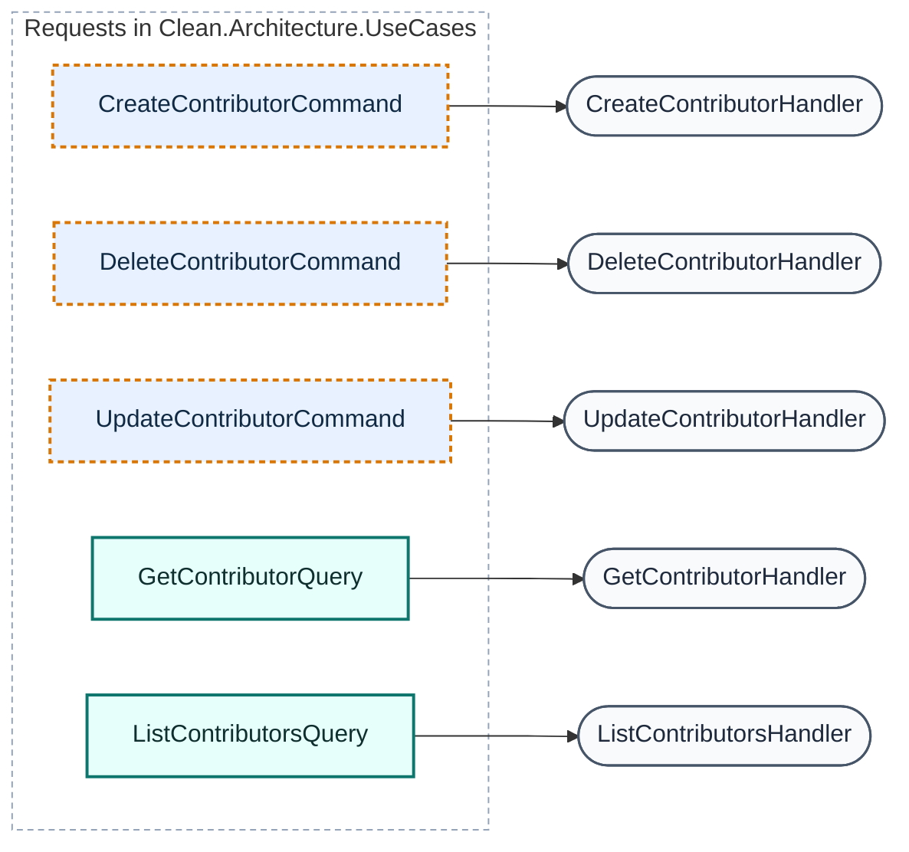
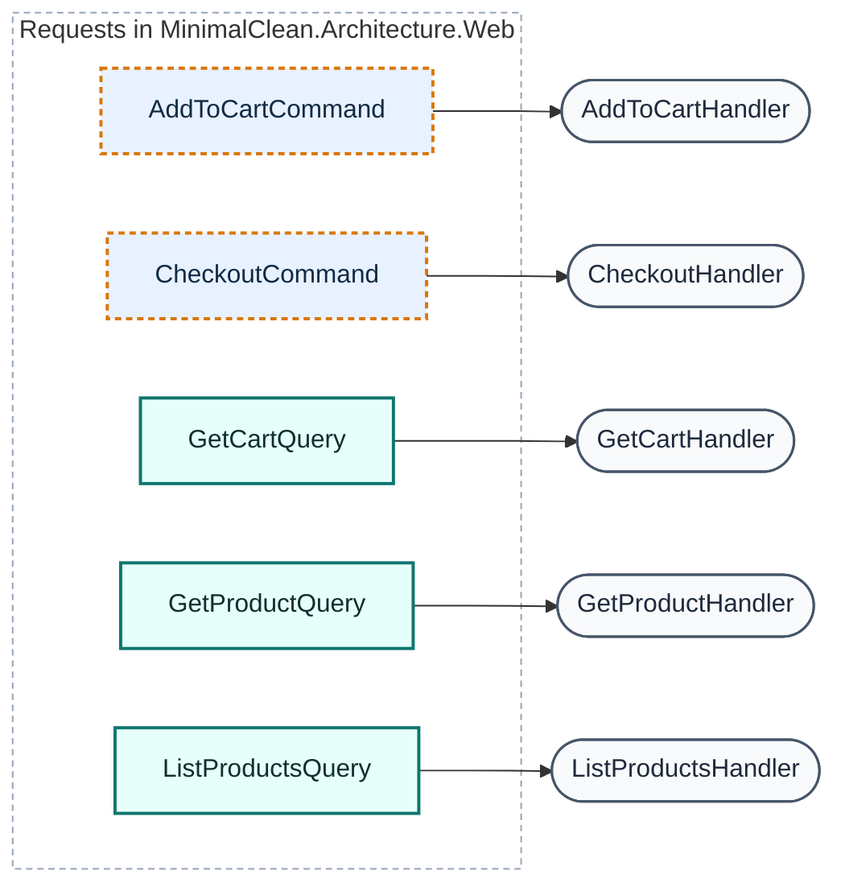
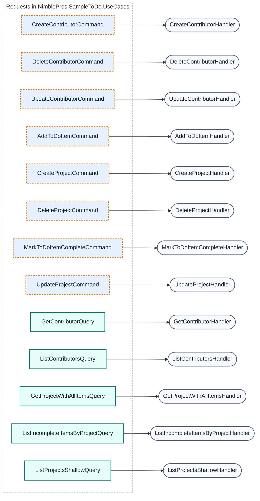

# Architecture Report

Generated by **CqrsLens 0.6.0** on 2026-10-25 18:33:21 UTC · text scanner · Source: `ardalis` · Conventions: Mediator

```text
╔═════════════════════════════════════════════════════════════╗
║           ███  ████  ████   ███  █      ███   ████          ║
║          █   █ █   █ █   █ █   █ █       █   █              ║
║          █████ ████  █   █ █████ █       █    ███           ║
║          █   █ █  █  █   █ █   █ █       █       █          ║
║          █   █ █   █ ████  █   █ █████  ███  ████           ║
║                                                             ║
║   ████ █     █████  ███  █   █      ███  ████   ████ █   █  ║
║  █     █     █     █   █ ██  █     █   █ █   █ █     █   █  ║
║  █     █     ████  █████ █ █ █     █████ ████  █     █████  ║
║  █     █     █     █   █ █  ██     █   █ █  █  █     █   █  ║
║   ████ █████ █████ █   █ █   █     █   █ █   █  ████ █   █  ║
╟─────────────────────────────────────────────────────────────╢
║             ◈ WATERMARK · ARDALIS CLEAN ARCH ◈              ║
╚═════════════════════════════════════════════════════════════╝
```

## Overview

| Metric | Count |
| --- | ---: |
| Projects | 22 |
| Requests (commands + queries) | 23 |
| Handlers | 23 |
| Validators | 21 |
| Pipeline behaviors | 3 |
| DbContexts | 3 |

## Project Dependency Graph

```mermaid
flowchart TD
    accTitle: Project dependency graph
    accDescr: 22 projects, 32 references.
    prj_Clean_Architecture_AspireHost["Clean.Architecture.AspireHost"]:::clsLayerOther
    prj_Clean_Architecture_AspireTests["Clean.Architecture.AspireTests"]:::clsLayerTests
    prj_Clean_Architecture_Core["Clean.Architecture.Core"]:::clsLayerOther
    prj_Clean_Architecture_FunctionalTests["Clean.Architecture.FunctionalTests"]:::clsLayerTests
    prj_Clean_Architecture_Infrastructure["Clean.Architecture.Infrastructure"]:::clsLayerInfrastructure
    prj_Clean_Architecture_IntegrationTests["Clean.Architecture.IntegrationTests"]:::clsLayerTests
    prj_Clean_Architecture_ServiceDefaults["Clean.Architecture.ServiceDefaults"]:::clsLayerOther
    prj_Clean_Architecture_UnitTests["Clean.Architecture.UnitTests"]:::clsLayerTests
    prj_Clean_Architecture_UseCases["Clean.Architecture.UseCases"]:::clsLayerOther
    prj_Clean_Architecture_Web["Clean.Architecture.Web"]:::clsLayerApi
    prj_MinimalClean_Architecture_AspireHost["MinimalClean.Architecture.AspireHost"]:::clsLayerOther
    prj_MinimalClean_Architecture_ServiceDefaults["MinimalClean.Architecture.ServiceDefaults"]:::clsLayerOther
    prj_MinimalClean_Architecture_Web["MinimalClean.Architecture.Web"]:::clsLayerApi
    prj_NimblePros_SampleToDo_AspireHost["NimblePros.SampleToDo.AspireHost"]:::clsLayerOther
    prj_NimblePros_SampleToDo_Core["NimblePros.SampleToDo.Core"]:::clsLayerOther
    prj_NimblePros_SampleToDo_FunctionalTests["NimblePros.SampleToDo.FunctionalTests"]:::clsLayerTests
    prj_NimblePros_SampleToDo_Infrastructure["NimblePros.SampleToDo.Infrastructure"]:::clsLayerInfrastructure
    prj_NimblePros_SampleToDo_IntegrationTests["NimblePros.SampleToDo.IntegrationTests"]:::clsLayerTests
    prj_NimblePros_SampleToDo_ServiceDefaults["NimblePros.SampleToDo.ServiceDefaults"]:::clsLayerOther
    prj_NimblePros_SampleToDo_UnitTests["NimblePros.SampleToDo.UnitTests"]:::clsLayerTests
    prj_NimblePros_SampleToDo_UseCases["NimblePros.SampleToDo.UseCases"]:::clsLayerOther
    prj_NimblePros_SampleToDo_Web["NimblePros.SampleToDo.Web"]:::clsLayerApi
    prj_Clean_Architecture_AspireHost --> prj_Clean_Architecture_ServiceDefaults
    prj_Clean_Architecture_AspireHost --> prj_Clean_Architecture_Web
    prj_Clean_Architecture_AspireTests --> prj_Clean_Architecture_AspireHost
    prj_Clean_Architecture_FunctionalTests --> prj_Clean_Architecture_Infrastructure
    prj_Clean_Architecture_FunctionalTests --> prj_Clean_Architecture_UseCases
    prj_Clean_Architecture_FunctionalTests --> prj_Clean_Architecture_Web
    prj_Clean_Architecture_Infrastructure --> prj_Clean_Architecture_Core
    prj_Clean_Architecture_Infrastructure --> prj_Clean_Architecture_UseCases
    prj_Clean_Architecture_IntegrationTests --> prj_Clean_Architecture_Infrastructure
    prj_Clean_Architecture_UnitTests --> prj_Clean_Architecture_Core
    prj_Clean_Architecture_UnitTests --> prj_Clean_Architecture_UseCases
    prj_Clean_Architecture_UseCases --> prj_Clean_Architecture_Core
    prj_Clean_Architecture_Web --> prj_Clean_Architecture_Infrastructure
    prj_Clean_Architecture_Web --> prj_Clean_Architecture_ServiceDefaults
    prj_Clean_Architecture_Web --> prj_Clean_Architecture_UseCases
    prj_MinimalClean_Architecture_AspireHost --> prj_MinimalClean_Architecture_ServiceDefaults
    prj_MinimalClean_Architecture_AspireHost --> prj_MinimalClean_Architecture_Web
    prj_MinimalClean_Architecture_Web --> prj_MinimalClean_Architecture_ServiceDefaults
    prj_NimblePros_SampleToDo_AspireHost --> prj_NimblePros_SampleToDo_ServiceDefaults
    prj_NimblePros_SampleToDo_AspireHost --> prj_NimblePros_SampleToDo_Web
    prj_NimblePros_SampleToDo_FunctionalTests --> prj_NimblePros_SampleToDo_UnitTests
    prj_NimblePros_SampleToDo_FunctionalTests --> prj_NimblePros_SampleToDo_Web
    prj_NimblePros_SampleToDo_Infrastructure --> prj_NimblePros_SampleToDo_Core
    prj_NimblePros_SampleToDo_Infrastructure --> prj_NimblePros_SampleToDo_UseCases
    prj_NimblePros_SampleToDo_IntegrationTests --> prj_NimblePros_SampleToDo_Infrastructure
    prj_NimblePros_SampleToDo_IntegrationTests --> prj_NimblePros_SampleToDo_UnitTests
    prj_NimblePros_SampleToDo_UnitTests --> prj_NimblePros_SampleToDo_Core
    prj_NimblePros_SampleToDo_UnitTests --> prj_NimblePros_SampleToDo_UseCases
    prj_NimblePros_SampleToDo_UseCases --> prj_NimblePros_SampleToDo_Core
    prj_NimblePros_SampleToDo_Web --> prj_NimblePros_SampleToDo_Infrastructure
    prj_NimblePros_SampleToDo_Web --> prj_NimblePros_SampleToDo_ServiceDefaults
    prj_NimblePros_SampleToDo_Web --> prj_NimblePros_SampleToDo_UseCases
    classDef clsLayerDomain fill:#ecfdf5,stroke:#059669,stroke-width:2px,color:#064e3b
    classDef clsLayerApplication fill:#eff6ff,stroke:#2563eb,stroke-width:2px,color:#1e3a8a
    classDef clsLayerInfrastructure fill:#fff7ed,stroke:#c2410c,stroke-width:2px,color:#431407
    classDef clsLayerApi fill:#f5f3ff,stroke:#7c3aed,stroke-width:2px,color:#2e1065
    classDef clsLayerTests fill:#f8fafc,stroke:#64748b,stroke-width:1.5px,color:#1e293b
    classDef clsLayerOther fill:#f8fafc,stroke:#64748b,stroke-width:1.5px,color:#1e293b
```



**Layer colors:** green = Domain · blue = Application · amber = Infrastructure · purple = Api/Web/UI · gray = Tests/other.

## Layers

```mermaid
flowchart TD
    accTitle: Layer diagram
    accDescr: 22 projects, 6 layers, 32 references.
    subgraph lyr_Web["Web"]
        prj_Clean_Architecture_Web["Clean.Architecture.Web"]:::clsLayerApi
        prj_MinimalClean_Architecture_Web["MinimalClean.Architecture.Web"]:::clsLayerApi
        prj_NimblePros_SampleToDo_Web["NimblePros.SampleToDo.Web"]:::clsLayerApi
    end
    subgraph lyr_Infrastructure["Infrastructure"]
        prj_Clean_Architecture_Infrastructure["Clean.Architecture.Infrastructure"]:::clsLayerInfrastructure
        prj_NimblePros_SampleToDo_Infrastructure["NimblePros.SampleToDo.Infrastructure"]:::clsLayerInfrastructure
    end
    subgraph lyr_Tests["Tests"]
        prj_Clean_Architecture_AspireTests["Clean.Architecture.AspireTests"]:::clsLayerTests
        prj_Clean_Architecture_FunctionalTests["Clean.Architecture.FunctionalTests"]:::clsLayerTests
        prj_Clean_Architecture_IntegrationTests["Clean.Architecture.IntegrationTests"]:::clsLayerTests
        prj_Clean_Architecture_UnitTests["Clean.Architecture.UnitTests"]:::clsLayerTests
        prj_NimblePros_SampleToDo_FunctionalTests["NimblePros.SampleToDo.FunctionalTests"]:::clsLayerTests
        prj_NimblePros_SampleToDo_IntegrationTests["NimblePros.SampleToDo.IntegrationTests"]:::clsLayerTests
        prj_NimblePros_SampleToDo_UnitTests["NimblePros.SampleToDo.UnitTests"]:::clsLayerTests
    end
    subgraph lyr_MinimalClean["MinimalClean"]
        prj_MinimalClean_Architecture_AspireHost["MinimalClean.Architecture.AspireHost"]:::clsLayerOther
        prj_MinimalClean_Architecture_ServiceDefaults["MinimalClean.Architecture.ServiceDefaults"]:::clsLayerOther
    end
    subgraph lyr_sample["sample"]
        prj_NimblePros_SampleToDo_AspireHost["NimblePros.SampleToDo.AspireHost"]:::clsLayerOther
        prj_NimblePros_SampleToDo_Core["NimblePros.SampleToDo.Core"]:::clsLayerOther
        prj_NimblePros_SampleToDo_ServiceDefaults["NimblePros.SampleToDo.ServiceDefaults"]:::clsLayerOther
        prj_NimblePros_SampleToDo_UseCases["NimblePros.SampleToDo.UseCases"]:::clsLayerOther
    end
    subgraph lyr_src["src"]
        prj_Clean_Architecture_AspireHost["Clean.Architecture.AspireHost"]:::clsLayerOther
        prj_Clean_Architecture_Core["Clean.Architecture.Core"]:::clsLayerOther
        prj_Clean_Architecture_ServiceDefaults["Clean.Architecture.ServiceDefaults"]:::clsLayerOther
        prj_Clean_Architecture_UseCases["Clean.Architecture.UseCases"]:::clsLayerOther
    end
    prj_Clean_Architecture_AspireHost --> prj_Clean_Architecture_ServiceDefaults
    prj_Clean_Architecture_AspireHost --> prj_Clean_Architecture_Web
    prj_Clean_Architecture_AspireTests --> prj_Clean_Architecture_AspireHost
    prj_Clean_Architecture_FunctionalTests --> prj_Clean_Architecture_Infrastructure
    prj_Clean_Architecture_FunctionalTests --> prj_Clean_Architecture_UseCases
    prj_Clean_Architecture_FunctionalTests --> prj_Clean_Architecture_Web
    prj_Clean_Architecture_Infrastructure --> prj_Clean_Architecture_Core
    prj_Clean_Architecture_Infrastructure --> prj_Clean_Architecture_UseCases
    prj_Clean_Architecture_IntegrationTests --> prj_Clean_Architecture_Infrastructure
    prj_Clean_Architecture_UnitTests --> prj_Clean_Architecture_Core
    prj_Clean_Architecture_UnitTests --> prj_Clean_Architecture_UseCases
    prj_Clean_Architecture_UseCases --> prj_Clean_Architecture_Core
    prj_Clean_Architecture_Web --> prj_Clean_Architecture_Infrastructure
    prj_Clean_Architecture_Web --> prj_Clean_Architecture_ServiceDefaults
    prj_Clean_Architecture_Web --> prj_Clean_Architecture_UseCases
    prj_MinimalClean_Architecture_AspireHost --> prj_MinimalClean_Architecture_ServiceDefaults
    prj_MinimalClean_Architecture_AspireHost --> prj_MinimalClean_Architecture_Web
    prj_MinimalClean_Architecture_Web --> prj_MinimalClean_Architecture_ServiceDefaults
    prj_NimblePros_SampleToDo_AspireHost --> prj_NimblePros_SampleToDo_ServiceDefaults
    prj_NimblePros_SampleToDo_AspireHost --> prj_NimblePros_SampleToDo_Web
    prj_NimblePros_SampleToDo_FunctionalTests --> prj_NimblePros_SampleToDo_UnitTests
    prj_NimblePros_SampleToDo_FunctionalTests --> prj_NimblePros_SampleToDo_Web
    prj_NimblePros_SampleToDo_Infrastructure --> prj_NimblePros_SampleToDo_Core
    prj_NimblePros_SampleToDo_Infrastructure --> prj_NimblePros_SampleToDo_UseCases
    prj_NimblePros_SampleToDo_IntegrationTests --> prj_NimblePros_SampleToDo_Infrastructure
    prj_NimblePros_SampleToDo_IntegrationTests --> prj_NimblePros_SampleToDo_UnitTests
    prj_NimblePros_SampleToDo_UnitTests --> prj_NimblePros_SampleToDo_Core
    prj_NimblePros_SampleToDo_UnitTests --> prj_NimblePros_SampleToDo_UseCases
    prj_NimblePros_SampleToDo_UseCases --> prj_NimblePros_SampleToDo_Core
    prj_NimblePros_SampleToDo_Web --> prj_NimblePros_SampleToDo_Infrastructure
    prj_NimblePros_SampleToDo_Web --> prj_NimblePros_SampleToDo_ServiceDefaults
    prj_NimblePros_SampleToDo_Web --> prj_NimblePros_SampleToDo_UseCases
    style lyr_Web fill:none,stroke:#94a3b8,stroke-dasharray:4 3
    style lyr_Infrastructure fill:none,stroke:#94a3b8,stroke-dasharray:4 3
    style lyr_Tests fill:none,stroke:#94a3b8,stroke-dasharray:4 3
    style lyr_MinimalClean fill:none,stroke:#94a3b8,stroke-dasharray:4 3
    style lyr_sample fill:none,stroke:#94a3b8,stroke-dasharray:4 3
    style lyr_src fill:none,stroke:#94a3b8,stroke-dasharray:4 3
    classDef clsLayerDomain fill:#ecfdf5,stroke:#059669,stroke-width:2px,color:#064e3b
    classDef clsLayerApplication fill:#eff6ff,stroke:#2563eb,stroke-width:2px,color:#1e3a8a
    classDef clsLayerInfrastructure fill:#fff7ed,stroke:#c2410c,stroke-width:2px,color:#431407
    classDef clsLayerApi fill:#f5f3ff,stroke:#7c3aed,stroke-width:2px,color:#2e1065
    classDef clsLayerTests fill:#f8fafc,stroke:#64748b,stroke-width:1.5px,color:#1e293b
    classDef clsLayerOther fill:#f8fafc,stroke:#64748b,stroke-width:1.5px,color:#1e293b
```



_Dashed boundaries group projects into layers. Projects are grouped by Clean Architecture naming convention (Domain / Application / Infrastructure / Api / Web / UI); projects matching no convention are grouped by their top-level folder._

## CQRS Map

**Legend:** blue = command · teal = query · violet = other request · gray stadium = handler · amber = validator. Amber dashed request = `CommandWithoutValidator` finding.

_Requests are grouped by declaring project. Handler and validator nodes are shown where linked and may be declared in a different project._

_23 requests across 3 projects. Diagrams are split by project and balanced so each stays within GitHub's rendering limits; every request appears exactly once._

### Clean.Architecture.UseCases — 5 requests



_5 requests · 5 handlers · 0 validators · 3 CommandWithoutValidator findings_

### MinimalClean.Architecture.Web — 5 requests



_5 requests · 5 handlers · 0 validators · 2 CommandWithoutValidator findings_

### NimblePros.SampleToDo.UseCases — 13 requests



_13 requests · 13 handlers · 0 validators · 8 CommandWithoutValidator findings_

### Requests

| Request | Type | Response | Handler | Validators | Project |
| --- | --- | --- | --- | --- | --- |
| AddToCartCommand | Command | Result&lt;CartDto&gt; | AddToCartHandler | — | MinimalClean.Architecture.Web |
| AddToDoItemCommand | Command | Result&lt;ToDoItemId&gt; | AddToDoItemHandler | — | NimblePros.SampleToDo.UseCases |
| CheckoutCommand | Command | Result&lt;CheckoutResult&gt; | CheckoutHandler | — | MinimalClean.Architecture.Web |
| CreateContributorCommand | Command | Result&lt;ContributorId&gt; | CreateContributorHandler | — | Clean.Architecture.UseCases |
| CreateContributorCommand | Command | Result&lt;int&gt; | CreateContributorHandler | — | NimblePros.SampleToDo.UseCases |
| CreateProjectCommand | Command | Result&lt;ProjectId&gt; | CreateProjectHandler | — | NimblePros.SampleToDo.UseCases |
| DeleteContributorCommand | Command | Result | DeleteContributorHandler | — | Clean.Architecture.UseCases |
| DeleteContributorCommand | Command | Result | DeleteContributorHandler | — | NimblePros.SampleToDo.UseCases |
| DeleteProjectCommand | Command | Result | DeleteProjectHandler | — | NimblePros.SampleToDo.UseCases |
| GetCartQuery | Query | Result&lt;CartDto&gt; | GetCartHandler | — | MinimalClean.Architecture.Web |
| GetContributorQuery | Query | Result&lt;ContributorDto&gt; | GetContributorHandler | — | Clean.Architecture.UseCases |
| GetContributorQuery | Query | Result&lt;ContributorDto&gt; | GetContributorHandler | — | NimblePros.SampleToDo.UseCases |
| GetProductQuery | Query | Result&lt;ProductDto&gt; | GetProductHandler | — | MinimalClean.Architecture.Web |
| GetProjectWithAllItemsQuery | Query | Result&lt;ProjectWithAllItemsDto&gt; | GetProjectWithAllItemsHandler | — | NimblePros.SampleToDo.UseCases |
| ListContributorsQuery | Query | Result&lt;PagedResult&lt;ContributorDto&gt;&gt; | ListContributorsHandler | — | Clean.Architecture.UseCases |
| ListContributorsQuery | Query | Result&lt;PagedResult&lt;ContributorDto&gt;&gt; | ListContributorsHandler | — | NimblePros.SampleToDo.UseCases |
| ListIncompleteItemsByProjectQuery | Query | Result&lt;IEnumerable&lt;ToDoItemDto&gt;&gt; | ListIncompleteItemsByProjectHandler | — | NimblePros.SampleToDo.UseCases |
| ListProductsQuery | Query | Result&lt;PagedResult&lt;ProductDto&gt;&gt; | ListProductsHandler | — | MinimalClean.Architecture.Web |
| ListProjectsShallowQuery | Query | Result&lt;IEnumerable&lt;ProjectDto&gt;&gt; | ListProjectsShallowHandler | — | NimblePros.SampleToDo.UseCases |
| MarkToDoItemCompleteCommand | Command | Result | MarkToDoItemCompleteHandler | — | NimblePros.SampleToDo.UseCases |
| UpdateContributorCommand | Command | Result&lt;ContributorDto&gt; | UpdateContributorHandler | — | Clean.Architecture.UseCases |
| UpdateContributorCommand | Command | Result&lt;ContributorDto&gt; | UpdateContributorHandler | — | NimblePros.SampleToDo.UseCases |
| UpdateProjectCommand | Command | Result&lt;ProjectDto&gt; | UpdateProjectHandler | — | NimblePros.SampleToDo.UseCases |

## Pipeline Behaviors

- `CachingBehavior` — NimblePros.SampleToDo.Web
- `LoggingBehavior` — MinimalClean.Architecture.Web
- `LoggingBehavior` — NimblePros.SampleToDo.Web

## Data Access (DbContexts)

| DbContext | Project | DbSets (property → entity) |
| --- | --- | --- |
| AppDbContext | Clean.Architecture.Infrastructure | Contributors → Contributor |
| AppDbContext | MinimalClean.Architecture.Web | Products → Product, Carts → Cart, CartItems → CartItem, GuestUsers → GuestUser, Orders → Order, OrderItems → OrderItem |
| AppDbContext | NimblePros.SampleToDo.Infrastructure | ToDoItems → ToDoItem, Projects → Project, Contributors → Contributor |

### Clean.Architecture.Infrastructure.Data.AppDbContext ER Diagram

```mermaid
erDiagram
    accTitle: AppDbContext ER diagram
    accDescr: 1 entity, 0 relationships.
    ent_Contributor["Contributor"] {
        PhoneNumber? PhoneNumber
        ContributorStatus Status
        ContributorName name
    }
```

### MinimalClean.Architecture.Web.Infrastructure.Data.AppDbContext ER Diagram

```mermaid
erDiagram
    accTitle: AppDbContext ER diagram
    accDescr: 6 entities, 0 relationships.
    ent_Cart["Cart"] {
        DateTime CreatedOn
        bool Deleted
    }
    ent_CartItem["CartItem"] {
        int ProductId
        int Quantity
        decimal UnitPrice
    }
    ent_GuestUser["GuestUser"] {
        string Email
    }
    ent_Order["Order"] {
        DateTimeOffset CreatedOn
        DateTimeOffset? DatePaid
        Guid GuestUserId
        string PaymentReference
    }
    ent_OrderItem["OrderItem"] {
        OrderId orderId
        ProductId productId
        Quantity quantity
        Price unitPrice
    }
    ent_Product["Product"] {
        string Name
        decimal UnitPrice
    }
```

### NimblePros.SampleToDo.Infrastructure.Data.AppDbContext ER Diagram

```mermaid
erDiagram
    accTitle: AppDbContext ER diagram
    accDescr: 3 entities, 0 relationships.
    ent_Contributor["Contributor"] {
        ContributorName Name
    }
    ent_Project["Project"] {
        ProjectName Name
    }
    ent_ToDoItem["ToDoItem"] {
        ContributorId? ContributorId
        ToDoItemDescription Description
        bool IsDone
        Priority Priority
        ToDoItemTitle Title
    }
```

## Analysis Diagnostics

No scan diagnostics.

## Architecture Checks

0 error(s), 13 warning(s):

- ⚠️ Warning **CommandWithoutValidator** — Command `Clean.Architecture.UseCases.Contributors.Create.CreateContributorCommand` has no validator. `src/Clean.Architecture.UseCases/Contributors/Create/CreateContributorCommand.cs:9:8`
- ⚠️ Warning **CommandWithoutValidator** — Command `Clean.Architecture.UseCases.Contributors.Delete.DeleteContributorCommand` has no validator. `src/Clean.Architecture.UseCases/Contributors/Delete/DeleteContributorCommand.cs:5:8`
- ⚠️ Warning **CommandWithoutValidator** — Command `Clean.Architecture.UseCases.Contributors.Update.UpdateContributorCommand` has no validator. `src/Clean.Architecture.UseCases/Contributors/Update/UpdateContributorCommand.cs:5:8`
- ⚠️ Warning **CommandWithoutValidator** — Command `MinimalClean.Architecture.Web.CartFeatures.AddToCart.AddToCartCommand` has no validator. `MinimalClean/src/MinimalClean.Architecture.Web/CartFeatures/AddToCart/AddToCartHandler.cs:8:8`
- ⚠️ Warning **CommandWithoutValidator** — Command `MinimalClean.Architecture.Web.CartFeatures.Checkout.CheckoutCommand` has no validator. `MinimalClean/src/MinimalClean.Architecture.Web/CartFeatures/Checkout/CheckoutHandler.cs:10:8`
- ⚠️ Warning **CommandWithoutValidator** — Command `NimblePros.SampleToDo.UseCases.Contributors.Commands.Create.CreateContributorCommand` has no validator. `sample/src/NimblePros.SampleToDo.UseCases/Contributors/Commands/Create/CreateContributorCommand.cs:9:8`
- ⚠️ Warning **CommandWithoutValidator** — Command `NimblePros.SampleToDo.UseCases.Contributors.Commands.Delete.DeleteContributorCommand` has no validator. `sample/src/NimblePros.SampleToDo.UseCases/Contributors/Commands/Delete/DeleteContributorCommand.cs:5:8`
- ⚠️ Warning **CommandWithoutValidator** — Command `NimblePros.SampleToDo.UseCases.Contributors.Commands.Update.UpdateContributorCommand` has no validator. `sample/src/NimblePros.SampleToDo.UseCases/Contributors/Commands/Update/UpdateContributorCommand.cs:5:8`
- ⚠️ Warning **CommandWithoutValidator** — Command `NimblePros.SampleToDo.UseCases.Projects.AddToDoItem.AddToDoItemCommand` has no validator. `sample/src/NimblePros.SampleToDo.UseCases/Projects/AddToDoItem/AddToDoItemCommand.cs:13:8`
- ⚠️ Warning **CommandWithoutValidator** — Command `NimblePros.SampleToDo.UseCases.Projects.Create.CreateProjectCommand` has no validator. `sample/src/NimblePros.SampleToDo.UseCases/Projects/Create/CreateProjectCommand.cs:9:8`
- ⚠️ Warning **CommandWithoutValidator** — Command `NimblePros.SampleToDo.UseCases.Projects.Delete.DeleteProjectCommand` has no validator. `sample/src/NimblePros.SampleToDo.UseCases/Projects/Delete/DeleteProjectCommand.cs:5:8`
- ⚠️ Warning **CommandWithoutValidator** — Command `NimblePros.SampleToDo.UseCases.Projects.MarkToDoItemComplete.MarkToDoItemCompleteCommand` has no validator. `sample/src/NimblePros.SampleToDo.UseCases/Projects/MarkToDoItemComplete/MarkToDoItemCompleteCommand.cs:9:8`
- ⚠️ Warning **CommandWithoutValidator** — Command `NimblePros.SampleToDo.UseCases.Projects.Update.UpdateProjectCommand` has no validator. `sample/src/NimblePros.SampleToDo.UseCases/Projects/Update/UpdateProjectCommand.cs:5:8`

---
_Generated by CqrsLens 0.6.0 in 362 ms — 362 files scanned._
_Report generated by [CqrsLens](https://github.com/AbdullahHakima/cqrslens) — static analysis only; the target solution was not built._
