# Architecture Report

Generated by **CqrsLens 0.9.0** on 2026-11-07 18:29:26 UTC · text scanner · Source: `jasontaylordev-clean-architecture`

## Overview

| Metric | Count |
| --- | ---: |
| Projects | 13 |
| Requests (commands + queries) | 11 |
| Handlers | 11 |
| Validators | 6 |
| Pipeline behaviors | 4 |
| DbContexts | 1 |
| Notifications (domain events) | 1 |
| Notification handlers | 1 |
| Architecture checks | 0 error(s), 6 warning(s) |

## Configuration & Conventions

_The settings this scan ran under (declared) and what it found under them (actual). Declared values are the resolved configuration; actual values are the scan outcome._

### Declared

| Setting | Value |
| --- | --- |
| Config file | No config file found |
| Request markers | none declared |
| Handler markers | none declared |
| Layer overrides | none declared |
| Include globs | none declared |
| Exclude globs | none declared |
| Rule severity overrides | none declared |

### Actual

| Fact | Value |
| --- | --- |
| Layer-model status | asserted |
| Layer checks | Layer rules are asserted as errors. No layer findings. |
| Requests discovered | 11 |
| Conventions detected | none detected |

## Project Dependency Graph

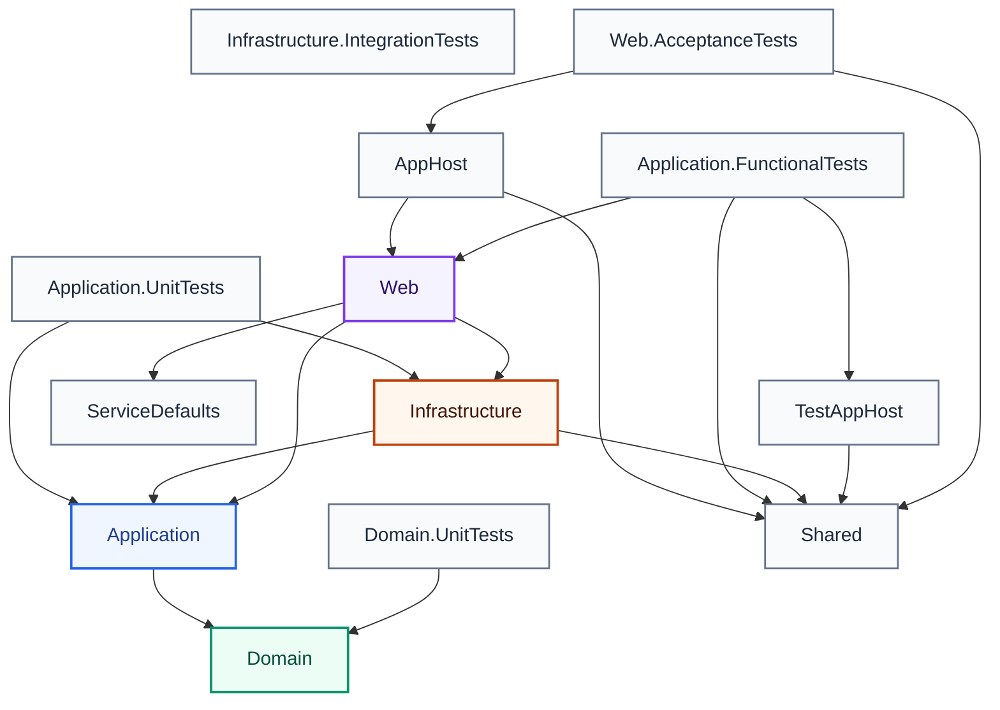

**Layer colors:** green = Domain · blue = Application · amber = Infrastructure · purple = Api/Web/UI · gray = Tests/other.

## Layers

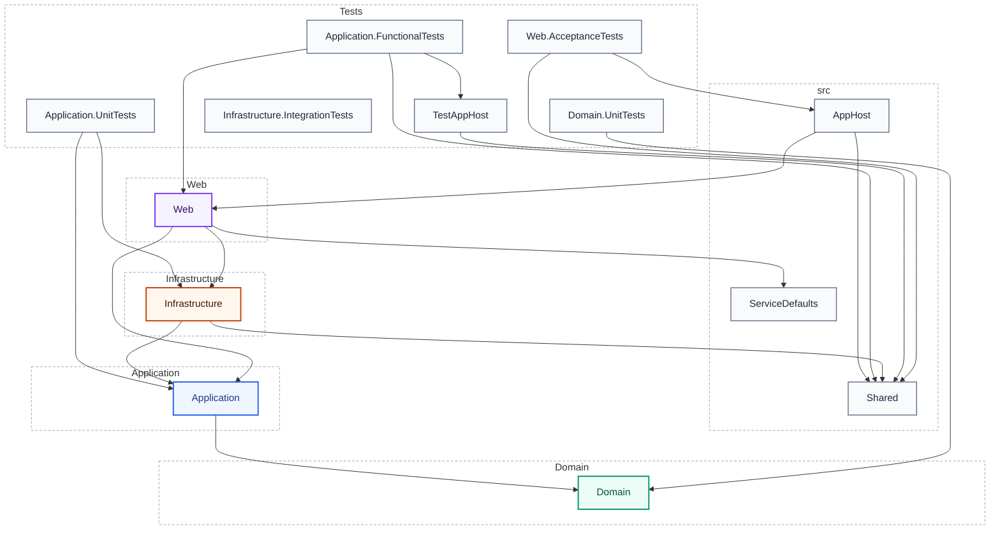

_Dashed boundaries group projects into layers. Projects are grouped by Clean Architecture naming convention (Domain / Application / Infrastructure / Api / Web / UI); projects matching no convention are grouped by their top-level folder._

## CQRS Map

**Legend:** blue = command · teal = query · violet = other request · gray stadium = handler · amber = validator. Amber dashed request = `CommandWithoutValidator` finding.

_Requests are grouped by declaring project. Handler and validator nodes are shown where linked and may be declared in a different project._

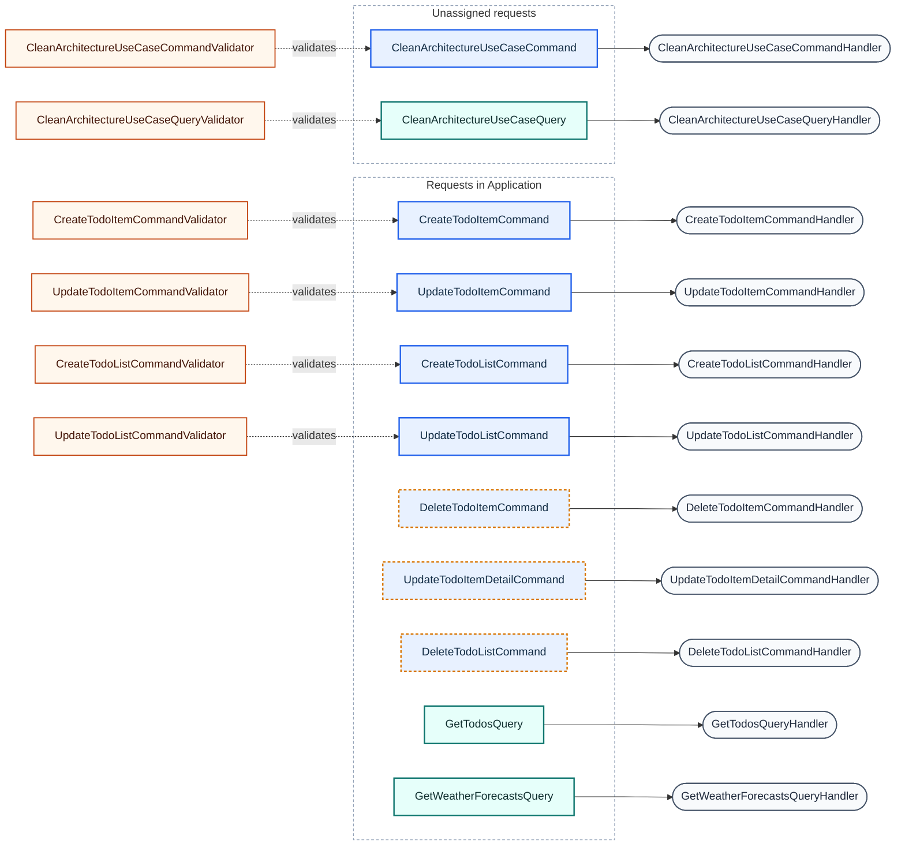

_11 requests · 11 handlers · 6 validators · 3 CommandWithoutValidator findings_


## Validation Coverage

_The share of requests with a linked validator (the model's request→validator linkage). A request with no linked validator is also reported individually by the command-without-validator check._

| Project | Requests | With linked validator | Coverage | Validators |
| --- | ---: | ---: | ---: | ---: |
| (unassigned) | 2 | 2 | 100.0% | 2 |
| Application | 9 | 4 | 44.4% | 4 |
| **All projects** | **11** | **6** | **54.5%** | **6** |

## Flow

_20 resolved flow edges across 4 feature/project diagrams (endpoint → request → handler and onward; DbContext nodes appear only when a handler directly references a discovered DbContext type; every flow edge appears in exactly one diagram). 8 unresolved dispatch call(s) are not drawn as edges._

**Legend:** blue stadium = endpoint · blue = request · gray = handler · fuchsia = notification · green = DbContext.

### (unassigned) — FeatureName — flow

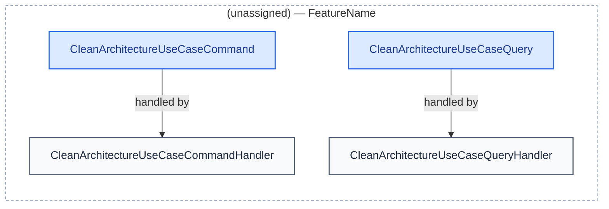

_2 edges · 2 connected flows_

### Application — TodoItems — flow

```mermaid
flowchart LR
    accTitle: Flow map
    accDescr: 8 edges, 12 nodes.
    subgraph flow["Application — TodoItems"]
        ep_TodoItems_CreateTodoItem(["TodoItems.CreateTodoItem"]):::clsFlowEndpoint
        req_CreateTodoItemCommand["CreateTodoItemCommand"]:::clsFlowRequest
        ep_TodoItems_DeleteTodoItem(["TodoItems.DeleteTodoItem"]):::clsFlowEndpoint
        req_DeleteTodoItemCommand["DeleteTodoItemCommand"]:::clsFlowRequest
        ep_TodoItems_UpdateTodoItem(["TodoItems.UpdateTodoItem"]):::clsFlowEndpoint
        req_UpdateTodoItemCommand["UpdateTodoItemCommand"]:::clsFlowRequest
        ep_TodoItems_UpdateTodoItemDetail(["TodoItems.UpdateTodoItemDetail"]):::clsFlowEndpoint
        req_UpdateTodoItemDetailCommand["UpdateTodoItemDetailCommand"]:::clsFlowRequest
        hdl_CreateTodoItemCommandHandler["CreateTodoItemCommandHandler"]:::clsFlowHandler
        hdl_DeleteTodoItemCommandHandler["DeleteTodoItemCommandHandler"]:::clsFlowHandler
        hdl_UpdateTodoItemCommandHandler["UpdateTodoItemCommandHandler"]:::clsFlowHandler
        hdl_UpdateTodoItemDetailCommandHandler["UpdateTodoItemDetailCommandHandler"]:::clsFlowHandler
    end
    ep_TodoItems_CreateTodoItem -->|dispatches| req_CreateTodoItemCommand
    ep_TodoItems_DeleteTodoItem -->|dispatches| req_DeleteTodoItemCommand
    ep_TodoItems_UpdateTodoItem -->|dispatches| req_UpdateTodoItemCommand
    ep_TodoItems_UpdateTodoItemDetail -->|dispatches| req_UpdateTodoItemDetailCommand
    req_CreateTodoItemCommand -->|handled by| hdl_CreateTodoItemCommandHandler
    req_DeleteTodoItemCommand -->|handled by| hdl_DeleteTodoItemCommandHandler
    req_UpdateTodoItemCommand -->|handled by| hdl_UpdateTodoItemCommandHandler
    req_UpdateTodoItemDetailCommand -->|handled by| hdl_UpdateTodoItemDetailCommandHandler
    classDef clsFlowEndpoint fill:#e0f2fe,stroke:#0284c7,stroke-width:2px,color:#0c4a6e
    classDef clsFlowRequest fill:#dbeafe,stroke:#2563eb,stroke-width:1.5px,color:#1e3a8a
    classDef clsFlowHandler fill:#f8fafc,stroke:#475569,stroke-width:1.5px,color:#1e293b
    classDef clsFlowNotification fill:#fdf4ff,stroke:#a21caf,stroke-width:2px,color:#4a044e
    classDef clsFlowDbContext fill:#ecfdf5,stroke:#059669,stroke-width:2px,color:#064e3b
    style flow fill:none,stroke:#94a3b8,stroke-dasharray:4 3
```

_8 edges · 4 connected flows_

### Application — TodoLists — flow

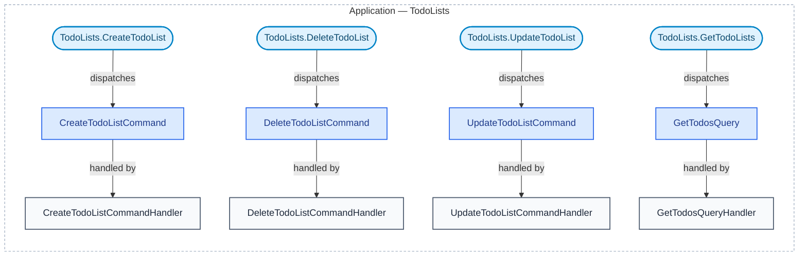

_8 edges · 4 connected flows_

### Application — WeatherForecasts — flow

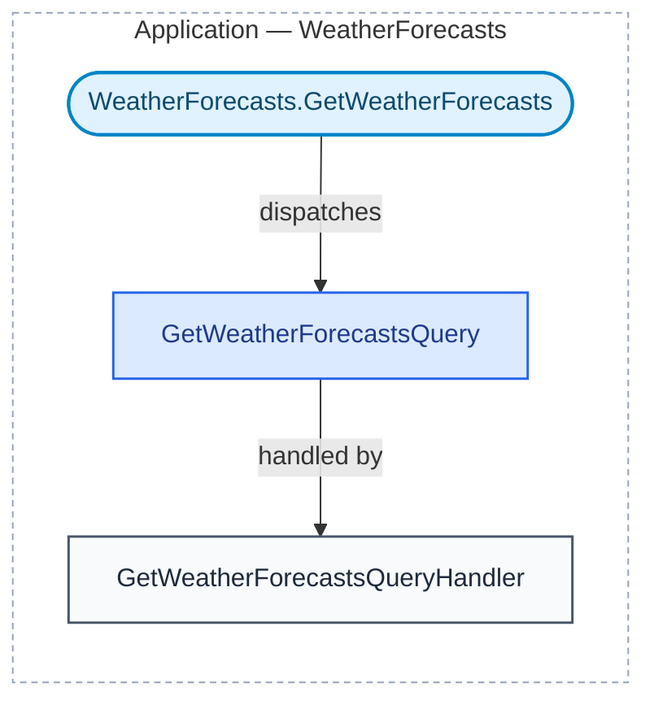

_2 edges · 1 connected flow_

## Request sequences

_One sequence diagram per request with a resolved handler, built only from data the scan model holds. Participants: endpoint → mediator → pipeline behaviors (registered order) → handler → DbContext → published notifications. A DbContext participant appears only when the model holds a handler → DbContext edge; behavior order is registered order, not execution order._

### CleanArchitectureUseCaseCommand

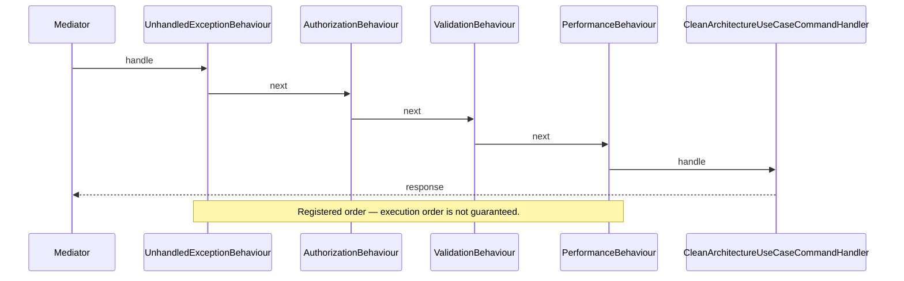

_Sequence for CleanArchitectureUseCaseCommand: mediator → handler (no endpoint edge in the model). Behaviors shown in registered order (4); execution order is not guaranteed._

### CleanArchitectureUseCaseQuery

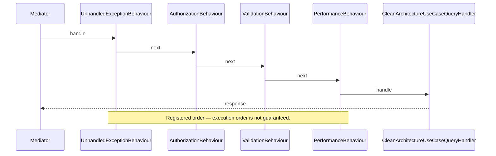

_Sequence for CleanArchitectureUseCaseQuery: mediator → handler (no endpoint edge in the model). Behaviors shown in registered order (4); execution order is not guaranteed._

### CreateTodoItemCommand

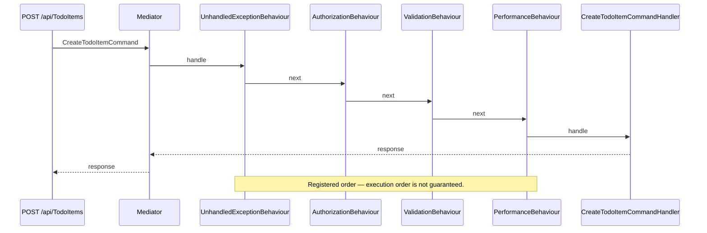

_Sequence for CreateTodoItemCommand: POST /api/TodoItems → mediator → handler. Behaviors shown in registered order (4); execution order is not guaranteed._

### CreateTodoListCommand


_Sequence for CreateTodoListCommand: POST /api/TodoLists → mediator → handler. Behaviors shown in registered order (4); execution order is not guaranteed._

### DeleteTodoItemCommand

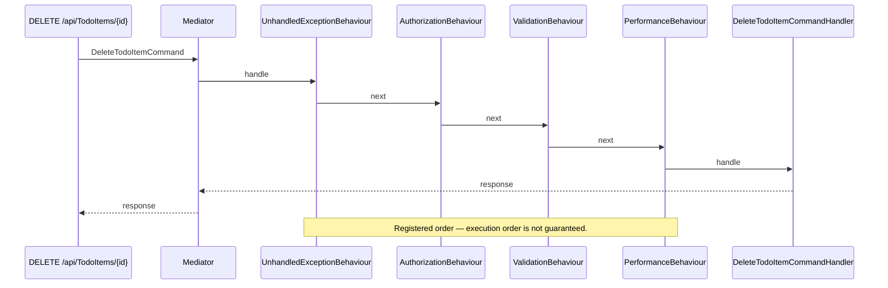

_Sequence for DeleteTodoItemCommand: DELETE /api/TodoItems/{id} → mediator → handler. Behaviors shown in registered order (4); execution order is not guaranteed._

### DeleteTodoListCommand

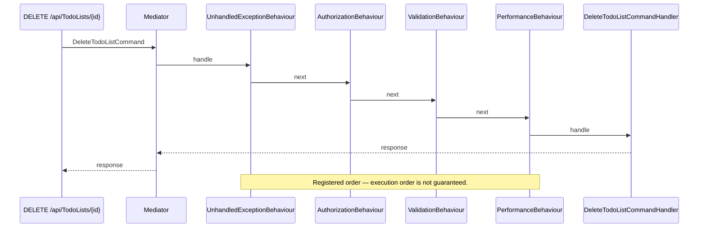

_Sequence for DeleteTodoListCommand: DELETE /api/TodoLists/{id} → mediator → handler. Behaviors shown in registered order (4); execution order is not guaranteed._

### GetTodosQuery

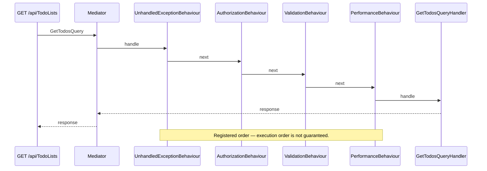

_Sequence for GetTodosQuery: GET /api/TodoLists → mediator → handler. Behaviors shown in registered order (4); execution order is not guaranteed._

### GetWeatherForecastsQuery


_Sequence for GetWeatherForecastsQuery: GET /api/WeatherForecasts → mediator → handler. Behaviors shown in registered order (4); execution order is not guaranteed._

### UpdateTodoItemCommand

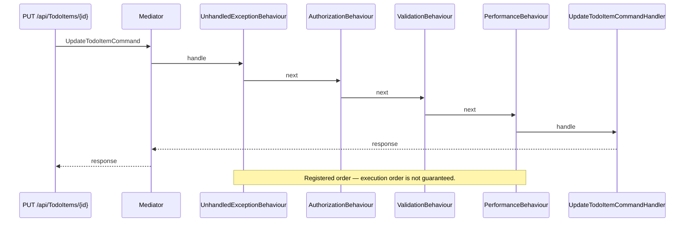

_Sequence for UpdateTodoItemCommand: PUT /api/TodoItems/{id} → mediator → handler. Behaviors shown in registered order (4); execution order is not guaranteed._

### UpdateTodoItemDetailCommand

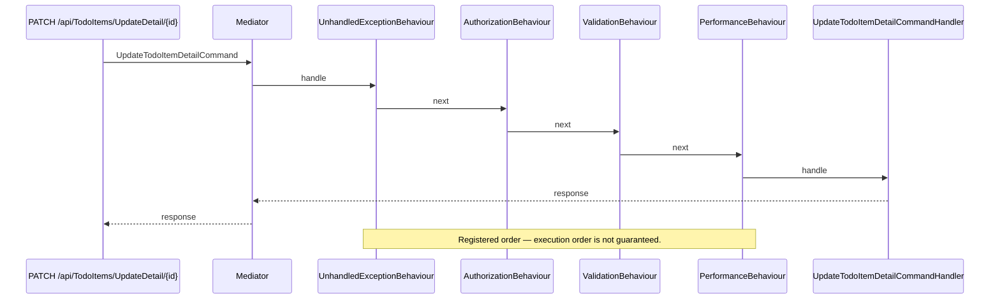

_Sequence for UpdateTodoItemDetailCommand: PATCH /api/TodoItems/UpdateDetail/{id} → mediator → handler. Behaviors shown in registered order (4); execution order is not guaranteed._

### UpdateTodoListCommand

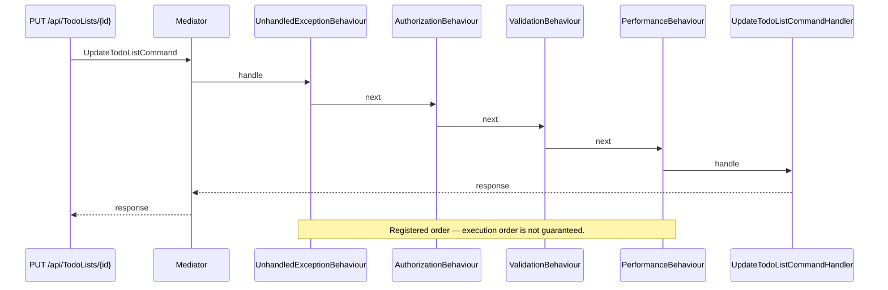

_Sequence for UpdateTodoListCommand: PUT /api/TodoLists/{id} → mediator → handler. Behaviors shown in registered order (4); execution order is not guaranteed._

## API Endpoints

_The HTTP surface and the request each endpoint dispatches to. `inferred` marks a route or verb guessed from naming rather than read from source; an `unresolved` target has no matching request in the model._

**9 endpoint(s)** (9 inferred) across 1 project(s).

| Method | Route | Endpoint | Project | Target request | Handler | Inferred |
| --- | --- | --- | --- | --- | --- | :---: |
| POST | /api/TodoItems | TodoItems.CreateTodoItem | Web | CreateTodoItemCommand | CreateTodoItemCommandHandler | yes |
| PATCH | /api/TodoItems/UpdateDetail/{id} | TodoItems.UpdateTodoItemDetail | Web | UpdateTodoItemDetailCommand | UpdateTodoItemDetailCommandHandler | yes |
| DELETE | /api/TodoItems/{id} | TodoItems.DeleteTodoItem | Web | DeleteTodoItemCommand | DeleteTodoItemCommandHandler | yes |
| PUT | /api/TodoItems/{id} | TodoItems.UpdateTodoItem | Web | UpdateTodoItemCommand | UpdateTodoItemCommandHandler | yes |
| POST | /api/TodoLists | TodoLists.CreateTodoList | Web | CreateTodoListCommand | CreateTodoListCommandHandler | yes |
| GET | /api/TodoLists | TodoLists.GetTodoLists | Web | GetTodosQuery | GetTodosQueryHandler | yes |
| DELETE | /api/TodoLists/{id} | TodoLists.DeleteTodoList | Web | DeleteTodoListCommand | DeleteTodoListCommandHandler | yes |
| PUT | /api/TodoLists/{id} | TodoLists.UpdateTodoList | Web | UpdateTodoListCommand | UpdateTodoListCommandHandler | yes |
| GET | /api/WeatherForecasts | WeatherForecasts.GetWeatherForecasts | Web | GetWeatherForecastsQuery | GetWeatherForecastsQueryHandler | yes |

## Requests

| Request | Type | Response | Handler | Validators | Dispatched by | Project |
| --- | --- | --- | --- | --- | --- | --- |
| CleanArchitectureUseCaseCommand | Command | TReturnType | CleanArchitectureUseCaseCommandHandler | CleanArchitectureUseCaseCommandValidator | — | — |
| CleanArchitectureUseCaseQuery | Query | TReturnType | CleanArchitectureUseCaseQueryHandler | CleanArchitectureUseCaseQueryValidator | — | — |
| CreateTodoItemCommand | Command | int | CreateTodoItemCommandHandler | CreateTodoItemCommandValidator | — | Application |
| CreateTodoListCommand | Command | int | CreateTodoListCommandHandler | CreateTodoListCommandValidator | — | Application |
| DeleteTodoItemCommand | Command | — | DeleteTodoItemCommandHandler | — | TodoItems | Application |
| DeleteTodoListCommand | Command | — | DeleteTodoListCommandHandler | — | TodoLists | Application |
| GetTodosQuery | Query | TodosVm | GetTodosQueryHandler | — | TodoLists | Application |
| GetWeatherForecastsQuery | Query | IEnumerable&lt;WeatherForecast&gt; | GetWeatherForecastsQueryHandler | — | WeatherForecasts | Application |
| UpdateTodoItemCommand | Command | — | UpdateTodoItemCommandHandler | UpdateTodoItemCommandValidator | — | Application |
| UpdateTodoItemDetailCommand | Command | — | UpdateTodoItemDetailCommandHandler | — | — | Application |
| UpdateTodoListCommand | Command | — | UpdateTodoListCommandHandler | UpdateTodoListCommandValidator | — | Application |
## Domain Events & Notifications

**Legend:** fuchsia = notification · amber dashed = orphan notification (`OrphanNotification` finding) · gray stadium = handler · indigo parallelogram = publisher.

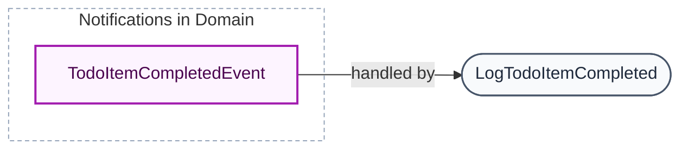

### Notifications

| Notification | Marker | Handlers | Project | Source |
| --- | --- | --- | --- | --- |
| TodoItemCompletedEvent | BaseEvent | LogTodoItemCompleted | Domain | `src/Domain/Events/TodoItemCompletedEvent.cs:3:14` |

## Pipeline Behaviors

_Behaviors are listed in registered order — the order of their DI registration expressions in the scanned source. Execution order is not guaranteed and is not proven by the scan._

```mermaid
flowchart LR
    accTitle: Pipeline behavior chain
    accDescr: 4 behaviors in registered order. Execution order is not guaranteed and is not proven by the scan.
    req(["Request"]):::clsChainRequest
    bhv_UnhandledExceptionBehaviour["UnhandledExceptionBehaviour"]:::clsChainBehavior
    req --> bhv_UnhandledExceptionBehaviour
    bhv_AuthorizationBehaviour["AuthorizationBehaviour"]:::clsChainBehavior
    bhv_UnhandledExceptionBehaviour --> bhv_AuthorizationBehaviour
    bhv_ValidationBehaviour["ValidationBehaviour"]:::clsChainBehavior
    bhv_AuthorizationBehaviour --> bhv_ValidationBehaviour
    bhv_PerformanceBehaviour["PerformanceBehaviour"]:::clsChainBehavior
    bhv_ValidationBehaviour --> bhv_PerformanceBehaviour
    bhv_PerformanceBehaviour --> hdl(["Handler"]):::clsChainHandler
    classDef clsChainRequest fill:#dbeafe,stroke:#2563eb,stroke-width:1.5px,color:#1e3a8a
    classDef clsChainBehavior fill:#fef3c7,stroke:#d97706,stroke-width:1.5px,color:#78350f
    classDef clsChainHandler fill:#f8fafc,stroke:#475569,stroke-width:1.5px,color:#1e293b
```

### Registered order

#### `src/Application/DependencyInjection.cs:19-22`

| # | Behavior | Project | Source |
| --- | --- | --- | --- |
| 1 | UnhandledExceptionBehaviour | Application | `src/Application/Common/Behaviours/UnhandledExceptionBehaviour.cs:5:14` |
| 2 | AuthorizationBehaviour | Application | `src/Application/Common/Behaviours/AuthorizationBehaviour.cs:8:14` |
| 3 | ValidationBehaviour | Application | `src/Application/Common/Behaviours/ValidationBehaviour.cs:5:14` |
| 4 | PerformanceBehaviour | Application | `src/Application/Common/Behaviours/PerformanceBehaviour.cs:7:14` |

## Data Access (DbContexts)

| DbContext | Project | DbSets (property → entity) |
| --- | --- | --- |
| ApplicationDbContext | Infrastructure | TodoLists → TodoList, TodoItems → TodoItem |

### Data model — all DbContexts

_Every DbContext in the solution with its entities and relationships in one place; each context's entity set matches its ER diagram below. Contexts with no entities discovered are listed explicitly and never dropped._

**1 DbContext(s):** 1 with entities, 0 with none · 2 entities · 1 relationships.

| DbContext | Project | Entities | DbSets | Relationships |
| --- | --- | ---: | ---: | ---: |
| ApplicationDbContext | Infrastructure | 2 | 2 | 1 |

#### ApplicationDbContext — 2 entities, 1 relationships

| Entity | Key | Mapped DbSet |
| --- | --- | --- |
| TodoItem | Id | TodoItems |
| TodoList | Id | TodoLists |

| Principal | Dependent | Navigation | FK | Kind |
| --- | --- | --- | --- | --- |
| CleanArchitecture.Domain.Entities.TodoList | CleanArchitecture.Domain.Entities.TodoItem | Items / List | ListId | one-to-many |


### ApplicationDbContext ER Diagram

```mermaid
erDiagram
    accTitle: ApplicationDbContext ER diagram
    accDescr: 2 entities, 1 relationship.
    ent_TodoItem["TodoItem"] {
        int Id PK
        DateTimeOffset Created
        string? CreatedBy
        DateTimeOffset LastModified
        string? LastModifiedBy
        int ListId FK
        string? Note
        PriorityLevel Priority
        string? Title
    }
    ent_TodoList["TodoList"] {
        int Id PK
        Colour Colour
        DateTimeOffset Created
        string? CreatedBy
        DateTimeOffset LastModified
        string? LastModifiedBy
        string? Title
    }
    ent_TodoList ||--o{ ent_TodoItem : "Items / List"
```

## Analysis Diagnostics

No analysis diagnostics.

## Architecture Checks

0 error(s), 6 warning(s):

### ⚠️ CommandWithoutValidator (3)

- ⚠️ Warning **CommandWithoutValidator** — Command `CleanArchitecture.Application.TodoItems.Commands.DeleteTodoItem.DeleteTodoItemCommand` has no validator. `src/Application/TodoItems/Commands/DeleteTodoItem/DeleteTodoItem.cs:5:15`
- ⚠️ Warning **CommandWithoutValidator** — Command `CleanArchitecture.Application.TodoItems.Commands.UpdateTodoItemDetail.UpdateTodoItemDetailCommand` has no validator. `src/Application/TodoItems/Commands/UpdateTodoItemDetail/UpdateTodoItemDetail.cs:6:15`
- ⚠️ Warning **CommandWithoutValidator** — Command `CleanArchitecture.Application.TodoLists.Commands.DeleteTodoList.DeleteTodoListCommand` has no validator. `src/Application/TodoLists/Commands/DeleteTodoList/DeleteTodoList.cs:5:15`

### ⚠️ UnreachableRequest (2)

- ℹ️ _8 unresolved dispatch call(s) in the solution could not be resolved and are not counted as call sites. (×2)_
- ⚠️ Warning **UnreachableRequest** — Request `CleanArchitecture.Application.FeatureName.Commands.CleanArchitectureUseCase.CleanArchitectureUseCaseCommand` has 1 handler(s) but no production call site. `templates/ca-use-case/FeatureName/Commands/CleanArchitectureUseCase/CleanArchitectureUseCase.cs:6:15`
- ⚠️ Warning **UnreachableRequest** — Request `CleanArchitecture.Application.FeatureName.Queries.CleanArchitectureUseCase.CleanArchitectureUseCaseQuery` has 1 handler(s) but no production call site. `templates/ca-use-case/FeatureName/Queries/CleanArchitectureUseCase/CleanArchitectureUseCase.cs:6:15`

### ⚠️ UnpublishedNotification (1)

- ⚠️ Warning **UnpublishedNotification** — Notification `CleanArchitecture.Domain.Events.TodoItemCompletedEvent` has 1 handler(s) but no production publisher. 8 unresolved dispatch call(s) in the solution could not be resolved and are not counted as call sites. `src/Domain/Events/TodoItemCompletedEvent.cs:3:14`


**Findings summary:** 6 finding(s) — 0 error(s), 6 warning(s) across 3 module(s) and 4 cluster(s).

### Findings by rule

| Rule | Errors | Warnings | Total |
| --- | ---: | ---: | ---: |
| CommandWithoutValidator | 0 | 3 | 3 |
| UnreachableRequest | 0 | 2 | 2 |
| UnpublishedNotification | 0 | 1 | 1 |

### Findings by module

| Module | Errors | Warnings | Total |
| --- | ---: | ---: | ---: |
| Application | 0 | 3 | 3 |
| (unassigned) | 0 | 2 | 2 |
| Domain | 0 | 1 | 1 |

### Findings by module and feature

_Each row is one module (project) and feature cluster; every finding is counted exactly once. Findings whose target has no resolvable feature appear under `(unassigned)`._

| Module | Feature | Rules | Errors | Warnings | Total |
| --- | --- | --- | ---: | ---: | ---: |
| (unassigned) | FeatureName | UnreachableRequest 2 | 0 | 2 | 2 |
| Application | TodoItems | CommandWithoutValidator 2 | 0 | 2 | 2 |
| Application | TodoLists | CommandWithoutValidator 1 | 0 | 1 | 1 |
| Domain | Events | UnpublishedNotification 1 | 0 | 1 | 1 |

---
_Generated by CqrsLens 0.9.0 in 252 ms — 110 files scanned._
_Report generated by [CqrsLens](https://github.com/AbdullahHakima/cqrslens) — static analysis only; the target solution was not built._
