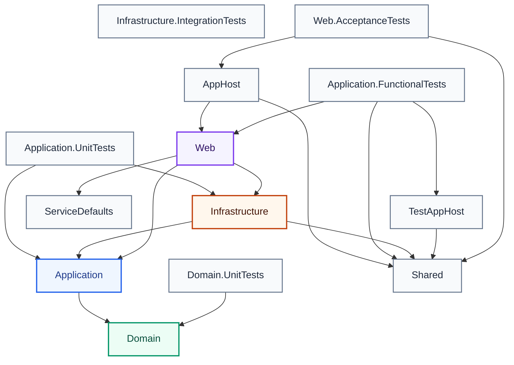
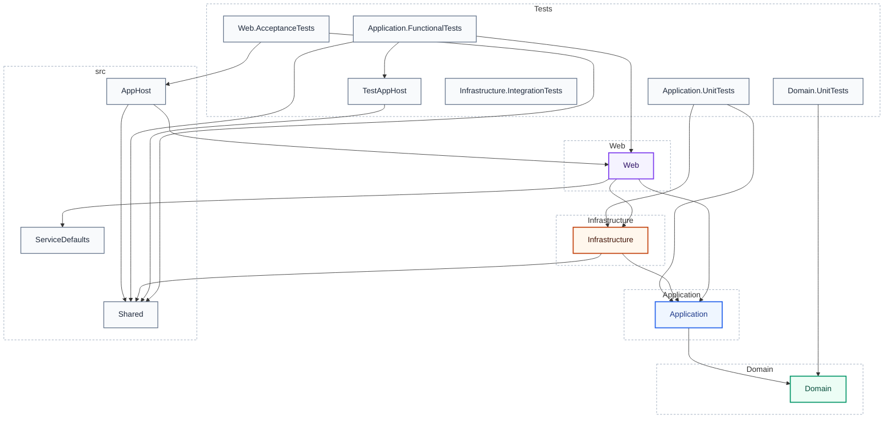
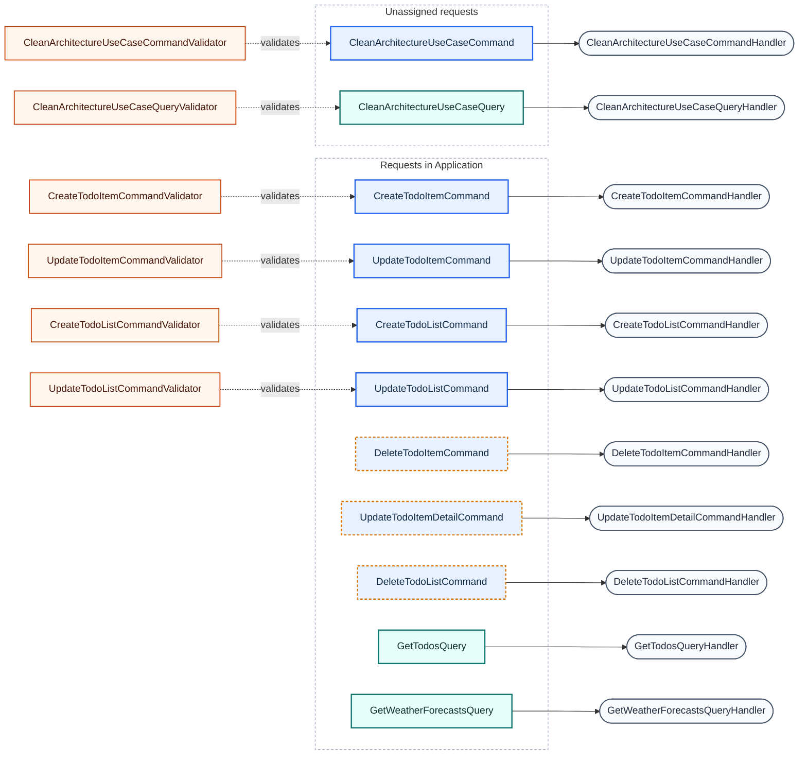

# Architecture Report

Generated by **CqrsLens 0.6.0** on 2026-10-25 18:33:20 UTC · text scanner · Source: `jasontaylor`

```text
╔═════════════════════════════════════════════════════════════════════════╗
║    ███  ███   ████  ███  █   █     █████  ███  █   █ █      ███  ████   ║
║      █ █   █ █     █   █ ██  █       █   █   █  █ █  █     █   █ █   █  ║
║      █ █████  ███  █   █ █ █ █       █   █████   █   █     █   █ ████   ║
║  █   █ █   █     █ █   █ █  ██       █   █   █   █   █     █   █ █  █   ║
║   ███  █   █ ████   ███  █   █       █   █   █   █   █████  ███  █   █  ║
║                                                                         ║
║         ████ █     █████  ███  █   █      ███  ████   ████ █   █        ║
║        █     █     █     █   █ ██  █     █   █ █   █ █     █   █        ║
║        █     █     ████  █████ █ █ █     █████ ████  █     █████        ║
║        █     █     █     █   █ █  ██     █   █ █  █  █     █   █        ║
║         ████ █████ █████ █   █ █   █     █   █ █   █  ████ █   █        ║
╟─────────────────────────────────────────────────────────────────────────╢
║                 ◈ WATERMARK · JASON TAYLOR CLEAN ARCH ◈                 ║
╚═════════════════════════════════════════════════════════════════════════╝
```

## Overview

| Metric | Count |
| --- | ---: |
| Projects | 13 |
| Requests (commands + queries) | 11 |
| Handlers | 11 |
| Validators | 6 |
| Pipeline behaviors | 4 |
| DbContexts | 1 |

## Project Dependency Graph



**Layer colors:** green = Domain · blue = Application · amber = Infrastructure · purple = Api/Web/UI · gray = Tests/other.

## Layers



_Dashed boundaries group projects into layers. Projects are grouped by Clean Architecture naming convention (Domain / Application / Infrastructure / Api / Web / UI); projects matching no convention are grouped by their top-level folder._

## CQRS Map

**Legend:** blue = command · teal = query · violet = other request · gray stadium = handler · amber = validator. Amber dashed request = `CommandWithoutValidator` finding.

_Requests are grouped by declaring project. Handler and validator nodes are shown where linked and may be declared in a different project._



_11 requests · 11 handlers · 6 validators · 3 CommandWithoutValidator findings_

### Requests

| Request | Type | Response | Handler | Validators | Project |
| --- | --- | --- | --- | --- | --- |
| CleanArchitectureUseCaseCommand | Command | TReturnType | CleanArchitectureUseCaseCommandHandler | CleanArchitectureUseCaseCommandValidator | — |
| CleanArchitectureUseCaseQuery | Query | TReturnType | CleanArchitectureUseCaseQueryHandler | CleanArchitectureUseCaseQueryValidator | — |
| CreateTodoItemCommand | Command | int | CreateTodoItemCommandHandler | CreateTodoItemCommandValidator | Application |
| CreateTodoListCommand | Command | int | CreateTodoListCommandHandler | CreateTodoListCommandValidator | Application |
| DeleteTodoItemCommand | Command | — | DeleteTodoItemCommandHandler | — | Application |
| DeleteTodoListCommand | Command | — | DeleteTodoListCommandHandler | — | Application |
| GetTodosQuery | Query | TodosVm | GetTodosQueryHandler | — | Application |
| GetWeatherForecastsQuery | Query | IEnumerable&lt;WeatherForecast&gt; | GetWeatherForecastsQueryHandler | — | Application |
| UpdateTodoItemCommand | Command | — | UpdateTodoItemCommandHandler | UpdateTodoItemCommandValidator | Application |
| UpdateTodoItemDetailCommand | Command | — | UpdateTodoItemDetailCommandHandler | — | Application |
| UpdateTodoListCommand | Command | — | UpdateTodoListCommandHandler | UpdateTodoListCommandValidator | Application |

## Pipeline Behaviors

- `AuthorizationBehaviour` — Application
- `PerformanceBehaviour` — Application
- `UnhandledExceptionBehaviour` — Application
- `ValidationBehaviour` — Application

## Data Access (DbContexts)

| DbContext | Project | DbSets (property → entity) |
| --- | --- | --- |
| ApplicationDbContext | Infrastructure | TodoLists → TodoList, TodoItems → TodoItem |

### ApplicationDbContext ER Diagram

```mermaid
erDiagram
    accTitle: ApplicationDbContext ER diagram
    accDescr: 2 entities, 1 relationship.
    ent_TodoItem["TodoItem"] {
        int Id PK
        DateTimeOffset Created
        string? CreatedBy
        DateTimeOffset LastModified
        string? LastModifiedBy
        int ListId FK
        string? Note
        PriorityLevel Priority
        string? Title
    }
    ent_TodoList["TodoList"] {
        int Id PK
        Colour Colour
        DateTimeOffset Created
        string? CreatedBy
        DateTimeOffset LastModified
        string? LastModifiedBy
        string? Title
    }
    ent_TodoList ||--o{ ent_TodoItem : "Items / List"
```

## Analysis Diagnostics

No scan diagnostics.

## Architecture Checks

0 error(s), 3 warning(s):

- ⚠️ Warning **CommandWithoutValidator** — Command `CleanArchitecture.Application.TodoItems.Commands.DeleteTodoItem.DeleteTodoItemCommand` has no validator. `src/Application/TodoItems/Commands/DeleteTodoItem/DeleteTodoItem.cs:5:8`
- ⚠️ Warning **CommandWithoutValidator** — Command `CleanArchitecture.Application.TodoItems.Commands.UpdateTodoItemDetail.UpdateTodoItemDetailCommand` has no validator. `src/Application/TodoItems/Commands/UpdateTodoItemDetail/UpdateTodoItemDetail.cs:6:8`
- ⚠️ Warning **CommandWithoutValidator** — Command `CleanArchitecture.Application.TodoLists.Commands.DeleteTodoList.DeleteTodoListCommand` has no validator. `src/Application/TodoLists/Commands/DeleteTodoList/DeleteTodoList.cs:5:8`

---
_Generated by CqrsLens 0.6.0 in 295 ms — 110 files scanned._
_Report generated by [CqrsLens](https://github.com/AbdullahHakima/cqrslens) — static analysis only; the target solution was not built._
