# Architecture Report

Generated by **CqrsLens 0.6.0** on 2026-10-25 18:33:22 UTC · text scanner · Source: `src`

```text
╔═════════════════════════════════════════════════════════════════════════╗
║                █   █  ███  ████  █   █ █      ███  ████                 ║
║                ██ ██ █   █ █   █ █   █ █     █   █ █   █                ║
║                █ █ █ █   █ █   █ █   █ █     █████ ████                 ║
║                █   █ █   █ █   █ █   █ █     █   █ █  █                 ║
║                █   █  ███  ████   ███  █████ █   █ █   █                ║
║                                                                         ║
║  █   █  ███  █   █  ███  █      ███  █████ █   █     ████  ████  ████   ║
║  ██ ██ █   █ ██  █ █   █ █       █     █   █   █     █   █ █   █ █   █  ║
║  █ █ █ █   █ █ █ █ █   █ █       █     █   █████     █   █ █   █ █   █  ║
║  █   █ █   █ █  ██ █   █ █       █     █   █   █     █   █ █   █ █   █  ║
║  █   █  ███  █   █  ███  █████  ███    █   █   █     ████  ████  ████   ║
╟─────────────────────────────────────────────────────────────────────────╢
║                  ◈ WATERMARK · MODULAR MONOLITH DDD ◈                   ║
╚═════════════════════════════════════════════════════════════════════════╝
```

## Overview

| Metric | Count |
| --- | ---: |
| Projects | 46 |
| Requests (commands + queries) | 105 |
| Handlers | 105 |
| Validators | 5 |
| Pipeline behaviors | 0 |
| DbContexts | 4 |

## Project Dependency Graph


**Layer colors:** green = Domain · blue = Application · amber = Infrastructure · purple = Api/Web/UI · gray = Tests/other.

## Layers

```mermaid
flowchart TD
    accTitle: Layer diagram
    accDescr: 46 projects, 7 layers, 15 references.
    subgraph lyr_Api["Api"]
        prj_CompanyName_MyMeetings_API["CompanyName.MyMeetings.API"]:::clsLayerApi
    end
    subgraph lyr_Application["Application"]
        prj_CompanyName_MyMeetings_BuildingBlocks_Application["CompanyName.MyMeetings.BuildingBlocks.Application"]:::clsLayerApplication
        prj_CompanyName_MyMeetings_Modules_Administration_Application["CompanyName.MyMeetings.Modules.Administration.Application"]:::clsLayerApplication
        prj_CompanyName_MyMeetings_Modules_Meetings_Application["CompanyName.MyMeetings.Modules.Meetings.Application"]:::clsLayerApplication
        prj_CompanyName_MyMeetings_Modules_Payments_Application["CompanyName.MyMeetings.Modules.Payments.Application"]:::clsLayerApplication
        prj_CompanyName_MyMeetings_Modules_Registrations_Application["CompanyName.MyMeetings.Modules.Registrations.Application"]:::clsLayerApplication
        prj_CompanyName_MyMeetings_Modules_UserAccess_Application["CompanyName.MyMeetings.Modules.UserAccess.Application"]:::clsLayerApplication
    end
    subgraph lyr_Infrastructure["Infrastructure"]
        prj_CompanyName_MyMeetings_BuildingBlocks_Infrastructure["CompanyName.MyMeetings.BuildingBlocks.Infrastructure"]:::clsLayerInfrastructure
        prj_CompanyName_MyMeetings_Modules_Administration_Infrastructure["CompanyName.MyMeetings.Modules.Administration.Infrastructure"]:::clsLayerInfrastructure
        prj_CompanyName_MyMeetings_Modules_Meetings_Infrastructure["CompanyName.MyMeetings.Modules.Meetings.Infrastructure"]:::clsLayerInfrastructure
        prj_CompanyName_MyMeetings_Modules_Payments_Infrastructure["CompanyName.MyMeetings.Modules.Payments.Infrastructure"]:::clsLayerInfrastructure
        prj_CompanyName_MyMeetings_Modules_Registrations_Infrastructure["CompanyName.MyMeetings.Modules.Registrations.Infrastructure"]:::clsLayerInfrastructure
        prj_CompanyName_MyMeetings_Modules_UserAccess_Infrastructure["CompanyName.MyMeetings.Modules.UserAccess.Infrastructure"]:::clsLayerInfrastructure
    end
    subgraph lyr_Domain["Domain"]
        prj_CompanyName_MyMeetings_BuildingBlocks_Domain["CompanyName.MyMeetings.BuildingBlocks.Domain"]:::clsLayerDomain
        prj_CompanyName_MyMeetings_Modules_Administration_Domain["CompanyName.MyMeetings.Modules.Administration.Domain"]:::clsLayerDomain
        prj_CompanyName_MyMeetings_Modules_Meetings_Domain["CompanyName.MyMeetings.Modules.Meetings.Domain"]:::clsLayerDomain
        prj_CompanyName_MyMeetings_Modules_Payments_Domain["CompanyName.MyMeetings.Modules.Payments.Domain"]:::clsLayerDomain
        prj_CompanyName_MyMeetings_Modules_Registrations_Domain["CompanyName.MyMeetings.Modules.Registrations.Domain"]:::clsLayerDomain
        prj_CompanyName_MyMeetings_Modules_UserAccess_Domain["CompanyName.MyMeetings.Modules.UserAccess.Domain"]:::clsLayerDomain
    end
    subgraph lyr_Tests["Tests"]
        prj_CompanyName_MyMeetings_ArchTests["CompanyName.MyMeetings.ArchTests"]:::clsLayerTests
        prj_CompanyName_MyMeetings_BuildingBlocks_Application_UnitTests["CompanyName.MyMeetings.BuildingBlocks.Application.UnitTests"]:::clsLayerTests
        prj_CompanyName_MyMeetings_BuildingBlocks_IntegrationTests["CompanyName.MyMeetings.BuildingBlocks.IntegrationTests"]:::clsLayerTests
        prj_CompanyName_MyMeetings_IntegrationTests["CompanyName.MyMeetings.IntegrationTests"]:::clsLayerTests
        prj_CompanyName_MyMeetings_Modules_Administration_ArchTests["CompanyName.MyMeetings.Modules.Administration.ArchTests"]:::clsLayerTests
        prj_CompanyName_MyMeetings_Modules_Administration_Domain_UnitTests["CompanyName.MyMeetings.Modules.Administration.Domain.UnitTests"]:::clsLayerTests
        prj_CompanyName_MyMeetings_Modules_Administration_IntegrationTests["CompanyName.MyMeetings.Modules.Administration.IntegrationTests"]:::clsLayerTests
        prj_CompanyName_MyMeetings_Modules_Meetings_ArchTests["CompanyName.MyMeetings.Modules.Meetings.ArchTests"]:::clsLayerTests
        prj_CompanyName_MyMeetings_Modules_Meetings_Domain_UnitTests["CompanyName.MyMeetings.Modules.Meetings.Domain.UnitTests"]:::clsLayerTests
        prj_CompanyName_MyMeetings_Modules_Meetings_IntegrationTests["CompanyName.MyMeetings.Modules.Meetings.IntegrationTests"]:::clsLayerTests
        prj_CompanyName_MyMeetings_Modules_Payments_ArchTests["CompanyName.MyMeetings.Modules.Payments.ArchTests"]:::clsLayerTests
        prj_CompanyName_MyMeetings_Modules_Payments_Domain_UnitTests["CompanyName.MyMeetings.Modules.Payments.Domain.UnitTests"]:::clsLayerTests
        prj_CompanyName_MyMeetings_Modules_Payments_IntegrationTests["CompanyName.MyMeetings.Modules.Payments.IntegrationTests"]:::clsLayerTests
        prj_CompanyName_MyMeetings_Modules_Registrations_ArchTests["CompanyName.MyMeetings.Modules.Registrations.ArchTests"]:::clsLayerTests
        prj_CompanyName_MyMeetings_Modules_Registrations_Domain_UnitTests["CompanyName.MyMeetings.Modules.Registrations.Domain.UnitTests"]:::clsLayerTests
        prj_CompanyName_MyMeetings_Modules_UserAccess_ArchTests["CompanyName.MyMeetings.Modules.UserAccess.ArchTests"]:::clsLayerTests
        prj_CompanyName_MyMeetings_Modules_UserAccess_Domain_UnitTests["CompanyName.MyMeetings.Modules.UserAccess.Domain.UnitTests"]:::clsLayerTests
        prj_CompanyName_MyMeetings_SUT["CompanyName.MyMeetings.SUT"]:::clsLayerTests
        prj_CompanyNames_MyMeetings_Modules_Registrations_IntegrationTests["CompanyNames.MyMeetings.Modules.Registrations.IntegrationTests"]:::clsLayerTests
        prj_CompanyNames_MyMeetings_Modules_UserAccess_IntegrationTests["CompanyNames.MyMeetings.Modules.UserAccess.IntegrationTests"]:::clsLayerTests
    end
    subgraph lyr_Database["Database"]
        prj_CompanyName_MyMeetings_Database_Build["CompanyName.MyMeetings.Database.Build"]:::clsLayerOther
        prj_DatabaseMigrator["DatabaseMigrator"]:::clsLayerOther
    end
    subgraph lyr_Modules["Modules"]
        prj_CompanyName_MyMeetings_Modules_Administration_IntegrationEvents["CompanyName.MyMeetings.Modules.Administration.IntegrationEvents"]:::clsLayerOther
        prj_CompanyName_MyMeetings_Modules_Meetings_IntegrationEvents["CompanyName.MyMeetings.Modules.Meetings.IntegrationEvents"]:::clsLayerOther
        prj_CompanyName_MyMeetings_Modules_Payments_IntegrationEvents["CompanyName.MyMeetings.Modules.Payments.IntegrationEvents"]:::clsLayerOther
        prj_CompanyName_MyMeetings_Modules_Registrations_IntegrationEvents["CompanyName.MyMeetings.Modules.Registrations.IntegrationEvents"]:::clsLayerOther
        prj_CompanyName_MyMeetings_Modules_UserAccess_IntegrationEvents["CompanyName.MyMeetings.Modules.UserAccess.IntegrationEvents"]:::clsLayerOther
    end
    prj_CompanyName_MyMeetings_Modules_Administration_Application --> prj_CompanyName_MyMeetings_Modules_Meetings_IntegrationEvents
    prj_CompanyName_MyMeetings_Modules_Administration_Application --> prj_CompanyName_MyMeetings_Modules_Registrations_IntegrationEvents
    prj_CompanyName_MyMeetings_Modules_Administration_Application --> prj_CompanyName_MyMeetings_Modules_UserAccess_IntegrationEvents
    prj_CompanyName_MyMeetings_Modules_Meetings_Application --> prj_CompanyName_MyMeetings_Modules_Administration_IntegrationEvents
    prj_CompanyName_MyMeetings_Modules_Meetings_Application --> prj_CompanyName_MyMeetings_Modules_Payments_IntegrationEvents
    prj_CompanyName_MyMeetings_Modules_Meetings_Application --> prj_CompanyName_MyMeetings_Modules_Registrations_IntegrationEvents
    prj_CompanyName_MyMeetings_Modules_Meetings_Application --> prj_CompanyName_MyMeetings_Modules_UserAccess_IntegrationEvents
    prj_CompanyName_MyMeetings_Modules_Payments_Application --> prj_CompanyName_MyMeetings_Modules_Administration_IntegrationEvents
    prj_CompanyName_MyMeetings_Modules_Payments_Application --> prj_CompanyName_MyMeetings_Modules_Meetings_IntegrationEvents
    prj_CompanyName_MyMeetings_Modules_Payments_Application --> prj_CompanyName_MyMeetings_Modules_Registrations_IntegrationEvents
    prj_CompanyName_MyMeetings_Modules_Payments_Application --> prj_CompanyName_MyMeetings_Modules_UserAccess_IntegrationEvents
    prj_CompanyName_MyMeetings_Modules_Registrations_Application --> prj_CompanyName_MyMeetings_BuildingBlocks_Application
    prj_CompanyName_MyMeetings_Modules_Registrations_Infrastructure --> prj_CompanyName_MyMeetings_Modules_UserAccess_Application
    prj_CompanyName_MyMeetings_Modules_Registrations_Infrastructure --> prj_CompanyName_MyMeetings_Modules_UserAccess_Infrastructure
    prj_CompanyName_MyMeetings_Modules_UserAccess_Application --> prj_CompanyName_MyMeetings_Modules_Meetings_IntegrationEvents
    style lyr_Api fill:none,stroke:#94a3b8,stroke-dasharray:4 3
    style lyr_Application fill:none,stroke:#94a3b8,stroke-dasharray:4 3
    style lyr_Infrastructure fill:none,stroke:#94a3b8,stroke-dasharray:4 3
    style lyr_Domain fill:none,stroke:#94a3b8,stroke-dasharray:4 3
    style lyr_Tests fill:none,stroke:#94a3b8,stroke-dasharray:4 3
    style lyr_Database fill:none,stroke:#94a3b8,stroke-dasharray:4 3
    style lyr_Modules fill:none,stroke:#94a3b8,stroke-dasharray:4 3
    classDef clsLayerDomain fill:#ecfdf5,stroke:#059669,stroke-width:2px,color:#064e3b
    classDef clsLayerApplication fill:#eff6ff,stroke:#2563eb,stroke-width:2px,color:#1e3a8a
    classDef clsLayerInfrastructure fill:#fff7ed,stroke:#c2410c,stroke-width:2px,color:#431407
    classDef clsLayerApi fill:#f5f3ff,stroke:#7c3aed,stroke-width:2px,color:#2e1065
    classDef clsLayerTests fill:#f8fafc,stroke:#64748b,stroke-width:1.5px,color:#1e293b
    classDef clsLayerOther fill:#f8fafc,stroke:#64748b,stroke-width:1.5px,color:#1e293b
```

_Dashed boundaries group projects into layers. Projects are grouped by Clean Architecture naming convention (Domain / Application / Infrastructure / Api / Web / UI); projects matching no convention are grouped by their top-level folder._

## CQRS Map

**Legend:** blue = command · teal = query · violet = other request · gray stadium = handler · amber = validator. Amber dashed request = `CommandWithoutValidator` finding.

_Requests are grouped by declaring project. Handler and validator nodes are shown where linked and may be declared in a different project._

_105 requests across 10 projects. Diagrams are split by project and balanced so each stays within GitHub's rendering limits; every request appears exactly once._

### CompanyName.MyMeetings.Modules.Administration.Application — 6 requests

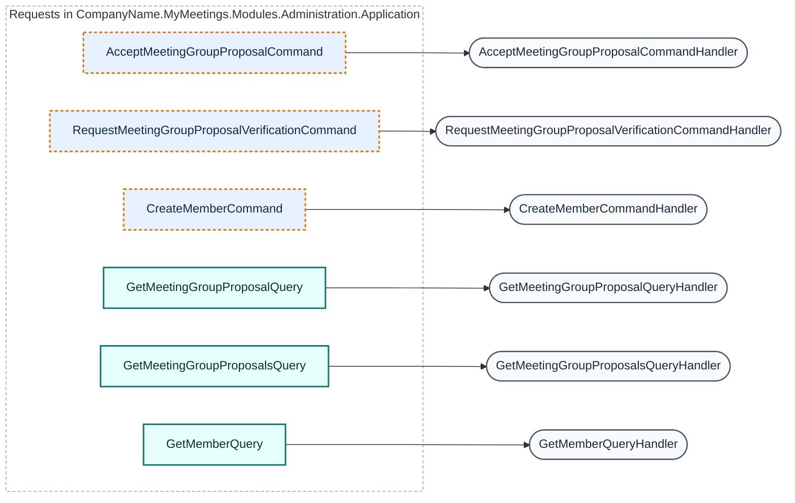

_6 requests · 6 handlers · 0 validators · 3 CommandWithoutValidator findings_

### CompanyName.MyMeetings.Modules.Administration.Infrastructure — 3 requests

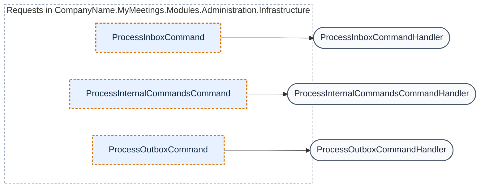

_3 requests · 3 handlers · 0 validators · 3 CommandWithoutValidator findings_

### CompanyName.MyMeetings.Modules.Meetings.Application — 15 of 44 requests (part 1 of 3)

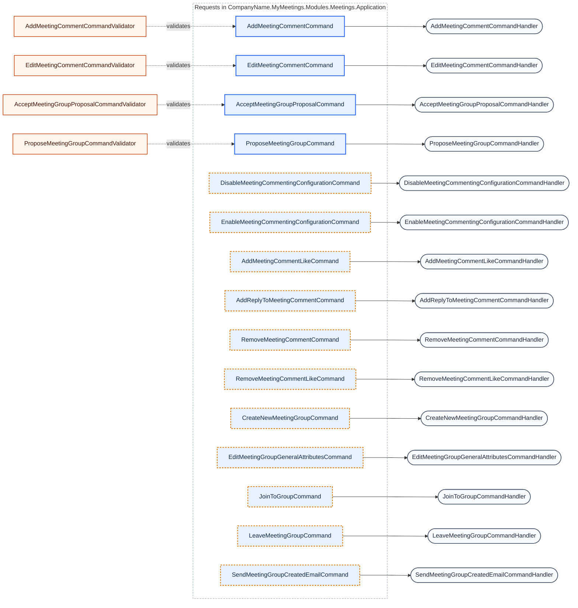

_15 requests · 15 handlers · 4 validators · 11 CommandWithoutValidator findings_

### CompanyName.MyMeetings.Modules.Meetings.Application — 15 of 44 requests (part 2 of 3)

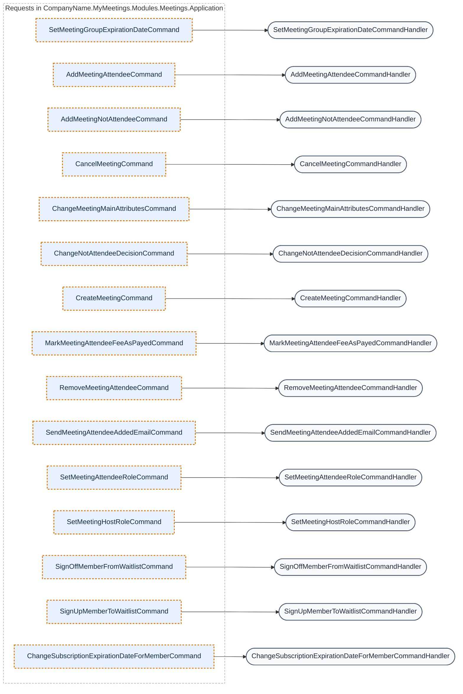

_15 requests · 15 handlers · 0 validators · 15 CommandWithoutValidator findings_

### CompanyName.MyMeetings.Modules.Meetings.Application — 14 of 44 requests (part 3 of 3)

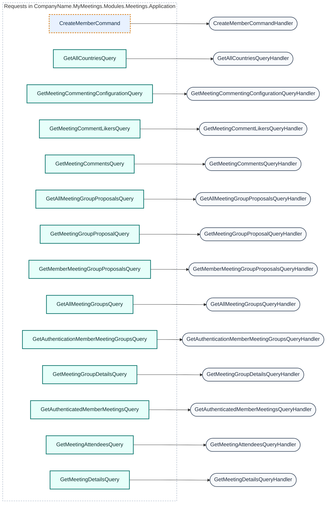

_14 requests · 14 handlers · 0 validators · 1 CommandWithoutValidator finding_

### CompanyName.MyMeetings.Modules.Meetings.Infrastructure — 3 requests

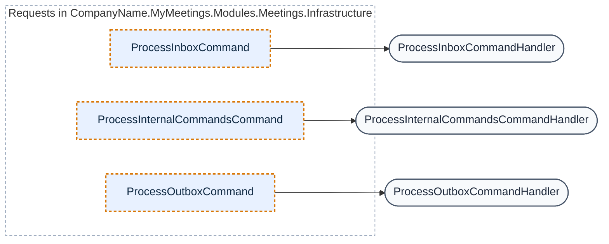

_3 requests · 3 handlers · 0 validators · 3 CommandWithoutValidator findings_

### CompanyName.MyMeetings.Modules.Payments.Application — 14 of 28 requests (part 1 of 2)

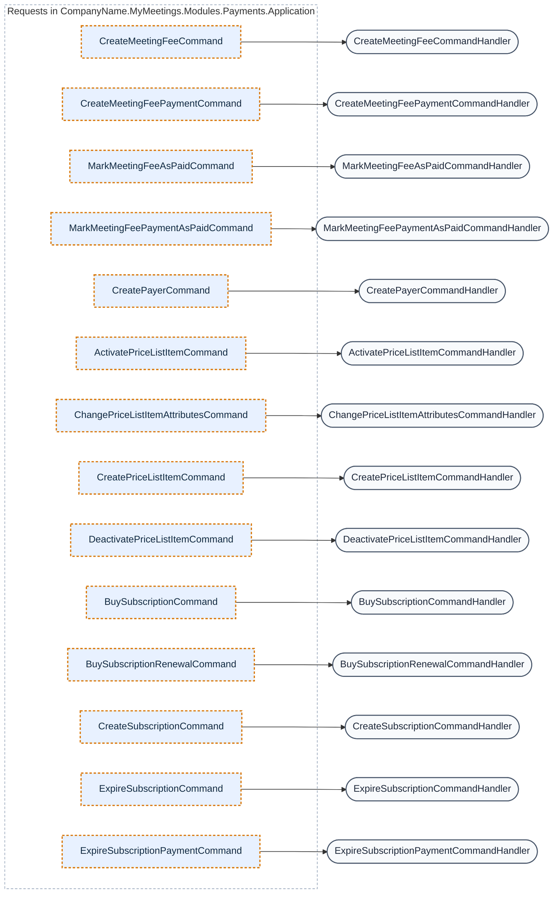

_14 requests · 14 handlers · 0 validators · 14 CommandWithoutValidator findings_

### CompanyName.MyMeetings.Modules.Payments.Application — 14 of 28 requests (part 2 of 2)

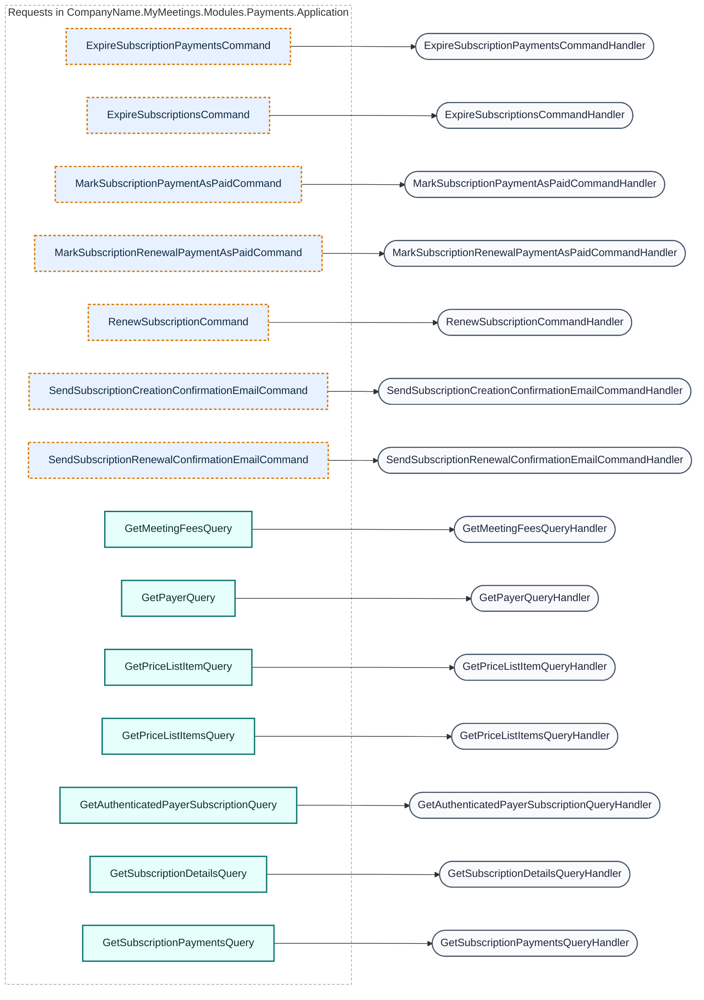

_14 requests · 14 handlers · 0 validators · 7 CommandWithoutValidator findings_

### CompanyName.MyMeetings.Modules.Payments.Infrastructure — 3 requests

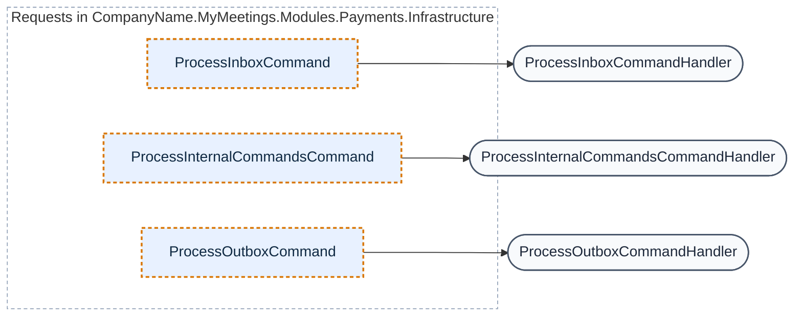

_3 requests · 3 handlers · 0 validators · 3 CommandWithoutValidator findings_

### CompanyName.MyMeetings.Modules.Registrations.Application — 4 requests

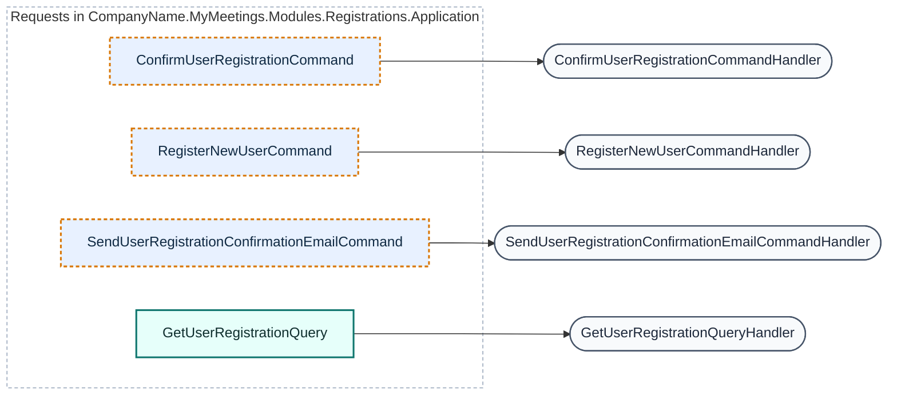

_4 requests · 4 handlers · 0 validators · 3 CommandWithoutValidator findings_

### CompanyName.MyMeetings.Modules.Registrations.Infrastructure — 3 requests

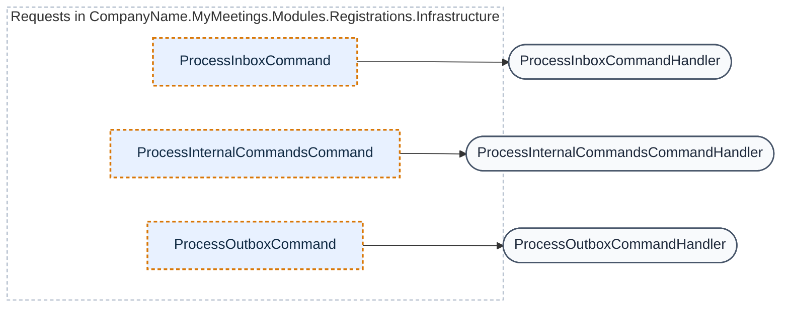

_3 requests · 3 handlers · 0 validators · 3 CommandWithoutValidator findings_

### CompanyName.MyMeetings.Modules.UserAccess.Application — 8 requests

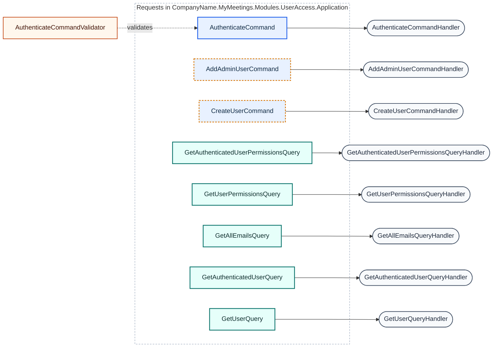

_8 requests · 8 handlers · 1 validator · 2 CommandWithoutValidator findings_

### CompanyName.MyMeetings.Modules.UserAccess.Infrastructure — 3 requests

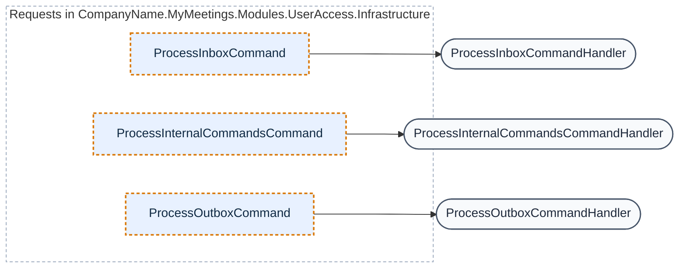

_3 requests · 3 handlers · 0 validators · 3 CommandWithoutValidator findings_

### Requests

| Request | Type | Response | Handler | Validators | Project |
| --- | --- | --- | --- | --- | --- |
| AcceptMeetingGroupProposalCommand | Command | — | AcceptMeetingGroupProposalCommandHandler | — | CompanyName.MyMeetings.Modules.Administration.Application |
| AcceptMeetingGroupProposalCommand | Command | — | AcceptMeetingGroupProposalCommandHandler | AcceptMeetingGroupProposalCommandValidator | CompanyName.MyMeetings.Modules.Meetings.Application |
| ActivatePriceListItemCommand | Command | — | ActivatePriceListItemCommandHandler | — | CompanyName.MyMeetings.Modules.Payments.Application |
| AddAdminUserCommand | Command | — | AddAdminUserCommandHandler | — | CompanyName.MyMeetings.Modules.UserAccess.Application |
| AddMeetingAttendeeCommand | Command | — | AddMeetingAttendeeCommandHandler | — | CompanyName.MyMeetings.Modules.Meetings.Application |
| AddMeetingCommentCommand | Command | Guid | AddMeetingCommentCommandHandler | AddMeetingCommentCommandValidator | CompanyName.MyMeetings.Modules.Meetings.Application |
| AddMeetingCommentLikeCommand | Command | — | AddMeetingCommentLikeCommandHandler | — | CompanyName.MyMeetings.Modules.Meetings.Application |
| AddMeetingNotAttendeeCommand | Command | — | AddMeetingNotAttendeeCommandHandler | — | CompanyName.MyMeetings.Modules.Meetings.Application |
| AddReplyToMeetingCommentCommand | Command | Guid | AddReplyToMeetingCommentCommandHandler | — | CompanyName.MyMeetings.Modules.Meetings.Application |
| AuthenticateCommand | Command | AuthenticationResult | AuthenticateCommandHandler | AuthenticateCommandValidator | CompanyName.MyMeetings.Modules.UserAccess.Application |
| BuySubscriptionCommand | Command | Guid | BuySubscriptionCommandHandler | — | CompanyName.MyMeetings.Modules.Payments.Application |
| BuySubscriptionRenewalCommand | Command | Guid | BuySubscriptionRenewalCommandHandler | — | CompanyName.MyMeetings.Modules.Payments.Application |
| CancelMeetingCommand | Command | — | CancelMeetingCommandHandler | — | CompanyName.MyMeetings.Modules.Meetings.Application |
| ChangeMeetingMainAttributesCommand | Command | — | ChangeMeetingMainAttributesCommandHandler | — | CompanyName.MyMeetings.Modules.Meetings.Application |
| ChangeNotAttendeeDecisionCommand | Command | — | ChangeNotAttendeeDecisionCommandHandler | — | CompanyName.MyMeetings.Modules.Meetings.Application |
| ChangePriceListItemAttributesCommand | Command | — | ChangePriceListItemAttributesCommandHandler | — | CompanyName.MyMeetings.Modules.Payments.Application |
| ChangeSubscriptionExpirationDateForMemberCommand | Command | — | ChangeSubscriptionExpirationDateForMemberCommandHandler | — | CompanyName.MyMeetings.Modules.Meetings.Application |
| ConfirmUserRegistrationCommand | Command | — | ConfirmUserRegistrationCommandHandler | — | CompanyName.MyMeetings.Modules.Registrations.Application |
| CreateMeetingCommand | Command | Guid | CreateMeetingCommandHandler | — | CompanyName.MyMeetings.Modules.Meetings.Application |
| CreateMeetingFeeCommand | Command | Guid | CreateMeetingFeeCommandHandler | — | CompanyName.MyMeetings.Modules.Payments.Application |
| CreateMeetingFeePaymentCommand | Command | Guid | CreateMeetingFeePaymentCommandHandler | — | CompanyName.MyMeetings.Modules.Payments.Application |
| CreateMemberCommand | Command | Guid | CreateMemberCommandHandler | — | CompanyName.MyMeetings.Modules.Administration.Application |
| CreateMemberCommand | Command | — | CreateMemberCommandHandler | — | CompanyName.MyMeetings.Modules.Meetings.Application |
| CreateNewMeetingGroupCommand | Command | — | CreateNewMeetingGroupCommandHandler | — | CompanyName.MyMeetings.Modules.Meetings.Application |
| CreatePayerCommand | Command | Guid | CreatePayerCommandHandler | — | CompanyName.MyMeetings.Modules.Payments.Application |
| CreatePriceListItemCommand | Command | Guid | CreatePriceListItemCommandHandler | — | CompanyName.MyMeetings.Modules.Payments.Application |
| CreateSubscriptionCommand | Command | Guid | CreateSubscriptionCommandHandler | — | CompanyName.MyMeetings.Modules.Payments.Application |
| CreateUserCommand | Command | — | CreateUserCommandHandler | — | CompanyName.MyMeetings.Modules.UserAccess.Application |
| DeactivatePriceListItemCommand | Command | — | DeactivatePriceListItemCommandHandler | — | CompanyName.MyMeetings.Modules.Payments.Application |
| DisableMeetingCommentingConfigurationCommand | Command | — | DisableMeetingCommentingConfigurationCommandHandler | — | CompanyName.MyMeetings.Modules.Meetings.Application |
| EditMeetingCommentCommand | Command | — | EditMeetingCommentCommandHandler | EditMeetingCommentCommandValidator | CompanyName.MyMeetings.Modules.Meetings.Application |
| EditMeetingGroupGeneralAttributesCommand | Command | — | EditMeetingGroupGeneralAttributesCommandHandler | — | CompanyName.MyMeetings.Modules.Meetings.Application |
| EnableMeetingCommentingConfigurationCommand | Command | — | EnableMeetingCommentingConfigurationCommandHandler | — | CompanyName.MyMeetings.Modules.Meetings.Application |
| ExpireSubscriptionCommand | Command | — | ExpireSubscriptionCommandHandler | — | CompanyName.MyMeetings.Modules.Payments.Application |
| ExpireSubscriptionPaymentCommand | Command | — | ExpireSubscriptionPaymentCommandHandler | — | CompanyName.MyMeetings.Modules.Payments.Application |
| ExpireSubscriptionPaymentsCommand | Command | — | ExpireSubscriptionPaymentsCommandHandler | — | CompanyName.MyMeetings.Modules.Payments.Application |
| ExpireSubscriptionsCommand | Command | — | ExpireSubscriptionsCommandHandler | — | CompanyName.MyMeetings.Modules.Payments.Application |
| GetAllCountriesQuery | Query | List&lt;CountryDto&gt; | GetAllCountriesQueryHandler | — | CompanyName.MyMeetings.Modules.Meetings.Application |
| GetAllEmailsQuery | Query | List&lt;EmailDto&gt; | GetAllEmailsQueryHandler | — | CompanyName.MyMeetings.Modules.UserAccess.Application |
| GetAllMeetingGroupProposalsQuery | Query | List&lt;MeetingGroupProposalDto&gt; | GetAllMeetingGroupProposalsQueryHandler | — | CompanyName.MyMeetings.Modules.Meetings.Application |
| GetAllMeetingGroupsQuery | Query | List&lt;MeetingGroupDto&gt; | GetAllMeetingGroupsQueryHandler | — | CompanyName.MyMeetings.Modules.Meetings.Application |
| GetAuthenticatedMemberMeetingsQuery | Query | List&lt;MemberMeetingDto&gt; | GetAuthenticatedMemberMeetingsQueryHandler | — | CompanyName.MyMeetings.Modules.Meetings.Application |
| GetAuthenticatedPayerSubscriptionQuery | Query | SubscriptionDetailsDto | GetAuthenticatedPayerSubscriptionQueryHandler | — | CompanyName.MyMeetings.Modules.Payments.Application |
| GetAuthenticatedUserPermissionsQuery | Query | List&lt;UserPermissionDto&gt; | GetAuthenticatedUserPermissionsQueryHandler | — | CompanyName.MyMeetings.Modules.UserAccess.Application |
| GetAuthenticatedUserQuery | Query | UserDto | GetAuthenticatedUserQueryHandler | — | CompanyName.MyMeetings.Modules.UserAccess.Application |
| GetAuthenticationMemberMeetingGroupsQuery | Query | List&lt;MemberMeetingGroupDto&gt; | GetAuthenticationMemberMeetingGroupsQueryHandler | — | CompanyName.MyMeetings.Modules.Meetings.Application |
| GetMeetingAttendeesQuery | Query | List&lt;MeetingAttendeeDto&gt; | GetMeetingAttendeesQueryHandler | — | CompanyName.MyMeetings.Modules.Meetings.Application |
| GetMeetingCommentingConfigurationQuery | Query | MeetingCommentingConfigurationDto | GetMeetingCommentingConfigurationQueryHandler | — | CompanyName.MyMeetings.Modules.Meetings.Application |
| GetMeetingCommentLikersQuery | Query | List&lt;MeetingCommentLikerDto&gt; | GetMeetingCommentLikersQueryHandler | — | CompanyName.MyMeetings.Modules.Meetings.Application |
| GetMeetingCommentsQuery | Query | List&lt;MeetingCommentDto&gt; | GetMeetingCommentsQueryHandler | — | CompanyName.MyMeetings.Modules.Meetings.Application |
| GetMeetingDetailsQuery | Query | MeetingDetailsDto | GetMeetingDetailsQueryHandler | — | CompanyName.MyMeetings.Modules.Meetings.Application |
| GetMeetingFeesQuery | Query | List&lt;MeetingFeeDto&gt; | GetMeetingFeesQueryHandler | — | CompanyName.MyMeetings.Modules.Payments.Application |
| GetMeetingGroupDetailsQuery | Query | MeetingGroupDetailsDto | GetMeetingGroupDetailsQueryHandler | — | CompanyName.MyMeetings.Modules.Meetings.Application |
| GetMeetingGroupProposalQuery | Query | MeetingGroupProposalDto | GetMeetingGroupProposalQueryHandler | — | CompanyName.MyMeetings.Modules.Administration.Application |
| GetMeetingGroupProposalQuery | Query | MeetingGroupProposalDto | GetMeetingGroupProposalQueryHandler | — | CompanyName.MyMeetings.Modules.Meetings.Application |
| GetMeetingGroupProposalsQuery | Query | List&lt;MeetingGroupProposalDto&gt; | GetMeetingGroupProposalsQueryHandler | — | CompanyName.MyMeetings.Modules.Administration.Application |
| GetMemberMeetingGroupProposalsQuery | Query | List&lt;MeetingGroupProposalDto&gt; | GetMemberMeetingGroupProposalsQueryHandler | — | CompanyName.MyMeetings.Modules.Meetings.Application |
| GetMemberQuery | Query | MemberDto | GetMemberQueryHandler | — | CompanyName.MyMeetings.Modules.Administration.Application |
| GetPayerQuery | Query | PayerDto | GetPayerQueryHandler | — | CompanyName.MyMeetings.Modules.Payments.Application |
| GetPriceListItemQuery | Query | PriceListItemMoneyValueDto | GetPriceListItemQueryHandler | — | CompanyName.MyMeetings.Modules.Payments.Application |
| GetPriceListItemsQuery | Query | List&lt;PriceListItemDto&gt; | GetPriceListItemsQueryHandler | — | CompanyName.MyMeetings.Modules.Payments.Application |
| GetSubscriptionDetailsQuery | Query | SubscriptionDetailsDto | GetSubscriptionDetailsQueryHandler | — | CompanyName.MyMeetings.Modules.Payments.Application |
| GetSubscriptionPaymentsQuery | Query | List&lt;SubscriptionPaymentDto&gt; | GetSubscriptionPaymentsQueryHandler | — | CompanyName.MyMeetings.Modules.Payments.Application |
| GetUserPermissionsQuery | Query | List&lt;UserPermissionDto&gt; | GetUserPermissionsQueryHandler | — | CompanyName.MyMeetings.Modules.UserAccess.Application |
| GetUserQuery | Query | UserDto | GetUserQueryHandler | — | CompanyName.MyMeetings.Modules.UserAccess.Application |
| GetUserRegistrationQuery | Query | UserRegistrationDto | GetUserRegistrationQueryHandler | — | CompanyName.MyMeetings.Modules.Registrations.Application |
| JoinToGroupCommand | Command | — | JoinToGroupCommandHandler | — | CompanyName.MyMeetings.Modules.Meetings.Application |
| LeaveMeetingGroupCommand | Command | — | LeaveMeetingGroupCommandHandler | — | CompanyName.MyMeetings.Modules.Meetings.Application |
| MarkMeetingAttendeeFeeAsPayedCommand | Command | — | MarkMeetingAttendeeFeeAsPayedCommandHandler | — | CompanyName.MyMeetings.Modules.Meetings.Application |
| MarkMeetingFeeAsPaidCommand | Command | — | MarkMeetingFeeAsPaidCommandHandler | — | CompanyName.MyMeetings.Modules.Payments.Application |
| MarkMeetingFeePaymentAsPaidCommand | Command | — | MarkMeetingFeePaymentAsPaidCommandHandler | — | CompanyName.MyMeetings.Modules.Payments.Application |
| MarkSubscriptionPaymentAsPaidCommand | Command | — | MarkSubscriptionPaymentAsPaidCommandHandler | — | CompanyName.MyMeetings.Modules.Payments.Application |
| MarkSubscriptionRenewalPaymentAsPaidCommand | Command | — | MarkSubscriptionRenewalPaymentAsPaidCommandHandler | — | CompanyName.MyMeetings.Modules.Payments.Application |
| ProcessInboxCommand | Command | — | ProcessInboxCommandHandler | — | CompanyName.MyMeetings.Modules.Administration.Infrastructure |
| ProcessInboxCommand | Command | — | ProcessInboxCommandHandler | — | CompanyName.MyMeetings.Modules.Meetings.Infrastructure |
| ProcessInboxCommand | Command | — | ProcessInboxCommandHandler | — | CompanyName.MyMeetings.Modules.Payments.Infrastructure |
| ProcessInboxCommand | Command | — | ProcessInboxCommandHandler | — | CompanyName.MyMeetings.Modules.Registrations.Infrastructure |
| ProcessInboxCommand | Command | — | ProcessInboxCommandHandler | — | CompanyName.MyMeetings.Modules.UserAccess.Infrastructure |
| ProcessInternalCommandsCommand | Command | — | ProcessInternalCommandsCommandHandler | — | CompanyName.MyMeetings.Modules.Administration.Infrastructure |
| ProcessInternalCommandsCommand | Command | — | ProcessInternalCommandsCommandHandler | — | CompanyName.MyMeetings.Modules.Meetings.Infrastructure |
| ProcessInternalCommandsCommand | Command | — | ProcessInternalCommandsCommandHandler | — | CompanyName.MyMeetings.Modules.Payments.Infrastructure |
| ProcessInternalCommandsCommand | Command | — | ProcessInternalCommandsCommandHandler | — | CompanyName.MyMeetings.Modules.Registrations.Infrastructure |
| ProcessInternalCommandsCommand | Command | — | ProcessInternalCommandsCommandHandler | — | CompanyName.MyMeetings.Modules.UserAccess.Infrastructure |
| ProcessOutboxCommand | Command | — | ProcessOutboxCommandHandler | — | CompanyName.MyMeetings.Modules.Administration.Infrastructure |
| ProcessOutboxCommand | Command | — | ProcessOutboxCommandHandler | — | CompanyName.MyMeetings.Modules.Meetings.Infrastructure |
| ProcessOutboxCommand | Command | — | ProcessOutboxCommandHandler | — | CompanyName.MyMeetings.Modules.Payments.Infrastructure |
| ProcessOutboxCommand | Command | — | ProcessOutboxCommandHandler | — | CompanyName.MyMeetings.Modules.Registrations.Infrastructure |
| ProcessOutboxCommand | Command | — | ProcessOutboxCommandHandler | — | CompanyName.MyMeetings.Modules.UserAccess.Infrastructure |
| ProposeMeetingGroupCommand | Command | Guid | ProposeMeetingGroupCommandHandler | ProposeMeetingGroupCommandValidator | CompanyName.MyMeetings.Modules.Meetings.Application |
| RegisterNewUserCommand | Command | Guid | RegisterNewUserCommandHandler | — | CompanyName.MyMeetings.Modules.Registrations.Application |
| RemoveMeetingAttendeeCommand | Command | — | RemoveMeetingAttendeeCommandHandler | — | CompanyName.MyMeetings.Modules.Meetings.Application |
| RemoveMeetingCommentCommand | Command | — | RemoveMeetingCommentCommandHandler | — | CompanyName.MyMeetings.Modules.Meetings.Application |
| RemoveMeetingCommentLikeCommand | Command | — | RemoveMeetingCommentLikeCommandHandler | — | CompanyName.MyMeetings.Modules.Meetings.Application |
| RenewSubscriptionCommand | Command | — | RenewSubscriptionCommandHandler | — | CompanyName.MyMeetings.Modules.Payments.Application |
| RequestMeetingGroupProposalVerificationCommand | Command | Guid | RequestMeetingGroupProposalVerificationCommandHandler | — | CompanyName.MyMeetings.Modules.Administration.Application |
| SendMeetingAttendeeAddedEmailCommand | Command | — | SendMeetingAttendeeAddedEmailCommandHandler | — | CompanyName.MyMeetings.Modules.Meetings.Application |
| SendMeetingGroupCreatedEmailCommand | Command | — | SendMeetingGroupCreatedEmailCommandHandler | — | CompanyName.MyMeetings.Modules.Meetings.Application |
| SendSubscriptionCreationConfirmationEmailCommand | Command | — | SendSubscriptionCreationConfirmationEmailCommandHandler | — | CompanyName.MyMeetings.Modules.Payments.Application |
| SendSubscriptionRenewalConfirmationEmailCommand | Command | — | SendSubscriptionRenewalConfirmationEmailCommandHandler | — | CompanyName.MyMeetings.Modules.Payments.Application |
| SendUserRegistrationConfirmationEmailCommand | Command | — | SendUserRegistrationConfirmationEmailCommandHandler | — | CompanyName.MyMeetings.Modules.Registrations.Application |
| SetMeetingAttendeeRoleCommand | Command | — | SetMeetingAttendeeRoleCommandHandler | — | CompanyName.MyMeetings.Modules.Meetings.Application |
| SetMeetingGroupExpirationDateCommand | Command | — | SetMeetingGroupExpirationDateCommandHandler | — | CompanyName.MyMeetings.Modules.Meetings.Application |
| SetMeetingHostRoleCommand | Command | — | SetMeetingHostRoleCommandHandler | — | CompanyName.MyMeetings.Modules.Meetings.Application |
| SignOffMemberFromWaitlistCommand | Command | — | SignOffMemberFromWaitlistCommandHandler | — | CompanyName.MyMeetings.Modules.Meetings.Application |
| SignUpMemberToWaitlistCommand | Command | — | SignUpMemberToWaitlistCommandHandler | — | CompanyName.MyMeetings.Modules.Meetings.Application |

## Pipeline Behaviors

_No IPipelineBehavior implementations found._

## Data Access (DbContexts)

| DbContext | Project | DbSets (property → entity) |
| --- | --- | --- |
| AdministrationContext | CompanyName.MyMeetings.Modules.Administration.Infrastructure | InternalCommands → InternalCommand, MeetingGroupProposals → MeetingGroupProposal, OutboxMessages → OutboxMessage, Members → Member |
| MeetingsContext | CompanyName.MyMeetings.Modules.Meetings.Infrastructure | MeetingGroups → MeetingGroup, Meetings → Meeting, MeetingGroupProposals → MeetingGroupProposal, OutboxMessages → OutboxMessage, InternalCommands → InternalCommand, Members → Member, MemberSubscriptions → MemberSubscription, MeetingComments → MeetingComment, MeetingCommentingConfigurations → MeetingCommentingConfiguration, MeetingMemberCommentLikes → MeetingMemberCommentLike |
| RegistrationsContext | CompanyName.MyMeetings.Modules.Registrations.Infrastructure | UserRegistrations → UserRegistration, OutboxMessages → OutboxMessage, InternalCommands → InternalCommand |
| UserAccessContext | CompanyName.MyMeetings.Modules.UserAccess.Infrastructure | Users → User, OutboxMessages → OutboxMessage, InternalCommands → InternalCommand |

### AdministrationContext ER Diagram

```mermaid
erDiagram
    accTitle: AdministrationContext ER diagram
    accDescr: 4 entities, 0 relationships.
    ent_OutboxMessage["OutboxMessage"] {
        Guid Id PK
        string Data
        DateTime OccurredOn
        DateTime? ProcessedDate
        string Type
    }
    ent_InternalCommand["InternalCommand"] {
        Guid Id PK
        string Data
        DateTime? ProcessedDate
        string Type
    }
    ent_MeetingGroupProposal["MeetingGroupProposal"] {
        MeetingGroupProposalId Id PK
    }
    ent_Member["Member"] {
        MemberId Id PK
    }
```

### MeetingsContext ER Diagram

```mermaid
erDiagram
    accTitle: MeetingsContext ER diagram
    accDescr: 10 entities, 3 relationships.
    ent_OutboxMessage["OutboxMessage"] {
        Guid Id PK
        string Data
        DateTime OccurredOn
        DateTime? ProcessedDate
        string Type
    }
    ent_InternalCommand["InternalCommand"] {
        Guid Id PK
        string Data
        DateTime? ProcessedDate
        string Type
    }
    ent_MeetingCommentingConfiguration["MeetingCommentingConfiguration"]
    ent_MeetingComment["MeetingComment"]
    ent_MeetingGroupProposal["MeetingGroupProposal"] {
        MeetingGroupProposalId Id PK
    }
    ent_MeetingGroup["MeetingGroup"] {
        MeetingGroupId Id PK
    }
    ent_MeetingMemberCommentLike["MeetingMemberCommentLike"]
    ent_Meeting["Meeting"] {
        MeetingId Id PK
    }
    ent_Member["Member"] {
        MemberId Id PK
    }
    ent_MemberSubscription["MemberSubscription"] {
        MemberSubscriptionId Id PK
    }
    ent_MeetingCommentingConfiguration |o--o| ent_Meeting : "_meetingId"
    ent_MeetingComment |o--o{ ent_MeetingMemberCommentLike : "_meetingCommentId"
    ent_Member |o--o{ ent_MeetingMemberCommentLike : "_memberId"
```

### RegistrationsContext ER Diagram

```mermaid
erDiagram
    accTitle: RegistrationsContext ER diagram
    accDescr: 3 entities, 0 relationships.
    ent_OutboxMessage["OutboxMessage"] {
        Guid Id PK
        string Data
        DateTime OccurredOn
        DateTime? ProcessedDate
        string Type
    }
    ent_InternalCommand["InternalCommand"] {
        Guid Id PK
        string Data
        DateTime? ProcessedDate
        string Type
    }
    ent_UserRegistration["UserRegistration"] {
        UserRegistrationId Id PK
    }
```

### UserAccessContext ER Diagram

```mermaid
erDiagram
    accTitle: UserAccessContext ER diagram
    accDescr: 3 entities, 0 relationships.
    ent_OutboxMessage["OutboxMessage"] {
        Guid Id PK
        string Data
        DateTime OccurredOn
        DateTime? ProcessedDate
        string Type
    }
    ent_InternalCommand["InternalCommand"] {
        Guid Id PK
        string Data
        DateTime? ProcessedDate
        string Type
    }
    ent_User["User"] {
        UserId Id PK
    }
```

## Analysis Diagnostics

No scan diagnostics.

## Architecture Checks

0 error(s), 71 warning(s):

- ⚠️ Warning **CommandWithoutValidator** — Command `CompanyName.MyMeetings.Modules.Administration.Application.MeetingGroupProposals.AcceptMeetingGroupProposal.AcceptMeetingGroupProposalCommand` has no validator. `Modules/Administration/Application/MeetingGroupProposals/AcceptMeetingGroupProposal/AcceptMeetingGroupProposalCommand.cs:5:12`
- ⚠️ Warning **CommandWithoutValidator** — Command `CompanyName.MyMeetings.Modules.Administration.Application.MeetingGroupProposals.RequestMeetingGroupProposalVerification.RequestMeetingGroupProposalVerificationCommand` has no validator. `Modules/Administration/Application/MeetingGroupProposals/RequestMeetingGroupProposalVerification/RequestMeetingGroupProposalVerificationCommand.cs:6:12`
- ⚠️ Warning **CommandWithoutValidator** — Command `CompanyName.MyMeetings.Modules.Administration.Application.Members.CreateMember.CreateMemberCommand` has no validator. `Modules/Administration/Application/Members/CreateMember/CreateMemberCommand.cs:6:12`
- ⚠️ Warning **CommandWithoutValidator** — Command `CompanyName.MyMeetings.Modules.Administration.Infrastructure.Configuration.Processing.Inbox.ProcessInboxCommand` has no validator. `Modules/Administration/Infrastructure/Configuration/Processing/Inbox/ProcessInboxCommand.cs:5:12`
- ⚠️ Warning **CommandWithoutValidator** — Command `CompanyName.MyMeetings.Modules.Administration.Infrastructure.Configuration.Processing.InternalCommands.ProcessInternalCommandsCommand` has no validator. `Modules/Administration/Infrastructure/Configuration/Processing/InternalCommands/ProcessInternalCommandsCommand.cs:5:14`
- ⚠️ Warning **CommandWithoutValidator** — Command `CompanyName.MyMeetings.Modules.Administration.Infrastructure.Configuration.Processing.Outbox.ProcessOutboxCommand` has no validator. `Modules/Administration/Infrastructure/Configuration/Processing/Outbox/ProcessOutboxCommand.cs:5:12`
- ⚠️ Warning **CommandWithoutValidator** — Command `CompanyName.MyMeetings.Modules.Meetings.Application.MeetingCommentingConfigurations.DisableMeetingCommentingConfiguration.DisableMeetingCommentingConfigurationCommand` has no validator. `Modules/Meetings/Application/MeetingCommentingConfigurations/DisableMeetingCommentingConfiguration/DisableMeetingCommentingConfigurationCommand.cs:5:12`
- ⚠️ Warning **CommandWithoutValidator** — Command `CompanyName.MyMeetings.Modules.Meetings.Application.MeetingCommentingConfigurations.EnableMeetingCommentingConfiguration.EnableMeetingCommentingConfigurationCommand` has no validator. `Modules/Meetings/Application/MeetingCommentingConfigurations/EnableMeetingCommentingConfiguration/EnableMeetingCommentingConfigurationCommand.cs:5:12`
- ⚠️ Warning **CommandWithoutValidator** — Command `CompanyName.MyMeetings.Modules.Meetings.Application.MeetingComments.AddMeetingCommentLike.AddMeetingCommentLikeCommand` has no validator. `Modules/Meetings/Application/MeetingComments/AddMeetingCommentLike/AddMeetingCommentLikeCommand.cs:5:12`
- ⚠️ Warning **CommandWithoutValidator** — Command `CompanyName.MyMeetings.Modules.Meetings.Application.MeetingComments.AddMeetingCommentReply.AddReplyToMeetingCommentCommand` has no validator. `Modules/Meetings/Application/MeetingComments/AddMeetingCommentReply/AddReplyToMeetingCommentCommand.cs:5:12`
- ⚠️ Warning **CommandWithoutValidator** — Command `CompanyName.MyMeetings.Modules.Meetings.Application.MeetingComments.RemoveMeetingComment.RemoveMeetingCommentCommand` has no validator. `Modules/Meetings/Application/MeetingComments/RemoveMeetingComment/RemoveMeetingCommentCommand.cs:5:12`
- ⚠️ Warning **CommandWithoutValidator** — Command `CompanyName.MyMeetings.Modules.Meetings.Application.MeetingComments.RemoveMeetingCommentLike.RemoveMeetingCommentLikeCommand` has no validator. `Modules/Meetings/Application/MeetingComments/RemoveMeetingCommentLike/RemoveMeetingCommentLikeCommand.cs:5:12`
- ⚠️ Warning **CommandWithoutValidator** — Command `CompanyName.MyMeetings.Modules.Meetings.Application.MeetingGroups.CreateNewMeetingGroup.CreateNewMeetingGroupCommand` has no validator. `Modules/Meetings/Application/MeetingGroups/CreateNewMeetingGroup/CreateNewMeetingGroupCommand.cs:7:12`
- ⚠️ Warning **CommandWithoutValidator** — Command `CompanyName.MyMeetings.Modules.Meetings.Application.MeetingGroups.EditMeetingGroupGeneralAttributes.EditMeetingGroupGeneralAttributesCommand` has no validator. `Modules/Meetings/Application/MeetingGroups/EditMeetingGroupGeneralAttributes/EditMeetingGroupGeneralAttributesCommand.cs:5:12`
- ⚠️ Warning **CommandWithoutValidator** — Command `CompanyName.MyMeetings.Modules.Meetings.Application.MeetingGroups.JoinToGroup.JoinToGroupCommand` has no validator. `Modules/Meetings/Application/MeetingGroups/JoinToGroup/JoinToGroupCommand.cs:5:12`
- ⚠️ Warning **CommandWithoutValidator** — Command `CompanyName.MyMeetings.Modules.Meetings.Application.MeetingGroups.LeaveMeetingGroup.LeaveMeetingGroupCommand` has no validator. `Modules/Meetings/Application/MeetingGroups/LeaveMeetingGroup/LeaveMeetingGroupCommand.cs:5:12`
- ⚠️ Warning **CommandWithoutValidator** — Command `CompanyName.MyMeetings.Modules.Meetings.Application.MeetingGroups.SendMeetingGroupCreatedEmail.SendMeetingGroupCreatedEmailCommand` has no validator. `Modules/Meetings/Application/MeetingGroups/SendMeetingGroupCreatedEmail/SendMeetingGroupCreatedEmailCommand.cs:8:14`
- ⚠️ Warning **CommandWithoutValidator** — Command `CompanyName.MyMeetings.Modules.Meetings.Application.MeetingGroups.SetMeetingGroupExpirationDate.SetMeetingGroupExpirationDateCommand` has no validator. `Modules/Meetings/Application/MeetingGroups/SetMeetingGroupExpirationDate/SetMeetingGroupExpirationDateCommand.cs:6:12`
- ⚠️ Warning **CommandWithoutValidator** — Command `CompanyName.MyMeetings.Modules.Meetings.Application.Meetings.AddMeetingAttendee.AddMeetingAttendeeCommand` has no validator. `Modules/Meetings/Application/Meetings/AddMeetingAttendee/AddMeetingAttendeeCommand.cs:5:12`
- ⚠️ Warning **CommandWithoutValidator** — Command `CompanyName.MyMeetings.Modules.Meetings.Application.Meetings.AddMeetingNotAttendee.AddMeetingNotAttendeeCommand` has no validator. `Modules/Meetings/Application/Meetings/AddMeetingNotAttendee/AddMeetingNotAttendeeCommand.cs:5:12`
- ⚠️ Warning **CommandWithoutValidator** — Command `CompanyName.MyMeetings.Modules.Meetings.Application.Meetings.CancelMeeting.CancelMeetingCommand` has no validator. `Modules/Meetings/Application/Meetings/CancelMeeting/CancelMeetingCommand.cs:5:12`
- ⚠️ Warning **CommandWithoutValidator** — Command `CompanyName.MyMeetings.Modules.Meetings.Application.Meetings.ChangeMeetingMainAttributes.ChangeMeetingMainAttributesCommand` has no validator. `Modules/Meetings/Application/Meetings/ChangeMeetingMainAttributes/ChangeMeetingMainAttributesCommand.cs:5:12`
- ⚠️ Warning **CommandWithoutValidator** — Command `CompanyName.MyMeetings.Modules.Meetings.Application.Meetings.ChangeNotAttendeeDecision.ChangeNotAttendeeDecisionCommand` has no validator. `Modules/Meetings/Application/Meetings/ChangeNotAttendeeDecision/ChangeNotAttendeeDecisionCommand.cs:5:12`
- ⚠️ Warning **CommandWithoutValidator** — Command `CompanyName.MyMeetings.Modules.Meetings.Application.Meetings.CreateMeeting.CreateMeetingCommand` has no validator. `Modules/Meetings/Application/Meetings/CreateMeeting/CreateMeetingCommand.cs:5:12`
- ⚠️ Warning **CommandWithoutValidator** — Command `CompanyName.MyMeetings.Modules.Meetings.Application.Meetings.MarkMeetingAttendeeFeeAsPayedCommand` has no validator. `Modules/Meetings/Application/Meetings/MarkMeetingAttendeeFeeAsPayedCommand.cs:6:12`
- ⚠️ Warning **CommandWithoutValidator** — Command `CompanyName.MyMeetings.Modules.Meetings.Application.Meetings.RemoveMeetingAttendee.RemoveMeetingAttendeeCommand` has no validator. `Modules/Meetings/Application/Meetings/RemoveMeetingAttendee/RemoveMeetingAttendeeCommand.cs:5:12`
- ⚠️ Warning **CommandWithoutValidator** — Command `CompanyName.MyMeetings.Modules.Meetings.Application.Meetings.SendMeetingAttendeeAddedEmail.SendMeetingAttendeeAddedEmailCommand` has no validator. `Modules/Meetings/Application/Meetings/SendMeetingAttendeeAddedEmail/SendMeetingAttendeeAddedEmailCommand.cs:8:14`
- ⚠️ Warning **CommandWithoutValidator** — Command `CompanyName.MyMeetings.Modules.Meetings.Application.Meetings.SetMeetingAttendeeRole.SetMeetingAttendeeRoleCommand` has no validator. `Modules/Meetings/Application/Meetings/SetMeetingAttendeeRole/SetMeetingAttendeeRoleCommand.cs:5:12`
- ⚠️ Warning **CommandWithoutValidator** — Command `CompanyName.MyMeetings.Modules.Meetings.Application.Meetings.SetMeetingHostRole.SetMeetingHostRoleCommand` has no validator. `Modules/Meetings/Application/Meetings/SetMeetingHostRole/SetMeetingHostRoleCommand.cs:5:12`
- ⚠️ Warning **CommandWithoutValidator** — Command `CompanyName.MyMeetings.Modules.Meetings.Application.Meetings.SignOffMemberFromWaitlist.SignOffMemberFromWaitlistCommand` has no validator. `Modules/Meetings/Application/Meetings/SignOffMemberFromWaitlist/SignOffMemberFromWaitlistCommand.cs:5:12`
- ⚠️ Warning **CommandWithoutValidator** — Command `CompanyName.MyMeetings.Modules.Meetings.Application.Meetings.SignUpMemberToWaitlist.SignUpMemberToWaitlistCommand` has no validator. `Modules/Meetings/Application/Meetings/SignUpMemberToWaitlist/SignUpMemberToWaitlistCommand.cs:5:12`
- ⚠️ Warning **CommandWithoutValidator** — Command `CompanyName.MyMeetings.Modules.Meetings.Application.MemberSubscriptions.ChangeSubscriptionExpirationDateForMember.ChangeSubscriptionExpirationDateForMemberCommand` has no validator. `Modules/Meetings/Application/MemberSubscriptions/ChangeSubscriptionExpirationDateForMember/ChangeSubscriptionExpirationDateForMemberCommand.cs:7:12`
- ⚠️ Warning **CommandWithoutValidator** — Command `CompanyName.MyMeetings.Modules.Meetings.Application.Members.CreateMember.CreateMemberCommand` has no validator. `Modules/Meetings/Application/Members/CreateMember/CreateMemberCommand.cs:6:12`
- ⚠️ Warning **CommandWithoutValidator** — Command `CompanyName.MyMeetings.Modules.Meetings.Infrastructure.Configuration.Processing.Inbox.ProcessInboxCommand` has no validator. `Modules/Meetings/Infrastructure/Configuration/Processing/Inbox/ProcessInboxCommand.cs:5:12`
- ⚠️ Warning **CommandWithoutValidator** — Command `CompanyName.MyMeetings.Modules.Meetings.Infrastructure.Configuration.Processing.InternalCommands.ProcessInternalCommandsCommand` has no validator. `Modules/Meetings/Infrastructure/Configuration/Processing/InternalCommands/ProcessInternalCommandsCommand.cs:5:14`
- ⚠️ Warning **CommandWithoutValidator** — Command `CompanyName.MyMeetings.Modules.Meetings.Infrastructure.Configuration.Processing.Outbox.ProcessOutboxCommand` has no validator. `Modules/Meetings/Infrastructure/Configuration/Processing/Outbox/ProcessOutboxCommand.cs:5:12`
- ⚠️ Warning **CommandWithoutValidator** — Command `CompanyName.MyMeetings.Modules.Payments.Application.MeetingFees.CreateMeetingFee.CreateMeetingFeeCommand` has no validator. `Modules/Payments/Application/MeetingFees/CreateMeetingFee/CreateMeetingFeeCommand.cs:6:12`
- ⚠️ Warning **CommandWithoutValidator** — Command `CompanyName.MyMeetings.Modules.Payments.Application.MeetingFees.CreateMeetingFeePayment.CreateMeetingFeePaymentCommand` has no validator. `Modules/Payments/Application/MeetingFees/CreateMeetingFeePayment/CreateMeetingFeePaymentCommand.cs:5:12`
- ⚠️ Warning **CommandWithoutValidator** — Command `CompanyName.MyMeetings.Modules.Payments.Application.MeetingFees.MarkMeetingFeeAsPaid.MarkMeetingFeeAsPaidCommand` has no validator. `Modules/Payments/Application/MeetingFees/MarkMeetingFeeAsPaid/MarkMeetingFeeAsPaidCommand.cs:6:12`
- ⚠️ Warning **CommandWithoutValidator** — Command `CompanyName.MyMeetings.Modules.Payments.Application.MeetingFees.MarkMeetingFeePaymentAsPaid.MarkMeetingFeePaymentAsPaidCommand` has no validator. `Modules/Payments/Application/MeetingFees/MarkMeetingFeePaymentAsPaid/MarkMeetingFeePaymentAsPaidCommand.cs:5:12`
- ⚠️ Warning **CommandWithoutValidator** — Command `CompanyName.MyMeetings.Modules.Payments.Application.Payers.CreatePayer.CreatePayerCommand` has no validator. `Modules/Payments/Application/Payers/CreatePayer/CreatePayerCommand.cs:6:12`
- ⚠️ Warning **CommandWithoutValidator** — Command `CompanyName.MyMeetings.Modules.Payments.Application.PriceListItems.ActivatePriceListItem.ActivatePriceListItemCommand` has no validator. `Modules/Payments/Application/PriceListItems/ActivatePriceListItem/ActivatePriceListItemCommand.cs:5:12`
- ⚠️ Warning **CommandWithoutValidator** — Command `CompanyName.MyMeetings.Modules.Payments.Application.PriceListItems.ChangePriceListItemAttributes.ChangePriceListItemAttributesCommand` has no validator. `Modules/Payments/Application/PriceListItems/ChangePriceListItemAttributes/ChangePriceListItemAttributesCommand.cs:5:12`
- ⚠️ Warning **CommandWithoutValidator** — Command `CompanyName.MyMeetings.Modules.Payments.Application.PriceListItems.CreatePriceListItem.CreatePriceListItemCommand` has no validator. `Modules/Payments/Application/PriceListItems/CreatePriceListItem/CreatePriceListItemCommand.cs:5:12`
- ⚠️ Warning **CommandWithoutValidator** — Command `CompanyName.MyMeetings.Modules.Payments.Application.PriceListItems.DeactivatePriceListItem.DeactivatePriceListItemCommand` has no validator. `Modules/Payments/Application/PriceListItems/DeactivatePriceListItem/DeactivatePriceListItemCommand.cs:5:12`
- ⚠️ Warning **CommandWithoutValidator** — Command `CompanyName.MyMeetings.Modules.Payments.Application.Subscriptions.BuySubscription.BuySubscriptionCommand` has no validator. `Modules/Payments/Application/Subscriptions/BuySubscription/BuySubscriptionCommand.cs:5:12`
- ⚠️ Warning **CommandWithoutValidator** — Command `CompanyName.MyMeetings.Modules.Payments.Application.Subscriptions.BuySubscriptionRenewal.BuySubscriptionRenewalCommand` has no validator. `Modules/Payments/Application/Subscriptions/BuySubscriptionRenewal/BuySubscriptionRenewalCommand.cs:5:12`
- ⚠️ Warning **CommandWithoutValidator** — Command `CompanyName.MyMeetings.Modules.Payments.Application.Subscriptions.CreateSubscription.CreateSubscriptionCommand` has no validator. `Modules/Payments/Application/Subscriptions/CreateSubscription/CreateSubscriptionCommand.cs:6:12`
- ⚠️ Warning **CommandWithoutValidator** — Command `CompanyName.MyMeetings.Modules.Payments.Application.Subscriptions.ExpireSubscription.ExpireSubscriptionCommand` has no validator. `Modules/Payments/Application/Subscriptions/ExpireSubscription/ExpireSubscriptionCommand.cs:6:12`
- ⚠️ Warning **CommandWithoutValidator** — Command `CompanyName.MyMeetings.Modules.Payments.Application.Subscriptions.ExpireSubscriptionPayment.ExpireSubscriptionPaymentCommand` has no validator. `Modules/Payments/Application/Subscriptions/ExpireSubscriptionPayment/ExpireSubscriptionPaymentCommand.cs:5:12`
- ⚠️ Warning **CommandWithoutValidator** — Command `CompanyName.MyMeetings.Modules.Payments.Application.Subscriptions.ExpireSubscriptionPayments.ExpireSubscriptionPaymentsCommand` has no validator. `Modules/Payments/Application/Subscriptions/ExpireSubscriptionPayments/ExpireSubscriptionPaymentsCommand.cs:5:12`
- ⚠️ Warning **CommandWithoutValidator** — Command `CompanyName.MyMeetings.Modules.Payments.Application.Subscriptions.ExpireSubscriptions.ExpireSubscriptionsCommand` has no validator. `Modules/Payments/Application/Subscriptions/ExpireSubscriptions/ExpireSubscriptionsCommand.cs:5:12`
- ⚠️ Warning **CommandWithoutValidator** — Command `CompanyName.MyMeetings.Modules.Payments.Application.Subscriptions.MarkSubscriptionPaymentAsPaid.MarkSubscriptionPaymentAsPaidCommand` has no validator. `Modules/Payments/Application/Subscriptions/MarkSubscriptionPaymentAsPaid/MarkSubscriptionPaymentAsPaidCommand.cs:5:12`
- ⚠️ Warning **CommandWithoutValidator** — Command `CompanyName.MyMeetings.Modules.Payments.Application.Subscriptions.MarkSubscriptionRenewalPaymentAsPaid.MarkSubscriptionRenewalPaymentAsPaidCommand` has no validator. `Modules/Payments/Application/Subscriptions/MarkSubscriptionRenewalPaymentAsPaid/MarkSubscriptionRenewalPaymentAsPaidCommand.cs:5:12`
- ⚠️ Warning **CommandWithoutValidator** — Command `CompanyName.MyMeetings.Modules.Payments.Application.Subscriptions.RenewSubscription.RenewSubscriptionCommand` has no validator. `Modules/Payments/Application/Subscriptions/RenewSubscription/RenewSubscriptionCommand.cs:6:12`
- ⚠️ Warning **CommandWithoutValidator** — Command `CompanyName.MyMeetings.Modules.Payments.Application.Subscriptions.SendSubscriptionCreationConfirmationEmail.SendSubscriptionCreationConfirmationEmailCommand` has no validator. `Modules/Payments/Application/Subscriptions/SendSubscriptionCreationConfirmationEmail/SendSubscriptionCreationConfirmationEmailCommand.cs:7:12`
- ⚠️ Warning **CommandWithoutValidator** — Command `CompanyName.MyMeetings.Modules.Payments.Application.Subscriptions.SendSubscriptionRenewalConfirmationEmail.SendSubscriptionRenewalConfirmationEmailCommand` has no validator. `Modules/Payments/Application/Subscriptions/SendSubscriptionRenewalConfirmationEmail/SendSubscriptionRenewalConfirmationEmailCommand.cs:7:12`
- ⚠️ Warning **CommandWithoutValidator** — Command `CompanyName.MyMeetings.Modules.Payments.Infrastructure.Configuration.Processing.Inbox.ProcessInboxCommand` has no validator. `Modules/Payments/Infrastructure/Configuration/Processing/Inbox/ProcessInboxCommand.cs:5:12`
- ⚠️ Warning **CommandWithoutValidator** — Command `CompanyName.MyMeetings.Modules.Payments.Infrastructure.Configuration.Processing.InternalCommands.ProcessInternalCommandsCommand` has no validator. `Modules/Payments/Infrastructure/Configuration/Processing/InternalCommands/ProcessInternalCommandsCommand.cs:5:14`
- ⚠️ Warning **CommandWithoutValidator** — Command `CompanyName.MyMeetings.Modules.Payments.Infrastructure.Configuration.Processing.Outbox.ProcessOutboxCommand` has no validator. `Modules/Payments/Infrastructure/Configuration/Processing/Outbox/ProcessOutboxCommand.cs:5:12`
- ⚠️ Warning **CommandWithoutValidator** — Command `CompanyName.MyMeetings.Modules.Registrations.Application.UserRegistrations.ConfirmUserRegistration.ConfirmUserRegistrationCommand` has no validator. `Modules/Registrations/Application/UserRegistrations/ConfirmUserRegistration/ConfirmUserRegistrationCommand.cs:5:12`
- ⚠️ Warning **CommandWithoutValidator** — Command `CompanyName.MyMeetings.Modules.Registrations.Application.UserRegistrations.RegisterNewUser.RegisterNewUserCommand` has no validator. `Modules/Registrations/Application/UserRegistrations/RegisterNewUser/RegisterNewUserCommand.cs:5:12`
- ⚠️ Warning **CommandWithoutValidator** — Command `CompanyName.MyMeetings.Modules.Registrations.Application.UserRegistrations.SendUserRegistrationConfirmationEmail.SendUserRegistrationConfirmationEmailCommand` has no validator. `Modules/Registrations/Application/UserRegistrations/SendUserRegistrationConfirmationEmail/SendUserRegistrationConfirmationEmailCommand.cs:7:12`
- ⚠️ Warning **CommandWithoutValidator** — Command `CompanyName.MyMeetings.Modules.Registrations.Infrastructure.Configuration.Processing.Inbox.ProcessInboxCommand` has no validator. `Modules/Registrations/Infrastructure/Configuration/Processing/Inbox/ProcessInboxCommand.cs:5:12`
- ⚠️ Warning **CommandWithoutValidator** — Command `CompanyName.MyMeetings.Modules.Registrations.Infrastructure.Configuration.Processing.InternalCommands.ProcessInternalCommandsCommand` has no validator. `Modules/Registrations/Infrastructure/Configuration/Processing/InternalCommands/ProcessInternalCommandsCommand.cs:5:14`
- ⚠️ Warning **CommandWithoutValidator** — Command `CompanyName.MyMeetings.Modules.Registrations.Infrastructure.Configuration.Processing.Outbox.ProcessOutboxCommand` has no validator. `Modules/Registrations/Infrastructure/Configuration/Processing/Outbox/ProcessOutboxCommand.cs:5:12`
- ⚠️ Warning **CommandWithoutValidator** — Command `CompanyName.MyMeetings.Modules.UserAccess.Application.Users.AddAdminUser.AddAdminUserCommand` has no validator. `Modules/UserAccess/Application/Users/AddAdminUser/AddAdminUserCommand.cs:5:12`
- ⚠️ Warning **CommandWithoutValidator** — Command `CompanyName.MyMeetings.Modules.UserAccess.Application.Users.CreateUser.CreateUserCommand` has no validator. `Modules/UserAccess/Application/Users/CreateUser/CreateUserCommand.cs:5:8`
- ⚠️ Warning **CommandWithoutValidator** — Command `CompanyName.MyMeetings.Modules.UserAccess.Infrastructure.Configuration.Processing.Inbox.ProcessInboxCommand` has no validator. `Modules/UserAccess/Infrastructure/Configuration/Processing/Inbox/ProcessInboxCommand.cs:5:12`
- ⚠️ Warning **CommandWithoutValidator** — Command `CompanyName.MyMeetings.Modules.UserAccess.Infrastructure.Configuration.Processing.InternalCommands.ProcessInternalCommandsCommand` has no validator. `Modules/UserAccess/Infrastructure/Configuration/Processing/InternalCommands/ProcessInternalCommandsCommand.cs:5:14`
- ⚠️ Warning **CommandWithoutValidator** — Command `CompanyName.MyMeetings.Modules.UserAccess.Infrastructure.Configuration.Processing.Outbox.ProcessOutboxCommand` has no validator. `Modules/UserAccess/Infrastructure/Configuration/Processing/Outbox/ProcessOutboxCommand.cs:5:12`

---
_Generated by CqrsLens 0.6.0 in 1348 ms — 1056 files scanned._
_Report generated by [CqrsLens](https://github.com/AbdullahHakima/cqrslens) — static analysis only; the target solution was not built._
