# Architecture Report

Generated by **CqrsLens 1.0.0** on 2026-11-07 19:24:47 UTC · text scanner · Source: `src`

## Overview

| Metric | Count |
| --- | ---: |
| Projects | 46 |
| Requests (commands + queries) | 105 |
| Handlers | 105 |
| Validators | 5 |
| Pipeline behaviors | 0 |
| DbContexts | 4 |
| Notifications (domain events) | 86 |
| Notification handlers | 30 |
| Architecture checks | 0 error(s), 205 warning(s) |

## Configuration & Conventions

_The settings this scan ran under (declared) and what it found under them (actual). Declared values are the resolved configuration; actual values are the scan outcome._

### Declared

| Setting | Value |
| --- | --- |
| Config file | No config file found |
| Request markers | ICommand, IQuery |
| Handler markers | none declared |
| Layer overrides | none declared |
| Include globs | none declared |
| Exclude globs | none declared |
| Rule severity overrides | none declared |

### Actual

| Fact | Value |
| --- | --- |
| Layer-model status | asserted |
| Layer checks | Layer rules are asserted as errors. No layer findings. |
| Requests discovered | 105 |
| Conventions detected | none detected |

## Project Dependency Graph


**Layer colors:** green = Domain · blue = Application · amber = Infrastructure · purple = Api/Web/UI · gray = Tests/other.

## Layers

```mermaid
flowchart TD
    accTitle: Layer diagram
    accDescr: 46 projects, 7 layers, 15 references.
    subgraph lyr_Tests["Tests"]
        prj_CompanyName_MyMeetings_ArchTests["CompanyName.MyMeetings.ArchTests"]:::clsLayerTests
        prj_CompanyName_MyMeetings_BuildingBlocks_Application_UnitTests["CompanyName.MyMeetings.BuildingBlocks.Application.UnitTests"]:::clsLayerTests
        prj_CompanyName_MyMeetings_BuildingBlocks_IntegrationTests["CompanyName.MyMeetings.BuildingBlocks.IntegrationTests"]:::clsLayerTests
        prj_CompanyName_MyMeetings_IntegrationTests["CompanyName.MyMeetings.IntegrationTests"]:::clsLayerTests
        prj_CompanyName_MyMeetings_Modules_Administration_ArchTests["CompanyName.MyMeetings.Modules.Administration.ArchTests"]:::clsLayerTests
        prj_CompanyName_MyMeetings_Modules_Administration_Domain_UnitTests["CompanyName.MyMeetings.Modules.Administration.Domain.UnitTests"]:::clsLayerTests
        prj_CompanyName_MyMeetings_Modules_Administration_IntegrationTests["CompanyName.MyMeetings.Modules.Administration.IntegrationTests"]:::clsLayerTests
        prj_CompanyName_MyMeetings_Modules_Meetings_ArchTests["CompanyName.MyMeetings.Modules.Meetings.ArchTests"]:::clsLayerTests
        prj_CompanyName_MyMeetings_Modules_Meetings_Domain_UnitTests["CompanyName.MyMeetings.Modules.Meetings.Domain.UnitTests"]:::clsLayerTests
        prj_CompanyName_MyMeetings_Modules_Meetings_IntegrationTests["CompanyName.MyMeetings.Modules.Meetings.IntegrationTests"]:::clsLayerTests
        prj_CompanyName_MyMeetings_Modules_Payments_ArchTests["CompanyName.MyMeetings.Modules.Payments.ArchTests"]:::clsLayerTests
        prj_CompanyName_MyMeetings_Modules_Payments_Domain_UnitTests["CompanyName.MyMeetings.Modules.Payments.Domain.UnitTests"]:::clsLayerTests
        prj_CompanyName_MyMeetings_Modules_Payments_IntegrationTests["CompanyName.MyMeetings.Modules.Payments.IntegrationTests"]:::clsLayerTests
        prj_CompanyName_MyMeetings_Modules_Registrations_ArchTests["CompanyName.MyMeetings.Modules.Registrations.ArchTests"]:::clsLayerTests
        prj_CompanyName_MyMeetings_Modules_Registrations_Domain_UnitTests["CompanyName.MyMeetings.Modules.Registrations.Domain.UnitTests"]:::clsLayerTests
        prj_CompanyName_MyMeetings_Modules_UserAccess_ArchTests["CompanyName.MyMeetings.Modules.UserAccess.ArchTests"]:::clsLayerTests
        prj_CompanyName_MyMeetings_Modules_UserAccess_Domain_UnitTests["CompanyName.MyMeetings.Modules.UserAccess.Domain.UnitTests"]:::clsLayerTests
        prj_CompanyName_MyMeetings_SUT["CompanyName.MyMeetings.SUT"]:::clsLayerTests
        prj_CompanyNames_MyMeetings_Modules_Registrations_IntegrationTests["CompanyNames.MyMeetings.Modules.Registrations.IntegrationTests"]:::clsLayerTests
        prj_CompanyNames_MyMeetings_Modules_UserAccess_IntegrationTests["CompanyNames.MyMeetings.Modules.UserAccess.IntegrationTests"]:::clsLayerTests
    end
    subgraph lyr_Api["Api"]
        prj_CompanyName_MyMeetings_API["CompanyName.MyMeetings.API"]:::clsLayerApi
    end
    subgraph lyr_Database["Database"]
        prj_CompanyName_MyMeetings_Database_Build["CompanyName.MyMeetings.Database.Build"]:::clsLayerOther
        prj_DatabaseMigrator["DatabaseMigrator"]:::clsLayerOther
    end
    subgraph lyr_Modules["Modules"]
        prj_CompanyName_MyMeetings_Modules_Administration_IntegrationEvents["CompanyName.MyMeetings.Modules.Administration.IntegrationEvents"]:::clsLayerOther
        prj_CompanyName_MyMeetings_Modules_Meetings_IntegrationEvents["CompanyName.MyMeetings.Modules.Meetings.IntegrationEvents"]:::clsLayerOther
        prj_CompanyName_MyMeetings_Modules_Payments_IntegrationEvents["CompanyName.MyMeetings.Modules.Payments.IntegrationEvents"]:::clsLayerOther
        prj_CompanyName_MyMeetings_Modules_Registrations_IntegrationEvents["CompanyName.MyMeetings.Modules.Registrations.IntegrationEvents"]:::clsLayerOther
        prj_CompanyName_MyMeetings_Modules_UserAccess_IntegrationEvents["CompanyName.MyMeetings.Modules.UserAccess.IntegrationEvents"]:::clsLayerOther
    end
    subgraph lyr_Infrastructure["Infrastructure"]
        prj_CompanyName_MyMeetings_BuildingBlocks_Infrastructure["CompanyName.MyMeetings.BuildingBlocks.Infrastructure"]:::clsLayerInfrastructure
        prj_CompanyName_MyMeetings_Modules_Administration_Infrastructure["CompanyName.MyMeetings.Modules.Administration.Infrastructure"]:::clsLayerInfrastructure
        prj_CompanyName_MyMeetings_Modules_Meetings_Infrastructure["CompanyName.MyMeetings.Modules.Meetings.Infrastructure"]:::clsLayerInfrastructure
        prj_CompanyName_MyMeetings_Modules_Payments_Infrastructure["CompanyName.MyMeetings.Modules.Payments.Infrastructure"]:::clsLayerInfrastructure
        prj_CompanyName_MyMeetings_Modules_Registrations_Infrastructure["CompanyName.MyMeetings.Modules.Registrations.Infrastructure"]:::clsLayerInfrastructure
        prj_CompanyName_MyMeetings_Modules_UserAccess_Infrastructure["CompanyName.MyMeetings.Modules.UserAccess.Infrastructure"]:::clsLayerInfrastructure
    end
    subgraph lyr_Application["Application"]
        prj_CompanyName_MyMeetings_BuildingBlocks_Application["CompanyName.MyMeetings.BuildingBlocks.Application"]:::clsLayerApplication
        prj_CompanyName_MyMeetings_Modules_Administration_Application["CompanyName.MyMeetings.Modules.Administration.Application"]:::clsLayerApplication
        prj_CompanyName_MyMeetings_Modules_Meetings_Application["CompanyName.MyMeetings.Modules.Meetings.Application"]:::clsLayerApplication
        prj_CompanyName_MyMeetings_Modules_Payments_Application["CompanyName.MyMeetings.Modules.Payments.Application"]:::clsLayerApplication
        prj_CompanyName_MyMeetings_Modules_Registrations_Application["CompanyName.MyMeetings.Modules.Registrations.Application"]:::clsLayerApplication
        prj_CompanyName_MyMeetings_Modules_UserAccess_Application["CompanyName.MyMeetings.Modules.UserAccess.Application"]:::clsLayerApplication
    end
    subgraph lyr_Domain["Domain"]
        prj_CompanyName_MyMeetings_BuildingBlocks_Domain["CompanyName.MyMeetings.BuildingBlocks.Domain"]:::clsLayerDomain
        prj_CompanyName_MyMeetings_Modules_Administration_Domain["CompanyName.MyMeetings.Modules.Administration.Domain"]:::clsLayerDomain
        prj_CompanyName_MyMeetings_Modules_Meetings_Domain["CompanyName.MyMeetings.Modules.Meetings.Domain"]:::clsLayerDomain
        prj_CompanyName_MyMeetings_Modules_Payments_Domain["CompanyName.MyMeetings.Modules.Payments.Domain"]:::clsLayerDomain
        prj_CompanyName_MyMeetings_Modules_Registrations_Domain["CompanyName.MyMeetings.Modules.Registrations.Domain"]:::clsLayerDomain
        prj_CompanyName_MyMeetings_Modules_UserAccess_Domain["CompanyName.MyMeetings.Modules.UserAccess.Domain"]:::clsLayerDomain
    end
    prj_CompanyName_MyMeetings_Modules_Administration_Application --> prj_CompanyName_MyMeetings_Modules_Meetings_IntegrationEvents
    prj_CompanyName_MyMeetings_Modules_Administration_Application --> prj_CompanyName_MyMeetings_Modules_Registrations_IntegrationEvents
    prj_CompanyName_MyMeetings_Modules_Administration_Application --> prj_CompanyName_MyMeetings_Modules_UserAccess_IntegrationEvents
    prj_CompanyName_MyMeetings_Modules_Meetings_Application --> prj_CompanyName_MyMeetings_Modules_Administration_IntegrationEvents
    prj_CompanyName_MyMeetings_Modules_Meetings_Application --> prj_CompanyName_MyMeetings_Modules_Payments_IntegrationEvents
    prj_CompanyName_MyMeetings_Modules_Meetings_Application --> prj_CompanyName_MyMeetings_Modules_Registrations_IntegrationEvents
    prj_CompanyName_MyMeetings_Modules_Meetings_Application --> prj_CompanyName_MyMeetings_Modules_UserAccess_IntegrationEvents
    prj_CompanyName_MyMeetings_Modules_Payments_Application --> prj_CompanyName_MyMeetings_Modules_Administration_IntegrationEvents
    prj_CompanyName_MyMeetings_Modules_Payments_Application --> prj_CompanyName_MyMeetings_Modules_Meetings_IntegrationEvents
    prj_CompanyName_MyMeetings_Modules_Payments_Application --> prj_CompanyName_MyMeetings_Modules_Registrations_IntegrationEvents
    prj_CompanyName_MyMeetings_Modules_Payments_Application --> prj_CompanyName_MyMeetings_Modules_UserAccess_IntegrationEvents
    prj_CompanyName_MyMeetings_Modules_Registrations_Application --> prj_CompanyName_MyMeetings_BuildingBlocks_Application
    prj_CompanyName_MyMeetings_Modules_Registrations_Infrastructure --> prj_CompanyName_MyMeetings_Modules_UserAccess_Application
    prj_CompanyName_MyMeetings_Modules_Registrations_Infrastructure --> prj_CompanyName_MyMeetings_Modules_UserAccess_Infrastructure
    prj_CompanyName_MyMeetings_Modules_UserAccess_Application --> prj_CompanyName_MyMeetings_Modules_Meetings_IntegrationEvents
    style lyr_Tests fill:none,stroke:#94a3b8,stroke-dasharray:4 3
    style lyr_Api fill:none,stroke:#94a3b8,stroke-dasharray:4 3
    style lyr_Database fill:none,stroke:#94a3b8,stroke-dasharray:4 3
    style lyr_Modules fill:none,stroke:#94a3b8,stroke-dasharray:4 3
    style lyr_Infrastructure fill:none,stroke:#94a3b8,stroke-dasharray:4 3
    style lyr_Application fill:none,stroke:#94a3b8,stroke-dasharray:4 3
    style lyr_Domain fill:none,stroke:#94a3b8,stroke-dasharray:4 3
    classDef clsLayerDomain fill:#ecfdf5,stroke:#059669,stroke-width:2px,color:#064e3b
    classDef clsLayerApplication fill:#eff6ff,stroke:#2563eb,stroke-width:2px,color:#1e3a8a
    classDef clsLayerInfrastructure fill:#fff7ed,stroke:#c2410c,stroke-width:2px,color:#431407
    classDef clsLayerApi fill:#f5f3ff,stroke:#7c3aed,stroke-width:2px,color:#2e1065
    classDef clsLayerTests fill:#f8fafc,stroke:#64748b,stroke-width:1.5px,color:#1e293b
    classDef clsLayerOther fill:#f8fafc,stroke:#64748b,stroke-width:1.5px,color:#1e293b
```

_Dashed boundaries group projects into layers. Projects are grouped by Clean Architecture naming convention (Domain / Application / Infrastructure / Api / Web / UI); projects matching no convention are grouped by their top-level folder._

## CQRS Map

**Legend:** blue = command · teal = query · violet = other request · gray stadium = handler · amber = validator. Amber dashed request = `CommandWithoutValidator` finding.

_Requests are grouped by declaring project. Handler and validator nodes are shown where linked and may be declared in a different project._

_105 requests across 10 projects. Diagrams are split by project and balanced so each stays within GitHub's rendering limits; every request appears exactly once._

### CompanyName.MyMeetings.Modules.Administration.Application — 6 requests

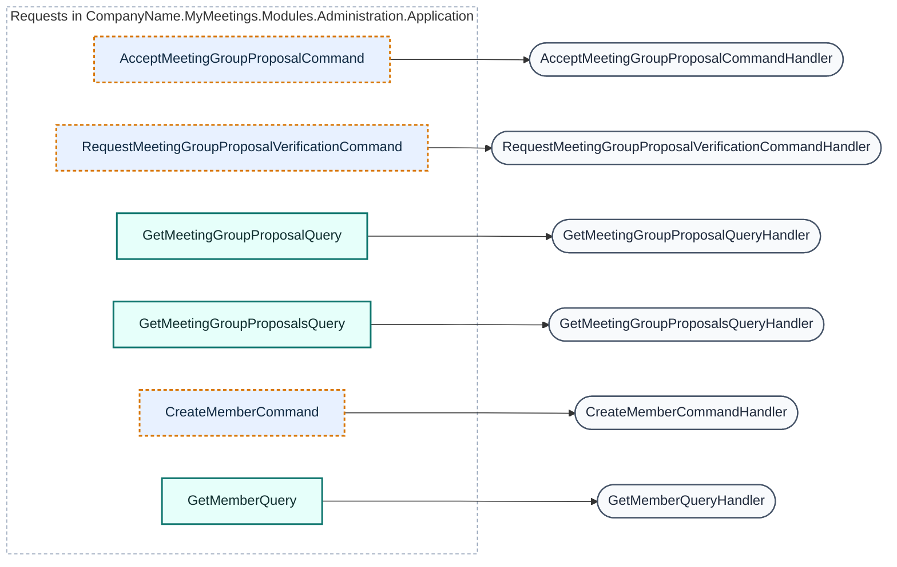

_6 requests · 6 handlers · 0 validators · 3 CommandWithoutValidator findings_

### CompanyName.MyMeetings.Modules.Administration.Infrastructure — 3 requests

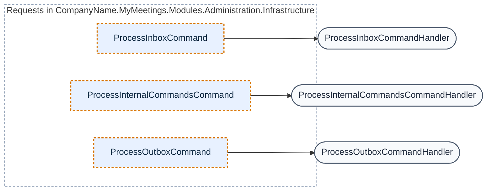

_3 requests · 3 handlers · 0 validators · 3 CommandWithoutValidator findings_

### CompanyName.MyMeetings.Modules.Meetings.Application — 12 of 44 requests (part 1 of 5)

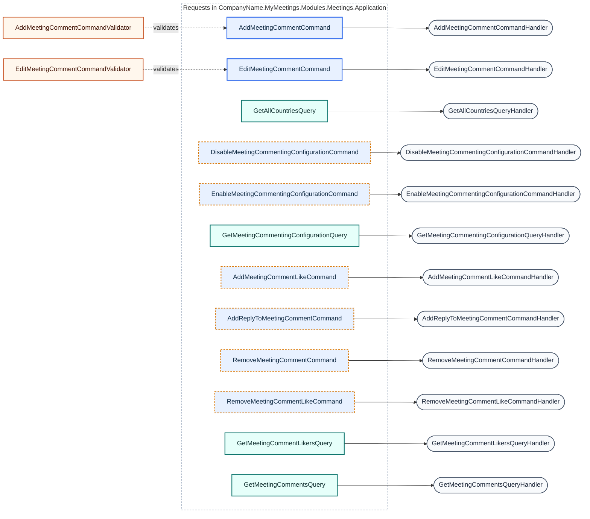

_12 requests · 12 handlers · 2 validators · 6 CommandWithoutValidator findings_

### CompanyName.MyMeetings.Modules.Meetings.Application — 14 of 44 requests (part 2 of 5)

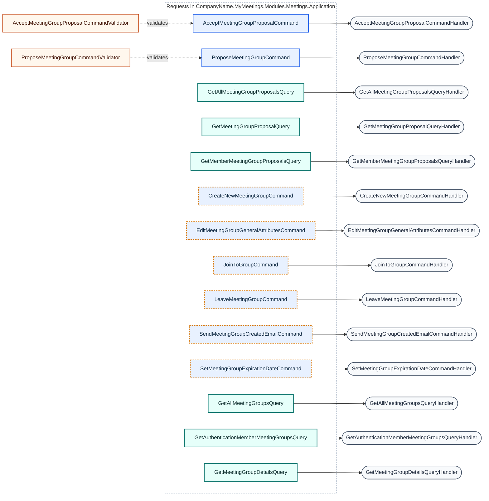

_14 requests · 14 handlers · 2 validators · 6 CommandWithoutValidator findings_

### CompanyName.MyMeetings.Modules.Meetings.Application — 15 of 44 requests (part 3 of 5)

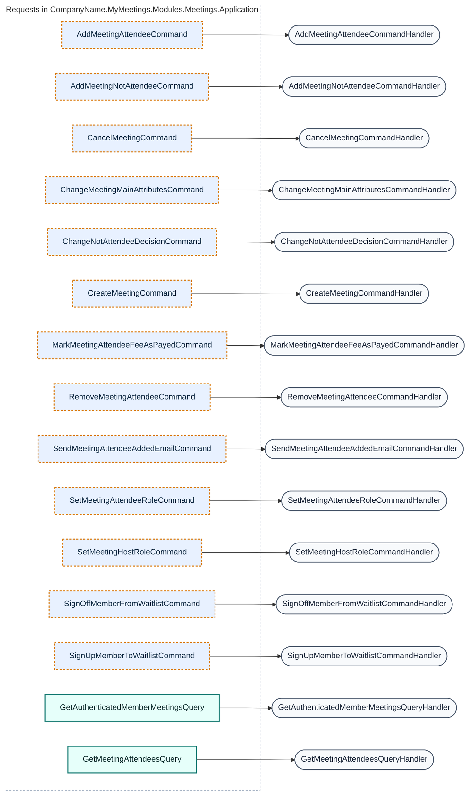

_15 requests · 15 handlers · 0 validators · 13 CommandWithoutValidator findings_

### CompanyName.MyMeetings.Modules.Meetings.Application — 1 of 44 requests (part 4 of 5)

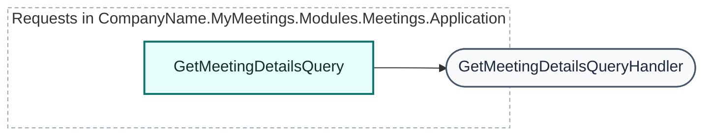

_1 request · 1 handler · 0 validators_

### CompanyName.MyMeetings.Modules.Meetings.Application — 2 of 44 requests (part 5 of 5)

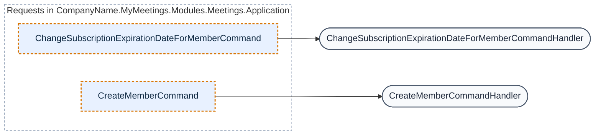

_2 requests · 2 handlers · 0 validators · 2 CommandWithoutValidator findings_

### CompanyName.MyMeetings.Modules.Meetings.Infrastructure — 3 requests

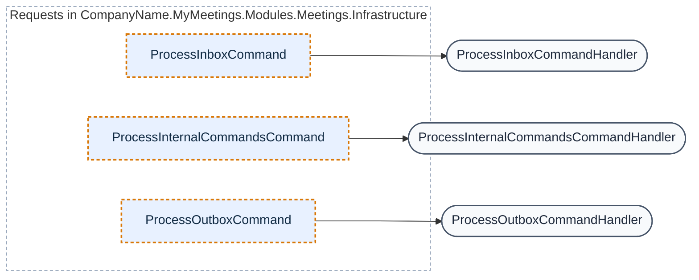

_3 requests · 3 handlers · 0 validators · 3 CommandWithoutValidator findings_

### CompanyName.MyMeetings.Modules.Payments.Application — 13 of 28 requests (part 1 of 2)

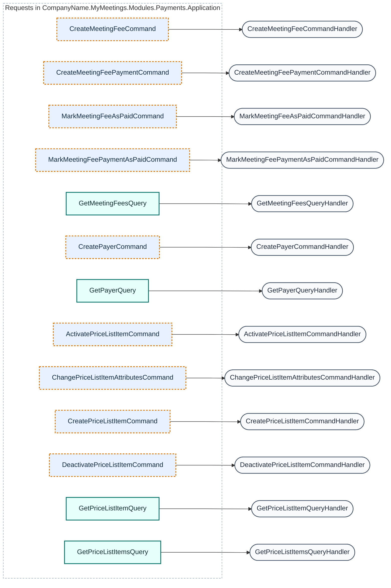

_13 requests · 13 handlers · 0 validators · 9 CommandWithoutValidator findings_

### CompanyName.MyMeetings.Modules.Payments.Application — 15 of 28 requests (part 2 of 2)

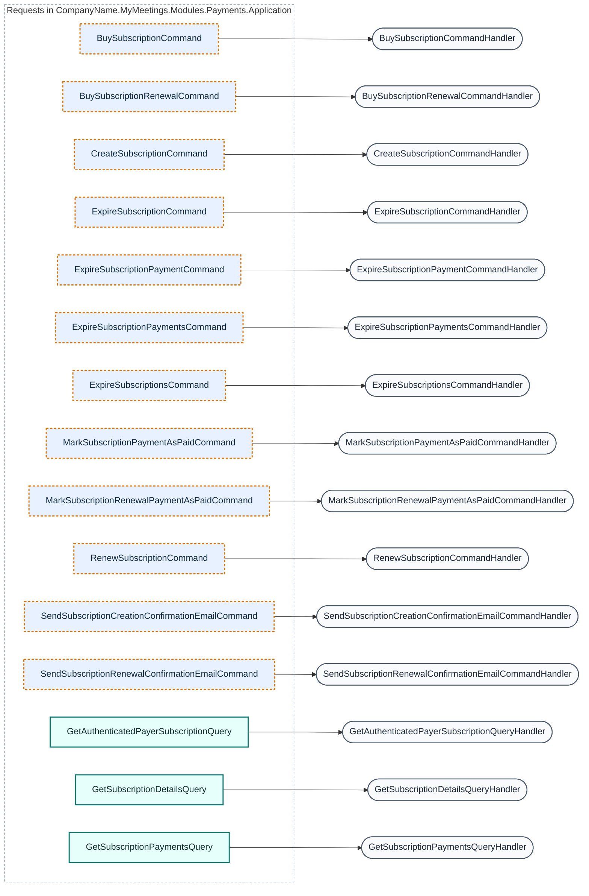

_15 requests · 15 handlers · 0 validators · 12 CommandWithoutValidator findings_

### CompanyName.MyMeetings.Modules.Payments.Infrastructure — 3 requests

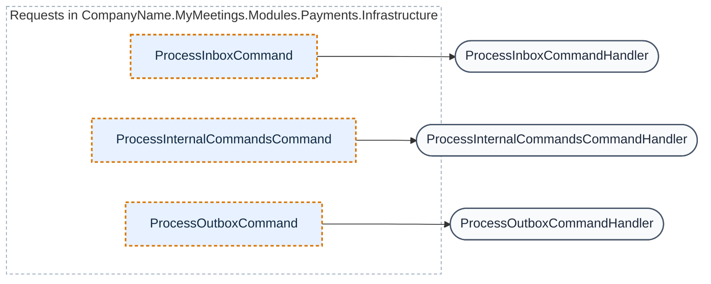

_3 requests · 3 handlers · 0 validators · 3 CommandWithoutValidator findings_

### CompanyName.MyMeetings.Modules.Registrations.Application — 4 requests

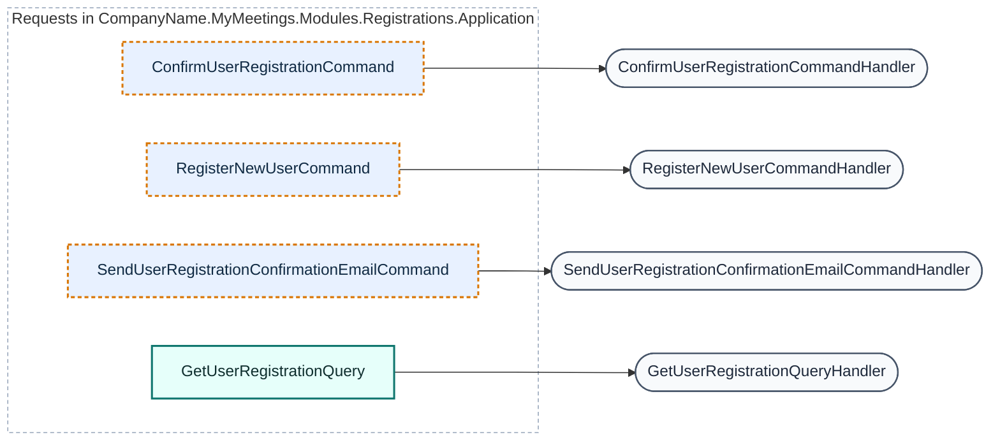

_4 requests · 4 handlers · 0 validators · 3 CommandWithoutValidator findings_

### CompanyName.MyMeetings.Modules.Registrations.Infrastructure — 3 requests

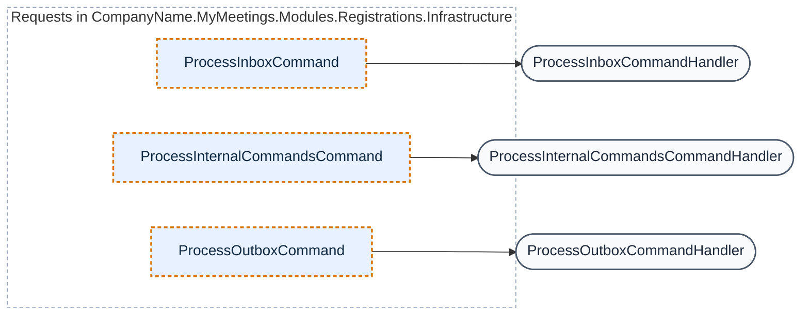

_3 requests · 3 handlers · 0 validators · 3 CommandWithoutValidator findings_

### CompanyName.MyMeetings.Modules.UserAccess.Application — 8 requests

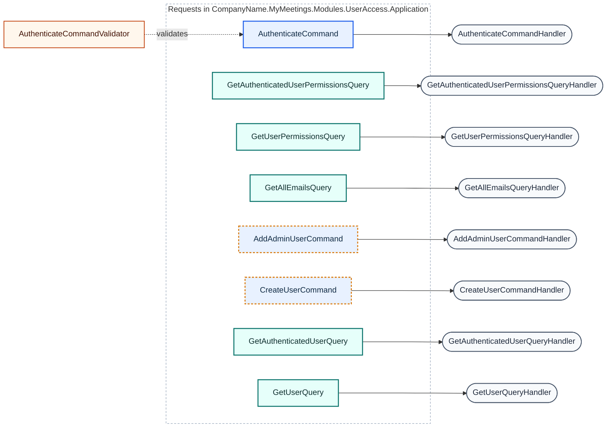

_8 requests · 8 handlers · 1 validator · 2 CommandWithoutValidator findings_

### CompanyName.MyMeetings.Modules.UserAccess.Infrastructure — 3 requests

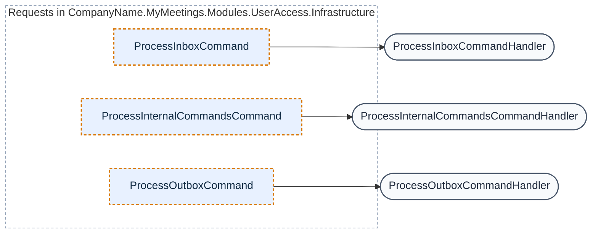

_3 requests · 3 handlers · 0 validators · 3 CommandWithoutValidator findings_


## Validation Coverage

_The share of requests with a linked validator (the model's request→validator linkage). A request with no linked validator is also reported individually by the command-without-validator check._

| Project | Requests | With linked validator | Coverage | Validators |
| --- | ---: | ---: | ---: | ---: |
| CompanyName.MyMeetings.Modules.Administration.Application | 6 | 0 | 0.0% | 0 |
| CompanyName.MyMeetings.Modules.Administration.Infrastructure | 3 | 0 | 0.0% | 0 |
| CompanyName.MyMeetings.Modules.Meetings.Application | 44 | 4 | 9.1% | 4 |
| CompanyName.MyMeetings.Modules.Meetings.Infrastructure | 3 | 0 | 0.0% | 0 |
| CompanyName.MyMeetings.Modules.Payments.Application | 28 | 0 | 0.0% | 0 |
| CompanyName.MyMeetings.Modules.Payments.Infrastructure | 3 | 0 | 0.0% | 0 |
| CompanyName.MyMeetings.Modules.Registrations.Application | 4 | 0 | 0.0% | 0 |
| CompanyName.MyMeetings.Modules.Registrations.Infrastructure | 3 | 0 | 0.0% | 0 |
| CompanyName.MyMeetings.Modules.UserAccess.Application | 8 | 1 | 12.5% | 1 |
| CompanyName.MyMeetings.Modules.UserAccess.Infrastructure | 3 | 0 | 0.0% | 0 |
| **All projects** | **105** | **5** | **4.8%** | **5** |

## Flow

_163 resolved flow edges across 24 feature/project diagrams (endpoint → request → handler and onward; DbContext nodes appear only when a handler directly references a discovered DbContext type; every flow edge appears in exactly one diagram). 26 unresolved dispatch call(s) are not drawn as edges._

**Legend:** blue stadium = endpoint · blue = request · gray = handler · fuchsia = notification · green = DbContext.

### CompanyName.MyMeetings.Modules.Administration.Application — MeetingGroupProposals — flow

```mermaid
flowchart LR
    accTitle: Flow map
    accDescr: 7 edges, 12 nodes.
    subgraph flow["CompanyName.MyMeetings.Modules.Administration.Application — MeetingGroupProposals"]
        ep_MeetingGroupProposalsController_AcceptMeetingGroupProposal(["MeetingGroupProposalsController.AcceptMeetingGroupProposal"]):::clsFlowEndpoint
        req_AcceptMeetingGroupProposalCommand["AcceptMeetingGroupProposalCommand"]:::clsFlowRequest
        ep_MeetingGroupProposalsController_GetMeetingGroupProposals(["MeetingGroupProposalsController.GetMeetingGroupProposals"]):::clsFlowEndpoint
        req_GetMeetingGroupProposalsQuery["GetMeetingGroupProposalsQuery"]:::clsFlowRequest
        hdl_AcceptMeetingGroupProposalCommandHandler["AcceptMeetingGroupProposalCommandHandler"]:::clsFlowHandler
        req_GetMeetingGroupProposalQuery["GetMeetingGroupProposalQuery"]:::clsFlowRequest
        hdl_GetMeetingGroupProposalQueryHandler["GetMeetingGroupProposalQueryHandler"]:::clsFlowHandler
        hdl_GetMeetingGroupProposalsQueryHandler["GetMeetingGroupProposalsQueryHandler"]:::clsFlowHandler
        req_RequestMeetingGroupProposalVerificationCommand["RequestMeetingGroupProposalVerificationCommand"]:::clsFlowRequest
        hdl_RequestMeetingGroupProposalVerificationCommandHandler["RequestMeetingGroupProposalVerificationCommandHandler"]:::clsFlowHandler
        hdl_MeetingGroupProposalAcceptedNotificationHandler["MeetingGroupProposalAcceptedNotificationHandler"]:::clsFlowHandler
        ntf_MeetingGroupProposalAcceptedIntegrationEvent["MeetingGroupProposalAcceptedIntegrationEvent"]:::clsFlowNotification
    end
    ep_MeetingGroupProposalsController_AcceptMeetingGroupProposal -->|dispatches| req_AcceptMeetingGroupProposalCommand
    ep_MeetingGroupProposalsController_GetMeetingGroupProposals -->|dispatches| req_GetMeetingGroupProposalsQuery
    req_AcceptMeetingGroupProposalCommand -->|handled by| hdl_AcceptMeetingGroupProposalCommandHandler
    req_GetMeetingGroupProposalQuery -->|handled by| hdl_GetMeetingGroupProposalQueryHandler
    req_GetMeetingGroupProposalsQuery -->|handled by| hdl_GetMeetingGroupProposalsQueryHandler
    req_RequestMeetingGroupProposalVerificationCommand -->|handled by| hdl_RequestMeetingGroupProposalVerificationCommandHandler
    hdl_MeetingGroupProposalAcceptedNotificationHandler -->|publishes| ntf_MeetingGroupProposalAcceptedIntegrationEvent
    classDef clsFlowEndpoint fill:#e0f2fe,stroke:#0284c7,stroke-width:2px,color:#0c4a6e
    classDef clsFlowRequest fill:#dbeafe,stroke:#2563eb,stroke-width:1.5px,color:#1e3a8a
    classDef clsFlowHandler fill:#f8fafc,stroke:#475569,stroke-width:1.5px,color:#1e293b
    classDef clsFlowNotification fill:#fdf4ff,stroke:#a21caf,stroke-width:2px,color:#4a044e
    classDef clsFlowDbContext fill:#ecfdf5,stroke:#059669,stroke-width:2px,color:#064e3b
    style flow fill:none,stroke:#94a3b8,stroke-dasharray:4 3
```

_7 edges · 5 connected flows_

### CompanyName.MyMeetings.Modules.Administration.Application — Members — flow

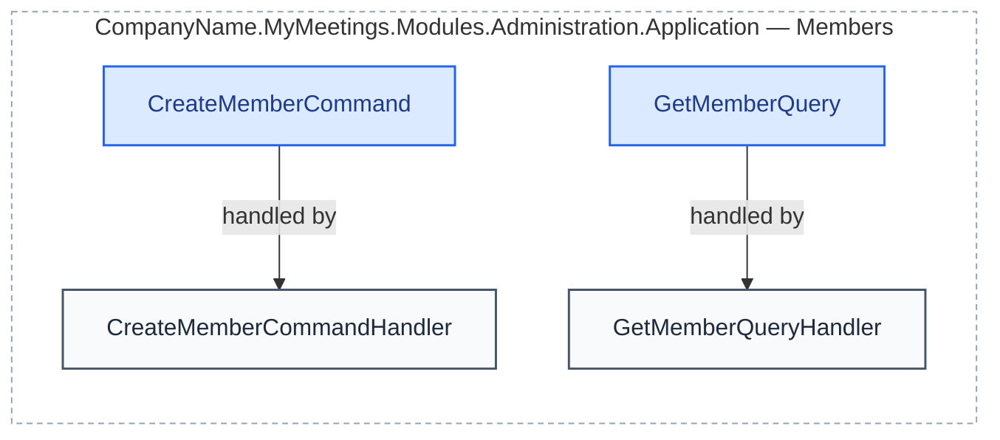

_2 edges · 2 connected flows_

### CompanyName.MyMeetings.Modules.Administration.Infrastructure — Configuration — flow

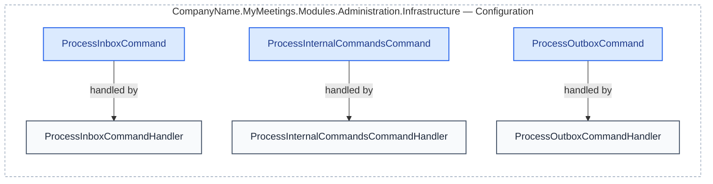

_3 edges · 3 connected flows_

### CompanyName.MyMeetings.Modules.Meetings.Application — Countries — flow

```mermaid
flowchart LR
    accTitle: Flow map
    accDescr: 2 edges, 3 nodes.
    subgraph flow["CompanyName.MyMeetings.Modules.Meetings.Application — Countries"]
        ep_CountriesController_GetAllCountries(["CountriesController.GetAllCountries"]):::clsFlowEndpoint
        req_GetAllCountriesQuery["GetAllCountriesQuery"]:::clsFlowRequest
        hdl_GetAllCountriesQueryHandler["GetAllCountriesQueryHandler"]:::clsFlowHandler
    end
    ep_CountriesController_GetAllCountries -->|dispatches| req_GetAllCountriesQuery
    req_GetAllCountriesQuery -->|handled by| hdl_GetAllCountriesQueryHandler
    classDef clsFlowEndpoint fill:#e0f2fe,stroke:#0284c7,stroke-width:2px,color:#0c4a6e
    classDef clsFlowRequest fill:#dbeafe,stroke:#2563eb,stroke-width:1.5px,color:#1e3a8a
    classDef clsFlowHandler fill:#f8fafc,stroke:#475569,stroke-width:1.5px,color:#1e293b
    classDef clsFlowNotification fill:#fdf4ff,stroke:#a21caf,stroke-width:2px,color:#4a044e
    classDef clsFlowDbContext fill:#ecfdf5,stroke:#059669,stroke-width:2px,color:#064e3b
    style flow fill:none,stroke:#94a3b8,stroke-dasharray:4 3
```

_2 edges · 1 connected flow_

### CompanyName.MyMeetings.Modules.Meetings.Application — MeetingCommentingConfigurations — flow

```mermaid
flowchart LR
    accTitle: Flow map
    accDescr: 5 edges, 8 nodes.
    subgraph flow["CompanyName.MyMeetings.Modules.Meetings.Application — MeetingCommentingConfigurations"]
        ep_MeetingCommentingConfigurationController_DisableCommenting(["MeetingCommentingConfigurationController.DisableCommenting"]):::clsFlowEndpoint
        req_DisableMeetingCommentingConfigurationCommand["DisableMeetingCommentingConfigurationCommand"]:::clsFlowRequest
        ep_MeetingCommentingConfigurationController_EnableCommenting(["MeetingCommentingConfigurationController.EnableCommenting"]):::clsFlowEndpoint
        req_EnableMeetingCommentingConfigurationCommand["EnableMeetingCommentingConfigurationCommand"]:::clsFlowRequest
        hdl_DisableMeetingCommentingConfigurationCommandHandler["DisableMeetingCommentingConfigurationCommandHandler"]:::clsFlowHandler
        hdl_EnableMeetingCommentingConfigurationCommandHandler["EnableMeetingCommentingConfigurationCommandHandler"]:::clsFlowHandler
        req_GetMeetingCommentingConfigurationQuery["GetMeetingCommentingConfigurationQuery"]:::clsFlowRequest
        hdl_GetMeetingCommentingConfigurationQueryHandler["GetMeetingCommentingConfigurationQueryHandler"]:::clsFlowHandler
    end
    ep_MeetingCommentingConfigurationController_DisableCommenting -->|dispatches| req_DisableMeetingCommentingConfigurationCommand
    ep_MeetingCommentingConfigurationController_EnableCommenting -->|dispatches| req_EnableMeetingCommentingConfigurationCommand
    req_DisableMeetingCommentingConfigurationCommand -->|handled by| hdl_DisableMeetingCommentingConfigurationCommandHandler
    req_EnableMeetingCommentingConfigurationCommand -->|handled by| hdl_EnableMeetingCommentingConfigurationCommandHandler
    req_GetMeetingCommentingConfigurationQuery -->|handled by| hdl_GetMeetingCommentingConfigurationQueryHandler
    classDef clsFlowEndpoint fill:#e0f2fe,stroke:#0284c7,stroke-width:2px,color:#0c4a6e
    classDef clsFlowRequest fill:#dbeafe,stroke:#2563eb,stroke-width:1.5px,color:#1e3a8a
    classDef clsFlowHandler fill:#f8fafc,stroke:#475569,stroke-width:1.5px,color:#1e293b
    classDef clsFlowNotification fill:#fdf4ff,stroke:#a21caf,stroke-width:2px,color:#4a044e
    classDef clsFlowDbContext fill:#ecfdf5,stroke:#059669,stroke-width:2px,color:#064e3b
    style flow fill:none,stroke:#94a3b8,stroke-dasharray:4 3
```

_5 edges · 3 connected flows_

### CompanyName.MyMeetings.Modules.Meetings.Application — MeetingComments — flow

```mermaid
flowchart LR
    accTitle: Flow map
    accDescr: 14 edges, 22 nodes.
    subgraph flow["CompanyName.MyMeetings.Modules.Meetings.Application — MeetingComments"]
        ep_MeetingCommentsController_AddComment(["MeetingCommentsController.AddComment"]):::clsFlowEndpoint
        req_AddMeetingCommentCommand["AddMeetingCommentCommand"]:::clsFlowRequest
        ep_MeetingCommentsController_AddReply(["MeetingCommentsController.AddReply"]):::clsFlowEndpoint
        req_AddReplyToMeetingCommentCommand["AddReplyToMeetingCommentCommand"]:::clsFlowRequest
        ep_MeetingCommentsController_DeleteComment(["MeetingCommentsController.DeleteComment"]):::clsFlowEndpoint
        req_RemoveMeetingCommentCommand["RemoveMeetingCommentCommand"]:::clsFlowRequest
        ep_MeetingCommentsController_EditComment(["MeetingCommentsController.EditComment"]):::clsFlowEndpoint
        req_EditMeetingCommentCommand["EditMeetingCommentCommand"]:::clsFlowRequest
        ep_MeetingCommentsController_LikeComment(["MeetingCommentsController.LikeComment"]):::clsFlowEndpoint
        req_AddMeetingCommentLikeCommand["AddMeetingCommentLikeCommand"]:::clsFlowRequest
        ep_MeetingCommentsController_UnlikeComment(["MeetingCommentsController.UnlikeComment"]):::clsFlowEndpoint
        req_RemoveMeetingCommentLikeCommand["RemoveMeetingCommentLikeCommand"]:::clsFlowRequest
        hdl_AddMeetingCommentCommandHandler["AddMeetingCommentCommandHandler"]:::clsFlowHandler
        hdl_AddMeetingCommentLikeCommandHandler["AddMeetingCommentLikeCommandHandler"]:::clsFlowHandler
        hdl_AddReplyToMeetingCommentCommandHandler["AddReplyToMeetingCommentCommandHandler"]:::clsFlowHandler
        hdl_EditMeetingCommentCommandHandler["EditMeetingCommentCommandHandler"]:::clsFlowHandler
        req_GetMeetingCommentLikersQuery["GetMeetingCommentLikersQuery"]:::clsFlowRequest
        hdl_GetMeetingCommentLikersQueryHandler["GetMeetingCommentLikersQueryHandler"]:::clsFlowHandler
        req_GetMeetingCommentsQuery["GetMeetingCommentsQuery"]:::clsFlowRequest
        hdl_GetMeetingCommentsQueryHandler["GetMeetingCommentsQueryHandler"]:::clsFlowHandler
        hdl_RemoveMeetingCommentCommandHandler["RemoveMeetingCommentCommandHandler"]:::clsFlowHandler
        hdl_RemoveMeetingCommentLikeCommandHandler["RemoveMeetingCommentLikeCommandHandler"]:::clsFlowHandler
    end
    ep_MeetingCommentsController_AddComment -->|dispatches| req_AddMeetingCommentCommand
    ep_MeetingCommentsController_AddReply -->|dispatches| req_AddReplyToMeetingCommentCommand
    ep_MeetingCommentsController_DeleteComment -->|dispatches| req_RemoveMeetingCommentCommand
    ep_MeetingCommentsController_EditComment -->|dispatches| req_EditMeetingCommentCommand
    ep_MeetingCommentsController_LikeComment -->|dispatches| req_AddMeetingCommentLikeCommand
    ep_MeetingCommentsController_UnlikeComment -->|dispatches| req_RemoveMeetingCommentLikeCommand
    req_AddMeetingCommentCommand -->|handled by| hdl_AddMeetingCommentCommandHandler
    req_AddMeetingCommentLikeCommand -->|handled by| hdl_AddMeetingCommentLikeCommandHandler
    req_AddReplyToMeetingCommentCommand -->|handled by| hdl_AddReplyToMeetingCommentCommandHandler
    req_EditMeetingCommentCommand -->|handled by| hdl_EditMeetingCommentCommandHandler
    req_GetMeetingCommentLikersQuery -->|handled by| hdl_GetMeetingCommentLikersQueryHandler
    req_GetMeetingCommentsQuery -->|handled by| hdl_GetMeetingCommentsQueryHandler
    req_RemoveMeetingCommentCommand -->|handled by| hdl_RemoveMeetingCommentCommandHandler
    req_RemoveMeetingCommentLikeCommand -->|handled by| hdl_RemoveMeetingCommentLikeCommandHandler
    classDef clsFlowEndpoint fill:#e0f2fe,stroke:#0284c7,stroke-width:2px,color:#0c4a6e
    classDef clsFlowRequest fill:#dbeafe,stroke:#2563eb,stroke-width:1.5px,color:#1e3a8a
    classDef clsFlowHandler fill:#f8fafc,stroke:#475569,stroke-width:1.5px,color:#1e293b
    classDef clsFlowNotification fill:#fdf4ff,stroke:#a21caf,stroke-width:2px,color:#4a044e
    classDef clsFlowDbContext fill:#ecfdf5,stroke:#059669,stroke-width:2px,color:#064e3b
    style flow fill:none,stroke:#94a3b8,stroke-dasharray:4 3
```

_14 edges · 8 connected flows_

### CompanyName.MyMeetings.Modules.Meetings.Application — MeetingGroupProposals — flow

```mermaid
flowchart LR
    accTitle: Flow map
    accDescr: 9 edges, 15 nodes.
    subgraph flow["CompanyName.MyMeetings.Modules.Meetings.Application — MeetingGroupProposals"]
        ep_MeetingGroupProposalsController_GetAllMeetingGroupProposals(["MeetingGroupProposalsController.GetAllMeetingGroupProposals"]):::clsFlowEndpoint
        req_GetAllMeetingGroupProposalsQuery["GetAllMeetingGroupProposalsQuery"]:::clsFlowRequest
        ep_MeetingGroupProposalsController_GetMemberMeetingGroupProposals(["MeetingGroupProposalsController.GetMemberMeetingGroupProposals"]):::clsFlowEndpoint
        req_GetMemberMeetingGroupProposalsQuery["GetMemberMeetingGroupProposalsQuery"]:::clsFlowRequest
        ep_MeetingGroupProposalsController_ProposeMeetingGroup(["MeetingGroupProposalsController.ProposeMeetingGroup"]):::clsFlowEndpoint
        req_ProposeMeetingGroupCommand["ProposeMeetingGroupCommand"]:::clsFlowRequest
        req_AcceptMeetingGroupProposalCommand["AcceptMeetingGroupProposalCommand"]:::clsFlowRequest
        hdl_AcceptMeetingGroupProposalCommandHandler["AcceptMeetingGroupProposalCommandHandler"]:::clsFlowHandler
        hdl_GetAllMeetingGroupProposalsQueryHandler["GetAllMeetingGroupProposalsQueryHandler"]:::clsFlowHandler
        req_GetMeetingGroupProposalQuery["GetMeetingGroupProposalQuery"]:::clsFlowRequest
        hdl_GetMeetingGroupProposalQueryHandler["GetMeetingGroupProposalQueryHandler"]:::clsFlowHandler
        hdl_GetMemberMeetingGroupProposalsQueryHandler["GetMemberMeetingGroupProposalsQueryHandler"]:::clsFlowHandler
        hdl_ProposeMeetingGroupCommandHandler["ProposeMeetingGroupCommandHandler"]:::clsFlowHandler
        hdl_MeetingGroupProposedNotificationHandler["MeetingGroupProposedNotificationHandler"]:::clsFlowHandler
        ntf_MeetingGroupProposedIntegrationEvent["MeetingGroupProposedIntegrationEvent"]:::clsFlowNotification
    end
    ep_MeetingGroupProposalsController_GetAllMeetingGroupProposals -->|dispatches| req_GetAllMeetingGroupProposalsQuery
    ep_MeetingGroupProposalsController_GetMemberMeetingGroupProposals -->|dispatches| req_GetMemberMeetingGroupProposalsQuery
    ep_MeetingGroupProposalsController_ProposeMeetingGroup -->|dispatches| req_ProposeMeetingGroupCommand
    req_AcceptMeetingGroupProposalCommand -->|handled by| hdl_AcceptMeetingGroupProposalCommandHandler
    req_GetAllMeetingGroupProposalsQuery -->|handled by| hdl_GetAllMeetingGroupProposalsQueryHandler
    req_GetMeetingGroupProposalQuery -->|handled by| hdl_GetMeetingGroupProposalQueryHandler
    req_GetMemberMeetingGroupProposalsQuery -->|handled by| hdl_GetMemberMeetingGroupProposalsQueryHandler
    req_ProposeMeetingGroupCommand -->|handled by| hdl_ProposeMeetingGroupCommandHandler
    hdl_MeetingGroupProposedNotificationHandler -->|publishes| ntf_MeetingGroupProposedIntegrationEvent
    classDef clsFlowEndpoint fill:#e0f2fe,stroke:#0284c7,stroke-width:2px,color:#0c4a6e
    classDef clsFlowRequest fill:#dbeafe,stroke:#2563eb,stroke-width:1.5px,color:#1e3a8a
    classDef clsFlowHandler fill:#f8fafc,stroke:#475569,stroke-width:1.5px,color:#1e293b
    classDef clsFlowNotification fill:#fdf4ff,stroke:#a21caf,stroke-width:2px,color:#4a044e
    classDef clsFlowDbContext fill:#ecfdf5,stroke:#059669,stroke-width:2px,color:#064e3b
    style flow fill:none,stroke:#94a3b8,stroke-dasharray:4 3
```

_9 edges · 6 connected flows_

### CompanyName.MyMeetings.Modules.Meetings.Application — MeetingGroups — flow

```mermaid
flowchart LR
    accTitle: Flow map
    accDescr: 15 edges, 24 nodes.
    subgraph flow["CompanyName.MyMeetings.Modules.Meetings.Application — MeetingGroups"]
        ep_MeetingGroupsController_EditMeetingGroupGeneralAttributes(["MeetingGroupsController.EditMeetingGroupGeneralAttributes"]):::clsFlowEndpoint
        req_EditMeetingGroupGeneralAttributesCommand["EditMeetingGroupGeneralAttributesCommand"]:::clsFlowRequest
        ep_MeetingGroupsController_GetAllMeetingGroups(["MeetingGroupsController.GetAllMeetingGroups"]):::clsFlowEndpoint
        req_GetAllMeetingGroupsQuery["GetAllMeetingGroupsQuery"]:::clsFlowRequest
        ep_MeetingGroupsController_GetAuthenticatedMemberMeetingGroups(["MeetingGroupsController.GetAuthenticatedMemberMeetingGroups"]):::clsFlowEndpoint
        req_GetAuthenticationMemberMeetingGroupsQuery["GetAuthenticationMemberMeetingGroupsQuery"]:::clsFlowRequest
        ep_MeetingGroupsController_GetMeetingGroupDetails(["MeetingGroupsController.GetMeetingGroupDetails"]):::clsFlowEndpoint
        req_GetMeetingGroupDetailsQuery["GetMeetingGroupDetailsQuery"]:::clsFlowRequest
        ep_MeetingGroupsController_JoinToGroup(["MeetingGroupsController.JoinToGroup"]):::clsFlowEndpoint
        req_JoinToGroupCommand["JoinToGroupCommand"]:::clsFlowRequest
        ep_MeetingGroupsController_LeaveMeetingGroup(["MeetingGroupsController.LeaveMeetingGroup"]):::clsFlowEndpoint
        req_LeaveMeetingGroupCommand["LeaveMeetingGroupCommand"]:::clsFlowRequest
        req_CreateNewMeetingGroupCommand["CreateNewMeetingGroupCommand"]:::clsFlowRequest
        hdl_CreateNewMeetingGroupCommandHandler["CreateNewMeetingGroupCommandHandler"]:::clsFlowHandler
        hdl_EditMeetingGroupGeneralAttributesCommandHandler["EditMeetingGroupGeneralAttributesCommandHandler"]:::clsFlowHandler
        hdl_GetAllMeetingGroupsQueryHandler["GetAllMeetingGroupsQueryHandler"]:::clsFlowHandler
        hdl_GetAuthenticationMemberMeetingGroupsQueryHandler["GetAuthenticationMemberMeetingGroupsQueryHandler"]:::clsFlowHandler
        hdl_GetMeetingGroupDetailsQueryHandler["GetMeetingGroupDetailsQueryHandler"]:::clsFlowHandler
        hdl_JoinToGroupCommandHandler["JoinToGroupCommandHandler"]:::clsFlowHandler
        hdl_LeaveMeetingGroupCommandHandler["LeaveMeetingGroupCommandHandler"]:::clsFlowHandler
        req_SendMeetingGroupCreatedEmailCommand["SendMeetingGroupCreatedEmailCommand"]:::clsFlowRequest
        hdl_SendMeetingGroupCreatedEmailCommandHandler["SendMeetingGroupCreatedEmailCommandHandler"]:::clsFlowHandler
        req_SetMeetingGroupExpirationDateCommand["SetMeetingGroupExpirationDateCommand"]:::clsFlowRequest
        hdl_SetMeetingGroupExpirationDateCommandHandler["SetMeetingGroupExpirationDateCommandHandler"]:::clsFlowHandler
    end
    ep_MeetingGroupsController_EditMeetingGroupGeneralAttributes -->|dispatches| req_EditMeetingGroupGeneralAttributesCommand
    ep_MeetingGroupsController_GetAllMeetingGroups -->|dispatches| req_GetAllMeetingGroupsQuery
    ep_MeetingGroupsController_GetAuthenticatedMemberMeetingGroups -->|dispatches| req_GetAuthenticationMemberMeetingGroupsQuery
    ep_MeetingGroupsController_GetMeetingGroupDetails -->|dispatches| req_GetMeetingGroupDetailsQuery
    ep_MeetingGroupsController_JoinToGroup -->|dispatches| req_JoinToGroupCommand
    ep_MeetingGroupsController_LeaveMeetingGroup -->|dispatches| req_LeaveMeetingGroupCommand
    req_CreateNewMeetingGroupCommand -->|handled by| hdl_CreateNewMeetingGroupCommandHandler
    req_EditMeetingGroupGeneralAttributesCommand -->|handled by| hdl_EditMeetingGroupGeneralAttributesCommandHandler
    req_GetAllMeetingGroupsQuery -->|handled by| hdl_GetAllMeetingGroupsQueryHandler
    req_GetAuthenticationMemberMeetingGroupsQuery -->|handled by| hdl_GetAuthenticationMemberMeetingGroupsQueryHandler
    req_GetMeetingGroupDetailsQuery -->|handled by| hdl_GetMeetingGroupDetailsQueryHandler
    req_JoinToGroupCommand -->|handled by| hdl_JoinToGroupCommandHandler
    req_LeaveMeetingGroupCommand -->|handled by| hdl_LeaveMeetingGroupCommandHandler
    req_SendMeetingGroupCreatedEmailCommand -->|handled by| hdl_SendMeetingGroupCreatedEmailCommandHandler
    req_SetMeetingGroupExpirationDateCommand -->|handled by| hdl_SetMeetingGroupExpirationDateCommandHandler
    classDef clsFlowEndpoint fill:#e0f2fe,stroke:#0284c7,stroke-width:2px,color:#0c4a6e
    classDef clsFlowRequest fill:#dbeafe,stroke:#2563eb,stroke-width:1.5px,color:#1e3a8a
    classDef clsFlowHandler fill:#f8fafc,stroke:#475569,stroke-width:1.5px,color:#1e293b
    classDef clsFlowNotification fill:#fdf4ff,stroke:#a21caf,stroke-width:2px,color:#4a044e
    classDef clsFlowDbContext fill:#ecfdf5,stroke:#059669,stroke-width:2px,color:#064e3b
    style flow fill:none,stroke:#94a3b8,stroke-dasharray:4 3
```

_15 edges · 9 connected flows_

### CompanyName.MyMeetings.Modules.Meetings.Application — Meetings — flow

```mermaid
flowchart LR
    accTitle: Flow map
    accDescr: 31 edges, 48 nodes.
    subgraph flow["CompanyName.MyMeetings.Modules.Meetings.Application — Meetings"]
        ep_MeetingsController_AddMeetingAttendee(["MeetingsController.AddMeetingAttendee"]):::clsFlowEndpoint
        req_AddMeetingAttendeeCommand["AddMeetingAttendeeCommand"]:::clsFlowRequest
        ep_MeetingsController_AddNotAttendee(["MeetingsController.AddNotAttendee"]):::clsFlowEndpoint
        req_AddMeetingNotAttendeeCommand["AddMeetingNotAttendeeCommand"]:::clsFlowRequest
        ep_MeetingsController_CancelMeeting(["MeetingsController.CancelMeeting"]):::clsFlowEndpoint
        req_CancelMeetingCommand["CancelMeetingCommand"]:::clsFlowRequest
        ep_MeetingsController_ChangeNotAttendeeDecision(["MeetingsController.ChangeNotAttendeeDecision"]):::clsFlowEndpoint
        req_ChangeNotAttendeeDecisionCommand["ChangeNotAttendeeDecisionCommand"]:::clsFlowRequest
        ep_MeetingsController_CreateNewMeeting(["MeetingsController.CreateNewMeeting"]):::clsFlowEndpoint
        req_CreateMeetingCommand["CreateMeetingCommand"]:::clsFlowRequest
        ep_MeetingsController_EditMeeting(["MeetingsController.EditMeeting"]):::clsFlowEndpoint
        req_ChangeMeetingMainAttributesCommand["ChangeMeetingMainAttributesCommand"]:::clsFlowRequest
        ep_MeetingsController_GetAuthenticatedMemberMeetings(["MeetingsController.GetAuthenticatedMemberMeetings"]):::clsFlowEndpoint
        req_GetAuthenticatedMemberMeetingsQuery["GetAuthenticatedMemberMeetingsQuery"]:::clsFlowRequest
        ep_MeetingsController_GetMeetingAttendees(["MeetingsController.GetMeetingAttendees"]):::clsFlowEndpoint
        req_GetMeetingAttendeesQuery["GetMeetingAttendeesQuery"]:::clsFlowRequest
        ep_MeetingsController_GetMeetingDetails(["MeetingsController.GetMeetingDetails"]):::clsFlowEndpoint
        req_GetMeetingDetailsQuery["GetMeetingDetailsQuery"]:::clsFlowRequest
        ep_MeetingsController_RemoveMeetingAttendee(["MeetingsController.RemoveMeetingAttendee"]):::clsFlowEndpoint
        req_RemoveMeetingAttendeeCommand["RemoveMeetingAttendeeCommand"]:::clsFlowRequest
        ep_MeetingsController_SetMeetingAttendeeRole(["MeetingsController.SetMeetingAttendeeRole"]):::clsFlowEndpoint
        req_SetMeetingAttendeeRoleCommand["SetMeetingAttendeeRoleCommand"]:::clsFlowRequest
        ep_MeetingsController_SetMeetingHostRole(["MeetingsController.SetMeetingHostRole"]):::clsFlowEndpoint
        req_SetMeetingHostRoleCommand["SetMeetingHostRoleCommand"]:::clsFlowRequest
        ep_MeetingsController_SignOffMemberFromWaitlist(["MeetingsController.SignOffMemberFromWaitlist"]):::clsFlowEndpoint
        req_SignOffMemberFromWaitlistCommand["SignOffMemberFromWaitlistCommand"]:::clsFlowRequest
        ep_MeetingsController_SignUpMemberToWaitlist(["MeetingsController.SignUpMemberToWaitlist"]):::clsFlowEndpoint
        req_SignUpMemberToWaitlistCommand["SignUpMemberToWaitlistCommand"]:::clsFlowRequest
        hdl_AddMeetingAttendeeCommandHandler["AddMeetingAttendeeCommandHandler"]:::clsFlowHandler
        hdl_AddMeetingNotAttendeeCommandHandler["AddMeetingNotAttendeeCommandHandler"]:::clsFlowHandler
        hdl_CancelMeetingCommandHandler["CancelMeetingCommandHandler"]:::clsFlowHandler
        hdl_ChangeMeetingMainAttributesCommandHandler["ChangeMeetingMainAttributesCommandHandler"]:::clsFlowHandler
        hdl_ChangeNotAttendeeDecisionCommandHandler["ChangeNotAttendeeDecisionCommandHandler"]:::clsFlowHandler
        hdl_CreateMeetingCommandHandler["CreateMeetingCommandHandler"]:::clsFlowHandler
        hdl_GetAuthenticatedMemberMeetingsQueryHandler["GetAuthenticatedMemberMeetingsQueryHandler"]:::clsFlowHandler
        hdl_GetMeetingAttendeesQueryHandler["GetMeetingAttendeesQueryHandler"]:::clsFlowHandler
        hdl_GetMeetingDetailsQueryHandler["GetMeetingDetailsQueryHandler"]:::clsFlowHandler
        req_MarkMeetingAttendeeFeeAsPayedCommand["MarkMeetingAttendeeFeeAsPayedCommand"]:::clsFlowRequest
        hdl_MarkMeetingAttendeeFeeAsPayedCommandHandler["MarkMeetingAttendeeFeeAsPayedCommandHandler"]:::clsFlowHandler
        hdl_RemoveMeetingAttendeeCommandHandler["RemoveMeetingAttendeeCommandHandler"]:::clsFlowHandler
        req_SendMeetingAttendeeAddedEmailCommand["SendMeetingAttendeeAddedEmailCommand"]:::clsFlowRequest
        hdl_SendMeetingAttendeeAddedEmailCommandHandler["SendMeetingAttendeeAddedEmailCommandHandler"]:::clsFlowHandler
        hdl_SetMeetingAttendeeRoleCommandHandler["SetMeetingAttendeeRoleCommandHandler"]:::clsFlowHandler
        hdl_SetMeetingHostRoleCommandHandler["SetMeetingHostRoleCommandHandler"]:::clsFlowHandler
        hdl_SignOffMemberFromWaitlistCommandHandler["SignOffMemberFromWaitlistCommandHandler"]:::clsFlowHandler
        hdl_SignUpMemberToWaitlistCommandHandler["SignUpMemberToWaitlistCommandHandler"]:::clsFlowHandler
        hdl_MeetingAttendeeAddedPublishEventNotificationHandler["MeetingAttendeeAddedPublishEventNotificationHandler"]:::clsFlowHandler
        ntf_MeetingAttendeeAddedIntegrationEvent["MeetingAttendeeAddedIntegrationEvent"]:::clsFlowNotification
    end
    ep_MeetingsController_AddMeetingAttendee -->|dispatches| req_AddMeetingAttendeeCommand
    ep_MeetingsController_AddNotAttendee -->|dispatches| req_AddMeetingNotAttendeeCommand
    ep_MeetingsController_CancelMeeting -->|dispatches| req_CancelMeetingCommand
    ep_MeetingsController_ChangeNotAttendeeDecision -->|dispatches| req_ChangeNotAttendeeDecisionCommand
    ep_MeetingsController_CreateNewMeeting -->|dispatches| req_CreateMeetingCommand
    ep_MeetingsController_EditMeeting -->|dispatches| req_ChangeMeetingMainAttributesCommand
    ep_MeetingsController_GetAuthenticatedMemberMeetings -->|dispatches| req_GetAuthenticatedMemberMeetingsQuery
    ep_MeetingsController_GetMeetingAttendees -->|dispatches| req_GetMeetingAttendeesQuery
    ep_MeetingsController_GetMeetingDetails -->|dispatches| req_GetMeetingDetailsQuery
    ep_MeetingsController_RemoveMeetingAttendee -->|dispatches| req_RemoveMeetingAttendeeCommand
    ep_MeetingsController_SetMeetingAttendeeRole -->|dispatches| req_SetMeetingAttendeeRoleCommand
    ep_MeetingsController_SetMeetingHostRole -->|dispatches| req_SetMeetingHostRoleCommand
    ep_MeetingsController_SignOffMemberFromWaitlist -->|dispatches| req_SignOffMemberFromWaitlistCommand
    ep_MeetingsController_SignUpMemberToWaitlist -->|dispatches| req_SignUpMemberToWaitlistCommand
    req_AddMeetingAttendeeCommand -->|handled by| hdl_AddMeetingAttendeeCommandHandler
    req_AddMeetingNotAttendeeCommand -->|handled by| hdl_AddMeetingNotAttendeeCommandHandler
    req_CancelMeetingCommand -->|handled by| hdl_CancelMeetingCommandHandler
    req_ChangeMeetingMainAttributesCommand -->|handled by| hdl_ChangeMeetingMainAttributesCommandHandler
    req_ChangeNotAttendeeDecisionCommand -->|handled by| hdl_ChangeNotAttendeeDecisionCommandHandler
    req_CreateMeetingCommand -->|handled by| hdl_CreateMeetingCommandHandler
    req_GetAuthenticatedMemberMeetingsQuery -->|handled by| hdl_GetAuthenticatedMemberMeetingsQueryHandler
    req_GetMeetingAttendeesQuery -->|handled by| hdl_GetMeetingAttendeesQueryHandler
    req_GetMeetingDetailsQuery -->|handled by| hdl_GetMeetingDetailsQueryHandler
    req_MarkMeetingAttendeeFeeAsPayedCommand -->|handled by| hdl_MarkMeetingAttendeeFeeAsPayedCommandHandler
    req_RemoveMeetingAttendeeCommand -->|handled by| hdl_RemoveMeetingAttendeeCommandHandler
    req_SendMeetingAttendeeAddedEmailCommand -->|handled by| hdl_SendMeetingAttendeeAddedEmailCommandHandler
    req_SetMeetingAttendeeRoleCommand -->|handled by| hdl_SetMeetingAttendeeRoleCommandHandler
    req_SetMeetingHostRoleCommand -->|handled by| hdl_SetMeetingHostRoleCommandHandler
    req_SignOffMemberFromWaitlistCommand -->|handled by| hdl_SignOffMemberFromWaitlistCommandHandler
    req_SignUpMemberToWaitlistCommand -->|handled by| hdl_SignUpMemberToWaitlistCommandHandler
    hdl_MeetingAttendeeAddedPublishEventNotificationHandler -->|publishes| ntf_MeetingAttendeeAddedIntegrationEvent
    classDef clsFlowEndpoint fill:#e0f2fe,stroke:#0284c7,stroke-width:2px,color:#0c4a6e
    classDef clsFlowRequest fill:#dbeafe,stroke:#2563eb,stroke-width:1.5px,color:#1e3a8a
    classDef clsFlowHandler fill:#f8fafc,stroke:#475569,stroke-width:1.5px,color:#1e293b
    classDef clsFlowNotification fill:#fdf4ff,stroke:#a21caf,stroke-width:2px,color:#4a044e
    classDef clsFlowDbContext fill:#ecfdf5,stroke:#059669,stroke-width:2px,color:#064e3b
    style flow fill:none,stroke:#94a3b8,stroke-dasharray:4 3
```

_31 edges · 17 connected flows_

### CompanyName.MyMeetings.Modules.Meetings.Application — MemberSubscriptions — flow

```mermaid
flowchart LR
    accTitle: Flow map
    accDescr: 1 edge, 2 nodes.
    subgraph flow["CompanyName.MyMeetings.Modules.Meetings.Application — MemberSubscriptions"]
        req_ChangeSubscriptionExpirationDateForMemberCommand["ChangeSubscriptionExpirationDateForMemberCommand"]:::clsFlowRequest
        hdl_ChangeSubscriptionExpirationDateForMemberCommandHandler["ChangeSubscriptionExpirationDateForMemberCommandHandler"]:::clsFlowHandler
    end
    req_ChangeSubscriptionExpirationDateForMemberCommand -->|handled by| hdl_ChangeSubscriptionExpirationDateForMemberCommandHandler
    classDef clsFlowEndpoint fill:#e0f2fe,stroke:#0284c7,stroke-width:2px,color:#0c4a6e
    classDef clsFlowRequest fill:#dbeafe,stroke:#2563eb,stroke-width:1.5px,color:#1e3a8a
    classDef clsFlowHandler fill:#f8fafc,stroke:#475569,stroke-width:1.5px,color:#1e293b
    classDef clsFlowNotification fill:#fdf4ff,stroke:#a21caf,stroke-width:2px,color:#4a044e
    classDef clsFlowDbContext fill:#ecfdf5,stroke:#059669,stroke-width:2px,color:#064e3b
    style flow fill:none,stroke:#94a3b8,stroke-dasharray:4 3
```

_1 edge · 1 connected flow_

### CompanyName.MyMeetings.Modules.Meetings.Application — Members — flow

```mermaid
flowchart LR
    accTitle: Flow map
    accDescr: 1 edge, 2 nodes.
    subgraph flow["CompanyName.MyMeetings.Modules.Meetings.Application — Members"]
        req_CreateMemberCommand["CreateMemberCommand"]:::clsFlowRequest
        hdl_CreateMemberCommandHandler["CreateMemberCommandHandler"]:::clsFlowHandler
    end
    req_CreateMemberCommand -->|handled by| hdl_CreateMemberCommandHandler
    classDef clsFlowEndpoint fill:#e0f2fe,stroke:#0284c7,stroke-width:2px,color:#0c4a6e
    classDef clsFlowRequest fill:#dbeafe,stroke:#2563eb,stroke-width:1.5px,color:#1e3a8a
    classDef clsFlowHandler fill:#f8fafc,stroke:#475569,stroke-width:1.5px,color:#1e293b
    classDef clsFlowNotification fill:#fdf4ff,stroke:#a21caf,stroke-width:2px,color:#4a044e
    classDef clsFlowDbContext fill:#ecfdf5,stroke:#059669,stroke-width:2px,color:#064e3b
    style flow fill:none,stroke:#94a3b8,stroke-dasharray:4 3
```

_1 edge · 1 connected flow_

### CompanyName.MyMeetings.Modules.Meetings.Infrastructure — Configuration — flow

```mermaid
flowchart LR
    accTitle: Flow map
    accDescr: 3 edges, 6 nodes.
    subgraph flow["CompanyName.MyMeetings.Modules.Meetings.Infrastructure — Configuration"]
        req_ProcessInboxCommand["ProcessInboxCommand"]:::clsFlowRequest
        hdl_ProcessInboxCommandHandler["ProcessInboxCommandHandler"]:::clsFlowHandler
        req_ProcessInternalCommandsCommand["ProcessInternalCommandsCommand"]:::clsFlowRequest
        hdl_ProcessInternalCommandsCommandHandler["ProcessInternalCommandsCommandHandler"]:::clsFlowHandler
        req_ProcessOutboxCommand["ProcessOutboxCommand"]:::clsFlowRequest
        hdl_ProcessOutboxCommandHandler["ProcessOutboxCommandHandler"]:::clsFlowHandler
    end
    req_ProcessInboxCommand -->|handled by| hdl_ProcessInboxCommandHandler
    req_ProcessInternalCommandsCommand -->|handled by| hdl_ProcessInternalCommandsCommandHandler
    req_ProcessOutboxCommand -->|handled by| hdl_ProcessOutboxCommandHandler
    classDef clsFlowEndpoint fill:#e0f2fe,stroke:#0284c7,stroke-width:2px,color:#0c4a6e
    classDef clsFlowRequest fill:#dbeafe,stroke:#2563eb,stroke-width:1.5px,color:#1e3a8a
    classDef clsFlowHandler fill:#f8fafc,stroke:#475569,stroke-width:1.5px,color:#1e293b
    classDef clsFlowNotification fill:#fdf4ff,stroke:#a21caf,stroke-width:2px,color:#4a044e
    classDef clsFlowDbContext fill:#ecfdf5,stroke:#059669,stroke-width:2px,color:#064e3b
    style flow fill:none,stroke:#94a3b8,stroke-dasharray:4 3
```

_3 edges · 3 connected flows_

### CompanyName.MyMeetings.Modules.Payments.Application — MeetingFees — flow

```mermaid
flowchart LR
    accTitle: Flow map
    accDescr: 8 edges, 14 nodes.
    subgraph flow["CompanyName.MyMeetings.Modules.Payments.Application — MeetingFees"]
        ep_MeetingFeePaymentsController_CreateMeetingFeePayment(["MeetingFeePaymentsController.CreateMeetingFeePayment"]):::clsFlowEndpoint
        req_CreateMeetingFeePaymentCommand["CreateMeetingFeePaymentCommand"]:::clsFlowRequest
        ep_MeetingFeePaymentsController_RegisterMeetingFeePayment(["MeetingFeePaymentsController.RegisterMeetingFeePayment"]):::clsFlowEndpoint
        req_MarkMeetingFeePaymentAsPaidCommand["MarkMeetingFeePaymentAsPaidCommand"]:::clsFlowRequest
        req_CreateMeetingFeeCommand["CreateMeetingFeeCommand"]:::clsFlowRequest
        hdl_CreateMeetingFeeCommandHandler["CreateMeetingFeeCommandHandler"]:::clsFlowHandler
        hdl_CreateMeetingFeePaymentCommandHandler["CreateMeetingFeePaymentCommandHandler"]:::clsFlowHandler
        req_GetMeetingFeesQuery["GetMeetingFeesQuery"]:::clsFlowRequest
        hdl_GetMeetingFeesQueryHandler["GetMeetingFeesQueryHandler"]:::clsFlowHandler
        req_MarkMeetingFeeAsPaidCommand["MarkMeetingFeeAsPaidCommand"]:::clsFlowRequest
        hdl_MarkMeetingFeeAsPaidCommandHandler["MarkMeetingFeeAsPaidCommandHandler"]:::clsFlowHandler
        hdl_MarkMeetingFeePaymentAsPaidCommandHandler["MarkMeetingFeePaymentAsPaidCommandHandler"]:::clsFlowHandler
        hdl_MeetingFeePaidNotificationHandler["MeetingFeePaidNotificationHandler"]:::clsFlowHandler
        ntf_MeetingFeePaidIntegrationEvent["MeetingFeePaidIntegrationEvent"]:::clsFlowNotification
    end
    ep_MeetingFeePaymentsController_CreateMeetingFeePayment -->|dispatches| req_CreateMeetingFeePaymentCommand
    ep_MeetingFeePaymentsController_RegisterMeetingFeePayment -->|dispatches| req_MarkMeetingFeePaymentAsPaidCommand
    req_CreateMeetingFeeCommand -->|handled by| hdl_CreateMeetingFeeCommandHandler
    req_CreateMeetingFeePaymentCommand -->|handled by| hdl_CreateMeetingFeePaymentCommandHandler
    req_GetMeetingFeesQuery -->|handled by| hdl_GetMeetingFeesQueryHandler
    req_MarkMeetingFeeAsPaidCommand -->|handled by| hdl_MarkMeetingFeeAsPaidCommandHandler
    req_MarkMeetingFeePaymentAsPaidCommand -->|handled by| hdl_MarkMeetingFeePaymentAsPaidCommandHandler
    hdl_MeetingFeePaidNotificationHandler -->|publishes| ntf_MeetingFeePaidIntegrationEvent
    classDef clsFlowEndpoint fill:#e0f2fe,stroke:#0284c7,stroke-width:2px,color:#0c4a6e
    classDef clsFlowRequest fill:#dbeafe,stroke:#2563eb,stroke-width:1.5px,color:#1e3a8a
    classDef clsFlowHandler fill:#f8fafc,stroke:#475569,stroke-width:1.5px,color:#1e293b
    classDef clsFlowNotification fill:#fdf4ff,stroke:#a21caf,stroke-width:2px,color:#4a044e
    classDef clsFlowDbContext fill:#ecfdf5,stroke:#059669,stroke-width:2px,color:#064e3b
    style flow fill:none,stroke:#94a3b8,stroke-dasharray:4 3
```

_8 edges · 6 connected flows_

### CompanyName.MyMeetings.Modules.Payments.Application — Payers — flow

```mermaid
flowchart LR
    accTitle: Flow map
    accDescr: 2 edges, 4 nodes.
    subgraph flow["CompanyName.MyMeetings.Modules.Payments.Application — Payers"]
        req_CreatePayerCommand["CreatePayerCommand"]:::clsFlowRequest
        hdl_CreatePayerCommandHandler["CreatePayerCommandHandler"]:::clsFlowHandler
        req_GetPayerQuery["GetPayerQuery"]:::clsFlowRequest
        hdl_GetPayerQueryHandler["GetPayerQueryHandler"]:::clsFlowHandler
    end
    req_CreatePayerCommand -->|handled by| hdl_CreatePayerCommandHandler
    req_GetPayerQuery -->|handled by| hdl_GetPayerQueryHandler
    classDef clsFlowEndpoint fill:#e0f2fe,stroke:#0284c7,stroke-width:2px,color:#0c4a6e
    classDef clsFlowRequest fill:#dbeafe,stroke:#2563eb,stroke-width:1.5px,color:#1e3a8a
    classDef clsFlowHandler fill:#f8fafc,stroke:#475569,stroke-width:1.5px,color:#1e293b
    classDef clsFlowNotification fill:#fdf4ff,stroke:#a21caf,stroke-width:2px,color:#4a044e
    classDef clsFlowDbContext fill:#ecfdf5,stroke:#059669,stroke-width:2px,color:#064e3b
    style flow fill:none,stroke:#94a3b8,stroke-dasharray:4 3
```

_2 edges · 2 connected flows_

### CompanyName.MyMeetings.Modules.Payments.Application — PriceListItems — flow

```mermaid
flowchart LR
    accTitle: Flow map
    accDescr: 11 edges, 17 nodes.
    subgraph flow["CompanyName.MyMeetings.Modules.Payments.Application — PriceListItems"]
        ep_PriceListItemsController_ActivatePriceListItem(["PriceListItemsController.ActivatePriceListItem"]):::clsFlowEndpoint
        req_ActivatePriceListItemCommand["ActivatePriceListItemCommand"]:::clsFlowRequest
        ep_PriceListItemsController_ChangePriceListItemAttributes(["PriceListItemsController.ChangePriceListItemAttributes"]):::clsFlowEndpoint
        req_ChangePriceListItemAttributesCommand["ChangePriceListItemAttributesCommand"]:::clsFlowRequest
        ep_PriceListItemsController_CreatePriceListItem(["PriceListItemsController.CreatePriceListItem"]):::clsFlowEndpoint
        req_CreatePriceListItemCommand["CreatePriceListItemCommand"]:::clsFlowRequest
        ep_PriceListItemsController_DeactivatePriceListItem(["PriceListItemsController.DeactivatePriceListItem"]):::clsFlowEndpoint
        req_DeactivatePriceListItemCommand["DeactivatePriceListItemCommand"]:::clsFlowRequest
        ep_PriceListItemsController_GetPriceListItem(["PriceListItemsController.GetPriceListItem"]):::clsFlowEndpoint
        req_GetPriceListItemQuery["GetPriceListItemQuery"]:::clsFlowRequest
        hdl_ActivatePriceListItemCommandHandler["ActivatePriceListItemCommandHandler"]:::clsFlowHandler
        hdl_ChangePriceListItemAttributesCommandHandler["ChangePriceListItemAttributesCommandHandler"]:::clsFlowHandler
        hdl_CreatePriceListItemCommandHandler["CreatePriceListItemCommandHandler"]:::clsFlowHandler
        hdl_DeactivatePriceListItemCommandHandler["DeactivatePriceListItemCommandHandler"]:::clsFlowHandler
        hdl_GetPriceListItemQueryHandler["GetPriceListItemQueryHandler"]:::clsFlowHandler
        req_GetPriceListItemsQuery["GetPriceListItemsQuery"]:::clsFlowRequest
        hdl_GetPriceListItemsQueryHandler["GetPriceListItemsQueryHandler"]:::clsFlowHandler
    end
    ep_PriceListItemsController_ActivatePriceListItem -->|dispatches| req_ActivatePriceListItemCommand
    ep_PriceListItemsController_ChangePriceListItemAttributes -->|dispatches| req_ChangePriceListItemAttributesCommand
    ep_PriceListItemsController_CreatePriceListItem -->|dispatches| req_CreatePriceListItemCommand
    ep_PriceListItemsController_DeactivatePriceListItem -->|dispatches| req_DeactivatePriceListItemCommand
    ep_PriceListItemsController_GetPriceListItem -->|dispatches| req_GetPriceListItemQuery
    req_ActivatePriceListItemCommand -->|handled by| hdl_ActivatePriceListItemCommandHandler
    req_ChangePriceListItemAttributesCommand -->|handled by| hdl_ChangePriceListItemAttributesCommandHandler
    req_CreatePriceListItemCommand -->|handled by| hdl_CreatePriceListItemCommandHandler
    req_DeactivatePriceListItemCommand -->|handled by| hdl_DeactivatePriceListItemCommandHandler
    req_GetPriceListItemQuery -->|handled by| hdl_GetPriceListItemQueryHandler
    req_GetPriceListItemsQuery -->|handled by| hdl_GetPriceListItemsQueryHandler
    classDef clsFlowEndpoint fill:#e0f2fe,stroke:#0284c7,stroke-width:2px,color:#0c4a6e
    classDef clsFlowRequest fill:#dbeafe,stroke:#2563eb,stroke-width:1.5px,color:#1e3a8a
    classDef clsFlowHandler fill:#f8fafc,stroke:#475569,stroke-width:1.5px,color:#1e293b
    classDef clsFlowNotification fill:#fdf4ff,stroke:#a21caf,stroke-width:2px,color:#4a044e
    classDef clsFlowDbContext fill:#ecfdf5,stroke:#059669,stroke-width:2px,color:#064e3b
    style flow fill:none,stroke:#94a3b8,stroke-dasharray:4 3
```

_11 edges · 6 connected flows_

### CompanyName.MyMeetings.Modules.Payments.Application — Subscriptions — flow

```mermaid
flowchart LR
    accTitle: Flow map
    accDescr: 22 edges, 38 nodes.
    subgraph flow["CompanyName.MyMeetings.Modules.Payments.Application — Subscriptions"]
        ep_PayersController_GetAuthenticatedPayerSubscription(["PayersController.GetAuthenticatedPayerSubscription"]):::clsFlowEndpoint
        req_GetAuthenticatedPayerSubscriptionQuery["GetAuthenticatedPayerSubscriptionQuery"]:::clsFlowRequest
        ep_SubscriptionPaymentsController_RegisterSubscriptionPayment(["SubscriptionPaymentsController.RegisterSubscriptionPayment"]):::clsFlowEndpoint
        req_MarkSubscriptionPaymentAsPaidCommand["MarkSubscriptionPaymentAsPaidCommand"]:::clsFlowRequest
        ep_SubscriptionRenewalsController_RegisterSubscriptionPayment(["SubscriptionRenewalsController.RegisterSubscriptionPayment"]):::clsFlowEndpoint
        req_MarkSubscriptionRenewalPaymentAsPaidCommand["MarkSubscriptionRenewalPaymentAsPaidCommand"]:::clsFlowRequest
        ep_SubscriptionsController_BuySubscription(["SubscriptionsController.BuySubscription"]):::clsFlowEndpoint
        req_BuySubscriptionCommand["BuySubscriptionCommand"]:::clsFlowRequest
        ep_SubscriptionsController_RenewSubscription(["SubscriptionsController.RenewSubscription"]):::clsFlowEndpoint
        req_BuySubscriptionRenewalCommand["BuySubscriptionRenewalCommand"]:::clsFlowRequest
        hdl_BuySubscriptionCommandHandler["BuySubscriptionCommandHandler"]:::clsFlowHandler
        hdl_BuySubscriptionRenewalCommandHandler["BuySubscriptionRenewalCommandHandler"]:::clsFlowHandler
        req_CreateSubscriptionCommand["CreateSubscriptionCommand"]:::clsFlowRequest
        hdl_CreateSubscriptionCommandHandler["CreateSubscriptionCommandHandler"]:::clsFlowHandler
        req_ExpireSubscriptionCommand["ExpireSubscriptionCommand"]:::clsFlowRequest
        hdl_ExpireSubscriptionCommandHandler["ExpireSubscriptionCommandHandler"]:::clsFlowHandler
        req_ExpireSubscriptionPaymentCommand["ExpireSubscriptionPaymentCommand"]:::clsFlowRequest
        hdl_ExpireSubscriptionPaymentCommandHandler["ExpireSubscriptionPaymentCommandHandler"]:::clsFlowHandler
        req_ExpireSubscriptionPaymentsCommand["ExpireSubscriptionPaymentsCommand"]:::clsFlowRequest
        hdl_ExpireSubscriptionPaymentsCommandHandler["ExpireSubscriptionPaymentsCommandHandler"]:::clsFlowHandler
        req_ExpireSubscriptionsCommand["ExpireSubscriptionsCommand"]:::clsFlowRequest
        hdl_ExpireSubscriptionsCommandHandler["ExpireSubscriptionsCommandHandler"]:::clsFlowHandler
        hdl_GetAuthenticatedPayerSubscriptionQueryHandler["GetAuthenticatedPayerSubscriptionQueryHandler"]:::clsFlowHandler
        req_GetSubscriptionDetailsQuery["GetSubscriptionDetailsQuery"]:::clsFlowRequest
        hdl_GetSubscriptionDetailsQueryHandler["GetSubscriptionDetailsQueryHandler"]:::clsFlowHandler
        req_GetSubscriptionPaymentsQuery["GetSubscriptionPaymentsQuery"]:::clsFlowRequest
        hdl_GetSubscriptionPaymentsQueryHandler["GetSubscriptionPaymentsQueryHandler"]:::clsFlowHandler
        hdl_MarkSubscriptionPaymentAsPaidCommandHandler["MarkSubscriptionPaymentAsPaidCommandHandler"]:::clsFlowHandler
        hdl_MarkSubscriptionRenewalPaymentAsPaidCommandHandler["MarkSubscriptionRenewalPaymentAsPaidCommandHandler"]:::clsFlowHandler
        req_RenewSubscriptionCommand["RenewSubscriptionCommand"]:::clsFlowRequest
        hdl_RenewSubscriptionCommandHandler["RenewSubscriptionCommandHandler"]:::clsFlowHandler
        req_SendSubscriptionCreationConfirmationEmailCommand["SendSubscriptionCreationConfirmationEmailCommand"]:::clsFlowRequest
        hdl_SendSubscriptionCreationConfirmationEmailCommandHandler["SendSubscriptionCreationConfirmationEmailCommandHandler"]:::clsFlowHandler
        req_SendSubscriptionRenewalConfirmationEmailCommand["SendSubscriptionRenewalConfirmationEmailCommand"]:::clsFlowRequest
        hdl_SendSubscriptionRenewalConfirmationEmailCommandHandler["SendSubscriptionRenewalConfirmationEmailCommandHandler"]:::clsFlowHandler
        hdl_SubscriptionCreatedNotificationHandler["SubscriptionCreatedNotificationHandler"]:::clsFlowHandler
        ntf_SubscriptionExpirationDateChangedIntegrationEvent["SubscriptionExpirationDateChangedIntegrationEvent"]:::clsFlowNotification
        hdl_SubscriptionRenewedNotificationHandler["SubscriptionRenewedNotificationHandler"]:::clsFlowHandler
    end
    ep_PayersController_GetAuthenticatedPayerSubscription -->|dispatches| req_GetAuthenticatedPayerSubscriptionQuery
    ep_SubscriptionPaymentsController_RegisterSubscriptionPayment -->|dispatches| req_MarkSubscriptionPaymentAsPaidCommand
    ep_SubscriptionRenewalsController_RegisterSubscriptionPayment -->|dispatches| req_MarkSubscriptionRenewalPaymentAsPaidCommand
    ep_SubscriptionsController_BuySubscription -->|dispatches| req_BuySubscriptionCommand
    ep_SubscriptionsController_RenewSubscription -->|dispatches| req_BuySubscriptionRenewalCommand
    req_BuySubscriptionCommand -->|handled by| hdl_BuySubscriptionCommandHandler
    req_BuySubscriptionRenewalCommand -->|handled by| hdl_BuySubscriptionRenewalCommandHandler
    req_CreateSubscriptionCommand -->|handled by| hdl_CreateSubscriptionCommandHandler
    req_ExpireSubscriptionCommand -->|handled by| hdl_ExpireSubscriptionCommandHandler
    req_ExpireSubscriptionPaymentCommand -->|handled by| hdl_ExpireSubscriptionPaymentCommandHandler
    req_ExpireSubscriptionPaymentsCommand -->|handled by| hdl_ExpireSubscriptionPaymentsCommandHandler
    req_ExpireSubscriptionsCommand -->|handled by| hdl_ExpireSubscriptionsCommandHandler
    req_GetAuthenticatedPayerSubscriptionQuery -->|handled by| hdl_GetAuthenticatedPayerSubscriptionQueryHandler
    req_GetSubscriptionDetailsQuery -->|handled by| hdl_GetSubscriptionDetailsQueryHandler
    req_GetSubscriptionPaymentsQuery -->|handled by| hdl_GetSubscriptionPaymentsQueryHandler
    req_MarkSubscriptionPaymentAsPaidCommand -->|handled by| hdl_MarkSubscriptionPaymentAsPaidCommandHandler
    req_MarkSubscriptionRenewalPaymentAsPaidCommand -->|handled by| hdl_MarkSubscriptionRenewalPaymentAsPaidCommandHandler
    req_RenewSubscriptionCommand -->|handled by| hdl_RenewSubscriptionCommandHandler
    req_SendSubscriptionCreationConfirmationEmailCommand -->|handled by| hdl_SendSubscriptionCreationConfirmationEmailCommandHandler
    req_SendSubscriptionRenewalConfirmationEmailCommand -->|handled by| hdl_SendSubscriptionRenewalConfirmationEmailCommandHandler
    hdl_SubscriptionCreatedNotificationHandler -->|publishes| ntf_SubscriptionExpirationDateChangedIntegrationEvent
    hdl_SubscriptionRenewedNotificationHandler -->|publishes| ntf_SubscriptionExpirationDateChangedIntegrationEvent
    classDef clsFlowEndpoint fill:#e0f2fe,stroke:#0284c7,stroke-width:2px,color:#0c4a6e
    classDef clsFlowRequest fill:#dbeafe,stroke:#2563eb,stroke-width:1.5px,color:#1e3a8a
    classDef clsFlowHandler fill:#f8fafc,stroke:#475569,stroke-width:1.5px,color:#1e293b
    classDef clsFlowNotification fill:#fdf4ff,stroke:#a21caf,stroke-width:2px,color:#4a044e
    classDef clsFlowDbContext fill:#ecfdf5,stroke:#059669,stroke-width:2px,color:#064e3b
    style flow fill:none,stroke:#94a3b8,stroke-dasharray:4 3
```

_22 edges · 17 connected flows_

### CompanyName.MyMeetings.Modules.Payments.Infrastructure — Configuration — flow

```mermaid
flowchart LR
    accTitle: Flow map
    accDescr: 3 edges, 6 nodes.
    subgraph flow["CompanyName.MyMeetings.Modules.Payments.Infrastructure — Configuration"]
        req_ProcessInboxCommand["ProcessInboxCommand"]:::clsFlowRequest
        hdl_ProcessInboxCommandHandler["ProcessInboxCommandHandler"]:::clsFlowHandler
        req_ProcessInternalCommandsCommand["ProcessInternalCommandsCommand"]:::clsFlowRequest
        hdl_ProcessInternalCommandsCommandHandler["ProcessInternalCommandsCommandHandler"]:::clsFlowHandler
        req_ProcessOutboxCommand["ProcessOutboxCommand"]:::clsFlowRequest
        hdl_ProcessOutboxCommandHandler["ProcessOutboxCommandHandler"]:::clsFlowHandler
    end
    req_ProcessInboxCommand -->|handled by| hdl_ProcessInboxCommandHandler
    req_ProcessInternalCommandsCommand -->|handled by| hdl_ProcessInternalCommandsCommandHandler
    req_ProcessOutboxCommand -->|handled by| hdl_ProcessOutboxCommandHandler
    classDef clsFlowEndpoint fill:#e0f2fe,stroke:#0284c7,stroke-width:2px,color:#0c4a6e
    classDef clsFlowRequest fill:#dbeafe,stroke:#2563eb,stroke-width:1.5px,color:#1e3a8a
    classDef clsFlowHandler fill:#f8fafc,stroke:#475569,stroke-width:1.5px,color:#1e293b
    classDef clsFlowNotification fill:#fdf4ff,stroke:#a21caf,stroke-width:2px,color:#4a044e
    classDef clsFlowDbContext fill:#ecfdf5,stroke:#059669,stroke-width:2px,color:#064e3b
    style flow fill:none,stroke:#94a3b8,stroke-dasharray:4 3
```

_3 edges · 3 connected flows_

### CompanyName.MyMeetings.Modules.Registrations.Application — UserRegistrations — flow

```mermaid
flowchart LR
    accTitle: Flow map
    accDescr: 7 edges, 12 nodes.
    subgraph flow["CompanyName.MyMeetings.Modules.Registrations.Application — UserRegistrations"]
        ep_UserRegistrationsController_ConfirmRegistration(["UserRegistrationsController.ConfirmRegistration"]):::clsFlowEndpoint
        req_ConfirmUserRegistrationCommand["ConfirmUserRegistrationCommand"]:::clsFlowRequest
        ep_UserRegistrationsController_RegisterNewUser(["UserRegistrationsController.RegisterNewUser"]):::clsFlowEndpoint
        req_RegisterNewUserCommand["RegisterNewUserCommand"]:::clsFlowRequest
        hdl_ConfirmUserRegistrationCommandHandler["ConfirmUserRegistrationCommandHandler"]:::clsFlowHandler
        req_GetUserRegistrationQuery["GetUserRegistrationQuery"]:::clsFlowRequest
        hdl_GetUserRegistrationQueryHandler["GetUserRegistrationQueryHandler"]:::clsFlowHandler
        hdl_RegisterNewUserCommandHandler["RegisterNewUserCommandHandler"]:::clsFlowHandler
        req_SendUserRegistrationConfirmationEmailCommand["SendUserRegistrationConfirmationEmailCommand"]:::clsFlowRequest
        hdl_SendUserRegistrationConfirmationEmailCommandHandler["SendUserRegistrationConfirmationEmailCommandHandler"]:::clsFlowHandler
        hdl_NewUserRegisteredPublishEventHandler["NewUserRegisteredPublishEventHandler"]:::clsFlowHandler
        ntf_NewUserRegisteredIntegrationEvent["NewUserRegisteredIntegrationEvent"]:::clsFlowNotification
    end
    ep_UserRegistrationsController_ConfirmRegistration -->|dispatches| req_ConfirmUserRegistrationCommand
    ep_UserRegistrationsController_RegisterNewUser -->|dispatches| req_RegisterNewUserCommand
    req_ConfirmUserRegistrationCommand -->|handled by| hdl_ConfirmUserRegistrationCommandHandler
    req_GetUserRegistrationQuery -->|handled by| hdl_GetUserRegistrationQueryHandler
    req_RegisterNewUserCommand -->|handled by| hdl_RegisterNewUserCommandHandler
    req_SendUserRegistrationConfirmationEmailCommand -->|handled by| hdl_SendUserRegistrationConfirmationEmailCommandHandler
    hdl_NewUserRegisteredPublishEventHandler -->|publishes| ntf_NewUserRegisteredIntegrationEvent
    classDef clsFlowEndpoint fill:#e0f2fe,stroke:#0284c7,stroke-width:2px,color:#0c4a6e
    classDef clsFlowRequest fill:#dbeafe,stroke:#2563eb,stroke-width:1.5px,color:#1e3a8a
    classDef clsFlowHandler fill:#f8fafc,stroke:#475569,stroke-width:1.5px,color:#1e293b
    classDef clsFlowNotification fill:#fdf4ff,stroke:#a21caf,stroke-width:2px,color:#4a044e
    classDef clsFlowDbContext fill:#ecfdf5,stroke:#059669,stroke-width:2px,color:#064e3b
    style flow fill:none,stroke:#94a3b8,stroke-dasharray:4 3
```

_7 edges · 5 connected flows_

### CompanyName.MyMeetings.Modules.Registrations.Infrastructure — Configuration — flow

```mermaid
flowchart LR
    accTitle: Flow map
    accDescr: 3 edges, 6 nodes.
    subgraph flow["CompanyName.MyMeetings.Modules.Registrations.Infrastructure — Configuration"]
        req_ProcessInboxCommand["ProcessInboxCommand"]:::clsFlowRequest
        hdl_ProcessInboxCommandHandler["ProcessInboxCommandHandler"]:::clsFlowHandler
        req_ProcessInternalCommandsCommand["ProcessInternalCommandsCommand"]:::clsFlowRequest
        hdl_ProcessInternalCommandsCommandHandler["ProcessInternalCommandsCommandHandler"]:::clsFlowHandler
        req_ProcessOutboxCommand["ProcessOutboxCommand"]:::clsFlowRequest
        hdl_ProcessOutboxCommandHandler["ProcessOutboxCommandHandler"]:::clsFlowHandler
    end
    req_ProcessInboxCommand -->|handled by| hdl_ProcessInboxCommandHandler
    req_ProcessInternalCommandsCommand -->|handled by| hdl_ProcessInternalCommandsCommandHandler
    req_ProcessOutboxCommand -->|handled by| hdl_ProcessOutboxCommandHandler
    classDef clsFlowEndpoint fill:#e0f2fe,stroke:#0284c7,stroke-width:2px,color:#0c4a6e
    classDef clsFlowRequest fill:#dbeafe,stroke:#2563eb,stroke-width:1.5px,color:#1e3a8a
    classDef clsFlowHandler fill:#f8fafc,stroke:#475569,stroke-width:1.5px,color:#1e293b
    classDef clsFlowNotification fill:#fdf4ff,stroke:#a21caf,stroke-width:2px,color:#4a044e
    classDef clsFlowDbContext fill:#ecfdf5,stroke:#059669,stroke-width:2px,color:#064e3b
    style flow fill:none,stroke:#94a3b8,stroke-dasharray:4 3
```

_3 edges · 3 connected flows_

### CompanyName.MyMeetings.Modules.UserAccess.Application — Authentication — flow

```mermaid
flowchart LR
    accTitle: Flow map
    accDescr: 1 edge, 2 nodes.
    subgraph flow["CompanyName.MyMeetings.Modules.UserAccess.Application — Authentication"]
        req_AuthenticateCommand["AuthenticateCommand"]:::clsFlowRequest
        hdl_AuthenticateCommandHandler["AuthenticateCommandHandler"]:::clsFlowHandler
    end
    req_AuthenticateCommand -->|handled by| hdl_AuthenticateCommandHandler
    classDef clsFlowEndpoint fill:#e0f2fe,stroke:#0284c7,stroke-width:2px,color:#0c4a6e
    classDef clsFlowRequest fill:#dbeafe,stroke:#2563eb,stroke-width:1.5px,color:#1e3a8a
    classDef clsFlowHandler fill:#f8fafc,stroke:#475569,stroke-width:1.5px,color:#1e293b
    classDef clsFlowNotification fill:#fdf4ff,stroke:#a21caf,stroke-width:2px,color:#4a044e
    classDef clsFlowDbContext fill:#ecfdf5,stroke:#059669,stroke-width:2px,color:#064e3b
    style flow fill:none,stroke:#94a3b8,stroke-dasharray:4 3
```

_1 edge · 1 connected flow_

### CompanyName.MyMeetings.Modules.UserAccess.Application — Authorization — flow

```mermaid
flowchart LR
    accTitle: Flow map
    accDescr: 3 edges, 5 nodes.
    subgraph flow["CompanyName.MyMeetings.Modules.UserAccess.Application — Authorization"]
        ep_AuthenticatedUserController_GetAuthenticatedUserPermissions(["AuthenticatedUserController.GetAuthenticatedUserPermissions"]):::clsFlowEndpoint
        req_GetAuthenticatedUserPermissionsQuery["GetAuthenticatedUserPermissionsQuery"]:::clsFlowRequest
        hdl_GetAuthenticatedUserPermissionsQueryHandler["GetAuthenticatedUserPermissionsQueryHandler"]:::clsFlowHandler
        req_GetUserPermissionsQuery["GetUserPermissionsQuery"]:::clsFlowRequest
        hdl_GetUserPermissionsQueryHandler["GetUserPermissionsQueryHandler"]:::clsFlowHandler
    end
    ep_AuthenticatedUserController_GetAuthenticatedUserPermissions -->|dispatches| req_GetAuthenticatedUserPermissionsQuery
    req_GetAuthenticatedUserPermissionsQuery -->|handled by| hdl_GetAuthenticatedUserPermissionsQueryHandler
    req_GetUserPermissionsQuery -->|handled by| hdl_GetUserPermissionsQueryHandler
    classDef clsFlowEndpoint fill:#e0f2fe,stroke:#0284c7,stroke-width:2px,color:#0c4a6e
    classDef clsFlowRequest fill:#dbeafe,stroke:#2563eb,stroke-width:1.5px,color:#1e3a8a
    classDef clsFlowHandler fill:#f8fafc,stroke:#475569,stroke-width:1.5px,color:#1e293b
    classDef clsFlowNotification fill:#fdf4ff,stroke:#a21caf,stroke-width:2px,color:#4a044e
    classDef clsFlowDbContext fill:#ecfdf5,stroke:#059669,stroke-width:2px,color:#064e3b
    style flow fill:none,stroke:#94a3b8,stroke-dasharray:4 3
```

_3 edges · 2 connected flows_

### CompanyName.MyMeetings.Modules.UserAccess.Application — Emails — flow

```mermaid
flowchart LR
    accTitle: Flow map
    accDescr: 2 edges, 3 nodes.
    subgraph flow["CompanyName.MyMeetings.Modules.UserAccess.Application — Emails"]
        ep_EmailsController_GetEmails(["EmailsController.GetEmails"]):::clsFlowEndpoint
        req_GetAllEmailsQuery["GetAllEmailsQuery"]:::clsFlowRequest
        hdl_GetAllEmailsQueryHandler["GetAllEmailsQueryHandler"]:::clsFlowHandler
    end
    ep_EmailsController_GetEmails -->|dispatches| req_GetAllEmailsQuery
    req_GetAllEmailsQuery -->|handled by| hdl_GetAllEmailsQueryHandler
    classDef clsFlowEndpoint fill:#e0f2fe,stroke:#0284c7,stroke-width:2px,color:#0c4a6e
    classDef clsFlowRequest fill:#dbeafe,stroke:#2563eb,stroke-width:1.5px,color:#1e3a8a
    classDef clsFlowHandler fill:#f8fafc,stroke:#475569,stroke-width:1.5px,color:#1e293b
    classDef clsFlowNotification fill:#fdf4ff,stroke:#a21caf,stroke-width:2px,color:#4a044e
    classDef clsFlowDbContext fill:#ecfdf5,stroke:#059669,stroke-width:2px,color:#064e3b
    style flow fill:none,stroke:#94a3b8,stroke-dasharray:4 3
```

_2 edges · 1 connected flow_

### CompanyName.MyMeetings.Modules.UserAccess.Application — Users — flow

```mermaid
flowchart LR
    accTitle: Flow map
    accDescr: 5 edges, 9 nodes.
    subgraph flow["CompanyName.MyMeetings.Modules.UserAccess.Application — Users"]
        ep_AuthenticatedUserController_GetAuthenticatedUser(["AuthenticatedUserController.GetAuthenticatedUser"]):::clsFlowEndpoint
        req_GetAuthenticatedUserQuery["GetAuthenticatedUserQuery"]:::clsFlowRequest
        req_AddAdminUserCommand["AddAdminUserCommand"]:::clsFlowRequest
        hdl_AddAdminUserCommandHandler["AddAdminUserCommandHandler"]:::clsFlowHandler
        req_CreateUserCommand["CreateUserCommand"]:::clsFlowRequest
        hdl_CreateUserCommandHandler["CreateUserCommandHandler"]:::clsFlowHandler
        hdl_GetAuthenticatedUserQueryHandler["GetAuthenticatedUserQueryHandler"]:::clsFlowHandler
        req_GetUserQuery["GetUserQuery"]:::clsFlowRequest
        hdl_GetUserQueryHandler["GetUserQueryHandler"]:::clsFlowHandler
    end
    ep_AuthenticatedUserController_GetAuthenticatedUser -->|dispatches| req_GetAuthenticatedUserQuery
    req_AddAdminUserCommand -->|handled by| hdl_AddAdminUserCommandHandler
    req_CreateUserCommand -->|handled by| hdl_CreateUserCommandHandler
    req_GetAuthenticatedUserQuery -->|handled by| hdl_GetAuthenticatedUserQueryHandler
    req_GetUserQuery -->|handled by| hdl_GetUserQueryHandler
    classDef clsFlowEndpoint fill:#e0f2fe,stroke:#0284c7,stroke-width:2px,color:#0c4a6e
    classDef clsFlowRequest fill:#dbeafe,stroke:#2563eb,stroke-width:1.5px,color:#1e3a8a
    classDef clsFlowHandler fill:#f8fafc,stroke:#475569,stroke-width:1.5px,color:#1e293b
    classDef clsFlowNotification fill:#fdf4ff,stroke:#a21caf,stroke-width:2px,color:#4a044e
    classDef clsFlowDbContext fill:#ecfdf5,stroke:#059669,stroke-width:2px,color:#064e3b
    style flow fill:none,stroke:#94a3b8,stroke-dasharray:4 3
```

_5 edges · 4 connected flows_

### CompanyName.MyMeetings.Modules.UserAccess.Infrastructure — Configuration — flow

```mermaid
flowchart LR
    accTitle: Flow map
    accDescr: 3 edges, 6 nodes.
    subgraph flow["CompanyName.MyMeetings.Modules.UserAccess.Infrastructure — Configuration"]
        req_ProcessInboxCommand["ProcessInboxCommand"]:::clsFlowRequest
        hdl_ProcessInboxCommandHandler["ProcessInboxCommandHandler"]:::clsFlowHandler
        req_ProcessInternalCommandsCommand["ProcessInternalCommandsCommand"]:::clsFlowRequest
        hdl_ProcessInternalCommandsCommandHandler["ProcessInternalCommandsCommandHandler"]:::clsFlowHandler
        req_ProcessOutboxCommand["ProcessOutboxCommand"]:::clsFlowRequest
        hdl_ProcessOutboxCommandHandler["ProcessOutboxCommandHandler"]:::clsFlowHandler
    end
    req_ProcessInboxCommand -->|handled by| hdl_ProcessInboxCommandHandler
    req_ProcessInternalCommandsCommand -->|handled by| hdl_ProcessInternalCommandsCommandHandler
    req_ProcessOutboxCommand -->|handled by| hdl_ProcessOutboxCommandHandler
    classDef clsFlowEndpoint fill:#e0f2fe,stroke:#0284c7,stroke-width:2px,color:#0c4a6e
    classDef clsFlowRequest fill:#dbeafe,stroke:#2563eb,stroke-width:1.5px,color:#1e3a8a
    classDef clsFlowHandler fill:#f8fafc,stroke:#475569,stroke-width:1.5px,color:#1e293b
    classDef clsFlowNotification fill:#fdf4ff,stroke:#a21caf,stroke-width:2px,color:#4a044e
    classDef clsFlowDbContext fill:#ecfdf5,stroke:#059669,stroke-width:2px,color:#064e3b
    style flow fill:none,stroke:#94a3b8,stroke-dasharray:4 3
```

_3 edges · 3 connected flows_

## Request sequences

_One sequence diagram per request with a resolved handler, built only from data the scan model holds. Participants: endpoint → mediator → pipeline behaviors (registered order) → handler → DbContext → published notifications. A DbContext participant appears only when the model holds a handler → DbContext edge; behavior order is registered order, not execution order._

### AcceptMeetingGroupProposalCommand

```mermaid
sequenceDiagram
    %% Request sequence: AcceptMeetingGroupProposalCommand
    participant ep as PATCH /api/administration/meetingGroupProposals/{meetingGroupProposalId}/accept
    participant m as Mediator
    participant h1 as AcceptMeetingGroupProposalCommandHandler
    ep->>m: AcceptMeetingGroupProposalCommand
    m->>h1: handle
    h1-->>m: response
    m-->>ep: response
```

_Sequence for AcceptMeetingGroupProposalCommand: PATCH /api/administration/meetingGroupProposals/{meetingGroupProposalId}/accept → mediator → handler._

### AcceptMeetingGroupProposalCommand

```mermaid
sequenceDiagram
    %% Request sequence: AcceptMeetingGroupProposalCommand
    participant m as Mediator
    participant h1 as AcceptMeetingGroupProposalCommandHandler
    m->>h1: handle
    h1-->>m: response
```

_Sequence for AcceptMeetingGroupProposalCommand: mediator → handler (no endpoint edge in the model)._

### ActivatePriceListItemCommand

```mermaid
sequenceDiagram
    %% Request sequence: ActivatePriceListItemCommand
    participant ep as PATCH /api/payments/priceListItems/{priceListItemId}/activate
    participant m as Mediator
    participant h1 as ActivatePriceListItemCommandHandler
    ep->>m: ActivatePriceListItemCommand
    m->>h1: handle
    h1-->>m: response
    m-->>ep: response
```

_Sequence for ActivatePriceListItemCommand: PATCH /api/payments/priceListItems/{priceListItemId}/activate → mediator → handler._

### AddAdminUserCommand

```mermaid
sequenceDiagram
    %% Request sequence: AddAdminUserCommand
    participant m as Mediator
    participant h1 as AddAdminUserCommandHandler
    m->>h1: handle
    h1-->>m: response
```

_Sequence for AddAdminUserCommand: mediator → handler (no endpoint edge in the model)._

### AddMeetingAttendeeCommand

```mermaid
sequenceDiagram
    %% Request sequence: AddMeetingAttendeeCommand
    participant ep as POST /api/meetings/meetings/{meetingId}/attendees
    participant m as Mediator
    participant h1 as AddMeetingAttendeeCommandHandler
    ep->>m: AddMeetingAttendeeCommand
    m->>h1: handle
    h1-->>m: response
    m-->>ep: response
```

_Sequence for AddMeetingAttendeeCommand: POST /api/meetings/meetings/{meetingId}/attendees → mediator → handler._

### AddMeetingCommentCommand

```mermaid
sequenceDiagram
    %% Request sequence: AddMeetingCommentCommand
    participant ep as POST /api/meetings/meetingcomments
    participant m as Mediator
    participant h1 as AddMeetingCommentCommandHandler
    ep->>m: AddMeetingCommentCommand
    m->>h1: handle
    h1-->>m: response
    m-->>ep: response
```

_Sequence for AddMeetingCommentCommand: POST /api/meetings/meetingcomments → mediator → handler._

### AddMeetingCommentLikeCommand

```mermaid
sequenceDiagram
    %% Request sequence: AddMeetingCommentLikeCommand
    participant ep as POST /api/meetings/meetingcomments/{meetingCommentId}/likes
    participant m as Mediator
    participant h1 as AddMeetingCommentLikeCommandHandler
    ep->>m: AddMeetingCommentLikeCommand
    m->>h1: handle
    h1-->>m: response
    m-->>ep: response
```

_Sequence for AddMeetingCommentLikeCommand: POST /api/meetings/meetingcomments/{meetingCommentId}/likes → mediator → handler._

### AddMeetingNotAttendeeCommand

```mermaid
sequenceDiagram
    %% Request sequence: AddMeetingNotAttendeeCommand
    participant ep as POST /api/meetings/meetings/{meetingId}/notAttendees
    participant m as Mediator
    participant h1 as AddMeetingNotAttendeeCommandHandler
    ep->>m: AddMeetingNotAttendeeCommand
    m->>h1: handle
    h1-->>m: response
    m-->>ep: response
```

_Sequence for AddMeetingNotAttendeeCommand: POST /api/meetings/meetings/{meetingId}/notAttendees → mediator → handler._

### AddReplyToMeetingCommentCommand

```mermaid
sequenceDiagram
    %% Request sequence: AddReplyToMeetingCommentCommand
    participant ep as POST /api/meetings/meetingcomments/{meetingCommentId}/replies
    participant m as Mediator
    participant h1 as AddReplyToMeetingCommentCommandHandler
    ep->>m: AddReplyToMeetingCommentCommand
    m->>h1: handle
    h1-->>m: response
    m-->>ep: response
```

_Sequence for AddReplyToMeetingCommentCommand: POST /api/meetings/meetingcomments/{meetingCommentId}/replies → mediator → handler._

### AuthenticateCommand

```mermaid
sequenceDiagram
    %% Request sequence: AuthenticateCommand
    participant m as Mediator
    participant h1 as AuthenticateCommandHandler
    m->>h1: handle
    h1-->>m: response
```

_Sequence for AuthenticateCommand: mediator → handler (no endpoint edge in the model)._

### BuySubscriptionCommand

```mermaid
sequenceDiagram
    %% Request sequence: BuySubscriptionCommand
    participant ep as POST /api/payments/subscriptions
    participant m as Mediator
    participant h1 as BuySubscriptionCommandHandler
    ep->>m: BuySubscriptionCommand
    m->>h1: handle
    h1-->>m: response
    m-->>ep: response
```

_Sequence for BuySubscriptionCommand: POST /api/payments/subscriptions → mediator → handler._

### BuySubscriptionRenewalCommand

```mermaid
sequenceDiagram
    %% Request sequence: BuySubscriptionRenewalCommand
    participant ep as POST /api/payments/subscriptions/{subscriptionId}/renewals
    participant m as Mediator
    participant h1 as BuySubscriptionRenewalCommandHandler
    ep->>m: BuySubscriptionRenewalCommand
    m->>h1: handle
    h1-->>m: response
    m-->>ep: response
```

_Sequence for BuySubscriptionRenewalCommand: POST /api/payments/subscriptions/{subscriptionId}/renewals → mediator → handler._

### CancelMeetingCommand

```mermaid
sequenceDiagram
    %% Request sequence: CancelMeetingCommand
    participant ep as PATCH /api/meetings/meetings/{meetingId}/cancel
    participant m as Mediator
    participant h1 as CancelMeetingCommandHandler
    ep->>m: CancelMeetingCommand
    m->>h1: handle
    h1-->>m: response
    m-->>ep: response
```

_Sequence for CancelMeetingCommand: PATCH /api/meetings/meetings/{meetingId}/cancel → mediator → handler._

### ChangeMeetingMainAttributesCommand

```mermaid
sequenceDiagram
    %% Request sequence: ChangeMeetingMainAttributesCommand
    participant ep as PUT /api/meetings/meetings/{meetingId}
    participant m as Mediator
    participant h1 as ChangeMeetingMainAttributesCommandHandler
    ep->>m: ChangeMeetingMainAttributesCommand
    m->>h1: handle
    h1-->>m: response
    m-->>ep: response
```

_Sequence for ChangeMeetingMainAttributesCommand: PUT /api/meetings/meetings/{meetingId} → mediator → handler._

### ChangeNotAttendeeDecisionCommand

```mermaid
sequenceDiagram
    %% Request sequence: ChangeNotAttendeeDecisionCommand
    participant ep as DELETE /api/meetings/meetings/{meetingId}/notAttendees
    participant m as Mediator
    participant h1 as ChangeNotAttendeeDecisionCommandHandler
    ep->>m: ChangeNotAttendeeDecisionCommand
    m->>h1: handle
    h1-->>m: response
    m-->>ep: response
```

_Sequence for ChangeNotAttendeeDecisionCommand: DELETE /api/meetings/meetings/{meetingId}/notAttendees → mediator → handler._

### ChangePriceListItemAttributesCommand

```mermaid
sequenceDiagram
    %% Request sequence: ChangePriceListItemAttributesCommand
    participant ep as PUT /api/payments/priceListItems
    participant m as Mediator
    participant h1 as ChangePriceListItemAttributesCommandHandler
    ep->>m: ChangePriceListItemAttributesCommand
    m->>h1: handle
    h1-->>m: response
    m-->>ep: response
```

_Sequence for ChangePriceListItemAttributesCommand: PUT /api/payments/priceListItems → mediator → handler._

### ChangeSubscriptionExpirationDateForMemberCommand

```mermaid
sequenceDiagram
    %% Request sequence: ChangeSubscriptionExpirationDateForMemberCommand
    participant m as Mediator
    participant h1 as ChangeSubscriptionExpirationDateForMemberCommandHandler
    m->>h1: handle
    h1-->>m: response
```

_Sequence for ChangeSubscriptionExpirationDateForMemberCommand: mediator → handler (no endpoint edge in the model)._

### ConfirmUserRegistrationCommand

```mermaid
sequenceDiagram
    %% Request sequence: ConfirmUserRegistrationCommand
    participant ep as PATCH /userAccess/userregistrations/{userRegistrationId}/confirm
    participant m as Mediator
    participant h1 as ConfirmUserRegistrationCommandHandler
    ep->>m: ConfirmUserRegistrationCommand
    m->>h1: handle
    h1-->>m: response
    m-->>ep: response
```

_Sequence for ConfirmUserRegistrationCommand: PATCH /userAccess/userregistrations/{userRegistrationId}/confirm → mediator → handler._

### CreateMeetingCommand

```mermaid
sequenceDiagram
    %% Request sequence: CreateMeetingCommand
    participant ep as POST /api/meetings/meetings
    participant m as Mediator
    participant h1 as CreateMeetingCommandHandler
    ep->>m: CreateMeetingCommand
    m->>h1: handle
    h1-->>m: response
    m-->>ep: response
```

_Sequence for CreateMeetingCommand: POST /api/meetings/meetings → mediator → handler._

### CreateMeetingFeeCommand

```mermaid
sequenceDiagram
    %% Request sequence: CreateMeetingFeeCommand
    participant m as Mediator
    participant h1 as CreateMeetingFeeCommandHandler
    m->>h1: handle
    h1-->>m: response
```

_Sequence for CreateMeetingFeeCommand: mediator → handler (no endpoint edge in the model)._

### CreateMeetingFeePaymentCommand

```mermaid
sequenceDiagram
    %% Request sequence: CreateMeetingFeePaymentCommand
    participant ep as POST /api/payments/meetingFeePayments
    participant m as Mediator
    participant h1 as CreateMeetingFeePaymentCommandHandler
    ep->>m: CreateMeetingFeePaymentCommand
    m->>h1: handle
    h1-->>m: response
    m-->>ep: response
```

_Sequence for CreateMeetingFeePaymentCommand: POST /api/payments/meetingFeePayments → mediator → handler._

### CreateMemberCommand

```mermaid
sequenceDiagram
    %% Request sequence: CreateMemberCommand
    participant m as Mediator
    participant h1 as CreateMemberCommandHandler
    m->>h1: handle
    h1-->>m: response
```

_Sequence for CreateMemberCommand: mediator → handler (no endpoint edge in the model)._

### CreateMemberCommand

```mermaid
sequenceDiagram
    %% Request sequence: CreateMemberCommand
    participant m as Mediator
    participant h1 as CreateMemberCommandHandler
    m->>h1: handle
    h1-->>m: response
```

_Sequence for CreateMemberCommand: mediator → handler (no endpoint edge in the model)._

### CreateNewMeetingGroupCommand

```mermaid
sequenceDiagram
    %% Request sequence: CreateNewMeetingGroupCommand
    participant m as Mediator
    participant h1 as CreateNewMeetingGroupCommandHandler
    m->>h1: handle
    h1-->>m: response
```

_Sequence for CreateNewMeetingGroupCommand: mediator → handler (no endpoint edge in the model)._

### CreatePayerCommand

```mermaid
sequenceDiagram
    %% Request sequence: CreatePayerCommand
    participant m as Mediator
    participant h1 as CreatePayerCommandHandler
    m->>h1: handle
    h1-->>m: response
```

_Sequence for CreatePayerCommand: mediator → handler (no endpoint edge in the model)._

### CreatePriceListItemCommand

```mermaid
sequenceDiagram
    %% Request sequence: CreatePriceListItemCommand
    participant ep as POST /api/payments/priceListItems
    participant m as Mediator
    participant h1 as CreatePriceListItemCommandHandler
    ep->>m: CreatePriceListItemCommand
    m->>h1: handle
    h1-->>m: response
    m-->>ep: response
```

_Sequence for CreatePriceListItemCommand: POST /api/payments/priceListItems → mediator → handler._

### CreateSubscriptionCommand

```mermaid
sequenceDiagram
    %% Request sequence: CreateSubscriptionCommand
    participant m as Mediator
    participant h1 as CreateSubscriptionCommandHandler
    m->>h1: handle
    h1-->>m: response
```

_Sequence for CreateSubscriptionCommand: mediator → handler (no endpoint edge in the model)._

### CreateUserCommand

```mermaid
sequenceDiagram
    %% Request sequence: CreateUserCommand
    participant m as Mediator
    participant h1 as CreateUserCommandHandler
    m->>h1: handle
    h1-->>m: response
```

_Sequence for CreateUserCommand: mediator → handler (no endpoint edge in the model)._

### DeactivatePriceListItemCommand

```mermaid
sequenceDiagram
    %% Request sequence: DeactivatePriceListItemCommand
    participant ep as PATCH /api/payments/priceListItems/{priceListItemId}/deactivate
    participant m as Mediator
    participant h1 as DeactivatePriceListItemCommandHandler
    ep->>m: DeactivatePriceListItemCommand
    m->>h1: handle
    h1-->>m: response
    m-->>ep: response
```

_Sequence for DeactivatePriceListItemCommand: PATCH /api/payments/priceListItems/{priceListItemId}/deactivate → mediator → handler._

### DisableMeetingCommentingConfigurationCommand

```mermaid
sequenceDiagram
    %% Request sequence: DisableMeetingCommentingConfigurationCommand
    participant ep as PATCH /disable
    participant m as Mediator
    participant h1 as DisableMeetingCommentingConfigurationCommandHandler
    ep->>m: DisableMeetingCommentingConfigurationCommand
    m->>h1: handle
    h1-->>m: response
    m-->>ep: response
```

_Sequence for DisableMeetingCommentingConfigurationCommand: PATCH /disable → mediator → handler._

### EditMeetingCommentCommand

```mermaid
sequenceDiagram
    %% Request sequence: EditMeetingCommentCommand
    participant ep as PUT /api/meetings/meetingcomments/{meetingCommentId}
    participant m as Mediator
    participant h1 as EditMeetingCommentCommandHandler
    ep->>m: EditMeetingCommentCommand
    m->>h1: handle
    h1-->>m: response
    m-->>ep: response
```

_Sequence for EditMeetingCommentCommand: PUT /api/meetings/meetingcomments/{meetingCommentId} → mediator → handler._

### EditMeetingGroupGeneralAttributesCommand

```mermaid
sequenceDiagram
    %% Request sequence: EditMeetingGroupGeneralAttributesCommand
    participant ep as PUT /api/meetings/meetinggroups/{meetingGroupId}
    participant m as Mediator
    participant h1 as EditMeetingGroupGeneralAttributesCommandHandler
    ep->>m: EditMeetingGroupGeneralAttributesCommand
    m->>h1: handle
    h1-->>m: response
    m-->>ep: response
```

_Sequence for EditMeetingGroupGeneralAttributesCommand: PUT /api/meetings/meetinggroups/{meetingGroupId} → mediator → handler._

### EnableMeetingCommentingConfigurationCommand

```mermaid
sequenceDiagram
    %% Request sequence: EnableMeetingCommentingConfigurationCommand
    participant ep as PATCH /enable
    participant m as Mediator
    participant h1 as EnableMeetingCommentingConfigurationCommandHandler
    ep->>m: EnableMeetingCommentingConfigurationCommand
    m->>h1: handle
    h1-->>m: response
    m-->>ep: response
```

_Sequence for EnableMeetingCommentingConfigurationCommand: PATCH /enable → mediator → handler._

### ExpireSubscriptionCommand

```mermaid
sequenceDiagram
    %% Request sequence: ExpireSubscriptionCommand
    participant m as Mediator
    participant h1 as ExpireSubscriptionCommandHandler
    m->>h1: handle
    h1-->>m: response
```

_Sequence for ExpireSubscriptionCommand: mediator → handler (no endpoint edge in the model)._

### ExpireSubscriptionPaymentCommand

```mermaid
sequenceDiagram
    %% Request sequence: ExpireSubscriptionPaymentCommand
    participant m as Mediator
    participant h1 as ExpireSubscriptionPaymentCommandHandler
    m->>h1: handle
    h1-->>m: response
```

_Sequence for ExpireSubscriptionPaymentCommand: mediator → handler (no endpoint edge in the model)._

### ExpireSubscriptionPaymentsCommand

```mermaid
sequenceDiagram
    %% Request sequence: ExpireSubscriptionPaymentsCommand
    participant m as Mediator
    participant h1 as ExpireSubscriptionPaymentsCommandHandler
    m->>h1: handle
    h1-->>m: response
```

_Sequence for ExpireSubscriptionPaymentsCommand: mediator → handler (no endpoint edge in the model)._

### ExpireSubscriptionsCommand

```mermaid
sequenceDiagram
    %% Request sequence: ExpireSubscriptionsCommand
    participant m as Mediator
    participant h1 as ExpireSubscriptionsCommandHandler
    m->>h1: handle
    h1-->>m: response
```

_Sequence for ExpireSubscriptionsCommand: mediator → handler (no endpoint edge in the model)._

### GetAllCountriesQuery

```mermaid
sequenceDiagram
    %% Request sequence: GetAllCountriesQuery
    participant ep as GET /api/meetings/countries
    participant m as Mediator
    participant h1 as GetAllCountriesQueryHandler
    ep->>m: GetAllCountriesQuery
    m->>h1: handle
    h1-->>m: response
    m-->>ep: response
```

_Sequence for GetAllCountriesQuery: GET /api/meetings/countries → mediator → handler._

### GetAllEmailsQuery

```mermaid
sequenceDiagram
    %% Request sequence: GetAllEmailsQuery
    participant ep as GET /api/userAccess/emails
    participant m as Mediator
    participant h1 as GetAllEmailsQueryHandler
    ep->>m: GetAllEmailsQuery
    m->>h1: handle
    h1-->>m: response
    m-->>ep: response
```

_Sequence for GetAllEmailsQuery: GET /api/userAccess/emails → mediator → handler._

### GetAllMeetingGroupProposalsQuery

```mermaid
sequenceDiagram
    %% Request sequence: GetAllMeetingGroupProposalsQuery
    participant ep as GET /api/meetings/meetinggroupproposals/all
    participant m as Mediator
    participant h1 as GetAllMeetingGroupProposalsQueryHandler
    ep->>m: GetAllMeetingGroupProposalsQuery
    m->>h1: handle
    h1-->>m: response
    m-->>ep: response
```

_Sequence for GetAllMeetingGroupProposalsQuery: GET /api/meetings/meetinggroupproposals/all → mediator → handler._

### GetAllMeetingGroupsQuery

```mermaid
sequenceDiagram
    %% Request sequence: GetAllMeetingGroupsQuery
    participant ep as GET /api/meetings/meetinggroups/all
    participant m as Mediator
    participant h1 as GetAllMeetingGroupsQueryHandler
    ep->>m: GetAllMeetingGroupsQuery
    m->>h1: handle
    h1-->>m: response
    m-->>ep: response
```

_Sequence for GetAllMeetingGroupsQuery: GET /api/meetings/meetinggroups/all → mediator → handler._

### GetAuthenticatedMemberMeetingsQuery

```mermaid
sequenceDiagram
    %% Request sequence: GetAuthenticatedMemberMeetingsQuery
    participant ep as GET /api/meetings/meetings
    participant m as Mediator
    participant h1 as GetAuthenticatedMemberMeetingsQueryHandler
    ep->>m: GetAuthenticatedMemberMeetingsQuery
    m->>h1: handle
    h1-->>m: response
    m-->>ep: response
```

_Sequence for GetAuthenticatedMemberMeetingsQuery: GET /api/meetings/meetings → mediator → handler._

### GetAuthenticatedPayerSubscriptionQuery

```mermaid
sequenceDiagram
    %% Request sequence: GetAuthenticatedPayerSubscriptionQuery
    participant ep as GET /api/payments/payers/authenticated/subscription
    participant m as Mediator
    participant h1 as GetAuthenticatedPayerSubscriptionQueryHandler
    ep->>m: GetAuthenticatedPayerSubscriptionQuery
    m->>h1: handle
    h1-->>m: response
    m-->>ep: response
```

_Sequence for GetAuthenticatedPayerSubscriptionQuery: GET /api/payments/payers/authenticated/subscription → mediator → handler._

### GetAuthenticatedUserPermissionsQuery

```mermaid
sequenceDiagram
    %% Request sequence: GetAuthenticatedUserPermissionsQuery
    participant ep as GET /api/userAccess/authenticatedUser/permissions
    participant m as Mediator
    participant h1 as GetAuthenticatedUserPermissionsQueryHandler
    ep->>m: GetAuthenticatedUserPermissionsQuery
    m->>h1: handle
    h1-->>m: response
    m-->>ep: response
```

_Sequence for GetAuthenticatedUserPermissionsQuery: GET /api/userAccess/authenticatedUser/permissions → mediator → handler._

### GetAuthenticatedUserQuery

```mermaid
sequenceDiagram
    %% Request sequence: GetAuthenticatedUserQuery
    participant ep as GET /api/userAccess/authenticatedUser
    participant m as Mediator
    participant h1 as GetAuthenticatedUserQueryHandler
    ep->>m: GetAuthenticatedUserQuery
    m->>h1: handle
    h1-->>m: response
    m-->>ep: response
```

_Sequence for GetAuthenticatedUserQuery: GET /api/userAccess/authenticatedUser → mediator → handler._

### GetAuthenticationMemberMeetingGroupsQuery

```mermaid
sequenceDiagram
    %% Request sequence: GetAuthenticationMemberMeetingGroupsQuery
    participant ep as GET /api/meetings/meetinggroups
    participant m as Mediator
    participant h1 as GetAuthenticationMemberMeetingGroupsQueryHandler
    ep->>m: GetAuthenticationMemberMeetingGroupsQuery
    m->>h1: handle
    h1-->>m: response
    m-->>ep: response
```

_Sequence for GetAuthenticationMemberMeetingGroupsQuery: GET /api/meetings/meetinggroups → mediator → handler._

### GetMeetingAttendeesQuery

```mermaid
sequenceDiagram
    %% Request sequence: GetMeetingAttendeesQuery
    participant ep as GET /api/meetings/meetings/{meetingId}/attendees
    participant m as Mediator
    participant h1 as GetMeetingAttendeesQueryHandler
    ep->>m: GetMeetingAttendeesQuery
    m->>h1: handle
    h1-->>m: response
    m-->>ep: response
```

_Sequence for GetMeetingAttendeesQuery: GET /api/meetings/meetings/{meetingId}/attendees → mediator → handler._

### GetMeetingCommentLikersQuery

```mermaid
sequenceDiagram
    %% Request sequence: GetMeetingCommentLikersQuery
    participant m as Mediator
    participant h1 as GetMeetingCommentLikersQueryHandler
    m->>h1: handle
    h1-->>m: response
```

_Sequence for GetMeetingCommentLikersQuery: mediator → handler (no endpoint edge in the model)._

### GetMeetingCommentingConfigurationQuery

```mermaid
sequenceDiagram
    %% Request sequence: GetMeetingCommentingConfigurationQuery
    participant m as Mediator
    participant h1 as GetMeetingCommentingConfigurationQueryHandler
    m->>h1: handle
    h1-->>m: response
```

_Sequence for GetMeetingCommentingConfigurationQuery: mediator → handler (no endpoint edge in the model)._

### GetMeetingCommentsQuery

```mermaid
sequenceDiagram
    %% Request sequence: GetMeetingCommentsQuery
    participant m as Mediator
    participant h1 as GetMeetingCommentsQueryHandler
    m->>h1: handle
    h1-->>m: response
```

_Sequence for GetMeetingCommentsQuery: mediator → handler (no endpoint edge in the model)._

### GetMeetingDetailsQuery

```mermaid
sequenceDiagram
    %% Request sequence: GetMeetingDetailsQuery
    participant ep as GET /api/meetings/meetings/{meetingId}
    participant m as Mediator
    participant h1 as GetMeetingDetailsQueryHandler
    ep->>m: GetMeetingDetailsQuery
    m->>h1: handle
    h1-->>m: response
    m-->>ep: response
```

_Sequence for GetMeetingDetailsQuery: GET /api/meetings/meetings/{meetingId} → mediator → handler._

### GetMeetingFeesQuery

```mermaid
sequenceDiagram
    %% Request sequence: GetMeetingFeesQuery
    participant m as Mediator
    participant h1 as GetMeetingFeesQueryHandler
    m->>h1: handle
    h1-->>m: response
```

_Sequence for GetMeetingFeesQuery: mediator → handler (no endpoint edge in the model)._

### GetMeetingGroupDetailsQuery

```mermaid
sequenceDiagram
    %% Request sequence: GetMeetingGroupDetailsQuery
    participant ep as GET /api/meetings/meetinggroups/{meetingGroupId}
    participant m as Mediator
    participant h1 as GetMeetingGroupDetailsQueryHandler
    ep->>m: GetMeetingGroupDetailsQuery
    m->>h1: handle
    h1-->>m: response
    m-->>ep: response
```

_Sequence for GetMeetingGroupDetailsQuery: GET /api/meetings/meetinggroups/{meetingGroupId} → mediator → handler._

### GetMeetingGroupProposalQuery

```mermaid
sequenceDiagram
    %% Request sequence: GetMeetingGroupProposalQuery
    participant m as Mediator
    participant h1 as GetMeetingGroupProposalQueryHandler
    m->>h1: handle
    h1-->>m: response
```

_Sequence for GetMeetingGroupProposalQuery: mediator → handler (no endpoint edge in the model)._

### GetMeetingGroupProposalQuery

```mermaid
sequenceDiagram
    %% Request sequence: GetMeetingGroupProposalQuery
    participant m as Mediator
    participant h1 as GetMeetingGroupProposalQueryHandler
    m->>h1: handle
    h1-->>m: response
```

_Sequence for GetMeetingGroupProposalQuery: mediator → handler (no endpoint edge in the model)._

### GetMeetingGroupProposalsQuery

```mermaid
sequenceDiagram
    %% Request sequence: GetMeetingGroupProposalsQuery
    participant ep as GET /api/administration/meetingGroupProposals
    participant m as Mediator
    participant h1 as GetMeetingGroupProposalsQueryHandler
    ep->>m: GetMeetingGroupProposalsQuery
    m->>h1: handle
    h1-->>m: response
    m-->>ep: response
```

_Sequence for GetMeetingGroupProposalsQuery: GET /api/administration/meetingGroupProposals → mediator → handler._

### GetMemberMeetingGroupProposalsQuery

```mermaid
sequenceDiagram
    %% Request sequence: GetMemberMeetingGroupProposalsQuery
    participant ep as GET /api/meetings/meetinggroupproposals
    participant m as Mediator
    participant h1 as GetMemberMeetingGroupProposalsQueryHandler
    ep->>m: GetMemberMeetingGroupProposalsQuery
    m->>h1: handle
    h1-->>m: response
    m-->>ep: response
```

_Sequence for GetMemberMeetingGroupProposalsQuery: GET /api/meetings/meetinggroupproposals → mediator → handler._

### GetMemberQuery

```mermaid
sequenceDiagram
    %% Request sequence: GetMemberQuery
    participant m as Mediator
    participant h1 as GetMemberQueryHandler
    m->>h1: handle
    h1-->>m: response
```

_Sequence for GetMemberQuery: mediator → handler (no endpoint edge in the model)._

### GetPayerQuery

```mermaid
sequenceDiagram
    %% Request sequence: GetPayerQuery
    participant m as Mediator
    participant h1 as GetPayerQueryHandler
    m->>h1: handle
    h1-->>m: response
```

_Sequence for GetPayerQuery: mediator → handler (no endpoint edge in the model)._

### GetPriceListItemQuery

```mermaid
sequenceDiagram
    %% Request sequence: GetPriceListItemQuery
    participant ep as GET /api/payments/priceListItems
    participant m as Mediator
    participant h1 as GetPriceListItemQueryHandler
    ep->>m: GetPriceListItemQuery
    m->>h1: handle
    h1-->>m: response
    m-->>ep: response
```

_Sequence for GetPriceListItemQuery: GET /api/payments/priceListItems → mediator → handler._

### GetPriceListItemsQuery

```mermaid
sequenceDiagram
    %% Request sequence: GetPriceListItemsQuery
    participant m as Mediator
    participant h1 as GetPriceListItemsQueryHandler
    m->>h1: handle
    h1-->>m: response
```

_Sequence for GetPriceListItemsQuery: mediator → handler (no endpoint edge in the model)._

### GetSubscriptionDetailsQuery

```mermaid
sequenceDiagram
    %% Request sequence: GetSubscriptionDetailsQuery
    participant m as Mediator
    participant h1 as GetSubscriptionDetailsQueryHandler
    m->>h1: handle
    h1-->>m: response
```

_Sequence for GetSubscriptionDetailsQuery: mediator → handler (no endpoint edge in the model)._

### GetSubscriptionPaymentsQuery

```mermaid
sequenceDiagram
    %% Request sequence: GetSubscriptionPaymentsQuery
    participant m as Mediator
    participant h1 as GetSubscriptionPaymentsQueryHandler
    m->>h1: handle
    h1-->>m: response
```

_Sequence for GetSubscriptionPaymentsQuery: mediator → handler (no endpoint edge in the model)._

### GetUserPermissionsQuery

```mermaid
sequenceDiagram
    %% Request sequence: GetUserPermissionsQuery
    participant m as Mediator
    participant h1 as GetUserPermissionsQueryHandler
    m->>h1: handle
    h1-->>m: response
```

_Sequence for GetUserPermissionsQuery: mediator → handler (no endpoint edge in the model)._

### GetUserQuery

```mermaid
sequenceDiagram
    %% Request sequence: GetUserQuery
    participant m as Mediator
    participant h1 as GetUserQueryHandler
    m->>h1: handle
    h1-->>m: response
```

_Sequence for GetUserQuery: mediator → handler (no endpoint edge in the model)._

### GetUserRegistrationQuery

```mermaid
sequenceDiagram
    %% Request sequence: GetUserRegistrationQuery
    participant m as Mediator
    participant h1 as GetUserRegistrationQueryHandler
    m->>h1: handle
    h1-->>m: response
```

_Sequence for GetUserRegistrationQuery: mediator → handler (no endpoint edge in the model)._

### JoinToGroupCommand

```mermaid
sequenceDiagram
    %% Request sequence: JoinToGroupCommand
    participant ep as POST /api/meetings/meetinggroups/{meetingGroupId}/members
    participant m as Mediator
    participant h1 as JoinToGroupCommandHandler
    ep->>m: JoinToGroupCommand
    m->>h1: handle
    h1-->>m: response
    m-->>ep: response
```

_Sequence for JoinToGroupCommand: POST /api/meetings/meetinggroups/{meetingGroupId}/members → mediator → handler._

### LeaveMeetingGroupCommand

```mermaid
sequenceDiagram
    %% Request sequence: LeaveMeetingGroupCommand
    participant ep as DELETE /api/meetings/meetinggroups/{meetingGroupId}/members
    participant m as Mediator
    participant h1 as LeaveMeetingGroupCommandHandler
    ep->>m: LeaveMeetingGroupCommand
    m->>h1: handle
    h1-->>m: response
    m-->>ep: response
```

_Sequence for LeaveMeetingGroupCommand: DELETE /api/meetings/meetinggroups/{meetingGroupId}/members → mediator → handler._

### MarkMeetingAttendeeFeeAsPayedCommand

```mermaid
sequenceDiagram
    %% Request sequence: MarkMeetingAttendeeFeeAsPayedCommand
    participant m as Mediator
    participant h1 as MarkMeetingAttendeeFeeAsPayedCommandHandler
    m->>h1: handle
    h1-->>m: response
```

_Sequence for MarkMeetingAttendeeFeeAsPayedCommand: mediator → handler (no endpoint edge in the model)._

### MarkMeetingFeeAsPaidCommand

```mermaid
sequenceDiagram
    %% Request sequence: MarkMeetingFeeAsPaidCommand
    participant m as Mediator
    participant h1 as MarkMeetingFeeAsPaidCommandHandler
    m->>h1: handle
    h1-->>m: response
```

_Sequence for MarkMeetingFeeAsPaidCommand: mediator → handler (no endpoint edge in the model)._

### MarkMeetingFeePaymentAsPaidCommand

```mermaid
sequenceDiagram
    %% Request sequence: MarkMeetingFeePaymentAsPaidCommand
    participant ep as PUT /api/payments/meetingFeePayments/{meetingFeePaymentId}/purchased
    participant m as Mediator
    participant h1 as MarkMeetingFeePaymentAsPaidCommandHandler
    ep->>m: MarkMeetingFeePaymentAsPaidCommand
    m->>h1: handle
    h1-->>m: response
    m-->>ep: response
```

_Sequence for MarkMeetingFeePaymentAsPaidCommand: PUT /api/payments/meetingFeePayments/{meetingFeePaymentId}/purchased → mediator → handler._

### MarkSubscriptionPaymentAsPaidCommand

```mermaid
sequenceDiagram
    %% Request sequence: MarkSubscriptionPaymentAsPaidCommand
    participant ep as POST /api/payments/subscriptionPayments
    participant m as Mediator
    participant h1 as MarkSubscriptionPaymentAsPaidCommandHandler
    ep->>m: MarkSubscriptionPaymentAsPaidCommand
    m->>h1: handle
    h1-->>m: response
    m-->>ep: response
```

_Sequence for MarkSubscriptionPaymentAsPaidCommand: POST /api/payments/subscriptionPayments → mediator → handler._

### MarkSubscriptionRenewalPaymentAsPaidCommand

```mermaid
sequenceDiagram
    %% Request sequence: MarkSubscriptionRenewalPaymentAsPaidCommand
    participant ep as POST /api/payments/subscriptionRenewals
    participant m as Mediator
    participant h1 as MarkSubscriptionRenewalPaymentAsPaidCommandHandler
    ep->>m: MarkSubscriptionRenewalPaymentAsPaidCommand
    m->>h1: handle
    h1-->>m: response
    m-->>ep: response
```

_Sequence for MarkSubscriptionRenewalPaymentAsPaidCommand: POST /api/payments/subscriptionRenewals → mediator → handler._

### ProcessInboxCommand

```mermaid
sequenceDiagram
    %% Request sequence: ProcessInboxCommand
    participant m as Mediator
    participant h1 as ProcessInboxCommandHandler
    m->>h1: handle
    h1-->>m: response
```

_Sequence for ProcessInboxCommand: mediator → handler (no endpoint edge in the model)._

### ProcessInboxCommand

```mermaid
sequenceDiagram
    %% Request sequence: ProcessInboxCommand
    participant m as Mediator
    participant h1 as ProcessInboxCommandHandler
    m->>h1: handle
    h1-->>m: response
```

_Sequence for ProcessInboxCommand: mediator → handler (no endpoint edge in the model)._

### ProcessInboxCommand

```mermaid
sequenceDiagram
    %% Request sequence: ProcessInboxCommand
    participant m as Mediator
    participant h1 as ProcessInboxCommandHandler
    m->>h1: handle
    h1-->>m: response
```

_Sequence for ProcessInboxCommand: mediator → handler (no endpoint edge in the model)._

### ProcessInboxCommand

```mermaid
sequenceDiagram
    %% Request sequence: ProcessInboxCommand
    participant m as Mediator
    participant h1 as ProcessInboxCommandHandler
    m->>h1: handle
    h1-->>m: response
```

_Sequence for ProcessInboxCommand: mediator → handler (no endpoint edge in the model)._

### ProcessInboxCommand

```mermaid
sequenceDiagram
    %% Request sequence: ProcessInboxCommand
    participant m as Mediator
    participant h1 as ProcessInboxCommandHandler
    m->>h1: handle
    h1-->>m: response
```

_Sequence for ProcessInboxCommand: mediator → handler (no endpoint edge in the model)._

### ProcessInternalCommandsCommand

```mermaid
sequenceDiagram
    %% Request sequence: ProcessInternalCommandsCommand
    participant m as Mediator
    participant h1 as ProcessInternalCommandsCommandHandler
    m->>h1: handle
    h1-->>m: response
```

_Sequence for ProcessInternalCommandsCommand: mediator → handler (no endpoint edge in the model)._

### ProcessInternalCommandsCommand

```mermaid
sequenceDiagram
    %% Request sequence: ProcessInternalCommandsCommand
    participant m as Mediator
    participant h1 as ProcessInternalCommandsCommandHandler
    m->>h1: handle
    h1-->>m: response
```

_Sequence for ProcessInternalCommandsCommand: mediator → handler (no endpoint edge in the model)._

### ProcessInternalCommandsCommand

```mermaid
sequenceDiagram
    %% Request sequence: ProcessInternalCommandsCommand
    participant m as Mediator
    participant h1 as ProcessInternalCommandsCommandHandler
    m->>h1: handle
    h1-->>m: response
```

_Sequence for ProcessInternalCommandsCommand: mediator → handler (no endpoint edge in the model)._

### ProcessInternalCommandsCommand

```mermaid
sequenceDiagram
    %% Request sequence: ProcessInternalCommandsCommand
    participant m as Mediator
    participant h1 as ProcessInternalCommandsCommandHandler
    m->>h1: handle
    h1-->>m: response
```

_Sequence for ProcessInternalCommandsCommand: mediator → handler (no endpoint edge in the model)._

### ProcessInternalCommandsCommand

```mermaid
sequenceDiagram
    %% Request sequence: ProcessInternalCommandsCommand
    participant m as Mediator
    participant h1 as ProcessInternalCommandsCommandHandler
    m->>h1: handle
    h1-->>m: response
```

_Sequence for ProcessInternalCommandsCommand: mediator → handler (no endpoint edge in the model)._

### ProcessOutboxCommand

```mermaid
sequenceDiagram
    %% Request sequence: ProcessOutboxCommand
    participant m as Mediator
    participant h1 as ProcessOutboxCommandHandler
    m->>h1: handle
    h1-->>m: response
```

_Sequence for ProcessOutboxCommand: mediator → handler (no endpoint edge in the model)._

### ProcessOutboxCommand

```mermaid
sequenceDiagram
    %% Request sequence: ProcessOutboxCommand
    participant m as Mediator
    participant h1 as ProcessOutboxCommandHandler
    m->>h1: handle
    h1-->>m: response
```

_Sequence for ProcessOutboxCommand: mediator → handler (no endpoint edge in the model)._

### ProcessOutboxCommand

```mermaid
sequenceDiagram
    %% Request sequence: ProcessOutboxCommand
    participant m as Mediator
    participant h1 as ProcessOutboxCommandHandler
    m->>h1: handle
    h1-->>m: response
```

_Sequence for ProcessOutboxCommand: mediator → handler (no endpoint edge in the model)._

### ProcessOutboxCommand

```mermaid
sequenceDiagram
    %% Request sequence: ProcessOutboxCommand
    participant m as Mediator
    participant h1 as ProcessOutboxCommandHandler
    m->>h1: handle
    h1-->>m: response
```

_Sequence for ProcessOutboxCommand: mediator → handler (no endpoint edge in the model)._

### ProcessOutboxCommand

```mermaid
sequenceDiagram
    %% Request sequence: ProcessOutboxCommand
    participant m as Mediator
    participant h1 as ProcessOutboxCommandHandler
    m->>h1: handle
    h1-->>m: response
```

_Sequence for ProcessOutboxCommand: mediator → handler (no endpoint edge in the model)._

### ProposeMeetingGroupCommand

```mermaid
sequenceDiagram
    %% Request sequence: ProposeMeetingGroupCommand
    participant ep as POST /api/meetings/meetinggroupproposals
    participant m as Mediator
    participant h1 as ProposeMeetingGroupCommandHandler
    ep->>m: ProposeMeetingGroupCommand
    m->>h1: handle
    h1-->>m: response
    m-->>ep: response
```

_Sequence for ProposeMeetingGroupCommand: POST /api/meetings/meetinggroupproposals → mediator → handler._

### RegisterNewUserCommand

```mermaid
sequenceDiagram
    %% Request sequence: RegisterNewUserCommand
    participant ep as POST /userAccess/userregistrations
    participant m as Mediator
    participant h1 as RegisterNewUserCommandHandler
    ep->>m: RegisterNewUserCommand
    m->>h1: handle
    h1-->>m: response
    m-->>ep: response
```

_Sequence for RegisterNewUserCommand: POST /userAccess/userregistrations → mediator → handler._

### RemoveMeetingAttendeeCommand

```mermaid
sequenceDiagram
    %% Request sequence: RemoveMeetingAttendeeCommand
    participant ep as DELETE /api/meetings/meetings/{meetingId}/attendees/{attendeeId}
    participant m as Mediator
    participant h1 as RemoveMeetingAttendeeCommandHandler
    ep->>m: RemoveMeetingAttendeeCommand
    m->>h1: handle
    h1-->>m: response
    m-->>ep: response
```

_Sequence for RemoveMeetingAttendeeCommand: DELETE /api/meetings/meetings/{meetingId}/attendees/{attendeeId} → mediator → handler._

### RemoveMeetingCommentCommand

```mermaid
sequenceDiagram
    %% Request sequence: RemoveMeetingCommentCommand
    participant ep as DELETE /api/meetings/meetingcomments/{meetingCommentId}
    participant m as Mediator
    participant h1 as RemoveMeetingCommentCommandHandler
    ep->>m: RemoveMeetingCommentCommand
    m->>h1: handle
    h1-->>m: response
    m-->>ep: response
```

_Sequence for RemoveMeetingCommentCommand: DELETE /api/meetings/meetingcomments/{meetingCommentId} → mediator → handler._

### RemoveMeetingCommentLikeCommand

```mermaid
sequenceDiagram
    %% Request sequence: RemoveMeetingCommentLikeCommand
    participant ep as DELETE /api/meetings/meetingcomments/{meetingCommentId}/likes
    participant m as Mediator
    participant h1 as RemoveMeetingCommentLikeCommandHandler
    ep->>m: RemoveMeetingCommentLikeCommand
    m->>h1: handle
    h1-->>m: response
    m-->>ep: response
```

_Sequence for RemoveMeetingCommentLikeCommand: DELETE /api/meetings/meetingcomments/{meetingCommentId}/likes → mediator → handler._

### RenewSubscriptionCommand

```mermaid
sequenceDiagram
    %% Request sequence: RenewSubscriptionCommand
    participant m as Mediator
    participant h1 as RenewSubscriptionCommandHandler
    m->>h1: handle
    h1-->>m: response
```

_Sequence for RenewSubscriptionCommand: mediator → handler (no endpoint edge in the model)._

### RequestMeetingGroupProposalVerificationCommand

```mermaid
sequenceDiagram
    %% Request sequence: RequestMeetingGroupProposalVerificationCommand
    participant m as Mediator
    participant h1 as RequestMeetingGroupProposalVerificationCommandHandler
    m->>h1: handle
    h1-->>m: response
```

_Sequence for RequestMeetingGroupProposalVerificationCommand: mediator → handler (no endpoint edge in the model)._

### SendMeetingAttendeeAddedEmailCommand

```mermaid
sequenceDiagram
    %% Request sequence: SendMeetingAttendeeAddedEmailCommand
    participant m as Mediator
    participant h1 as SendMeetingAttendeeAddedEmailCommandHandler
    m->>h1: handle
    h1-->>m: response
```

_Sequence for SendMeetingAttendeeAddedEmailCommand: mediator → handler (no endpoint edge in the model)._

### SendMeetingGroupCreatedEmailCommand

```mermaid
sequenceDiagram
    %% Request sequence: SendMeetingGroupCreatedEmailCommand
    participant m as Mediator
    participant h1 as SendMeetingGroupCreatedEmailCommandHandler
    m->>h1: handle
    h1-->>m: response
```

_Sequence for SendMeetingGroupCreatedEmailCommand: mediator → handler (no endpoint edge in the model)._

### SendSubscriptionCreationConfirmationEmailCommand

```mermaid
sequenceDiagram
    %% Request sequence: SendSubscriptionCreationConfirmationEmailCommand
    participant m as Mediator
    participant h1 as SendSubscriptionCreationConfirmationEmailCommandHandler
    m->>h1: handle
    h1-->>m: response
```

_Sequence for SendSubscriptionCreationConfirmationEmailCommand: mediator → handler (no endpoint edge in the model)._

### SendSubscriptionRenewalConfirmationEmailCommand

```mermaid
sequenceDiagram
    %% Request sequence: SendSubscriptionRenewalConfirmationEmailCommand
    participant m as Mediator
    participant h1 as SendSubscriptionRenewalConfirmationEmailCommandHandler
    m->>h1: handle
    h1-->>m: response
```

_Sequence for SendSubscriptionRenewalConfirmationEmailCommand: mediator → handler (no endpoint edge in the model)._

### SendUserRegistrationConfirmationEmailCommand

```mermaid
sequenceDiagram
    %% Request sequence: SendUserRegistrationConfirmationEmailCommand
    participant m as Mediator
    participant h1 as SendUserRegistrationConfirmationEmailCommandHandler
    m->>h1: handle
    h1-->>m: response
```

_Sequence for SendUserRegistrationConfirmationEmailCommand: mediator → handler (no endpoint edge in the model)._

### SetMeetingAttendeeRoleCommand

```mermaid
sequenceDiagram
    %% Request sequence: SetMeetingAttendeeRoleCommand
    participant ep as POST /api/meetings/meetings/{meetingId}/attendees/attendeeRole
    participant m as Mediator
    participant h1 as SetMeetingAttendeeRoleCommandHandler
    ep->>m: SetMeetingAttendeeRoleCommand
    m->>h1: handle
    h1-->>m: response
    m-->>ep: response
```

_Sequence for SetMeetingAttendeeRoleCommand: POST /api/meetings/meetings/{meetingId}/attendees/attendeeRole → mediator → handler._

### SetMeetingGroupExpirationDateCommand

```mermaid
sequenceDiagram
    %% Request sequence: SetMeetingGroupExpirationDateCommand
    participant m as Mediator
    participant h1 as SetMeetingGroupExpirationDateCommandHandler
    m->>h1: handle
    h1-->>m: response
```

_Sequence for SetMeetingGroupExpirationDateCommand: mediator → handler (no endpoint edge in the model)._

### SetMeetingHostRoleCommand

```mermaid
sequenceDiagram
    %% Request sequence: SetMeetingHostRoleCommand
    participant ep as POST /api/meetings/meetings/{meetingId}/hosts
    participant m as Mediator
    participant h1 as SetMeetingHostRoleCommandHandler
    ep->>m: SetMeetingHostRoleCommand
    m->>h1: handle
    h1-->>m: response
    m-->>ep: response
```

_Sequence for SetMeetingHostRoleCommand: POST /api/meetings/meetings/{meetingId}/hosts → mediator → handler._

### SignOffMemberFromWaitlistCommand

```mermaid
sequenceDiagram
    %% Request sequence: SignOffMemberFromWaitlistCommand
    participant ep as DELETE /api/meetings/meetings/{meetingId}/waitlistMembers
    participant m as Mediator
    participant h1 as SignOffMemberFromWaitlistCommandHandler
    ep->>m: SignOffMemberFromWaitlistCommand
    m->>h1: handle
    h1-->>m: response
    m-->>ep: response
```

_Sequence for SignOffMemberFromWaitlistCommand: DELETE /api/meetings/meetings/{meetingId}/waitlistMembers → mediator → handler._

### SignUpMemberToWaitlistCommand

```mermaid
sequenceDiagram
    %% Request sequence: SignUpMemberToWaitlistCommand
    participant ep as POST /api/meetings/meetings/{meetingId}/waitlistMembers
    participant m as Mediator
    participant h1 as SignUpMemberToWaitlistCommandHandler
    ep->>m: SignUpMemberToWaitlistCommand
    m->>h1: handle
    h1-->>m: response
    m-->>ep: response
```

_Sequence for SignUpMemberToWaitlistCommand: POST /api/meetings/meetings/{meetingId}/waitlistMembers → mediator → handler._

## API Endpoints

_The HTTP surface and the request each endpoint dispatches to. `inferred` marks a route or verb guessed from naming rather than read from source; an `unresolved` target has no matching request in the model._

**51 endpoint(s)** across 1 project(s).

| Method | Route | Endpoint | Project | Target request | Handler | Inferred |
| --- | --- | --- | --- | --- | --- | :---: |
| GET | /api/administration/meetingGroupProposals | MeetingGroupProposalsController.GetMeetingGroupProposals | CompanyName.MyMeetings.API | GetMeetingGroupProposalsQuery | GetMeetingGroupProposalsQueryHandler | — |
| PATCH | /api/administration/meetingGroupProposals/{meetingGroupProposalId}/accept | MeetingGroupProposalsController.AcceptMeetingGroupProposal | CompanyName.MyMeetings.API | AcceptMeetingGroupProposalCommand | AcceptMeetingGroupProposalCommandHandler | — |
| GET | /api/meetings/countries | CountriesController.GetAllCountries | CompanyName.MyMeetings.API | GetAllCountriesQuery | GetAllCountriesQueryHandler | — |
| POST | /api/meetings/meetingcomments | MeetingCommentsController.AddComment | CompanyName.MyMeetings.API | AddMeetingCommentCommand | AddMeetingCommentCommandHandler | — |
| DELETE | /api/meetings/meetingcomments/{meetingCommentId} | MeetingCommentsController.DeleteComment | CompanyName.MyMeetings.API | RemoveMeetingCommentCommand | RemoveMeetingCommentCommandHandler | — |
| PUT | /api/meetings/meetingcomments/{meetingCommentId} | MeetingCommentsController.EditComment | CompanyName.MyMeetings.API | EditMeetingCommentCommand | EditMeetingCommentCommandHandler | — |
| POST | /api/meetings/meetingcomments/{meetingCommentId}/likes | MeetingCommentsController.LikeComment | CompanyName.MyMeetings.API | AddMeetingCommentLikeCommand | AddMeetingCommentLikeCommandHandler | — |
| DELETE | /api/meetings/meetingcomments/{meetingCommentId}/likes | MeetingCommentsController.UnlikeComment | CompanyName.MyMeetings.API | RemoveMeetingCommentLikeCommand | RemoveMeetingCommentLikeCommandHandler | — |
| POST | /api/meetings/meetingcomments/{meetingCommentId}/replies | MeetingCommentsController.AddReply | CompanyName.MyMeetings.API | AddReplyToMeetingCommentCommand | AddReplyToMeetingCommentCommandHandler | — |
| GET | /api/meetings/meetinggroupproposals | MeetingGroupProposalsController.GetMemberMeetingGroupProposals | CompanyName.MyMeetings.API | GetMemberMeetingGroupProposalsQuery | GetMemberMeetingGroupProposalsQueryHandler | — |
| POST | /api/meetings/meetinggroupproposals | MeetingGroupProposalsController.ProposeMeetingGroup | CompanyName.MyMeetings.API | ProposeMeetingGroupCommand | ProposeMeetingGroupCommandHandler | — |
| GET | /api/meetings/meetinggroupproposals/all | MeetingGroupProposalsController.GetAllMeetingGroupProposals | CompanyName.MyMeetings.API | GetAllMeetingGroupProposalsQuery | GetAllMeetingGroupProposalsQueryHandler | — |
| GET | /api/meetings/meetinggroups | MeetingGroupsController.GetAuthenticatedMemberMeetingGroups | CompanyName.MyMeetings.API | GetAuthenticationMemberMeetingGroupsQuery | GetAuthenticationMemberMeetingGroupsQueryHandler | — |
| GET | /api/meetings/meetinggroups/all | MeetingGroupsController.GetAllMeetingGroups | CompanyName.MyMeetings.API | GetAllMeetingGroupsQuery | GetAllMeetingGroupsQueryHandler | — |
| PUT | /api/meetings/meetinggroups/{meetingGroupId} | MeetingGroupsController.EditMeetingGroupGeneralAttributes | CompanyName.MyMeetings.API | EditMeetingGroupGeneralAttributesCommand | EditMeetingGroupGeneralAttributesCommandHandler | — |
| GET | /api/meetings/meetinggroups/{meetingGroupId} | MeetingGroupsController.GetMeetingGroupDetails | CompanyName.MyMeetings.API | GetMeetingGroupDetailsQuery | GetMeetingGroupDetailsQueryHandler | — |
| POST | /api/meetings/meetinggroups/{meetingGroupId}/members | MeetingGroupsController.JoinToGroup | CompanyName.MyMeetings.API | JoinToGroupCommand | JoinToGroupCommandHandler | — |
| DELETE | /api/meetings/meetinggroups/{meetingGroupId}/members | MeetingGroupsController.LeaveMeetingGroup | CompanyName.MyMeetings.API | LeaveMeetingGroupCommand | LeaveMeetingGroupCommandHandler | — |
| POST | /api/meetings/meetings | MeetingsController.CreateNewMeeting | CompanyName.MyMeetings.API | CreateMeetingCommand | CreateMeetingCommandHandler | — |
| GET | /api/meetings/meetings | MeetingsController.GetAuthenticatedMemberMeetings | CompanyName.MyMeetings.API | GetAuthenticatedMemberMeetingsQuery | GetAuthenticatedMemberMeetingsQueryHandler | — |
| PUT | /api/meetings/meetings/{meetingId} | MeetingsController.EditMeeting | CompanyName.MyMeetings.API | ChangeMeetingMainAttributesCommand | ChangeMeetingMainAttributesCommandHandler | — |
| GET | /api/meetings/meetings/{meetingId} | MeetingsController.GetMeetingDetails | CompanyName.MyMeetings.API | GetMeetingDetailsQuery | GetMeetingDetailsQueryHandler | — |
| POST | /api/meetings/meetings/{meetingId}/attendees | MeetingsController.AddMeetingAttendee | CompanyName.MyMeetings.API | AddMeetingAttendeeCommand | AddMeetingAttendeeCommandHandler | — |
| GET | /api/meetings/meetings/{meetingId}/attendees | MeetingsController.GetMeetingAttendees | CompanyName.MyMeetings.API | GetMeetingAttendeesQuery | GetMeetingAttendeesQueryHandler | — |
| POST | /api/meetings/meetings/{meetingId}/attendees/attendeeRole | MeetingsController.SetMeetingAttendeeRole | CompanyName.MyMeetings.API | SetMeetingAttendeeRoleCommand | SetMeetingAttendeeRoleCommandHandler | — |
| DELETE | /api/meetings/meetings/{meetingId}/attendees/{attendeeId} | MeetingsController.RemoveMeetingAttendee | CompanyName.MyMeetings.API | RemoveMeetingAttendeeCommand | RemoveMeetingAttendeeCommandHandler | — |
| PATCH | /api/meetings/meetings/{meetingId}/cancel | MeetingsController.CancelMeeting | CompanyName.MyMeetings.API | CancelMeetingCommand | CancelMeetingCommandHandler | — |
| POST | /api/meetings/meetings/{meetingId}/hosts | MeetingsController.SetMeetingHostRole | CompanyName.MyMeetings.API | SetMeetingHostRoleCommand | SetMeetingHostRoleCommandHandler | — |
| POST | /api/meetings/meetings/{meetingId}/notAttendees | MeetingsController.AddNotAttendee | CompanyName.MyMeetings.API | AddMeetingNotAttendeeCommand | AddMeetingNotAttendeeCommandHandler | — |
| DELETE | /api/meetings/meetings/{meetingId}/notAttendees | MeetingsController.ChangeNotAttendeeDecision | CompanyName.MyMeetings.API | ChangeNotAttendeeDecisionCommand | ChangeNotAttendeeDecisionCommandHandler | — |
| DELETE | /api/meetings/meetings/{meetingId}/waitlistMembers | MeetingsController.SignOffMemberFromWaitlist | CompanyName.MyMeetings.API | SignOffMemberFromWaitlistCommand | SignOffMemberFromWaitlistCommandHandler | — |
| POST | /api/meetings/meetings/{meetingId}/waitlistMembers | MeetingsController.SignUpMemberToWaitlist | CompanyName.MyMeetings.API | SignUpMemberToWaitlistCommand | SignUpMemberToWaitlistCommandHandler | — |
| POST | /api/payments/meetingFeePayments | MeetingFeePaymentsController.CreateMeetingFeePayment | CompanyName.MyMeetings.API | CreateMeetingFeePaymentCommand | CreateMeetingFeePaymentCommandHandler | — |
| PUT | /api/payments/meetingFeePayments/{meetingFeePaymentId}/purchased | MeetingFeePaymentsController.RegisterMeetingFeePayment | CompanyName.MyMeetings.API | MarkMeetingFeePaymentAsPaidCommand | MarkMeetingFeePaymentAsPaidCommandHandler | — |
| GET | /api/payments/payers/authenticated/subscription | PayersController.GetAuthenticatedPayerSubscription | CompanyName.MyMeetings.API | GetAuthenticatedPayerSubscriptionQuery | GetAuthenticatedPayerSubscriptionQueryHandler | — |
| PUT | /api/payments/priceListItems | PriceListItemsController.ChangePriceListItemAttributes | CompanyName.MyMeetings.API | ChangePriceListItemAttributesCommand | ChangePriceListItemAttributesCommandHandler | — |
| POST | /api/payments/priceListItems | PriceListItemsController.CreatePriceListItem | CompanyName.MyMeetings.API | CreatePriceListItemCommand | CreatePriceListItemCommandHandler | — |
| GET | /api/payments/priceListItems | PriceListItemsController.GetPriceListItem | CompanyName.MyMeetings.API | GetPriceListItemQuery | GetPriceListItemQueryHandler | — |
| PATCH | /api/payments/priceListItems/{priceListItemId}/activate | PriceListItemsController.ActivatePriceListItem | CompanyName.MyMeetings.API | ActivatePriceListItemCommand | ActivatePriceListItemCommandHandler | — |
| PATCH | /api/payments/priceListItems/{priceListItemId}/deactivate | PriceListItemsController.DeactivatePriceListItem | CompanyName.MyMeetings.API | DeactivatePriceListItemCommand | DeactivatePriceListItemCommandHandler | — |
| POST | /api/payments/subscriptionPayments | SubscriptionPaymentsController.RegisterSubscriptionPayment | CompanyName.MyMeetings.API | MarkSubscriptionPaymentAsPaidCommand | MarkSubscriptionPaymentAsPaidCommandHandler | — |
| POST | /api/payments/subscriptionRenewals | SubscriptionRenewalsController.RegisterSubscriptionPayment | CompanyName.MyMeetings.API | MarkSubscriptionRenewalPaymentAsPaidCommand | MarkSubscriptionRenewalPaymentAsPaidCommandHandler | — |
| POST | /api/payments/subscriptions | SubscriptionsController.BuySubscription | CompanyName.MyMeetings.API | BuySubscriptionCommand | BuySubscriptionCommandHandler | — |
| POST | /api/payments/subscriptions/{subscriptionId}/renewals | SubscriptionsController.RenewSubscription | CompanyName.MyMeetings.API | BuySubscriptionRenewalCommand | BuySubscriptionRenewalCommandHandler | — |
| GET | /api/userAccess/authenticatedUser | AuthenticatedUserController.GetAuthenticatedUser | CompanyName.MyMeetings.API | GetAuthenticatedUserQuery | GetAuthenticatedUserQueryHandler | — |
| GET | /api/userAccess/authenticatedUser/permissions | AuthenticatedUserController.GetAuthenticatedUserPermissions | CompanyName.MyMeetings.API | GetAuthenticatedUserPermissionsQuery | GetAuthenticatedUserPermissionsQueryHandler | — |
| GET | /api/userAccess/emails | EmailsController.GetEmails | CompanyName.MyMeetings.API | GetAllEmailsQuery | GetAllEmailsQueryHandler | — |
| PATCH | /disable | MeetingCommentingConfigurationController.DisableCommenting | CompanyName.MyMeetings.API | DisableMeetingCommentingConfigurationCommand | DisableMeetingCommentingConfigurationCommandHandler | — |
| PATCH | /enable | MeetingCommentingConfigurationController.EnableCommenting | CompanyName.MyMeetings.API | EnableMeetingCommentingConfigurationCommand | EnableMeetingCommentingConfigurationCommandHandler | — |
| POST | /userAccess/userregistrations | UserRegistrationsController.RegisterNewUser | CompanyName.MyMeetings.API | RegisterNewUserCommand | RegisterNewUserCommandHandler | — |
| PATCH | /userAccess/userregistrations/{userRegistrationId}/confirm | UserRegistrationsController.ConfirmRegistration | CompanyName.MyMeetings.API | ConfirmUserRegistrationCommand | ConfirmUserRegistrationCommandHandler | — |

## Requests

| Request | Type | Response | Handler | Validators | Dispatched by | Project |
| --- | --- | --- | --- | --- | --- | --- |
| AcceptMeetingGroupProposalCommand | Command | — | AcceptMeetingGroupProposalCommandHandler | — | — | CompanyName.MyMeetings.Modules.Administration.Application |
| AcceptMeetingGroupProposalCommand | Command | — | AcceptMeetingGroupProposalCommandHandler | AcceptMeetingGroupProposalCommandValidator | — | CompanyName.MyMeetings.Modules.Meetings.Application |
| ActivatePriceListItemCommand | Command | — | ActivatePriceListItemCommandHandler | — | — | CompanyName.MyMeetings.Modules.Payments.Application |
| AddAdminUserCommand | Command | — | AddAdminUserCommandHandler | — | — | CompanyName.MyMeetings.Modules.UserAccess.Application |
| AddMeetingAttendeeCommand | Command | — | AddMeetingAttendeeCommandHandler | — | — | CompanyName.MyMeetings.Modules.Meetings.Application |
| AddMeetingCommentCommand | Command | Guid | AddMeetingCommentCommandHandler | AddMeetingCommentCommandValidator | — | CompanyName.MyMeetings.Modules.Meetings.Application |
| AddMeetingCommentLikeCommand | Command | — | AddMeetingCommentLikeCommandHandler | — | — | CompanyName.MyMeetings.Modules.Meetings.Application |
| AddMeetingNotAttendeeCommand | Command | — | AddMeetingNotAttendeeCommandHandler | — | — | CompanyName.MyMeetings.Modules.Meetings.Application |
| AddReplyToMeetingCommentCommand | Command | Guid | AddReplyToMeetingCommentCommandHandler | — | — | CompanyName.MyMeetings.Modules.Meetings.Application |
| AuthenticateCommand | Command | AuthenticationResult | AuthenticateCommandHandler | AuthenticateCommandValidator | — | CompanyName.MyMeetings.Modules.UserAccess.Application |
| BuySubscriptionCommand | Command | Guid | BuySubscriptionCommandHandler | — | — | CompanyName.MyMeetings.Modules.Payments.Application |
| BuySubscriptionRenewalCommand | Command | Guid | BuySubscriptionRenewalCommandHandler | — | — | CompanyName.MyMeetings.Modules.Payments.Application |
| CancelMeetingCommand | Command | — | CancelMeetingCommandHandler | — | — | CompanyName.MyMeetings.Modules.Meetings.Application |
| ChangeMeetingMainAttributesCommand | Command | — | ChangeMeetingMainAttributesCommandHandler | — | — | CompanyName.MyMeetings.Modules.Meetings.Application |
| ChangeNotAttendeeDecisionCommand | Command | — | ChangeNotAttendeeDecisionCommandHandler | — | — | CompanyName.MyMeetings.Modules.Meetings.Application |
| ChangePriceListItemAttributesCommand | Command | — | ChangePriceListItemAttributesCommandHandler | — | — | CompanyName.MyMeetings.Modules.Payments.Application |
| ChangeSubscriptionExpirationDateForMemberCommand | Command | — | ChangeSubscriptionExpirationDateForMemberCommandHandler | — | — | CompanyName.MyMeetings.Modules.Meetings.Application |
| ConfirmUserRegistrationCommand | Command | — | ConfirmUserRegistrationCommandHandler | — | — | CompanyName.MyMeetings.Modules.Registrations.Application |
| CreateMeetingCommand | Command | Guid | CreateMeetingCommandHandler | — | — | CompanyName.MyMeetings.Modules.Meetings.Application |
| CreateMeetingFeeCommand | Command | Guid | CreateMeetingFeeCommandHandler | — | — | CompanyName.MyMeetings.Modules.Payments.Application |
| CreateMeetingFeePaymentCommand | Command | Guid | CreateMeetingFeePaymentCommandHandler | — | — | CompanyName.MyMeetings.Modules.Payments.Application |
| CreateMemberCommand | Command | Guid | CreateMemberCommandHandler | — | — | CompanyName.MyMeetings.Modules.Administration.Application |
| CreateMemberCommand | Command | — | CreateMemberCommandHandler | — | — | CompanyName.MyMeetings.Modules.Meetings.Application |
| CreateNewMeetingGroupCommand | Command | — | CreateNewMeetingGroupCommandHandler | — | — | CompanyName.MyMeetings.Modules.Meetings.Application |
| CreatePayerCommand | Command | Guid | CreatePayerCommandHandler | — | — | CompanyName.MyMeetings.Modules.Payments.Application |
| CreatePriceListItemCommand | Command | Guid | CreatePriceListItemCommandHandler | — | — | CompanyName.MyMeetings.Modules.Payments.Application |
| CreateSubscriptionCommand | Command | Guid | CreateSubscriptionCommandHandler | — | — | CompanyName.MyMeetings.Modules.Payments.Application |
| CreateUserCommand | Command | — | CreateUserCommandHandler | — | — | CompanyName.MyMeetings.Modules.UserAccess.Application |
| DeactivatePriceListItemCommand | Command | — | DeactivatePriceListItemCommandHandler | — | — | CompanyName.MyMeetings.Modules.Payments.Application |
| DisableMeetingCommentingConfigurationCommand | Command | — | DisableMeetingCommentingConfigurationCommandHandler | — | — | CompanyName.MyMeetings.Modules.Meetings.Application |
| EditMeetingCommentCommand | Command | — | EditMeetingCommentCommandHandler | EditMeetingCommentCommandValidator | — | CompanyName.MyMeetings.Modules.Meetings.Application |
| EditMeetingGroupGeneralAttributesCommand | Command | — | EditMeetingGroupGeneralAttributesCommandHandler | — | — | CompanyName.MyMeetings.Modules.Meetings.Application |
| EnableMeetingCommentingConfigurationCommand | Command | — | EnableMeetingCommentingConfigurationCommandHandler | — | — | CompanyName.MyMeetings.Modules.Meetings.Application |
| ExpireSubscriptionCommand | Command | — | ExpireSubscriptionCommandHandler | — | — | CompanyName.MyMeetings.Modules.Payments.Application |
| ExpireSubscriptionPaymentCommand | Command | — | ExpireSubscriptionPaymentCommandHandler | — | — | CompanyName.MyMeetings.Modules.Payments.Application |
| ExpireSubscriptionPaymentsCommand | Command | — | ExpireSubscriptionPaymentsCommandHandler | — | — | CompanyName.MyMeetings.Modules.Payments.Application |
| ExpireSubscriptionsCommand | Command | — | ExpireSubscriptionsCommandHandler | — | — | CompanyName.MyMeetings.Modules.Payments.Application |
| GetAllCountriesQuery | Query | List&lt;CountryDto&gt; | GetAllCountriesQueryHandler | — | — | CompanyName.MyMeetings.Modules.Meetings.Application |
| GetAllEmailsQuery | Query | List&lt;EmailDto&gt; | GetAllEmailsQueryHandler | — | — | CompanyName.MyMeetings.Modules.UserAccess.Application |
| GetAllMeetingGroupProposalsQuery | Query | List&lt;MeetingGroupProposalDto&gt; | GetAllMeetingGroupProposalsQueryHandler | — | — | CompanyName.MyMeetings.Modules.Meetings.Application |
| GetAllMeetingGroupsQuery | Query | List&lt;MeetingGroupDto&gt; | GetAllMeetingGroupsQueryHandler | — | — | CompanyName.MyMeetings.Modules.Meetings.Application |
| GetAuthenticatedMemberMeetingsQuery | Query | List&lt;MemberMeetingDto&gt; | GetAuthenticatedMemberMeetingsQueryHandler | — | — | CompanyName.MyMeetings.Modules.Meetings.Application |
| GetAuthenticatedPayerSubscriptionQuery | Query | SubscriptionDetailsDto | GetAuthenticatedPayerSubscriptionQueryHandler | — | — | CompanyName.MyMeetings.Modules.Payments.Application |
| GetAuthenticatedUserPermissionsQuery | Query | List&lt;UserPermissionDto&gt; | GetAuthenticatedUserPermissionsQueryHandler | — | — | CompanyName.MyMeetings.Modules.UserAccess.Application |
| GetAuthenticatedUserQuery | Query | UserDto | GetAuthenticatedUserQueryHandler | — | — | CompanyName.MyMeetings.Modules.UserAccess.Application |
| GetAuthenticationMemberMeetingGroupsQuery | Query | List&lt;MemberMeetingGroupDto&gt; | GetAuthenticationMemberMeetingGroupsQueryHandler | — | — | CompanyName.MyMeetings.Modules.Meetings.Application |
| GetMeetingAttendeesQuery | Query | List&lt;MeetingAttendeeDto&gt; | GetMeetingAttendeesQueryHandler | — | — | CompanyName.MyMeetings.Modules.Meetings.Application |
| GetMeetingCommentingConfigurationQuery | Query | MeetingCommentingConfigurationDto | GetMeetingCommentingConfigurationQueryHandler | — | — | CompanyName.MyMeetings.Modules.Meetings.Application |
| GetMeetingCommentLikersQuery | Query | List&lt;MeetingCommentLikerDto&gt; | GetMeetingCommentLikersQueryHandler | — | — | CompanyName.MyMeetings.Modules.Meetings.Application |
| GetMeetingCommentsQuery | Query | List&lt;MeetingCommentDto&gt; | GetMeetingCommentsQueryHandler | — | — | CompanyName.MyMeetings.Modules.Meetings.Application |
| GetMeetingDetailsQuery | Query | MeetingDetailsDto | GetMeetingDetailsQueryHandler | — | — | CompanyName.MyMeetings.Modules.Meetings.Application |
| GetMeetingFeesQuery | Query | List&lt;MeetingFeeDto&gt; | GetMeetingFeesQueryHandler | — | — | CompanyName.MyMeetings.Modules.Payments.Application |
| GetMeetingGroupDetailsQuery | Query | MeetingGroupDetailsDto | GetMeetingGroupDetailsQueryHandler | — | — | CompanyName.MyMeetings.Modules.Meetings.Application |
| GetMeetingGroupProposalQuery | Query | MeetingGroupProposalDto | GetMeetingGroupProposalQueryHandler | — | — | CompanyName.MyMeetings.Modules.Administration.Application |
| GetMeetingGroupProposalQuery | Query | MeetingGroupProposalDto | GetMeetingGroupProposalQueryHandler | — | — | CompanyName.MyMeetings.Modules.Meetings.Application |
| GetMeetingGroupProposalsQuery | Query | List&lt;MeetingGroupProposalDto&gt; | GetMeetingGroupProposalsQueryHandler | — | — | CompanyName.MyMeetings.Modules.Administration.Application |
| GetMemberMeetingGroupProposalsQuery | Query | List&lt;MeetingGroupProposalDto&gt; | GetMemberMeetingGroupProposalsQueryHandler | — | — | CompanyName.MyMeetings.Modules.Meetings.Application |
| GetMemberQuery | Query | MemberDto | GetMemberQueryHandler | — | — | CompanyName.MyMeetings.Modules.Administration.Application |
| GetPayerQuery | Query | PayerDto | GetPayerQueryHandler | — | — | CompanyName.MyMeetings.Modules.Payments.Application |
| GetPriceListItemQuery | Query | PriceListItemMoneyValueDto | GetPriceListItemQueryHandler | — | — | CompanyName.MyMeetings.Modules.Payments.Application |
| GetPriceListItemsQuery | Query | List&lt;PriceListItemDto&gt; | GetPriceListItemsQueryHandler | — | — | CompanyName.MyMeetings.Modules.Payments.Application |
| GetSubscriptionDetailsQuery | Query | SubscriptionDetailsDto | GetSubscriptionDetailsQueryHandler | — | — | CompanyName.MyMeetings.Modules.Payments.Application |
| GetSubscriptionPaymentsQuery | Query | List&lt;SubscriptionPaymentDto&gt; | GetSubscriptionPaymentsQueryHandler | — | — | CompanyName.MyMeetings.Modules.Payments.Application |
| GetUserPermissionsQuery | Query | List&lt;UserPermissionDto&gt; | GetUserPermissionsQueryHandler | — | — | CompanyName.MyMeetings.Modules.UserAccess.Application |
| GetUserQuery | Query | UserDto | GetUserQueryHandler | — | — | CompanyName.MyMeetings.Modules.UserAccess.Application |
| GetUserRegistrationQuery | Query | UserRegistrationDto | GetUserRegistrationQueryHandler | — | — | CompanyName.MyMeetings.Modules.Registrations.Application |
| JoinToGroupCommand | Command | — | JoinToGroupCommandHandler | — | — | CompanyName.MyMeetings.Modules.Meetings.Application |
| LeaveMeetingGroupCommand | Command | — | LeaveMeetingGroupCommandHandler | — | — | CompanyName.MyMeetings.Modules.Meetings.Application |
| MarkMeetingAttendeeFeeAsPayedCommand | Command | — | MarkMeetingAttendeeFeeAsPayedCommandHandler | — | — | CompanyName.MyMeetings.Modules.Meetings.Application |
| MarkMeetingFeeAsPaidCommand | Command | — | MarkMeetingFeeAsPaidCommandHandler | — | — | CompanyName.MyMeetings.Modules.Payments.Application |
| MarkMeetingFeePaymentAsPaidCommand | Command | — | MarkMeetingFeePaymentAsPaidCommandHandler | — | — | CompanyName.MyMeetings.Modules.Payments.Application |
| MarkSubscriptionPaymentAsPaidCommand | Command | — | MarkSubscriptionPaymentAsPaidCommandHandler | — | — | CompanyName.MyMeetings.Modules.Payments.Application |
| MarkSubscriptionRenewalPaymentAsPaidCommand | Command | — | MarkSubscriptionRenewalPaymentAsPaidCommandHandler | — | — | CompanyName.MyMeetings.Modules.Payments.Application |
| ProcessInboxCommand | Command | — | ProcessInboxCommandHandler | — | — | CompanyName.MyMeetings.Modules.Administration.Infrastructure |
| ProcessInboxCommand | Command | — | ProcessInboxCommandHandler | — | — | CompanyName.MyMeetings.Modules.Meetings.Infrastructure |
| ProcessInboxCommand | Command | — | ProcessInboxCommandHandler | — | — | CompanyName.MyMeetings.Modules.Payments.Infrastructure |
| ProcessInboxCommand | Command | — | ProcessInboxCommandHandler | — | — | CompanyName.MyMeetings.Modules.Registrations.Infrastructure |
| ProcessInboxCommand | Command | — | ProcessInboxCommandHandler | — | — | CompanyName.MyMeetings.Modules.UserAccess.Infrastructure |
| ProcessInternalCommandsCommand | Command | — | ProcessInternalCommandsCommandHandler | — | — | CompanyName.MyMeetings.Modules.Administration.Infrastructure |
| ProcessInternalCommandsCommand | Command | — | ProcessInternalCommandsCommandHandler | — | — | CompanyName.MyMeetings.Modules.Meetings.Infrastructure |
| ProcessInternalCommandsCommand | Command | — | ProcessInternalCommandsCommandHandler | — | — | CompanyName.MyMeetings.Modules.Payments.Infrastructure |
| ProcessInternalCommandsCommand | Command | — | ProcessInternalCommandsCommandHandler | — | — | CompanyName.MyMeetings.Modules.Registrations.Infrastructure |
| ProcessInternalCommandsCommand | Command | — | ProcessInternalCommandsCommandHandler | — | — | CompanyName.MyMeetings.Modules.UserAccess.Infrastructure |
| ProcessOutboxCommand | Command | — | ProcessOutboxCommandHandler | — | — | CompanyName.MyMeetings.Modules.Administration.Infrastructure |
| ProcessOutboxCommand | Command | — | ProcessOutboxCommandHandler | — | — | CompanyName.MyMeetings.Modules.Meetings.Infrastructure |
| ProcessOutboxCommand | Command | — | ProcessOutboxCommandHandler | — | — | CompanyName.MyMeetings.Modules.Payments.Infrastructure |
| ProcessOutboxCommand | Command | — | ProcessOutboxCommandHandler | — | — | CompanyName.MyMeetings.Modules.Registrations.Infrastructure |
| ProcessOutboxCommand | Command | — | ProcessOutboxCommandHandler | — | — | CompanyName.MyMeetings.Modules.UserAccess.Infrastructure |
| ProposeMeetingGroupCommand | Command | Guid | ProposeMeetingGroupCommandHandler | ProposeMeetingGroupCommandValidator | — | CompanyName.MyMeetings.Modules.Meetings.Application |
| RegisterNewUserCommand | Command | Guid | RegisterNewUserCommandHandler | — | — | CompanyName.MyMeetings.Modules.Registrations.Application |
| RemoveMeetingAttendeeCommand | Command | — | RemoveMeetingAttendeeCommandHandler | — | — | CompanyName.MyMeetings.Modules.Meetings.Application |
| RemoveMeetingCommentCommand | Command | — | RemoveMeetingCommentCommandHandler | — | — | CompanyName.MyMeetings.Modules.Meetings.Application |
| RemoveMeetingCommentLikeCommand | Command | — | RemoveMeetingCommentLikeCommandHandler | — | — | CompanyName.MyMeetings.Modules.Meetings.Application |
| RenewSubscriptionCommand | Command | — | RenewSubscriptionCommandHandler | — | — | CompanyName.MyMeetings.Modules.Payments.Application |
| RequestMeetingGroupProposalVerificationCommand | Command | Guid | RequestMeetingGroupProposalVerificationCommandHandler | — | — | CompanyName.MyMeetings.Modules.Administration.Application |
| SendMeetingAttendeeAddedEmailCommand | Command | — | SendMeetingAttendeeAddedEmailCommandHandler | — | — | CompanyName.MyMeetings.Modules.Meetings.Application |
| SendMeetingGroupCreatedEmailCommand | Command | — | SendMeetingGroupCreatedEmailCommandHandler | — | — | CompanyName.MyMeetings.Modules.Meetings.Application |
| SendSubscriptionCreationConfirmationEmailCommand | Command | — | SendSubscriptionCreationConfirmationEmailCommandHandler | — | — | CompanyName.MyMeetings.Modules.Payments.Application |
| SendSubscriptionRenewalConfirmationEmailCommand | Command | — | SendSubscriptionRenewalConfirmationEmailCommandHandler | — | — | CompanyName.MyMeetings.Modules.Payments.Application |
| SendUserRegistrationConfirmationEmailCommand | Command | — | SendUserRegistrationConfirmationEmailCommandHandler | — | — | CompanyName.MyMeetings.Modules.Registrations.Application |
| SetMeetingAttendeeRoleCommand | Command | — | SetMeetingAttendeeRoleCommandHandler | — | — | CompanyName.MyMeetings.Modules.Meetings.Application |
| SetMeetingGroupExpirationDateCommand | Command | — | SetMeetingGroupExpirationDateCommandHandler | — | — | CompanyName.MyMeetings.Modules.Meetings.Application |
| SetMeetingHostRoleCommand | Command | — | SetMeetingHostRoleCommandHandler | — | — | CompanyName.MyMeetings.Modules.Meetings.Application |
| SignOffMemberFromWaitlistCommand | Command | — | SignOffMemberFromWaitlistCommandHandler | — | — | CompanyName.MyMeetings.Modules.Meetings.Application |
| SignUpMemberToWaitlistCommand | Command | — | SignUpMemberToWaitlistCommandHandler | — | — | CompanyName.MyMeetings.Modules.Meetings.Application |
## Domain Events & Notifications

**Legend:** fuchsia = notification · amber dashed = orphan notification (`OrphanNotification` finding) · gray stadium = handler · indigo parallelogram = publisher.

```mermaid
flowchart LR
    accTitle: Domain events and notifications map
    accDescr: 24 notifications, 30 handlers, 7 publishers, 62 OrphanNotification.
    subgraph prj_CompanyName_MyMeetings_Modules_Administration_Application["Notifications in CompanyName.MyMeetings.Modules.Administration.Application"]
        ntf_Administration_MeetingGroupProposalAcceptedNotification["Administration.MeetingGroupProposalAcceptedNotification"]:::clsNotification
    end
    subgraph prj_CompanyName_MyMeetings_Modules_Administration_IntegrationEvents["Notifications in CompanyName.MyMeetings.Modules.Administration.IntegrationEvents"]
        ntf_MeetingGroupProposalAcceptedIntegrationEvent["MeetingGroupProposalAcceptedIntegrationEvent"]:::clsNotification
    end
    subgraph prj_CompanyName_MyMeetings_Modules_Meetings_Application["Notifications in CompanyName.MyMeetings.Modules.Meetings.Application"]
        ntf_MeetingCommentLikedNotification["MeetingCommentLikedNotification"]:::clsNotification
        ntf_MeetingCommentUnlikedNotification["MeetingCommentUnlikedNotification"]:::clsNotification
        ntf_Meetings_MeetingGroupProposalAcceptedNotification["Meetings.MeetingGroupProposalAcceptedNotification"]:::clsNotification
        ntf_MeetingGroupProposedNotification["MeetingGroupProposedNotification"]:::clsNotification
        ntf_MeetingGroupCreatedNotification["MeetingGroupCreatedNotification"]:::clsNotification
        ntf_MeetingAttendeeAddedNotification["MeetingAttendeeAddedNotification"]:::clsNotification
        ntf_MemberSubscriptionExpirationDateChangedNotification["MemberSubscriptionExpirationDateChangedNotification"]:::clsNotification
        ntf_MemberCreatedNotification["MemberCreatedNotification"]:::clsNotification
    end
    subgraph prj_CompanyName_MyMeetings_Modules_Meetings_Domain["Notifications in CompanyName.MyMeetings.Modules.Meetings.Domain"]
        ntf_MeetingCreatedDomainEvent["MeetingCreatedDomainEvent"]:::clsNotification
    end
    subgraph prj_CompanyName_MyMeetings_Modules_Meetings_IntegrationEvents["Notifications in CompanyName.MyMeetings.Modules.Meetings.IntegrationEvents"]
        ntf_MeetingAttendeeAddedIntegrationEvent["MeetingAttendeeAddedIntegrationEvent"]:::clsNotification
        ntf_MeetingGroupProposedIntegrationEvent["MeetingGroupProposedIntegrationEvent"]:::clsNotification
    end
    subgraph prj_CompanyName_MyMeetings_Modules_Payments_Application["Notifications in CompanyName.MyMeetings.Modules.Payments.Application"]
        ntf_MeetingFeePaidNotification["MeetingFeePaidNotification"]:::clsNotification
        ntf_MeetingFeePaymentPaidNotification["MeetingFeePaymentPaidNotification"]:::clsNotification
        ntf_SubscriptionCreatedNotification["SubscriptionCreatedNotification"]:::clsNotification
        ntf_SubscriptionPaymentPaidNotification["SubscriptionPaymentPaidNotification"]:::clsNotification
        ntf_SubscriptionRenewalPaymentPaidNotification["SubscriptionRenewalPaymentPaidNotification"]:::clsNotification
        ntf_SubscriptionRenewedNotification["SubscriptionRenewedNotification"]:::clsNotification
    end
    subgraph prj_CompanyName_MyMeetings_Modules_Payments_IntegrationEvents["Notifications in CompanyName.MyMeetings.Modules.Payments.IntegrationEvents"]
        ntf_MeetingFeePaidIntegrationEvent["MeetingFeePaidIntegrationEvent"]:::clsNotification
        ntf_SubscriptionExpirationDateChangedIntegrationEvent["SubscriptionExpirationDateChangedIntegrationEvent"]:::clsNotification
    end
    subgraph prj_CompanyName_MyMeetings_Modules_Registrations_Application["Notifications in CompanyName.MyMeetings.Modules.Registrations.Application"]
        ntf_UserRegistrationConfirmedNotification["UserRegistrationConfirmedNotification"]:::clsNotification
        ntf_NewUserRegisteredNotification["NewUserRegisteredNotification"]:::clsNotification
    end
    subgraph prj_CompanyName_MyMeetings_Modules_Registrations_IntegrationEvents["Notifications in CompanyName.MyMeetings.Modules.Registrations.IntegrationEvents"]
        ntf_NewUserRegisteredIntegrationEvent["NewUserRegisteredIntegrationEvent"]:::clsNotification
    end
    nhd_Administration_MeetingGroupProposalAcceptedNotificationHandler(["Administration.MeetingGroupProposalAcceptedNotificationHandler"]):::clsHandler
    nhd_MeetingGroupProposedIntegrationEventHandler(["MeetingGroupProposedIntegrationEventHandler"]):::clsHandler
    nhd_Members_NewUserRegisteredIntegrationEventHandler(["Members.NewUserRegisteredIntegrationEventHandler"]):::clsHandler
    nhd_MeetingCreatedEventHandler(["MeetingCreatedEventHandler"]):::clsHandler
    nhd_MeetingCommentLikedNotificationHandler(["MeetingCommentLikedNotificationHandler"]):::clsHandler
    nhd_MeetingCommentUnlikeNotificationHandler(["MeetingCommentUnlikeNotificationHandler"]):::clsHandler
    nhd_Meetings_MeetingGroupProposalAcceptedNotificationHandler(["Meetings.MeetingGroupProposalAcceptedNotificationHandler"]):::clsHandler
    nhd_MeetingGroupProposalAcceptedIntegrationEventHandler(["MeetingGroupProposalAcceptedIntegrationEventHandler"]):::clsHandler
    nhd_MeetingGroupProposedNotificationHandler(["MeetingGroupProposedNotificationHandler"]):::clsHandler
    nhd_MeetingGroupCreatedSendEmailHandler(["MeetingGroupCreatedSendEmailHandler"]):::clsHandler
    nhd_MeetingFeePaidIntegrationEventHandler(["MeetingFeePaidIntegrationEventHandler"]):::clsHandler
    nhd_MeetingAttendeeAddedNotificationHandler(["MeetingAttendeeAddedNotificationHandler"]):::clsHandler
    nhd_MeetingAttendeeAddedPublishEventNotificationHandler(["MeetingAttendeeAddedPublishEventNotificationHandler"]):::clsHandler
    nhd_MemberSubscriptionExpirationDateChangedNotificationHandler(["MemberSubscriptionExpirationDateChangedNotificationHandler"]):::clsHandler
    nhd_SubscriptionExpirationDateChangedIntegrationEventHandler(["SubscriptionExpirationDateChangedIntegrationEventHandler"]):::clsHandler
    nhd_MemberCratedNotificationHandler(["MemberCratedNotificationHandler"]):::clsHandler
    nhd_CreateMember_NewUserRegisteredIntegrationEventHandler(["CreateMember.NewUserRegisteredIntegrationEventHandler"]):::clsHandler
    nhd_MeetingFeePaidNotificationHandler(["MeetingFeePaidNotificationHandler"]):::clsHandler
    nhd_MeetingFeePaymentPaidNotificationHandler(["MeetingFeePaymentPaidNotificationHandler"]):::clsHandler
    nhd_MeetingAttendeeAddedIntegrationEventHandler(["MeetingAttendeeAddedIntegrationEventHandler"]):::clsHandler
    nhd_CreatePayer_NewUserRegisteredIntegrationEventHandler(["CreatePayer.NewUserRegisteredIntegrationEventHandler"]):::clsHandler
    nhd_SubscriptionCreatedEnqueueEmailConfirmationHandler(["SubscriptionCreatedEnqueueEmailConfirmationHandler"]):::clsHandler
    nhd_SubscriptionCreatedNotificationHandler(["SubscriptionCreatedNotificationHandler"]):::clsHandler
    nhd_SubscriptionPaymentPaidNotificationHandler(["SubscriptionPaymentPaidNotificationHandler"]):::clsHandler
    nhd_SubscriptionRenewalPaymentAsPaidNotificationHandler(["SubscriptionRenewalPaymentAsPaidNotificationHandler"]):::clsHandler
    nhd_SubscriptionRenewedEnqueueEmailConfirmationHandler(["SubscriptionRenewedEnqueueEmailConfirmationHandler"]):::clsHandler
    nhd_SubscriptionRenewedNotificationHandler(["SubscriptionRenewedNotificationHandler"]):::clsHandler
    nhd_UserRegistrationConfirmedNotificationHandler(["UserRegistrationConfirmedNotificationHandler"]):::clsHandler
    nhd_NewUserRegisteredEnqueueEmailConfirmationHandler(["NewUserRegisteredEnqueueEmailConfirmationHandler"]):::clsHandler
    nhd_NewUserRegisteredPublishEventHandler(["NewUserRegisteredPublishEventHandler"]):::clsHandler
    pub_MeetingGroupProposalAcceptedNotificationHandler[/"MeetingGroupProposalAcceptedNotificationHandler"/]:::clsPublisher
    pub_MeetingGroupProposedNotificationHandler[/"MeetingGroupProposedNotificationHandler"/]:::clsPublisher
    pub_MeetingAttendeeAddedPublishEventNotificationHandler[/"MeetingAttendeeAddedPublishEventNotificationHandler"/]:::clsPublisher
    pub_MeetingFeePaidNotificationHandler[/"MeetingFeePaidNotificationHandler"/]:::clsPublisher
    pub_SubscriptionCreatedNotificationHandler[/"SubscriptionCreatedNotificationHandler"/]:::clsPublisher
    pub_SubscriptionRenewedNotificationHandler[/"SubscriptionRenewedNotificationHandler"/]:::clsPublisher
    pub_NewUserRegisteredPublishEventHandler[/"NewUserRegisteredPublishEventHandler"/]:::clsPublisher
    ntf_Administration_MeetingGroupProposalAcceptedNotification -->|handled by| nhd_Administration_MeetingGroupProposalAcceptedNotificationHandler
    pub_MeetingGroupProposalAcceptedNotificationHandler -->|publishes| ntf_MeetingGroupProposalAcceptedIntegrationEvent
    ntf_MeetingGroupProposalAcceptedIntegrationEvent -->|handled by| nhd_MeetingGroupProposalAcceptedIntegrationEventHandler
    ntf_MeetingCommentLikedNotification -->|handled by| nhd_MeetingCommentLikedNotificationHandler
    ntf_MeetingCommentUnlikedNotification -->|handled by| nhd_MeetingCommentUnlikeNotificationHandler
    ntf_Meetings_MeetingGroupProposalAcceptedNotification -->|handled by| nhd_Meetings_MeetingGroupProposalAcceptedNotificationHandler
    ntf_MeetingGroupProposedNotification -->|handled by| nhd_MeetingGroupProposedNotificationHandler
    ntf_MeetingGroupCreatedNotification -->|handled by| nhd_MeetingGroupCreatedSendEmailHandler
    ntf_MeetingAttendeeAddedNotification -->|handled by| nhd_MeetingAttendeeAddedNotificationHandler
    ntf_MeetingAttendeeAddedNotification -->|handled by| nhd_MeetingAttendeeAddedPublishEventNotificationHandler
    ntf_MemberSubscriptionExpirationDateChangedNotification -->|handled by| nhd_MemberSubscriptionExpirationDateChangedNotificationHandler
    ntf_MemberCreatedNotification -->|handled by| nhd_MemberCratedNotificationHandler
    ntf_MeetingCreatedDomainEvent -->|handled by| nhd_MeetingCreatedEventHandler
    pub_MeetingAttendeeAddedPublishEventNotificationHandler -->|publishes| ntf_MeetingAttendeeAddedIntegrationEvent
    ntf_MeetingAttendeeAddedIntegrationEvent -->|handled by| nhd_MeetingAttendeeAddedIntegrationEventHandler
    pub_MeetingGroupProposedNotificationHandler -->|publishes| ntf_MeetingGroupProposedIntegrationEvent
    ntf_MeetingGroupProposedIntegrationEvent -->|handled by| nhd_MeetingGroupProposedIntegrationEventHandler
    ntf_MeetingFeePaidNotification -->|handled by| nhd_MeetingFeePaidNotificationHandler
    ntf_MeetingFeePaymentPaidNotification -->|handled by| nhd_MeetingFeePaymentPaidNotificationHandler
    ntf_SubscriptionCreatedNotification -->|handled by| nhd_SubscriptionCreatedEnqueueEmailConfirmationHandler
    ntf_SubscriptionCreatedNotification -->|handled by| nhd_SubscriptionCreatedNotificationHandler
    ntf_SubscriptionPaymentPaidNotification -->|handled by| nhd_SubscriptionPaymentPaidNotificationHandler
    ntf_SubscriptionRenewalPaymentPaidNotification -->|handled by| nhd_SubscriptionRenewalPaymentAsPaidNotificationHandler
    ntf_SubscriptionRenewedNotification -->|handled by| nhd_SubscriptionRenewedEnqueueEmailConfirmationHandler
    ntf_SubscriptionRenewedNotification -->|handled by| nhd_SubscriptionRenewedNotificationHandler
    pub_MeetingFeePaidNotificationHandler -->|publishes| ntf_MeetingFeePaidIntegrationEvent
    ntf_MeetingFeePaidIntegrationEvent -->|handled by| nhd_MeetingFeePaidIntegrationEventHandler
    pub_SubscriptionCreatedNotificationHandler -->|publishes| ntf_SubscriptionExpirationDateChangedIntegrationEvent
    pub_SubscriptionRenewedNotificationHandler -->|publishes| ntf_SubscriptionExpirationDateChangedIntegrationEvent
    ntf_SubscriptionExpirationDateChangedIntegrationEvent -->|handled by| nhd_SubscriptionExpirationDateChangedIntegrationEventHandler
    ntf_UserRegistrationConfirmedNotification -->|handled by| nhd_UserRegistrationConfirmedNotificationHandler
    ntf_NewUserRegisteredNotification -->|handled by| nhd_NewUserRegisteredEnqueueEmailConfirmationHandler
    ntf_NewUserRegisteredNotification -->|handled by| nhd_NewUserRegisteredPublishEventHandler
    pub_NewUserRegisteredPublishEventHandler -->|publishes| ntf_NewUserRegisteredIntegrationEvent
    ntf_NewUserRegisteredIntegrationEvent -->|handled by| nhd_Members_NewUserRegisteredIntegrationEventHandler
    ntf_NewUserRegisteredIntegrationEvent -->|handled by| nhd_CreateMember_NewUserRegisteredIntegrationEventHandler
    ntf_NewUserRegisteredIntegrationEvent -->|handled by| nhd_CreatePayer_NewUserRegisteredIntegrationEventHandler
    style prj_CompanyName_MyMeetings_Modules_Administration_Application fill:none,stroke:#94a3b8,stroke-dasharray:4 3
    style prj_CompanyName_MyMeetings_Modules_Administration_IntegrationEvents fill:none,stroke:#94a3b8,stroke-dasharray:4 3
    style prj_CompanyName_MyMeetings_Modules_Meetings_Application fill:none,stroke:#94a3b8,stroke-dasharray:4 3
    style prj_CompanyName_MyMeetings_Modules_Meetings_Domain fill:none,stroke:#94a3b8,stroke-dasharray:4 3
    style prj_CompanyName_MyMeetings_Modules_Meetings_IntegrationEvents fill:none,stroke:#94a3b8,stroke-dasharray:4 3
    style prj_CompanyName_MyMeetings_Modules_Payments_Application fill:none,stroke:#94a3b8,stroke-dasharray:4 3
    style prj_CompanyName_MyMeetings_Modules_Payments_IntegrationEvents fill:none,stroke:#94a3b8,stroke-dasharray:4 3
    style prj_CompanyName_MyMeetings_Modules_Registrations_Application fill:none,stroke:#94a3b8,stroke-dasharray:4 3
    style prj_CompanyName_MyMeetings_Modules_Registrations_IntegrationEvents fill:none,stroke:#94a3b8,stroke-dasharray:4 3
    classDef clsNotification fill:#fdf4ff,stroke:#a21caf,stroke-width:2px,color:#4a044e
    classDef clsHandler fill:#f8fafc,stroke:#475569,stroke-width:1.5px,color:#1e293b
    classDef clsPublisher fill:#eef2ff,stroke:#4f46e5,stroke-width:2px,color:#312e81
    classDef clsOrphanNotification fill:#fffbeb,stroke:#d97706,stroke-width:2px,stroke-dasharray:4 3,color:#78350f
```

_62 notifications with no publisher or handler are omitted from this diagram; all 86 are listed in the table below._

### Notifications

| Notification | Marker | Handlers | Project | Source |
| --- | --- | --- | --- | --- |
| DomainEventBase | IDomainEvent | — | CompanyName.MyMeetings.BuildingBlocks.Domain | `BuildingBlocks/Domain/DomainEventBase.cs:3:18` |
| DomainNotificationBase | IDomainEventNotification | — | CompanyName.MyMeetings.BuildingBlocks.Application | `BuildingBlocks/Application/Events/DomainNotificationBase.cs:5:18` |
| MeetingAttendeeAddedDomainEvent | DomainEventBase | — | CompanyName.MyMeetings.Modules.Meetings.Domain | `Modules/Meetings/Domain/Meetings/Events/MeetingAttendeeAddedDomainEvent.cs:6:18` |
| MeetingAttendeeAddedIntegrationEvent | IntegrationEvent | MeetingAttendeeAddedIntegrationEventHandler | CompanyName.MyMeetings.Modules.Meetings.IntegrationEvents | `Modules/Meetings/IntegrationEvents/MeetingAttendeeAddedIntegrationEvent.cs:5:18` |
| MeetingAttendeeAddedNotification | DomainNotificationBase | MeetingAttendeeAddedNotificationHandler, MeetingAttendeeAddedPublishEventNotificationHandler | CompanyName.MyMeetings.Modules.Meetings.Application | `Modules/Meetings/Application/Meetings/SendMeetingAttendeeAddedEmail/MeetingAttendeeAddedNotification.cs:7:18` |
| MeetingAttendeeChangedDecisionDomainEvent | DomainEventBase | — | CompanyName.MyMeetings.Modules.Meetings.Domain | `Modules/Meetings/Domain/MeetingGroups/Events/MeetingAttendeeChangedDecisionDomainEvent.cs:7:18` |
| MeetingAttendeeFeePaidDomainEvent | DomainEventBase | — | CompanyName.MyMeetings.Modules.Meetings.Domain | `Modules/Meetings/Domain/Meetings/Events/MeetingAttendeeFeePaidDomainEvent.cs:6:18` |
| MeetingAttendeeRemovedDomainEvent | DomainEventBase | — | CompanyName.MyMeetings.Modules.Meetings.Domain | `Modules/Meetings/Domain/Meetings/Events/MeetingAttendeeRemovedDomainEvent.cs:6:18` |
| MeetingCanceledDomainEvent | DomainEventBase | — | CompanyName.MyMeetings.Modules.Meetings.Domain | `Modules/Meetings/Domain/Meetings/Events/MeetingCanceledDomainEvent.cs:6:18` |
| MeetingCommentAddedDomainEvent | DomainEventBase | — | CompanyName.MyMeetings.Modules.Meetings.Domain | `Modules/Meetings/Domain/MeetingComments/Events/MeetingCommentAddedDomainEvent.cs:6:18` |
| MeetingCommentEditedDomainEvent | DomainEventBase | — | CompanyName.MyMeetings.Modules.Meetings.Domain | `Modules/Meetings/Domain/MeetingComments/Events/MeetingCommentEditedDomainEvent.cs:5:18` |
| MeetingCommentingConfigurationCreatedDomainEvent | DomainEventBase | — | CompanyName.MyMeetings.Modules.Meetings.Domain | `Modules/Meetings/Domain/MeetingCommentingConfigurations/Events/MeetingCommentingConfigurationCreatedDomainEvent.cs:6:18` |
| MeetingCommentingDisabledDomainEvent | DomainEventBase | — | CompanyName.MyMeetings.Modules.Meetings.Domain | `Modules/Meetings/Domain/MeetingCommentingConfigurations/Events/MeetingCommentingDisabledDomainEvent.cs:6:18` |
| MeetingCommentingEnabledDomainEvent | DomainEventBase | — | CompanyName.MyMeetings.Modules.Meetings.Domain | `Modules/Meetings/Domain/MeetingCommentingConfigurations/Events/MeetingCommentingEnabledDomainEvent.cs:6:18` |
| MeetingCommentLikedDomainEvent | DomainEventBase | — | CompanyName.MyMeetings.Modules.Meetings.Domain | `Modules/Meetings/Domain/MeetingMemberCommentLikes/Events/MeetingCommentLikedDomainEvent.cs:7:18` |
| MeetingCommentLikedNotification | DomainNotificationBase | MeetingCommentLikedNotificationHandler | CompanyName.MyMeetings.Modules.Meetings.Application | `Modules/Meetings/Application/MeetingComments/MeetingCommentLikedNotification.cs:6:18` |
| MeetingCommentRemovedDomainEvent | DomainEventBase | — | CompanyName.MyMeetings.Modules.Meetings.Domain | `Modules/Meetings/Domain/MeetingComments/Events/MeetingCommentRemovedDomainEvent.cs:5:18` |
| MeetingCommentUnlikedDomainEvent | DomainEventBase | — | CompanyName.MyMeetings.Modules.Meetings.Domain | `Modules/Meetings/Domain/MeetingMemberCommentLikes/Events/MeetingCommentUnlikedDomainEvent.cs:7:18` |
| MeetingCommentUnlikedNotification | DomainNotificationBase | MeetingCommentUnlikeNotificationHandler | CompanyName.MyMeetings.Modules.Meetings.Application | `Modules/Meetings/Application/MeetingComments/MeetingCommentUnlikedNotification.cs:6:18` |
| MeetingCreatedDomainEvent | DomainEventBase | MeetingCreatedEventHandler | CompanyName.MyMeetings.Modules.Meetings.Domain | `Modules/Meetings/Domain/Meetings/Events/MeetingCreatedDomainEvent.cs:5:18` |
| MeetingEditedDomainEvent | DomainEventBase | — | CompanyName.MyMeetings.Modules.Meetings.Domain | `Modules/Meetings/Domain/Meetings/Events/MeetingEditedDomainEvent.cs:5:18` |
| MeetingFeeCanceledDomainEvent | DomainEventBase | — | CompanyName.MyMeetings.Modules.Payments.Domain | `Modules/Payments/Domain/MeetingFees/Events/MeetingFeeCanceledDomainEvent.cs:5:18` |
| MeetingFeeCreatedDomainEvent | DomainEventBase | — | CompanyName.MyMeetings.Modules.Payments.Domain | `Modules/Payments/Domain/MeetingFees/Events/MeetingFeeCreatedDomainEvent.cs:5:18` |
| MeetingFeeExpiredDomainEvent | DomainEventBase | — | CompanyName.MyMeetings.Modules.Payments.Domain | `Modules/Payments/Domain/MeetingFees/Events/MeetingFeeExpiredDomainEvent.cs:5:18` |
| MeetingFeePaidDomainEvent | DomainEventBase | — | CompanyName.MyMeetings.Modules.Payments.Domain | `Modules/Payments/Domain/MeetingFees/Events/MeetingFeePaidDomainEvent.cs:5:18` |
| MeetingFeePaidIntegrationEvent | IntegrationEvent | MeetingFeePaidIntegrationEventHandler | CompanyName.MyMeetings.Modules.Payments.IntegrationEvents | `Modules/Payments/IntegrationEvents/MeetingFeePaidIntegrationEvent.cs:5:18` |
| MeetingFeePaidNotification | DomainNotificationBase | MeetingFeePaidNotificationHandler | CompanyName.MyMeetings.Modules.Payments.Application | `Modules/Payments/Application/MeetingFees/MarkMeetingFeeAsPaid/MeetingFeePaidNotification.cs:6:18` |
| MeetingFeePaymentCreatedDomainEvent | DomainEventBase | — | CompanyName.MyMeetings.Modules.Payments.Domain | `Modules/Payments/Domain/MeetingFeePayments/Events/MeetingFeePaymentCreatedDomainEvent.cs:5:18` |
| MeetingFeePaymentExpiredDomainEvent | DomainEventBase | — | CompanyName.MyMeetings.Modules.Payments.Domain | `Modules/Payments/Domain/MeetingFeePayments/Events/MeetingFeePaymentExpiredDomainEvent.cs:5:18` |
| MeetingFeePaymentPaidDomainEvent | DomainEventBase | — | CompanyName.MyMeetings.Modules.Payments.Domain | `Modules/Payments/Domain/MeetingFeePayments/Events/MeetingFeePaymentPaidDomainEvent.cs:5:18` |
| MeetingFeePaymentPaidNotification | DomainNotificationBase | MeetingFeePaymentPaidNotificationHandler | CompanyName.MyMeetings.Modules.Payments.Application | `Modules/Payments/Application/MeetingFees/MarkMeetingFeePaymentAsPaid/MeetingFeePaymentPaidNotification.cs:6:18` |
| MeetingGroupCreatedDomainEvent | DomainEventBase | — | CompanyName.MyMeetings.Modules.Meetings.Domain | `Modules/Meetings/Domain/MeetingGroups/Events/MeetingGroupCreatedDomainEvent.cs:6:18` |
| MeetingGroupCreatedNotification | DomainNotificationBase | MeetingGroupCreatedSendEmailHandler | CompanyName.MyMeetings.Modules.Meetings.Application | `Modules/Meetings/Application/MeetingGroups/MeetingGroupCreatedNotification.cs:7:18` |
| MeetingGroupGeneralAttributesEditedDomainEvent | DomainEventBase | — | CompanyName.MyMeetings.Modules.Meetings.Domain | `Modules/Meetings/Domain/MeetingGroups/Events/MeetingGroupGeneralAttributesEditedDomainEvent.cs:5:18` |
| MeetingGroupMemberLeftGroupDomainEvent | DomainEventBase | — | CompanyName.MyMeetings.Modules.Meetings.Domain | `Modules/Meetings/Domain/MeetingGroups/Events/MeetingGroupMemberLeftGroupDomainEvent.cs:6:18` |
| MeetingGroupPaymentInfoUpdatedDomainEvent | DomainEventBase | — | CompanyName.MyMeetings.Modules.Meetings.Domain | `Modules/Meetings/Domain/MeetingGroups/Events/MeetingGroupPaymentInfoUpdatedDomainEvent.cs:5:18` |
| MeetingGroupProposalAcceptedDomainEvent | DomainEventBase | — | CompanyName.MyMeetings.Modules.Administration.Domain | `Modules/Administration/Domain/MeetingGroupProposals/Events/MeetingGroupProposalAcceptedDomainEvent.cs:5:18` |
| MeetingGroupProposalAcceptedDomainEvent | DomainEventBase | — | CompanyName.MyMeetings.Modules.Meetings.Domain | `Modules/Meetings/Domain/MeetingGroupProposals/Events/MeetingGroupProposalAcceptedDomainEvent.cs:5:18` |
| MeetingGroupProposalAcceptedIntegrationEvent | IntegrationEvent | MeetingGroupProposalAcceptedIntegrationEventHandler | CompanyName.MyMeetings.Modules.Administration.IntegrationEvents | `Modules/Administration/IntegrationEvents/MeetingGroupProposals/MeetingGroupProposalAcceptedIntegrationEvent.cs:5:18` |
| MeetingGroupProposalAcceptedNotification | DomainNotificationBase | Administration.MeetingGroupProposalAcceptedNotificationHandler | CompanyName.MyMeetings.Modules.Administration.Application | `Modules/Administration/Application/MeetingGroupProposals/AcceptMeetingGroupProposal/MeetingGroupProposalAcceptedNotification.cs:7:18` |
| MeetingGroupProposalAcceptedNotification | DomainNotificationBase | Meetings.MeetingGroupProposalAcceptedNotificationHandler | CompanyName.MyMeetings.Modules.Meetings.Application | `Modules/Meetings/Application/MeetingGroupProposals/AcceptMeetingGroupProposal/MeetingGroupProposalAcceptedNotification.cs:6:18` |
| MeetingGroupProposalRejectedDomainEvent | DomainEventBase | — | CompanyName.MyMeetings.Modules.Administration.Domain | `Modules/Administration/Domain/MeetingGroupProposals/Events/MeetingGroupProposalRejectedDomainEvent.cs:5:20` |
| MeetingGroupProposalVerificationRequestedDomainEvent | DomainEventBase | — | CompanyName.MyMeetings.Modules.Administration.Domain | `Modules/Administration/Domain/MeetingGroupProposals/Events/MeetingGroupProposalVerificationRequestedDomainEvent.cs:5:18` |
| MeetingGroupProposedDomainEvent | DomainEventBase | — | CompanyName.MyMeetings.Modules.Meetings.Domain | `Modules/Meetings/Domain/MeetingGroupProposals/Events/MeetingGroupProposedDomainEvent.cs:6:18` |
| MeetingGroupProposedIntegrationEvent | IntegrationEvent | MeetingGroupProposedIntegrationEventHandler | CompanyName.MyMeetings.Modules.Meetings.IntegrationEvents | `Modules/Meetings/IntegrationEvents/MeetingGroupProposedIntegrationEvent.cs:5:18` |
| MeetingGroupProposedNotification | DomainNotificationBase | MeetingGroupProposedNotificationHandler | CompanyName.MyMeetings.Modules.Meetings.Application | `Modules/Meetings/Application/MeetingGroupProposals/MeetingGroupProposedNotification.cs:7:18` |
| MeetingMainAttributesChangedDomainEvent | DomainEventBase | — | CompanyName.MyMeetings.Modules.Meetings.Domain | `Modules/Meetings/Domain/Meetings/Events/MeetingMainAttributesChangedDomainEvent.cs:5:18` |
| MeetingNotAttendeeAddedDomainEvent | DomainEventBase | — | CompanyName.MyMeetings.Modules.Meetings.Domain | `Modules/Meetings/Domain/Meetings/Events/MeetingNotAttendeeAddedDomainEvent.cs:6:18` |
| MeetingNotAttendeeChangedDecisionDomainEvent | DomainEventBase | — | CompanyName.MyMeetings.Modules.Meetings.Domain | `Modules/Meetings/Domain/MeetingGroups/Events/MeetingNotAttendeeChangedDecisionDomainEvent.cs:7:18` |
| MeetingWaitlistMemberAddedDomainEvent | DomainEventBase | — | CompanyName.MyMeetings.Modules.Meetings.Domain | `Modules/Meetings/Domain/Meetings/Events/MeetingWaitlistMemberAddedDomainEvent.cs:6:18` |
| MemberCreatedDomainEvent | DomainEventBase | — | CompanyName.MyMeetings.Modules.Administration.Domain | `Modules/Administration/Domain/Members/Events/MemberCreatedDomainEvent.cs:5:18` |
| MemberCreatedDomainEvent | DomainEventBase | — | CompanyName.MyMeetings.Modules.Meetings.Domain | `Modules/Meetings/Domain/Members/Events/MemberCreatedDomainEvent.cs:5:18` |
| MemberCreatedIntegrationEvent | IntegrationEvent | — | CompanyName.MyMeetings.Modules.Meetings.IntegrationEvents | `Modules/Meetings/IntegrationEvents/MemberCreatedIntegrationEvent.cs:5:18` |
| MemberCreatedNotification | DomainNotificationBase | MemberCratedNotificationHandler | CompanyName.MyMeetings.Modules.Meetings.Application | `Modules/Meetings/Application/Members/CreateMember/MemberCreatedNotification.cs:7:18` |
| MemberSetAsAttendeeDomainEvent | DomainEventBase | — | CompanyName.MyMeetings.Modules.Meetings.Domain | `Modules/Meetings/Domain/Meetings/Events/MemberSetAsAttendeeDomainEvent.cs:6:18` |
| MemberSignedOffFromMeetingWaitlistDomainEvent | DomainEventBase | — | CompanyName.MyMeetings.Modules.Meetings.Domain | `Modules/Meetings/Domain/Meetings/Events/MemberSignedOffFromMeetingWaitlistDomainEvent.cs:6:18` |
| MemberSubscriptionExpirationDateChangedDomainEvent | DomainEventBase | — | CompanyName.MyMeetings.Modules.Meetings.Domain | `Modules/Meetings/Domain/Members/MemberSubscriptions/Events/MemberSubscriptionExpirationDateChangedDomainEvent.cs:5:18` |
| MemberSubscriptionExpirationDateChangedNotification | DomainNotificationBase | MemberSubscriptionExpirationDateChangedNotificationHandler | CompanyName.MyMeetings.Modules.Meetings.Application | `Modules/Meetings/Application/MemberSubscriptions/MemberSubscriptionExpirationDateChangedNotification.cs:7:18` |
| NewMeetingGroupMemberJoinedDomainEvent | DomainEventBase | — | CompanyName.MyMeetings.Modules.Meetings.Domain | `Modules/Meetings/Domain/MeetingGroups/Events/NewMeetingGroupMemberJoinedDomainEvent.cs:6:18` |
| NewMeetingHostSetDomainEvent | DomainEventBase | — | CompanyName.MyMeetings.Modules.Meetings.Domain | `Modules/Meetings/Domain/Meetings/Events/NewMeetingHostSetDomainEvent.cs:6:18` |
| NewUserRegisteredDomainEvent | DomainEventBase | — | CompanyName.MyMeetings.Modules.Registrations.Domain | `Modules/Registrations/Domain/UserRegistrations/Events/NewUserRegisteredDomainEvent.cs:5:18` |
| NewUserRegisteredIntegrationEvent | IntegrationEvent | CreateMember.NewUserRegisteredIntegrationEventHandler, CreatePayer.NewUserRegisteredIntegrationEventHandler, Members.NewUserRegisteredIntegrationEventHandler | CompanyName.MyMeetings.Modules.Registrations.IntegrationEvents | `Modules/Registrations/IntegrationEvents/NewUserRegisteredIntegrationEvent.cs:5:18` |
| NewUserRegisteredNotification | DomainNotificationBase | NewUserRegisteredEnqueueEmailConfirmationHandler, NewUserRegisteredPublishEventHandler | CompanyName.MyMeetings.Modules.Registrations.Application | `Modules/Registrations/Application/UserRegistrations/RegisterNewUser/NewUserRegisteredNotification.cs:7:18` |
| PayerCreatedDomainEvent | DomainEventBase | — | CompanyName.MyMeetings.Modules.Payments.Domain | `Modules/Payments/Domain/Payers/Events/PayerCreatedDomainEvent.cs:5:18` |
| PriceListItemActivatedDomainEvent | DomainEventBase | — | CompanyName.MyMeetings.Modules.Payments.Domain | `Modules/Payments/Domain/PriceListItems/Events/PriceListItemActivatedDomainEvent.cs:5:18` |
| PriceListItemAttributesChangedDomainEvent | DomainEventBase | — | CompanyName.MyMeetings.Modules.Payments.Domain | `Modules/Payments/Domain/PriceListItems/Events/PriceListItemAttributesChangedDomainEvent.cs:5:18` |
| PriceListItemCreatedDomainEvent | DomainEventBase | — | CompanyName.MyMeetings.Modules.Payments.Domain | `Modules/Payments/Domain/PriceListItems/Events/PriceListItemCreatedDomainEvent.cs:5:18` |
| PriceListItemDeactivatedDomainEvent | DomainEventBase | — | CompanyName.MyMeetings.Modules.Payments.Domain | `Modules/Payments/Domain/PriceListItems/Events/PriceListItemDeactivatedDomainEvent.cs:5:18` |
| ReplyToMeetingCommentAddedDomainEvent | DomainEventBase | — | CompanyName.MyMeetings.Modules.Meetings.Domain | `Modules/Meetings/Domain/MeetingComments/Events/ReplyToMeetingCommentAddedDomainEvent.cs:5:18` |
| SubscriptionCreatedDomainEvent | DomainEventBase | — | CompanyName.MyMeetings.Modules.Payments.Domain | `Modules/Payments/Domain/Subscriptions/Events/SubscriptionCreatedDomainEvent.cs:5:18` |
| SubscriptionCreatedNotification | DomainNotificationBase | SubscriptionCreatedEnqueueEmailConfirmationHandler, SubscriptionCreatedNotificationHandler | CompanyName.MyMeetings.Modules.Payments.Application | `Modules/Payments/Application/Subscriptions/CreateSubscription/SubscriptionCreatedNotification.cs:7:18` |
| SubscriptionExpirationDateChangedIntegrationEvent | IntegrationEvent | SubscriptionExpirationDateChangedIntegrationEventHandler | CompanyName.MyMeetings.Modules.Payments.IntegrationEvents | `Modules/Payments/IntegrationEvents/SubscriptionExpirationDateChangedIntegrationEvent.cs:5:18` |
| SubscriptionExpiredDomainEvent | DomainEventBase | — | CompanyName.MyMeetings.Modules.Payments.Domain | `Modules/Payments/Domain/Subscriptions/Events/SubscriptionExpiredDomainEvent.cs:5:18` |
| SubscriptionPaymentCreatedDomainEvent | DomainEventBase | — | CompanyName.MyMeetings.Modules.Payments.Domain | `Modules/Payments/Domain/SubscriptionPayments/Events/SubscriptionPaymentCreatedDomainEvent.cs:5:18` |
| SubscriptionPaymentExpiredDomainEvent | DomainEventBase | — | CompanyName.MyMeetings.Modules.Payments.Domain | `Modules/Payments/Domain/SubscriptionPayments/Events/SubscriptionPaymentExpiredDomainEvent.cs:5:18` |
| SubscriptionPaymentPaidDomainEvent | DomainEventBase | — | CompanyName.MyMeetings.Modules.Payments.Domain | `Modules/Payments/Domain/SubscriptionPayments/Events/SubscriptionPaymentPaidDomainEvent.cs:5:18` |
| SubscriptionPaymentPaidNotification | DomainNotificationBase | SubscriptionPaymentPaidNotificationHandler | CompanyName.MyMeetings.Modules.Payments.Application | `Modules/Payments/Application/Subscriptions/MarkSubscriptionPaymentAsPaid/SubscriptionPaymentPaidNotification.cs:6:18` |
| SubscriptionRenewalPaymentCreatedDomainEvent | DomainEventBase | — | CompanyName.MyMeetings.Modules.Payments.Domain | `Modules/Payments/Domain/SubscriptionRenewalPayments/Events/SubscriptionRenewalPaymentCreatedDomainEvent.cs:5:18` |
| SubscriptionRenewalPaymentPaidDomainEvent | DomainEventBase | — | CompanyName.MyMeetings.Modules.Payments.Domain | `Modules/Payments/Domain/SubscriptionRenewalPayments/Events/SubscriptionRenewalPaymentPaidDomainEvent.cs:5:18` |
| SubscriptionRenewalPaymentPaidNotification | DomainNotificationBase | SubscriptionRenewalPaymentAsPaidNotificationHandler | CompanyName.MyMeetings.Modules.Payments.Application | `Modules/Payments/Application/Subscriptions/MarkSubscriptionRenewalPaymentAsPaid/SubscriptionRenewalPaymentPaidNotification.cs:6:18` |
| SubscriptionRenewedDomainEvent | DomainEventBase | — | CompanyName.MyMeetings.Modules.Payments.Domain | `Modules/Payments/Domain/Subscriptions/Events/SubscriptionRenewedDomainEvent.cs:5:18` |
| SubscriptionRenewedNotification | DomainNotificationBase | SubscriptionRenewedEnqueueEmailConfirmationHandler, SubscriptionRenewedNotificationHandler | CompanyName.MyMeetings.Modules.Payments.Application | `Modules/Payments/Application/Subscriptions/RenewSubscription/SubscriptionRenewedNotification.cs:7:18` |
| UserCreatedDomainEvent | DomainEventBase | — | CompanyName.MyMeetings.Modules.UserAccess.Domain | `Modules/UserAccess/Domain/Users/Events/UserCreatedDomainEvent.cs:5:18` |
| UserRegistrationConfirmedDomainEvent | DomainEventBase | — | CompanyName.MyMeetings.Modules.Registrations.Domain | `Modules/Registrations/Domain/UserRegistrations/Events/UserRegistrationConfirmedDomainEvent.cs:5:18` |
| UserRegistrationConfirmedNotification | DomainNotificationBase | UserRegistrationConfirmedNotificationHandler | CompanyName.MyMeetings.Modules.Registrations.Application | `Modules/Registrations/Application/UserRegistrations/ConfirmUserRegistration/UserRegistrationConfirmedNotification.cs:6:14` |
| UserRegistrationExpiredDomainEvent | DomainEventBase | — | CompanyName.MyMeetings.Modules.Registrations.Domain | `Modules/Registrations/Domain/UserRegistrations/Events/UserRegistrationExpiredDomainEvent.cs:5:18` |

## Pipeline Behaviors

_No IPipelineBehavior implementations found._

## Data Access (DbContexts)

| DbContext | Project | DbSets (property → entity) |
| --- | --- | --- |
| AdministrationContext | CompanyName.MyMeetings.Modules.Administration.Infrastructure | InternalCommands → InternalCommand, MeetingGroupProposals → MeetingGroupProposal, OutboxMessages → OutboxMessage, Members → Member |
| MeetingsContext | CompanyName.MyMeetings.Modules.Meetings.Infrastructure | MeetingGroups → MeetingGroup, Meetings → Meeting, MeetingGroupProposals → MeetingGroupProposal, OutboxMessages → OutboxMessage, InternalCommands → InternalCommand, Members → Member, MemberSubscriptions → MemberSubscription, MeetingComments → MeetingComment, MeetingCommentingConfigurations → MeetingCommentingConfiguration, MeetingMemberCommentLikes → MeetingMemberCommentLike |
| RegistrationsContext | CompanyName.MyMeetings.Modules.Registrations.Infrastructure | UserRegistrations → UserRegistration, OutboxMessages → OutboxMessage, InternalCommands → InternalCommand |
| UserAccessContext | CompanyName.MyMeetings.Modules.UserAccess.Infrastructure | Users → User, OutboxMessages → OutboxMessage, InternalCommands → InternalCommand |

### Data model — all DbContexts

_Every DbContext in the solution with its entities and relationships in one place; each context's entity set matches its ER diagram below. Contexts with no entities discovered are listed explicitly and never dropped._

**4 DbContext(s):** 4 with entities, 0 with none · 20 entities · 3 relationships.

| DbContext | Project | Entities | DbSets | Relationships |
| --- | --- | ---: | ---: | ---: |
| AdministrationContext | CompanyName.MyMeetings.Modules.Administration.Infrastructure | 4 | 4 | 0 |
| MeetingsContext | CompanyName.MyMeetings.Modules.Meetings.Infrastructure | 10 | 10 | 3 |
| RegistrationsContext | CompanyName.MyMeetings.Modules.Registrations.Infrastructure | 3 | 3 | 0 |
| UserAccessContext | CompanyName.MyMeetings.Modules.UserAccess.Infrastructure | 3 | 3 | 0 |

#### AdministrationContext — 4 entities, 0 relationships

| Entity | Key | Mapped DbSet |
| --- | --- | --- |
| OutboxMessage | Id | OutboxMessages |
| InternalCommand | Id | InternalCommands |
| MeetingGroupProposal | Id | MeetingGroupProposals |
| Member | Id | Members |

#### MeetingsContext — 10 entities, 3 relationships

| Entity | Key | Mapped DbSet |
| --- | --- | --- |
| OutboxMessage | Id | OutboxMessages |
| InternalCommand | Id | InternalCommands |
| MeetingCommentingConfiguration | — | MeetingCommentingConfigurations |
| MeetingComment | — | MeetingComments |
| MeetingGroupProposal | Id | MeetingGroupProposals |
| MeetingGroup | Id | MeetingGroups |
| MeetingMemberCommentLike | — | MeetingMemberCommentLikes |
| Meeting | Id | Meetings |
| Member | Id | Members |
| MemberSubscription | Id | MemberSubscriptions |

| Principal | Dependent | Navigation | FK | Kind |
| --- | --- | --- | --- | --- |
| CompanyName.MyMeetings.Modules.Meetings.Domain.MeetingCommentingConfigurations.MeetingCommentingConfiguration | CompanyName.MyMeetings.Modules.Meetings.Domain.Meetings.Meeting | _meetingId | _meetingId | one-to-one |
| CompanyName.MyMeetings.Modules.Meetings.Domain.MeetingComments.MeetingComment | CompanyName.MyMeetings.Modules.Meetings.Domain.MeetingMemberCommentLikes.MeetingMemberCommentLike | _meetingCommentId | _meetingCommentId | one-to-many |
| CompanyName.MyMeetings.Modules.Meetings.Domain.Members.Member | CompanyName.MyMeetings.Modules.Meetings.Domain.MeetingMemberCommentLikes.MeetingMemberCommentLike | _memberId | _memberId | one-to-many |

#### RegistrationsContext — 3 entities, 0 relationships

| Entity | Key | Mapped DbSet |
| --- | --- | --- |
| OutboxMessage | Id | OutboxMessages |
| InternalCommand | Id | InternalCommands |
| UserRegistration | Id | UserRegistrations |

#### UserAccessContext — 3 entities, 0 relationships

| Entity | Key | Mapped DbSet |
| --- | --- | --- |
| OutboxMessage | Id | OutboxMessages |
| InternalCommand | Id | InternalCommands |
| User | Id | Users |


### AdministrationContext ER Diagram

```mermaid
erDiagram
    accTitle: AdministrationContext ER diagram
    accDescr: 4 entities, 0 relationships.
    ent_OutboxMessage["OutboxMessage"] {
        Guid Id PK
        string Data
        DateTime OccurredOn
        DateTime? ProcessedDate
        string Type
    }
    ent_InternalCommand["InternalCommand"] {
        Guid Id PK
        string Data
        DateTime? ProcessedDate
        string Type
    }
    ent_MeetingGroupProposal["MeetingGroupProposal"] {
        MeetingGroupProposalId Id PK
    }
    ent_Member["Member"] {
        MemberId Id PK
    }
```

### MeetingsContext ER Diagram

```mermaid
erDiagram
    accTitle: MeetingsContext ER diagram
    accDescr: 10 entities, 3 relationships.
    ent_OutboxMessage["OutboxMessage"] {
        Guid Id PK
        string Data
        DateTime OccurredOn
        DateTime? ProcessedDate
        string Type
    }
    ent_InternalCommand["InternalCommand"] {
        Guid Id PK
        string Data
        DateTime? ProcessedDate
        string Type
    }
    ent_MeetingCommentingConfiguration["MeetingCommentingConfiguration"]
    ent_MeetingComment["MeetingComment"]
    ent_MeetingGroupProposal["MeetingGroupProposal"] {
        MeetingGroupProposalId Id PK
    }
    ent_MeetingGroup["MeetingGroup"] {
        MeetingGroupId Id PK
    }
    ent_MeetingMemberCommentLike["MeetingMemberCommentLike"]
    ent_Meeting["Meeting"] {
        MeetingId Id PK
    }
    ent_Member["Member"] {
        MemberId Id PK
    }
    ent_MemberSubscription["MemberSubscription"] {
        MemberSubscriptionId Id PK
    }
    ent_MeetingCommentingConfiguration |o--o| ent_Meeting : "_meetingId"
    ent_MeetingComment |o--o{ ent_MeetingMemberCommentLike : "_meetingCommentId"
    ent_Member |o--o{ ent_MeetingMemberCommentLike : "_memberId"
```

### RegistrationsContext ER Diagram

```mermaid
erDiagram
    accTitle: RegistrationsContext ER diagram
    accDescr: 3 entities, 0 relationships.
    ent_OutboxMessage["OutboxMessage"] {
        Guid Id PK
        string Data
        DateTime OccurredOn
        DateTime? ProcessedDate
        string Type
    }
    ent_InternalCommand["InternalCommand"] {
        Guid Id PK
        string Data
        DateTime? ProcessedDate
        string Type
    }
    ent_UserRegistration["UserRegistration"] {
        UserRegistrationId Id PK
    }
```

### UserAccessContext ER Diagram

```mermaid
erDiagram
    accTitle: UserAccessContext ER diagram
    accDescr: 3 entities, 0 relationships.
    ent_OutboxMessage["OutboxMessage"] {
        Guid Id PK
        string Data
        DateTime OccurredOn
        DateTime? ProcessedDate
        string Type
    }
    ent_InternalCommand["InternalCommand"] {
        Guid Id PK
        string Data
        DateTime? ProcessedDate
        string Type
    }
    ent_User["User"] {
        UserId Id PK
    }
```

## Analysis Diagnostics

No analysis diagnostics.

## Architecture Checks

0 error(s), 205 warning(s):

### ⚠️ CommandWithoutValidator (71)

- ⚠️ Warning **CommandWithoutValidator** — Command `CompanyName.MyMeetings.Modules.Administration.Application.MeetingGroupProposals.AcceptMeetingGroupProposal.AcceptMeetingGroupProposalCommand` has no validator. `Modules/Administration/Application/MeetingGroupProposals/AcceptMeetingGroupProposal/AcceptMeetingGroupProposalCommand.cs:5:18`
- ⚠️ Warning **CommandWithoutValidator** — Command `CompanyName.MyMeetings.Modules.Administration.Application.MeetingGroupProposals.RequestMeetingGroupProposalVerification.RequestMeetingGroupProposalVerificationCommand` has no validator. `Modules/Administration/Application/MeetingGroupProposals/RequestMeetingGroupProposalVerification/RequestMeetingGroupProposalVerificationCommand.cs:6:18`
- ⚠️ Warning **CommandWithoutValidator** — Command `CompanyName.MyMeetings.Modules.Administration.Application.Members.CreateMember.CreateMemberCommand` has no validator. `Modules/Administration/Application/Members/CreateMember/CreateMemberCommand.cs:6:18`
- ⚠️ Warning **CommandWithoutValidator** — Command `CompanyName.MyMeetings.Modules.Administration.Infrastructure.Configuration.Processing.Inbox.ProcessInboxCommand` has no validator. `Modules/Administration/Infrastructure/Configuration/Processing/Inbox/ProcessInboxCommand.cs:5:18`
- ⚠️ Warning **CommandWithoutValidator** — Command `CompanyName.MyMeetings.Modules.Administration.Infrastructure.Configuration.Processing.InternalCommands.ProcessInternalCommandsCommand` has no validator. `Modules/Administration/Infrastructure/Configuration/Processing/InternalCommands/ProcessInternalCommandsCommand.cs:5:20`
- ⚠️ Warning **CommandWithoutValidator** — Command `CompanyName.MyMeetings.Modules.Administration.Infrastructure.Configuration.Processing.Outbox.ProcessOutboxCommand` has no validator. `Modules/Administration/Infrastructure/Configuration/Processing/Outbox/ProcessOutboxCommand.cs:5:18`
- ⚠️ Warning **CommandWithoutValidator** — Command `CompanyName.MyMeetings.Modules.Meetings.Application.MeetingCommentingConfigurations.DisableMeetingCommentingConfiguration.DisableMeetingCommentingConfigurationCommand` has no validator. `Modules/Meetings/Application/MeetingCommentingConfigurations/DisableMeetingCommentingConfiguration/DisableMeetingCommentingConfigurationCommand.cs:5:18`
- ⚠️ Warning **CommandWithoutValidator** — Command `CompanyName.MyMeetings.Modules.Meetings.Application.MeetingCommentingConfigurations.EnableMeetingCommentingConfiguration.EnableMeetingCommentingConfigurationCommand` has no validator. `Modules/Meetings/Application/MeetingCommentingConfigurations/EnableMeetingCommentingConfiguration/EnableMeetingCommentingConfigurationCommand.cs:5:18`
- ⚠️ Warning **CommandWithoutValidator** — Command `CompanyName.MyMeetings.Modules.Meetings.Application.MeetingComments.AddMeetingCommentLike.AddMeetingCommentLikeCommand` has no validator. `Modules/Meetings/Application/MeetingComments/AddMeetingCommentLike/AddMeetingCommentLikeCommand.cs:5:18`
- ⚠️ Warning **CommandWithoutValidator** — Command `CompanyName.MyMeetings.Modules.Meetings.Application.MeetingComments.AddMeetingCommentReply.AddReplyToMeetingCommentCommand` has no validator. `Modules/Meetings/Application/MeetingComments/AddMeetingCommentReply/AddReplyToMeetingCommentCommand.cs:5:18`
- ⚠️ Warning **CommandWithoutValidator** — Command `CompanyName.MyMeetings.Modules.Meetings.Application.MeetingComments.RemoveMeetingComment.RemoveMeetingCommentCommand` has no validator. `Modules/Meetings/Application/MeetingComments/RemoveMeetingComment/RemoveMeetingCommentCommand.cs:5:18`
- ⚠️ Warning **CommandWithoutValidator** — Command `CompanyName.MyMeetings.Modules.Meetings.Application.MeetingComments.RemoveMeetingCommentLike.RemoveMeetingCommentLikeCommand` has no validator. `Modules/Meetings/Application/MeetingComments/RemoveMeetingCommentLike/RemoveMeetingCommentLikeCommand.cs:5:18`
- ⚠️ Warning **CommandWithoutValidator** — Command `CompanyName.MyMeetings.Modules.Meetings.Application.MeetingGroups.CreateNewMeetingGroup.CreateNewMeetingGroupCommand` has no validator. `Modules/Meetings/Application/MeetingGroups/CreateNewMeetingGroup/CreateNewMeetingGroupCommand.cs:7:18`
- ⚠️ Warning **CommandWithoutValidator** — Command `CompanyName.MyMeetings.Modules.Meetings.Application.MeetingGroups.EditMeetingGroupGeneralAttributes.EditMeetingGroupGeneralAttributesCommand` has no validator. `Modules/Meetings/Application/MeetingGroups/EditMeetingGroupGeneralAttributes/EditMeetingGroupGeneralAttributesCommand.cs:5:18`
- ⚠️ Warning **CommandWithoutValidator** — Command `CompanyName.MyMeetings.Modules.Meetings.Application.MeetingGroups.JoinToGroup.JoinToGroupCommand` has no validator. `Modules/Meetings/Application/MeetingGroups/JoinToGroup/JoinToGroupCommand.cs:5:18`
- ⚠️ Warning **CommandWithoutValidator** — Command `CompanyName.MyMeetings.Modules.Meetings.Application.MeetingGroups.LeaveMeetingGroup.LeaveMeetingGroupCommand` has no validator. `Modules/Meetings/Application/MeetingGroups/LeaveMeetingGroup/LeaveMeetingGroupCommand.cs:5:18`
- ⚠️ Warning **CommandWithoutValidator** — Command `CompanyName.MyMeetings.Modules.Meetings.Application.MeetingGroups.SendMeetingGroupCreatedEmail.SendMeetingGroupCreatedEmailCommand` has no validator. `Modules/Meetings/Application/MeetingGroups/SendMeetingGroupCreatedEmail/SendMeetingGroupCreatedEmailCommand.cs:8:20`
- ⚠️ Warning **CommandWithoutValidator** — Command `CompanyName.MyMeetings.Modules.Meetings.Application.MeetingGroups.SetMeetingGroupExpirationDate.SetMeetingGroupExpirationDateCommand` has no validator. `Modules/Meetings/Application/MeetingGroups/SetMeetingGroupExpirationDate/SetMeetingGroupExpirationDateCommand.cs:6:18`
- ⚠️ Warning **CommandWithoutValidator** — Command `CompanyName.MyMeetings.Modules.Meetings.Application.Meetings.AddMeetingAttendee.AddMeetingAttendeeCommand` has no validator. `Modules/Meetings/Application/Meetings/AddMeetingAttendee/AddMeetingAttendeeCommand.cs:5:18`
- ⚠️ Warning **CommandWithoutValidator** — Command `CompanyName.MyMeetings.Modules.Meetings.Application.Meetings.AddMeetingNotAttendee.AddMeetingNotAttendeeCommand` has no validator. `Modules/Meetings/Application/Meetings/AddMeetingNotAttendee/AddMeetingNotAttendeeCommand.cs:5:18`
- ⚠️ Warning **CommandWithoutValidator** — Command `CompanyName.MyMeetings.Modules.Meetings.Application.Meetings.CancelMeeting.CancelMeetingCommand` has no validator. `Modules/Meetings/Application/Meetings/CancelMeeting/CancelMeetingCommand.cs:5:18`
- ⚠️ Warning **CommandWithoutValidator** — Command `CompanyName.MyMeetings.Modules.Meetings.Application.Meetings.ChangeMeetingMainAttributes.ChangeMeetingMainAttributesCommand` has no validator. `Modules/Meetings/Application/Meetings/ChangeMeetingMainAttributes/ChangeMeetingMainAttributesCommand.cs:5:18`
- ⚠️ Warning **CommandWithoutValidator** — Command `CompanyName.MyMeetings.Modules.Meetings.Application.Meetings.ChangeNotAttendeeDecision.ChangeNotAttendeeDecisionCommand` has no validator. `Modules/Meetings/Application/Meetings/ChangeNotAttendeeDecision/ChangeNotAttendeeDecisionCommand.cs:5:18`
- ⚠️ Warning **CommandWithoutValidator** — Command `CompanyName.MyMeetings.Modules.Meetings.Application.Meetings.CreateMeeting.CreateMeetingCommand` has no validator. `Modules/Meetings/Application/Meetings/CreateMeeting/CreateMeetingCommand.cs:5:18`
- ⚠️ Warning **CommandWithoutValidator** — Command `CompanyName.MyMeetings.Modules.Meetings.Application.Meetings.MarkMeetingAttendeeFeeAsPayedCommand` has no validator. `Modules/Meetings/Application/Meetings/MarkMeetingAttendeeFeeAsPayedCommand.cs:6:18`
- ⚠️ Warning **CommandWithoutValidator** — Command `CompanyName.MyMeetings.Modules.Meetings.Application.Meetings.RemoveMeetingAttendee.RemoveMeetingAttendeeCommand` has no validator. `Modules/Meetings/Application/Meetings/RemoveMeetingAttendee/RemoveMeetingAttendeeCommand.cs:5:18`
- ⚠️ Warning **CommandWithoutValidator** — Command `CompanyName.MyMeetings.Modules.Meetings.Application.Meetings.SendMeetingAttendeeAddedEmail.SendMeetingAttendeeAddedEmailCommand` has no validator. `Modules/Meetings/Application/Meetings/SendMeetingAttendeeAddedEmail/SendMeetingAttendeeAddedEmailCommand.cs:8:20`
- ⚠️ Warning **CommandWithoutValidator** — Command `CompanyName.MyMeetings.Modules.Meetings.Application.Meetings.SetMeetingAttendeeRole.SetMeetingAttendeeRoleCommand` has no validator. `Modules/Meetings/Application/Meetings/SetMeetingAttendeeRole/SetMeetingAttendeeRoleCommand.cs:5:18`
- ⚠️ Warning **CommandWithoutValidator** — Command `CompanyName.MyMeetings.Modules.Meetings.Application.Meetings.SetMeetingHostRole.SetMeetingHostRoleCommand` has no validator. `Modules/Meetings/Application/Meetings/SetMeetingHostRole/SetMeetingHostRoleCommand.cs:5:18`
- ⚠️ Warning **CommandWithoutValidator** — Command `CompanyName.MyMeetings.Modules.Meetings.Application.Meetings.SignOffMemberFromWaitlist.SignOffMemberFromWaitlistCommand` has no validator. `Modules/Meetings/Application/Meetings/SignOffMemberFromWaitlist/SignOffMemberFromWaitlistCommand.cs:5:18`
- ⚠️ Warning **CommandWithoutValidator** — Command `CompanyName.MyMeetings.Modules.Meetings.Application.Meetings.SignUpMemberToWaitlist.SignUpMemberToWaitlistCommand` has no validator. `Modules/Meetings/Application/Meetings/SignUpMemberToWaitlist/SignUpMemberToWaitlistCommand.cs:5:18`
- ⚠️ Warning **CommandWithoutValidator** — Command `CompanyName.MyMeetings.Modules.Meetings.Application.MemberSubscriptions.ChangeSubscriptionExpirationDateForMember.ChangeSubscriptionExpirationDateForMemberCommand` has no validator. `Modules/Meetings/Application/MemberSubscriptions/ChangeSubscriptionExpirationDateForMember/ChangeSubscriptionExpirationDateForMemberCommand.cs:7:18`
- ⚠️ Warning **CommandWithoutValidator** — Command `CompanyName.MyMeetings.Modules.Meetings.Application.Members.CreateMember.CreateMemberCommand` has no validator. `Modules/Meetings/Application/Members/CreateMember/CreateMemberCommand.cs:6:18`
- ⚠️ Warning **CommandWithoutValidator** — Command `CompanyName.MyMeetings.Modules.Meetings.Infrastructure.Configuration.Processing.Inbox.ProcessInboxCommand` has no validator. `Modules/Meetings/Infrastructure/Configuration/Processing/Inbox/ProcessInboxCommand.cs:5:18`
- ⚠️ Warning **CommandWithoutValidator** — Command `CompanyName.MyMeetings.Modules.Meetings.Infrastructure.Configuration.Processing.InternalCommands.ProcessInternalCommandsCommand` has no validator. `Modules/Meetings/Infrastructure/Configuration/Processing/InternalCommands/ProcessInternalCommandsCommand.cs:5:20`
- ⚠️ Warning **CommandWithoutValidator** — Command `CompanyName.MyMeetings.Modules.Meetings.Infrastructure.Configuration.Processing.Outbox.ProcessOutboxCommand` has no validator. `Modules/Meetings/Infrastructure/Configuration/Processing/Outbox/ProcessOutboxCommand.cs:5:18`
- ⚠️ Warning **CommandWithoutValidator** — Command `CompanyName.MyMeetings.Modules.Payments.Application.MeetingFees.CreateMeetingFee.CreateMeetingFeeCommand` has no validator. `Modules/Payments/Application/MeetingFees/CreateMeetingFee/CreateMeetingFeeCommand.cs:6:18`
- ⚠️ Warning **CommandWithoutValidator** — Command `CompanyName.MyMeetings.Modules.Payments.Application.MeetingFees.CreateMeetingFeePayment.CreateMeetingFeePaymentCommand` has no validator. `Modules/Payments/Application/MeetingFees/CreateMeetingFeePayment/CreateMeetingFeePaymentCommand.cs:5:18`
- ⚠️ Warning **CommandWithoutValidator** — Command `CompanyName.MyMeetings.Modules.Payments.Application.MeetingFees.MarkMeetingFeeAsPaid.MarkMeetingFeeAsPaidCommand` has no validator. `Modules/Payments/Application/MeetingFees/MarkMeetingFeeAsPaid/MarkMeetingFeeAsPaidCommand.cs:6:18`
- ⚠️ Warning **CommandWithoutValidator** — Command `CompanyName.MyMeetings.Modules.Payments.Application.MeetingFees.MarkMeetingFeePaymentAsPaid.MarkMeetingFeePaymentAsPaidCommand` has no validator. `Modules/Payments/Application/MeetingFees/MarkMeetingFeePaymentAsPaid/MarkMeetingFeePaymentAsPaidCommand.cs:5:18`
- ⚠️ Warning **CommandWithoutValidator** — Command `CompanyName.MyMeetings.Modules.Payments.Application.Payers.CreatePayer.CreatePayerCommand` has no validator. `Modules/Payments/Application/Payers/CreatePayer/CreatePayerCommand.cs:6:18`
- ⚠️ Warning **CommandWithoutValidator** — Command `CompanyName.MyMeetings.Modules.Payments.Application.PriceListItems.ActivatePriceListItem.ActivatePriceListItemCommand` has no validator. `Modules/Payments/Application/PriceListItems/ActivatePriceListItem/ActivatePriceListItemCommand.cs:5:18`
- ⚠️ Warning **CommandWithoutValidator** — Command `CompanyName.MyMeetings.Modules.Payments.Application.PriceListItems.ChangePriceListItemAttributes.ChangePriceListItemAttributesCommand` has no validator. `Modules/Payments/Application/PriceListItems/ChangePriceListItemAttributes/ChangePriceListItemAttributesCommand.cs:5:18`
- ⚠️ Warning **CommandWithoutValidator** — Command `CompanyName.MyMeetings.Modules.Payments.Application.PriceListItems.CreatePriceListItem.CreatePriceListItemCommand` has no validator. `Modules/Payments/Application/PriceListItems/CreatePriceListItem/CreatePriceListItemCommand.cs:5:18`
- ⚠️ Warning **CommandWithoutValidator** — Command `CompanyName.MyMeetings.Modules.Payments.Application.PriceListItems.DeactivatePriceListItem.DeactivatePriceListItemCommand` has no validator. `Modules/Payments/Application/PriceListItems/DeactivatePriceListItem/DeactivatePriceListItemCommand.cs:5:18`
- ⚠️ Warning **CommandWithoutValidator** — Command `CompanyName.MyMeetings.Modules.Payments.Application.Subscriptions.BuySubscription.BuySubscriptionCommand` has no validator. `Modules/Payments/Application/Subscriptions/BuySubscription/BuySubscriptionCommand.cs:5:18`
- ⚠️ Warning **CommandWithoutValidator** — Command `CompanyName.MyMeetings.Modules.Payments.Application.Subscriptions.BuySubscriptionRenewal.BuySubscriptionRenewalCommand` has no validator. `Modules/Payments/Application/Subscriptions/BuySubscriptionRenewal/BuySubscriptionRenewalCommand.cs:5:18`
- ⚠️ Warning **CommandWithoutValidator** — Command `CompanyName.MyMeetings.Modules.Payments.Application.Subscriptions.CreateSubscription.CreateSubscriptionCommand` has no validator. `Modules/Payments/Application/Subscriptions/CreateSubscription/CreateSubscriptionCommand.cs:6:18`
- ⚠️ Warning **CommandWithoutValidator** — Command `CompanyName.MyMeetings.Modules.Payments.Application.Subscriptions.ExpireSubscription.ExpireSubscriptionCommand` has no validator. `Modules/Payments/Application/Subscriptions/ExpireSubscription/ExpireSubscriptionCommand.cs:6:18`
- ⚠️ Warning **CommandWithoutValidator** — Command `CompanyName.MyMeetings.Modules.Payments.Application.Subscriptions.ExpireSubscriptionPayment.ExpireSubscriptionPaymentCommand` has no validator. `Modules/Payments/Application/Subscriptions/ExpireSubscriptionPayment/ExpireSubscriptionPaymentCommand.cs:5:18`
- ⚠️ Warning **CommandWithoutValidator** — Command `CompanyName.MyMeetings.Modules.Payments.Application.Subscriptions.ExpireSubscriptionPayments.ExpireSubscriptionPaymentsCommand` has no validator. `Modules/Payments/Application/Subscriptions/ExpireSubscriptionPayments/ExpireSubscriptionPaymentsCommand.cs:5:18`
- ⚠️ Warning **CommandWithoutValidator** — Command `CompanyName.MyMeetings.Modules.Payments.Application.Subscriptions.ExpireSubscriptions.ExpireSubscriptionsCommand` has no validator. `Modules/Payments/Application/Subscriptions/ExpireSubscriptions/ExpireSubscriptionsCommand.cs:5:18`
- ⚠️ Warning **CommandWithoutValidator** — Command `CompanyName.MyMeetings.Modules.Payments.Application.Subscriptions.MarkSubscriptionPaymentAsPaid.MarkSubscriptionPaymentAsPaidCommand` has no validator. `Modules/Payments/Application/Subscriptions/MarkSubscriptionPaymentAsPaid/MarkSubscriptionPaymentAsPaidCommand.cs:5:18`
- ⚠️ Warning **CommandWithoutValidator** — Command `CompanyName.MyMeetings.Modules.Payments.Application.Subscriptions.MarkSubscriptionRenewalPaymentAsPaid.MarkSubscriptionRenewalPaymentAsPaidCommand` has no validator. `Modules/Payments/Application/Subscriptions/MarkSubscriptionRenewalPaymentAsPaid/MarkSubscriptionRenewalPaymentAsPaidCommand.cs:5:18`
- ⚠️ Warning **CommandWithoutValidator** — Command `CompanyName.MyMeetings.Modules.Payments.Application.Subscriptions.RenewSubscription.RenewSubscriptionCommand` has no validator. `Modules/Payments/Application/Subscriptions/RenewSubscription/RenewSubscriptionCommand.cs:6:18`
- ⚠️ Warning **CommandWithoutValidator** — Command `CompanyName.MyMeetings.Modules.Payments.Application.Subscriptions.SendSubscriptionCreationConfirmationEmail.SendSubscriptionCreationConfirmationEmailCommand` has no validator. `Modules/Payments/Application/Subscriptions/SendSubscriptionCreationConfirmationEmail/SendSubscriptionCreationConfirmationEmailCommand.cs:7:18`
- ⚠️ Warning **CommandWithoutValidator** — Command `CompanyName.MyMeetings.Modules.Payments.Application.Subscriptions.SendSubscriptionRenewalConfirmationEmail.SendSubscriptionRenewalConfirmationEmailCommand` has no validator. `Modules/Payments/Application/Subscriptions/SendSubscriptionRenewalConfirmationEmail/SendSubscriptionRenewalConfirmationEmailCommand.cs:7:18`
- ⚠️ Warning **CommandWithoutValidator** — Command `CompanyName.MyMeetings.Modules.Payments.Infrastructure.Configuration.Processing.Inbox.ProcessInboxCommand` has no validator. `Modules/Payments/Infrastructure/Configuration/Processing/Inbox/ProcessInboxCommand.cs:5:18`
- ⚠️ Warning **CommandWithoutValidator** — Command `CompanyName.MyMeetings.Modules.Payments.Infrastructure.Configuration.Processing.InternalCommands.ProcessInternalCommandsCommand` has no validator. `Modules/Payments/Infrastructure/Configuration/Processing/InternalCommands/ProcessInternalCommandsCommand.cs:5:20`
- ⚠️ Warning **CommandWithoutValidator** — Command `CompanyName.MyMeetings.Modules.Payments.Infrastructure.Configuration.Processing.Outbox.ProcessOutboxCommand` has no validator. `Modules/Payments/Infrastructure/Configuration/Processing/Outbox/ProcessOutboxCommand.cs:5:18`
- ⚠️ Warning **CommandWithoutValidator** — Command `CompanyName.MyMeetings.Modules.Registrations.Application.UserRegistrations.ConfirmUserRegistration.ConfirmUserRegistrationCommand` has no validator. `Modules/Registrations/Application/UserRegistrations/ConfirmUserRegistration/ConfirmUserRegistrationCommand.cs:5:18`
- ⚠️ Warning **CommandWithoutValidator** — Command `CompanyName.MyMeetings.Modules.Registrations.Application.UserRegistrations.RegisterNewUser.RegisterNewUserCommand` has no validator. `Modules/Registrations/Application/UserRegistrations/RegisterNewUser/RegisterNewUserCommand.cs:5:18`
- ⚠️ Warning **CommandWithoutValidator** — Command `CompanyName.MyMeetings.Modules.Registrations.Application.UserRegistrations.SendUserRegistrationConfirmationEmail.SendUserRegistrationConfirmationEmailCommand` has no validator. `Modules/Registrations/Application/UserRegistrations/SendUserRegistrationConfirmationEmail/SendUserRegistrationConfirmationEmailCommand.cs:7:18`
- ⚠️ Warning **CommandWithoutValidator** — Command `CompanyName.MyMeetings.Modules.Registrations.Infrastructure.Configuration.Processing.Inbox.ProcessInboxCommand` has no validator. `Modules/Registrations/Infrastructure/Configuration/Processing/Inbox/ProcessInboxCommand.cs:5:18`
- ⚠️ Warning **CommandWithoutValidator** — Command `CompanyName.MyMeetings.Modules.Registrations.Infrastructure.Configuration.Processing.InternalCommands.ProcessInternalCommandsCommand` has no validator. `Modules/Registrations/Infrastructure/Configuration/Processing/InternalCommands/ProcessInternalCommandsCommand.cs:5:20`
- ⚠️ Warning **CommandWithoutValidator** — Command `CompanyName.MyMeetings.Modules.Registrations.Infrastructure.Configuration.Processing.Outbox.ProcessOutboxCommand` has no validator. `Modules/Registrations/Infrastructure/Configuration/Processing/Outbox/ProcessOutboxCommand.cs:5:18`
- ⚠️ Warning **CommandWithoutValidator** — Command `CompanyName.MyMeetings.Modules.UserAccess.Application.Users.AddAdminUser.AddAdminUserCommand` has no validator. `Modules/UserAccess/Application/Users/AddAdminUser/AddAdminUserCommand.cs:5:18`
- ⚠️ Warning **CommandWithoutValidator** — Command `CompanyName.MyMeetings.Modules.UserAccess.Application.Users.CreateUser.CreateUserCommand` has no validator. `Modules/UserAccess/Application/Users/CreateUser/CreateUserCommand.cs:5:14`
- ⚠️ Warning **CommandWithoutValidator** — Command `CompanyName.MyMeetings.Modules.UserAccess.Infrastructure.Configuration.Processing.Inbox.ProcessInboxCommand` has no validator. `Modules/UserAccess/Infrastructure/Configuration/Processing/Inbox/ProcessInboxCommand.cs:5:18`
- ⚠️ Warning **CommandWithoutValidator** — Command `CompanyName.MyMeetings.Modules.UserAccess.Infrastructure.Configuration.Processing.InternalCommands.ProcessInternalCommandsCommand` has no validator. `Modules/UserAccess/Infrastructure/Configuration/Processing/InternalCommands/ProcessInternalCommandsCommand.cs:5:20`
- ⚠️ Warning **CommandWithoutValidator** — Command `CompanyName.MyMeetings.Modules.UserAccess.Infrastructure.Configuration.Processing.Outbox.ProcessOutboxCommand` has no validator. `Modules/UserAccess/Infrastructure/Configuration/Processing/Outbox/ProcessOutboxCommand.cs:5:18`

### ⚠️ OrphanNotification (62)

- ⚠️ Warning **OrphanNotification** — Notification `CompanyName.MyMeetings.BuildingBlocks.Application.Events.DomainNotificationBase` has no handler. `BuildingBlocks/Application/Events/DomainNotificationBase.cs:5:18`
- ⚠️ Warning **OrphanNotification** — Notification `CompanyName.MyMeetings.BuildingBlocks.Domain.DomainEventBase` has no handler. `BuildingBlocks/Domain/DomainEventBase.cs:3:18`
- ⚠️ Warning **OrphanNotification** — Notification `CompanyName.MyMeetings.Modules.Administration.Domain.MeetingGroupProposals.Events.MeetingGroupProposalAcceptedDomainEvent` has no handler. `Modules/Administration/Domain/MeetingGroupProposals/Events/MeetingGroupProposalAcceptedDomainEvent.cs:5:18`
- ⚠️ Warning **OrphanNotification** — Notification `CompanyName.MyMeetings.Modules.Administration.Domain.MeetingGroupProposals.Events.MeetingGroupProposalRejectedDomainEvent` has no handler. `Modules/Administration/Domain/MeetingGroupProposals/Events/MeetingGroupProposalRejectedDomainEvent.cs:5:20`
- ⚠️ Warning **OrphanNotification** — Notification `CompanyName.MyMeetings.Modules.Administration.Domain.MeetingGroupProposals.Events.MeetingGroupProposalVerificationRequestedDomainEvent` has no handler. `Modules/Administration/Domain/MeetingGroupProposals/Events/MeetingGroupProposalVerificationRequestedDomainEvent.cs:5:18`
- ⚠️ Warning **OrphanNotification** — Notification `CompanyName.MyMeetings.Modules.Administration.Domain.Members.Events.MemberCreatedDomainEvent` has no handler. `Modules/Administration/Domain/Members/Events/MemberCreatedDomainEvent.cs:5:18`
- ⚠️ Warning **OrphanNotification** — Notification `CompanyName.MyMeetings.Modules.Meetings.Domain.MeetingCommentingConfigurations.Events.MeetingCommentingConfigurationCreatedDomainEvent` has no handler. `Modules/Meetings/Domain/MeetingCommentingConfigurations/Events/MeetingCommentingConfigurationCreatedDomainEvent.cs:6:18`
- ⚠️ Warning **OrphanNotification** — Notification `CompanyName.MyMeetings.Modules.Meetings.Domain.MeetingCommentingConfigurations.Events.MeetingCommentingDisabledDomainEvent` has no handler. `Modules/Meetings/Domain/MeetingCommentingConfigurations/Events/MeetingCommentingDisabledDomainEvent.cs:6:18`
- ⚠️ Warning **OrphanNotification** — Notification `CompanyName.MyMeetings.Modules.Meetings.Domain.MeetingCommentingConfigurations.Events.MeetingCommentingEnabledDomainEvent` has no handler. `Modules/Meetings/Domain/MeetingCommentingConfigurations/Events/MeetingCommentingEnabledDomainEvent.cs:6:18`
- ⚠️ Warning **OrphanNotification** — Notification `CompanyName.MyMeetings.Modules.Meetings.Domain.MeetingComments.Events.MeetingCommentAddedDomainEvent` has no handler. `Modules/Meetings/Domain/MeetingComments/Events/MeetingCommentAddedDomainEvent.cs:6:18`
- ⚠️ Warning **OrphanNotification** — Notification `CompanyName.MyMeetings.Modules.Meetings.Domain.MeetingComments.Events.MeetingCommentEditedDomainEvent` has no handler. `Modules/Meetings/Domain/MeetingComments/Events/MeetingCommentEditedDomainEvent.cs:5:18`
- ⚠️ Warning **OrphanNotification** — Notification `CompanyName.MyMeetings.Modules.Meetings.Domain.MeetingComments.Events.MeetingCommentRemovedDomainEvent` has no handler. `Modules/Meetings/Domain/MeetingComments/Events/MeetingCommentRemovedDomainEvent.cs:5:18`
- ⚠️ Warning **OrphanNotification** — Notification `CompanyName.MyMeetings.Modules.Meetings.Domain.MeetingComments.Events.ReplyToMeetingCommentAddedDomainEvent` has no handler. `Modules/Meetings/Domain/MeetingComments/Events/ReplyToMeetingCommentAddedDomainEvent.cs:5:18`
- ⚠️ Warning **OrphanNotification** — Notification `CompanyName.MyMeetings.Modules.Meetings.Domain.MeetingGroupProposals.Events.MeetingGroupProposalAcceptedDomainEvent` has no handler. `Modules/Meetings/Domain/MeetingGroupProposals/Events/MeetingGroupProposalAcceptedDomainEvent.cs:5:18`
- ⚠️ Warning **OrphanNotification** — Notification `CompanyName.MyMeetings.Modules.Meetings.Domain.MeetingGroupProposals.Events.MeetingGroupProposedDomainEvent` has no handler. `Modules/Meetings/Domain/MeetingGroupProposals/Events/MeetingGroupProposedDomainEvent.cs:6:18`
- ⚠️ Warning **OrphanNotification** — Notification `CompanyName.MyMeetings.Modules.Meetings.Domain.MeetingGroups.Events.MeetingAttendeeChangedDecisionDomainEvent` has no handler. `Modules/Meetings/Domain/MeetingGroups/Events/MeetingAttendeeChangedDecisionDomainEvent.cs:7:18`
- ⚠️ Warning **OrphanNotification** — Notification `CompanyName.MyMeetings.Modules.Meetings.Domain.MeetingGroups.Events.MeetingGroupCreatedDomainEvent` has no handler. `Modules/Meetings/Domain/MeetingGroups/Events/MeetingGroupCreatedDomainEvent.cs:6:18`
- ⚠️ Warning **OrphanNotification** — Notification `CompanyName.MyMeetings.Modules.Meetings.Domain.MeetingGroups.Events.MeetingGroupGeneralAttributesEditedDomainEvent` has no handler. `Modules/Meetings/Domain/MeetingGroups/Events/MeetingGroupGeneralAttributesEditedDomainEvent.cs:5:18`
- ⚠️ Warning **OrphanNotification** — Notification `CompanyName.MyMeetings.Modules.Meetings.Domain.MeetingGroups.Events.MeetingGroupMemberLeftGroupDomainEvent` has no handler. `Modules/Meetings/Domain/MeetingGroups/Events/MeetingGroupMemberLeftGroupDomainEvent.cs:6:18`
- ⚠️ Warning **OrphanNotification** — Notification `CompanyName.MyMeetings.Modules.Meetings.Domain.MeetingGroups.Events.MeetingGroupPaymentInfoUpdatedDomainEvent` has no handler. `Modules/Meetings/Domain/MeetingGroups/Events/MeetingGroupPaymentInfoUpdatedDomainEvent.cs:5:18`
- ⚠️ Warning **OrphanNotification** — Notification `CompanyName.MyMeetings.Modules.Meetings.Domain.MeetingGroups.Events.MeetingNotAttendeeChangedDecisionDomainEvent` has no handler. `Modules/Meetings/Domain/MeetingGroups/Events/MeetingNotAttendeeChangedDecisionDomainEvent.cs:7:18`
- ⚠️ Warning **OrphanNotification** — Notification `CompanyName.MyMeetings.Modules.Meetings.Domain.MeetingGroups.Events.NewMeetingGroupMemberJoinedDomainEvent` has no handler. `Modules/Meetings/Domain/MeetingGroups/Events/NewMeetingGroupMemberJoinedDomainEvent.cs:6:18`
- ⚠️ Warning **OrphanNotification** — Notification `CompanyName.MyMeetings.Modules.Meetings.Domain.MeetingMemberCommentLikes.Events.MeetingCommentLikedDomainEvent` has no handler. `Modules/Meetings/Domain/MeetingMemberCommentLikes/Events/MeetingCommentLikedDomainEvent.cs:7:18`
- ⚠️ Warning **OrphanNotification** — Notification `CompanyName.MyMeetings.Modules.Meetings.Domain.MeetingMemberCommentLikes.Events.MeetingCommentUnlikedDomainEvent` has no handler. `Modules/Meetings/Domain/MeetingMemberCommentLikes/Events/MeetingCommentUnlikedDomainEvent.cs:7:18`
- ⚠️ Warning **OrphanNotification** — Notification `CompanyName.MyMeetings.Modules.Meetings.Domain.Meetings.Events.MeetingAttendeeAddedDomainEvent` has no handler. `Modules/Meetings/Domain/Meetings/Events/MeetingAttendeeAddedDomainEvent.cs:6:18`
- ⚠️ Warning **OrphanNotification** — Notification `CompanyName.MyMeetings.Modules.Meetings.Domain.Meetings.Events.MeetingAttendeeFeePaidDomainEvent` has no handler. `Modules/Meetings/Domain/Meetings/Events/MeetingAttendeeFeePaidDomainEvent.cs:6:18`
- ⚠️ Warning **OrphanNotification** — Notification `CompanyName.MyMeetings.Modules.Meetings.Domain.Meetings.Events.MeetingAttendeeRemovedDomainEvent` has no handler. `Modules/Meetings/Domain/Meetings/Events/MeetingAttendeeRemovedDomainEvent.cs:6:18`
- ⚠️ Warning **OrphanNotification** — Notification `CompanyName.MyMeetings.Modules.Meetings.Domain.Meetings.Events.MeetingCanceledDomainEvent` has no handler. `Modules/Meetings/Domain/Meetings/Events/MeetingCanceledDomainEvent.cs:6:18`
- ⚠️ Warning **OrphanNotification** — Notification `CompanyName.MyMeetings.Modules.Meetings.Domain.Meetings.Events.MeetingEditedDomainEvent` has no handler. `Modules/Meetings/Domain/Meetings/Events/MeetingEditedDomainEvent.cs:5:18`
- ⚠️ Warning **OrphanNotification** — Notification `CompanyName.MyMeetings.Modules.Meetings.Domain.Meetings.Events.MeetingMainAttributesChangedDomainEvent` has no handler. `Modules/Meetings/Domain/Meetings/Events/MeetingMainAttributesChangedDomainEvent.cs:5:18`
- ⚠️ Warning **OrphanNotification** — Notification `CompanyName.MyMeetings.Modules.Meetings.Domain.Meetings.Events.MeetingNotAttendeeAddedDomainEvent` has no handler. `Modules/Meetings/Domain/Meetings/Events/MeetingNotAttendeeAddedDomainEvent.cs:6:18`
- ⚠️ Warning **OrphanNotification** — Notification `CompanyName.MyMeetings.Modules.Meetings.Domain.Meetings.Events.MeetingWaitlistMemberAddedDomainEvent` has no handler. `Modules/Meetings/Domain/Meetings/Events/MeetingWaitlistMemberAddedDomainEvent.cs:6:18`
- ⚠️ Warning **OrphanNotification** — Notification `CompanyName.MyMeetings.Modules.Meetings.Domain.Meetings.Events.MemberSetAsAttendeeDomainEvent` has no handler. `Modules/Meetings/Domain/Meetings/Events/MemberSetAsAttendeeDomainEvent.cs:6:18`
- ⚠️ Warning **OrphanNotification** — Notification `CompanyName.MyMeetings.Modules.Meetings.Domain.Meetings.Events.MemberSignedOffFromMeetingWaitlistDomainEvent` has no handler. `Modules/Meetings/Domain/Meetings/Events/MemberSignedOffFromMeetingWaitlistDomainEvent.cs:6:18`
- ⚠️ Warning **OrphanNotification** — Notification `CompanyName.MyMeetings.Modules.Meetings.Domain.Meetings.Events.NewMeetingHostSetDomainEvent` has no handler. `Modules/Meetings/Domain/Meetings/Events/NewMeetingHostSetDomainEvent.cs:6:18`
- ⚠️ Warning **OrphanNotification** — Notification `CompanyName.MyMeetings.Modules.Meetings.Domain.Members.Events.MemberCreatedDomainEvent` has no handler. `Modules/Meetings/Domain/Members/Events/MemberCreatedDomainEvent.cs:5:18`
- ⚠️ Warning **OrphanNotification** — Notification `CompanyName.MyMeetings.Modules.Meetings.Domain.Members.MemberSubscriptions.Events.MemberSubscriptionExpirationDateChangedDomainEvent` has no handler. `Modules/Meetings/Domain/Members/MemberSubscriptions/Events/MemberSubscriptionExpirationDateChangedDomainEvent.cs:5:18`
- ⚠️ Warning **OrphanNotification** — Notification `CompanyName.MyMeetings.Modules.Meetings.IntegrationEvents.MemberCreatedIntegrationEvent` has no handler. `Modules/Meetings/IntegrationEvents/MemberCreatedIntegrationEvent.cs:5:18`
- ⚠️ Warning **OrphanNotification** — Notification `CompanyName.MyMeetings.Modules.Payments.Domain.MeetingFeePayments.Events.MeetingFeePaymentCreatedDomainEvent` has no handler. `Modules/Payments/Domain/MeetingFeePayments/Events/MeetingFeePaymentCreatedDomainEvent.cs:5:18`
- ⚠️ Warning **OrphanNotification** — Notification `CompanyName.MyMeetings.Modules.Payments.Domain.MeetingFeePayments.Events.MeetingFeePaymentExpiredDomainEvent` has no handler. `Modules/Payments/Domain/MeetingFeePayments/Events/MeetingFeePaymentExpiredDomainEvent.cs:5:18`
- ⚠️ Warning **OrphanNotification** — Notification `CompanyName.MyMeetings.Modules.Payments.Domain.MeetingFeePayments.Events.MeetingFeePaymentPaidDomainEvent` has no handler. `Modules/Payments/Domain/MeetingFeePayments/Events/MeetingFeePaymentPaidDomainEvent.cs:5:18`
- ⚠️ Warning **OrphanNotification** — Notification `CompanyName.MyMeetings.Modules.Payments.Domain.MeetingFees.Events.MeetingFeeCanceledDomainEvent` has no handler. `Modules/Payments/Domain/MeetingFees/Events/MeetingFeeCanceledDomainEvent.cs:5:18`
- ⚠️ Warning **OrphanNotification** — Notification `CompanyName.MyMeetings.Modules.Payments.Domain.MeetingFees.Events.MeetingFeeCreatedDomainEvent` has no handler. `Modules/Payments/Domain/MeetingFees/Events/MeetingFeeCreatedDomainEvent.cs:5:18`
- ⚠️ Warning **OrphanNotification** — Notification `CompanyName.MyMeetings.Modules.Payments.Domain.MeetingFees.Events.MeetingFeeExpiredDomainEvent` has no handler. `Modules/Payments/Domain/MeetingFees/Events/MeetingFeeExpiredDomainEvent.cs:5:18`
- ⚠️ Warning **OrphanNotification** — Notification `CompanyName.MyMeetings.Modules.Payments.Domain.MeetingFees.Events.MeetingFeePaidDomainEvent` has no handler. `Modules/Payments/Domain/MeetingFees/Events/MeetingFeePaidDomainEvent.cs:5:18`
- ⚠️ Warning **OrphanNotification** — Notification `CompanyName.MyMeetings.Modules.Payments.Domain.Payers.Events.PayerCreatedDomainEvent` has no handler. `Modules/Payments/Domain/Payers/Events/PayerCreatedDomainEvent.cs:5:18`
- ⚠️ Warning **OrphanNotification** — Notification `CompanyName.MyMeetings.Modules.Payments.Domain.PriceListItems.Events.PriceListItemActivatedDomainEvent` has no handler. `Modules/Payments/Domain/PriceListItems/Events/PriceListItemActivatedDomainEvent.cs:5:18`
- ⚠️ Warning **OrphanNotification** — Notification `CompanyName.MyMeetings.Modules.Payments.Domain.PriceListItems.Events.PriceListItemAttributesChangedDomainEvent` has no handler. `Modules/Payments/Domain/PriceListItems/Events/PriceListItemAttributesChangedDomainEvent.cs:5:18`
- ⚠️ Warning **OrphanNotification** — Notification `CompanyName.MyMeetings.Modules.Payments.Domain.PriceListItems.Events.PriceListItemCreatedDomainEvent` has no handler. `Modules/Payments/Domain/PriceListItems/Events/PriceListItemCreatedDomainEvent.cs:5:18`
- ⚠️ Warning **OrphanNotification** — Notification `CompanyName.MyMeetings.Modules.Payments.Domain.PriceListItems.Events.PriceListItemDeactivatedDomainEvent` has no handler. `Modules/Payments/Domain/PriceListItems/Events/PriceListItemDeactivatedDomainEvent.cs:5:18`
- ⚠️ Warning **OrphanNotification** — Notification `CompanyName.MyMeetings.Modules.Payments.Domain.SubscriptionPayments.Events.SubscriptionPaymentCreatedDomainEvent` has no handler. `Modules/Payments/Domain/SubscriptionPayments/Events/SubscriptionPaymentCreatedDomainEvent.cs:5:18`
- ⚠️ Warning **OrphanNotification** — Notification `CompanyName.MyMeetings.Modules.Payments.Domain.SubscriptionPayments.Events.SubscriptionPaymentExpiredDomainEvent` has no handler. `Modules/Payments/Domain/SubscriptionPayments/Events/SubscriptionPaymentExpiredDomainEvent.cs:5:18`
- ⚠️ Warning **OrphanNotification** — Notification `CompanyName.MyMeetings.Modules.Payments.Domain.SubscriptionPayments.Events.SubscriptionPaymentPaidDomainEvent` has no handler. `Modules/Payments/Domain/SubscriptionPayments/Events/SubscriptionPaymentPaidDomainEvent.cs:5:18`
- ⚠️ Warning **OrphanNotification** — Notification `CompanyName.MyMeetings.Modules.Payments.Domain.SubscriptionRenewalPayments.Events.SubscriptionRenewalPaymentCreatedDomainEvent` has no handler. `Modules/Payments/Domain/SubscriptionRenewalPayments/Events/SubscriptionRenewalPaymentCreatedDomainEvent.cs:5:18`
- ⚠️ Warning **OrphanNotification** — Notification `CompanyName.MyMeetings.Modules.Payments.Domain.SubscriptionRenewalPayments.Events.SubscriptionRenewalPaymentPaidDomainEvent` has no handler. `Modules/Payments/Domain/SubscriptionRenewalPayments/Events/SubscriptionRenewalPaymentPaidDomainEvent.cs:5:18`
- ⚠️ Warning **OrphanNotification** — Notification `CompanyName.MyMeetings.Modules.Payments.Domain.Subscriptions.Events.SubscriptionCreatedDomainEvent` has no handler. `Modules/Payments/Domain/Subscriptions/Events/SubscriptionCreatedDomainEvent.cs:5:18`
- ⚠️ Warning **OrphanNotification** — Notification `CompanyName.MyMeetings.Modules.Payments.Domain.Subscriptions.Events.SubscriptionExpiredDomainEvent` has no handler. `Modules/Payments/Domain/Subscriptions/Events/SubscriptionExpiredDomainEvent.cs:5:18`
- ⚠️ Warning **OrphanNotification** — Notification `CompanyName.MyMeetings.Modules.Payments.Domain.Subscriptions.Events.SubscriptionRenewedDomainEvent` has no handler. `Modules/Payments/Domain/Subscriptions/Events/SubscriptionRenewedDomainEvent.cs:5:18`
- ⚠️ Warning **OrphanNotification** — Notification `CompanyName.MyMeetings.Modules.Registrations.Domain.UserRegistrations.Events.NewUserRegisteredDomainEvent` has no handler. `Modules/Registrations/Domain/UserRegistrations/Events/NewUserRegisteredDomainEvent.cs:5:18`
- ⚠️ Warning **OrphanNotification** — Notification `CompanyName.MyMeetings.Modules.Registrations.Domain.UserRegistrations.Events.UserRegistrationConfirmedDomainEvent` has no handler. `Modules/Registrations/Domain/UserRegistrations/Events/UserRegistrationConfirmedDomainEvent.cs:5:18`
- ⚠️ Warning **OrphanNotification** — Notification `CompanyName.MyMeetings.Modules.Registrations.Domain.UserRegistrations.Events.UserRegistrationExpiredDomainEvent` has no handler. `Modules/Registrations/Domain/UserRegistrations/Events/UserRegistrationExpiredDomainEvent.cs:5:18`
- ⚠️ Warning **OrphanNotification** — Notification `CompanyName.MyMeetings.Modules.UserAccess.Domain.Users.Events.UserCreatedDomainEvent` has no handler. `Modules/UserAccess/Domain/Users/Events/UserCreatedDomainEvent.cs:5:18`

### ⚠️ UnreachableRequest (54)

- ℹ️ _26 unresolved dispatch call(s) in the solution could not be resolved and are not counted as call sites. (×54)_
- ⚠️ Warning **UnreachableRequest** — Request `CompanyName.MyMeetings.Modules.Administration.Application.MeetingGroupProposals.GetMeetingGroupProposal.GetMeetingGroupProposalQuery` has 1 handler(s) but no production call site. `Modules/Administration/Application/MeetingGroupProposals/GetMeetingGroupProposal/GetMeetingGroupProposalQuery.cs:5:18`
- ⚠️ Warning **UnreachableRequest** — Request `CompanyName.MyMeetings.Modules.Administration.Application.MeetingGroupProposals.RequestMeetingGroupProposalVerification.RequestMeetingGroupProposalVerificationCommand` has 1 handler(s) but no production call site. `Modules/Administration/Application/MeetingGroupProposals/RequestMeetingGroupProposalVerification/RequestMeetingGroupProposalVerificationCommand.cs:6:18`
- ⚠️ Warning **UnreachableRequest** — Request `CompanyName.MyMeetings.Modules.Administration.Application.Members.CreateMember.CreateMemberCommand` has 1 handler(s) but no production call site. `Modules/Administration/Application/Members/CreateMember/CreateMemberCommand.cs:6:18`
- ⚠️ Warning **UnreachableRequest** — Request `CompanyName.MyMeetings.Modules.Administration.Application.Members.GetMember.GetMemberQuery` has 1 handler(s) but no production call site. `Modules/Administration/Application/Members/GetMember/GetMemberQuery.cs:5:18`
- ⚠️ Warning **UnreachableRequest** — Request `CompanyName.MyMeetings.Modules.Administration.Infrastructure.Configuration.Processing.Inbox.ProcessInboxCommand` has 1 handler(s) but no production call site. `Modules/Administration/Infrastructure/Configuration/Processing/Inbox/ProcessInboxCommand.cs:5:18`
- ⚠️ Warning **UnreachableRequest** — Request `CompanyName.MyMeetings.Modules.Administration.Infrastructure.Configuration.Processing.InternalCommands.ProcessInternalCommandsCommand` has 1 handler(s) but no production call site. `Modules/Administration/Infrastructure/Configuration/Processing/InternalCommands/ProcessInternalCommandsCommand.cs:5:20`
- ⚠️ Warning **UnreachableRequest** — Request `CompanyName.MyMeetings.Modules.Administration.Infrastructure.Configuration.Processing.Outbox.ProcessOutboxCommand` has 1 handler(s) but no production call site. `Modules/Administration/Infrastructure/Configuration/Processing/Outbox/ProcessOutboxCommand.cs:5:18`
- ⚠️ Warning **UnreachableRequest** — Request `CompanyName.MyMeetings.Modules.Meetings.Application.MeetingCommentingConfigurations.GetMeetingCommentingConfiguration.GetMeetingCommentingConfigurationQuery` has 1 handler(s) but no production call site. `Modules/Meetings/Application/MeetingCommentingConfigurations/GetMeetingCommentingConfiguration/GetMeetingCommentingConfigurationQuery.cs:5:18`
- ⚠️ Warning **UnreachableRequest** — Request `CompanyName.MyMeetings.Modules.Meetings.Application.MeetingComments.GetMeetingCommentLikers.GetMeetingCommentLikersQuery` has 1 handler(s) but no production call site. `Modules/Meetings/Application/MeetingComments/GetMeetingCommentLikers/GetMeetingCommentLikersQuery.cs:5:18`
- ⚠️ Warning **UnreachableRequest** — Request `CompanyName.MyMeetings.Modules.Meetings.Application.MeetingComments.GetMeetingComments.GetMeetingCommentsQuery` has 1 handler(s) but no production call site. `Modules/Meetings/Application/MeetingComments/GetMeetingComments/GetMeetingCommentsQuery.cs:5:18`
- ⚠️ Warning **UnreachableRequest** — Request `CompanyName.MyMeetings.Modules.Meetings.Application.MeetingGroupProposals.AcceptMeetingGroupProposal.AcceptMeetingGroupProposalCommand` has 1 handler(s) but no production call site. `Modules/Meetings/Application/MeetingGroupProposals/AcceptMeetingGroupProposal/AcceptMeetingGroupProposalCommand.cs:6:18`
- ⚠️ Warning **UnreachableRequest** — Request `CompanyName.MyMeetings.Modules.Meetings.Application.MeetingGroupProposals.GetMeetingGroupProposal.GetMeetingGroupProposalQuery` has 1 handler(s) but no production call site. `Modules/Meetings/Application/MeetingGroupProposals/GetMeetingGroupProposal/GetMeetingGroupProposalQuery.cs:5:18`
- ⚠️ Warning **UnreachableRequest** — Request `CompanyName.MyMeetings.Modules.Meetings.Application.MeetingGroups.CreateNewMeetingGroup.CreateNewMeetingGroupCommand` has 1 handler(s) but no production call site. `Modules/Meetings/Application/MeetingGroups/CreateNewMeetingGroup/CreateNewMeetingGroupCommand.cs:7:18`
- ⚠️ Warning **UnreachableRequest** — Request `CompanyName.MyMeetings.Modules.Meetings.Application.MeetingGroups.SendMeetingGroupCreatedEmail.SendMeetingGroupCreatedEmailCommand` has 1 handler(s) but no production call site. `Modules/Meetings/Application/MeetingGroups/SendMeetingGroupCreatedEmail/SendMeetingGroupCreatedEmailCommand.cs:8:20`
- ⚠️ Warning **UnreachableRequest** — Request `CompanyName.MyMeetings.Modules.Meetings.Application.MeetingGroups.SetMeetingGroupExpirationDate.SetMeetingGroupExpirationDateCommand` has 1 handler(s) but no production call site. `Modules/Meetings/Application/MeetingGroups/SetMeetingGroupExpirationDate/SetMeetingGroupExpirationDateCommand.cs:6:18`
- ⚠️ Warning **UnreachableRequest** — Request `CompanyName.MyMeetings.Modules.Meetings.Application.Meetings.MarkMeetingAttendeeFeeAsPayedCommand` has 1 handler(s) but no production call site. `Modules/Meetings/Application/Meetings/MarkMeetingAttendeeFeeAsPayedCommand.cs:6:18`
- ⚠️ Warning **UnreachableRequest** — Request `CompanyName.MyMeetings.Modules.Meetings.Application.Meetings.SendMeetingAttendeeAddedEmail.SendMeetingAttendeeAddedEmailCommand` has 1 handler(s) but no production call site. `Modules/Meetings/Application/Meetings/SendMeetingAttendeeAddedEmail/SendMeetingAttendeeAddedEmailCommand.cs:8:20`
- ⚠️ Warning **UnreachableRequest** — Request `CompanyName.MyMeetings.Modules.Meetings.Application.MemberSubscriptions.ChangeSubscriptionExpirationDateForMember.ChangeSubscriptionExpirationDateForMemberCommand` has 1 handler(s) but no production call site. `Modules/Meetings/Application/MemberSubscriptions/ChangeSubscriptionExpirationDateForMember/ChangeSubscriptionExpirationDateForMemberCommand.cs:7:18`
- ⚠️ Warning **UnreachableRequest** — Request `CompanyName.MyMeetings.Modules.Meetings.Application.Members.CreateMember.CreateMemberCommand` has 1 handler(s) but no production call site. `Modules/Meetings/Application/Members/CreateMember/CreateMemberCommand.cs:6:18`
- ⚠️ Warning **UnreachableRequest** — Request `CompanyName.MyMeetings.Modules.Meetings.Infrastructure.Configuration.Processing.Inbox.ProcessInboxCommand` has 1 handler(s) but no production call site. `Modules/Meetings/Infrastructure/Configuration/Processing/Inbox/ProcessInboxCommand.cs:5:18`
- ⚠️ Warning **UnreachableRequest** — Request `CompanyName.MyMeetings.Modules.Meetings.Infrastructure.Configuration.Processing.InternalCommands.ProcessInternalCommandsCommand` has 1 handler(s) but no production call site. `Modules/Meetings/Infrastructure/Configuration/Processing/InternalCommands/ProcessInternalCommandsCommand.cs:5:20`
- ⚠️ Warning **UnreachableRequest** — Request `CompanyName.MyMeetings.Modules.Meetings.Infrastructure.Configuration.Processing.Outbox.ProcessOutboxCommand` has 1 handler(s) but no production call site. `Modules/Meetings/Infrastructure/Configuration/Processing/Outbox/ProcessOutboxCommand.cs:5:18`
- ⚠️ Warning **UnreachableRequest** — Request `CompanyName.MyMeetings.Modules.Payments.Application.MeetingFees.CreateMeetingFee.CreateMeetingFeeCommand` has 1 handler(s) but no production call site. `Modules/Payments/Application/MeetingFees/CreateMeetingFee/CreateMeetingFeeCommand.cs:6:18`
- ⚠️ Warning **UnreachableRequest** — Request `CompanyName.MyMeetings.Modules.Payments.Application.MeetingFees.GetMeetingFees.GetMeetingFeesQuery` has 1 handler(s) but no production call site. `Modules/Payments/Application/MeetingFees/GetMeetingFees/GetMeetingFeesQuery.cs:5:18`
- ⚠️ Warning **UnreachableRequest** — Request `CompanyName.MyMeetings.Modules.Payments.Application.MeetingFees.MarkMeetingFeeAsPaid.MarkMeetingFeeAsPaidCommand` has 1 handler(s) but no production call site. `Modules/Payments/Application/MeetingFees/MarkMeetingFeeAsPaid/MarkMeetingFeeAsPaidCommand.cs:6:18`
- ⚠️ Warning **UnreachableRequest** — Request `CompanyName.MyMeetings.Modules.Payments.Application.Payers.CreatePayer.CreatePayerCommand` has 1 handler(s) but no production call site. `Modules/Payments/Application/Payers/CreatePayer/CreatePayerCommand.cs:6:18`
- ⚠️ Warning **UnreachableRequest** — Request `CompanyName.MyMeetings.Modules.Payments.Application.Payers.GetPayer.GetPayerQuery` has 1 handler(s) but no production call site. `Modules/Payments/Application/Payers/GetPayer/GetPayerQuery.cs:5:18`
- ⚠️ Warning **UnreachableRequest** — Request `CompanyName.MyMeetings.Modules.Payments.Application.PriceListItems.GetPriceListItems.GetPriceListItemsQuery` has 1 handler(s) but no production call site. `Modules/Payments/Application/PriceListItems/GetPriceListItems/GetPriceListItemsQuery.cs:5:18`
- ⚠️ Warning **UnreachableRequest** — Request `CompanyName.MyMeetings.Modules.Payments.Application.Subscriptions.CreateSubscription.CreateSubscriptionCommand` has 1 handler(s) but no production call site. `Modules/Payments/Application/Subscriptions/CreateSubscription/CreateSubscriptionCommand.cs:6:18`
- ⚠️ Warning **UnreachableRequest** — Request `CompanyName.MyMeetings.Modules.Payments.Application.Subscriptions.ExpireSubscription.ExpireSubscriptionCommand` has 1 handler(s) but no production call site. `Modules/Payments/Application/Subscriptions/ExpireSubscription/ExpireSubscriptionCommand.cs:6:18`
- ⚠️ Warning **UnreachableRequest** — Request `CompanyName.MyMeetings.Modules.Payments.Application.Subscriptions.ExpireSubscriptionPayment.ExpireSubscriptionPaymentCommand` has 1 handler(s) but no production call site. `Modules/Payments/Application/Subscriptions/ExpireSubscriptionPayment/ExpireSubscriptionPaymentCommand.cs:5:18`
- ⚠️ Warning **UnreachableRequest** — Request `CompanyName.MyMeetings.Modules.Payments.Application.Subscriptions.ExpireSubscriptionPayments.ExpireSubscriptionPaymentsCommand` has 1 handler(s) but no production call site. `Modules/Payments/Application/Subscriptions/ExpireSubscriptionPayments/ExpireSubscriptionPaymentsCommand.cs:5:18`
- ⚠️ Warning **UnreachableRequest** — Request `CompanyName.MyMeetings.Modules.Payments.Application.Subscriptions.ExpireSubscriptions.ExpireSubscriptionsCommand` has 1 handler(s) but no production call site. `Modules/Payments/Application/Subscriptions/ExpireSubscriptions/ExpireSubscriptionsCommand.cs:5:18`
- ⚠️ Warning **UnreachableRequest** — Request `CompanyName.MyMeetings.Modules.Payments.Application.Subscriptions.GetSubscriptionDetails.GetSubscriptionDetailsQuery` has 1 handler(s) but no production call site. `Modules/Payments/Application/Subscriptions/GetSubscriptionDetails/GetSubscriptionDetailsQuery.cs:5:18`
- ⚠️ Warning **UnreachableRequest** — Request `CompanyName.MyMeetings.Modules.Payments.Application.Subscriptions.GetSubscriptionPayments.GetSubscriptionPaymentsQuery` has 1 handler(s) but no production call site. `Modules/Payments/Application/Subscriptions/GetSubscriptionPayments/GetSubscriptionPaymentsQuery.cs:5:18`
- ⚠️ Warning **UnreachableRequest** — Request `CompanyName.MyMeetings.Modules.Payments.Application.Subscriptions.RenewSubscription.RenewSubscriptionCommand` has 1 handler(s) but no production call site. `Modules/Payments/Application/Subscriptions/RenewSubscription/RenewSubscriptionCommand.cs:6:18`
- ⚠️ Warning **UnreachableRequest** — Request `CompanyName.MyMeetings.Modules.Payments.Application.Subscriptions.SendSubscriptionCreationConfirmationEmail.SendSubscriptionCreationConfirmationEmailCommand` has 1 handler(s) but no production call site. `Modules/Payments/Application/Subscriptions/SendSubscriptionCreationConfirmationEmail/SendSubscriptionCreationConfirmationEmailCommand.cs:7:18`
- ⚠️ Warning **UnreachableRequest** — Request `CompanyName.MyMeetings.Modules.Payments.Application.Subscriptions.SendSubscriptionRenewalConfirmationEmail.SendSubscriptionRenewalConfirmationEmailCommand` has 1 handler(s) but no production call site. `Modules/Payments/Application/Subscriptions/SendSubscriptionRenewalConfirmationEmail/SendSubscriptionRenewalConfirmationEmailCommand.cs:7:18`
- ⚠️ Warning **UnreachableRequest** — Request `CompanyName.MyMeetings.Modules.Payments.Infrastructure.Configuration.Processing.Inbox.ProcessInboxCommand` has 1 handler(s) but no production call site. `Modules/Payments/Infrastructure/Configuration/Processing/Inbox/ProcessInboxCommand.cs:5:18`
- ⚠️ Warning **UnreachableRequest** — Request `CompanyName.MyMeetings.Modules.Payments.Infrastructure.Configuration.Processing.InternalCommands.ProcessInternalCommandsCommand` has 1 handler(s) but no production call site. `Modules/Payments/Infrastructure/Configuration/Processing/InternalCommands/ProcessInternalCommandsCommand.cs:5:20`
- ⚠️ Warning **UnreachableRequest** — Request `CompanyName.MyMeetings.Modules.Payments.Infrastructure.Configuration.Processing.Outbox.ProcessOutboxCommand` has 1 handler(s) but no production call site. `Modules/Payments/Infrastructure/Configuration/Processing/Outbox/ProcessOutboxCommand.cs:5:18`
- ⚠️ Warning **UnreachableRequest** — Request `CompanyName.MyMeetings.Modules.Registrations.Application.UserRegistrations.GetUserRegistration.GetUserRegistrationQuery` has 1 handler(s) but no production call site. `Modules/Registrations/Application/UserRegistrations/GetUserRegistration/GetUserRegistrationQuery.cs:5:18`
- ⚠️ Warning **UnreachableRequest** — Request `CompanyName.MyMeetings.Modules.Registrations.Application.UserRegistrations.SendUserRegistrationConfirmationEmail.SendUserRegistrationConfirmationEmailCommand` has 1 handler(s) but no production call site. `Modules/Registrations/Application/UserRegistrations/SendUserRegistrationConfirmationEmail/SendUserRegistrationConfirmationEmailCommand.cs:7:18`
- ⚠️ Warning **UnreachableRequest** — Request `CompanyName.MyMeetings.Modules.Registrations.Infrastructure.Configuration.Processing.Inbox.ProcessInboxCommand` has 1 handler(s) but no production call site. `Modules/Registrations/Infrastructure/Configuration/Processing/Inbox/ProcessInboxCommand.cs:5:18`
- ⚠️ Warning **UnreachableRequest** — Request `CompanyName.MyMeetings.Modules.Registrations.Infrastructure.Configuration.Processing.InternalCommands.ProcessInternalCommandsCommand` has 1 handler(s) but no production call site. `Modules/Registrations/Infrastructure/Configuration/Processing/InternalCommands/ProcessInternalCommandsCommand.cs:5:20`
- ⚠️ Warning **UnreachableRequest** — Request `CompanyName.MyMeetings.Modules.Registrations.Infrastructure.Configuration.Processing.Outbox.ProcessOutboxCommand` has 1 handler(s) but no production call site. `Modules/Registrations/Infrastructure/Configuration/Processing/Outbox/ProcessOutboxCommand.cs:5:18`
- ⚠️ Warning **UnreachableRequest** — Request `CompanyName.MyMeetings.Modules.UserAccess.Application.Authentication.Authenticate.AuthenticateCommand` has 1 handler(s) but no production call site. `Modules/UserAccess/Application/Authentication/Authenticate/AuthenticateCommand.cs:5:18`
- ⚠️ Warning **UnreachableRequest** — Request `CompanyName.MyMeetings.Modules.UserAccess.Application.Authorization.GetUserPermissions.GetUserPermissionsQuery` has 1 handler(s) but no production call site. `Modules/UserAccess/Application/Authorization/GetUserPermissions/GetUserPermissionsQuery.cs:5:18`
- ⚠️ Warning **UnreachableRequest** — Request `CompanyName.MyMeetings.Modules.UserAccess.Application.Users.AddAdminUser.AddAdminUserCommand` has 1 handler(s) but no production call site. `Modules/UserAccess/Application/Users/AddAdminUser/AddAdminUserCommand.cs:5:18`
- ⚠️ Warning **UnreachableRequest** — Request `CompanyName.MyMeetings.Modules.UserAccess.Application.Users.CreateUser.CreateUserCommand` has 1 handler(s) but no production call site. `Modules/UserAccess/Application/Users/CreateUser/CreateUserCommand.cs:5:14`
- ⚠️ Warning **UnreachableRequest** — Request `CompanyName.MyMeetings.Modules.UserAccess.Application.Users.GetUser.GetUserQuery` has 1 handler(s) but no production call site. `Modules/UserAccess/Application/Users/GetUser/GetUserQuery.cs:5:18`
- ⚠️ Warning **UnreachableRequest** — Request `CompanyName.MyMeetings.Modules.UserAccess.Infrastructure.Configuration.Processing.Inbox.ProcessInboxCommand` has 1 handler(s) but no production call site. `Modules/UserAccess/Infrastructure/Configuration/Processing/Inbox/ProcessInboxCommand.cs:5:18`
- ⚠️ Warning **UnreachableRequest** — Request `CompanyName.MyMeetings.Modules.UserAccess.Infrastructure.Configuration.Processing.InternalCommands.ProcessInternalCommandsCommand` has 1 handler(s) but no production call site. `Modules/UserAccess/Infrastructure/Configuration/Processing/InternalCommands/ProcessInternalCommandsCommand.cs:5:20`
- ⚠️ Warning **UnreachableRequest** — Request `CompanyName.MyMeetings.Modules.UserAccess.Infrastructure.Configuration.Processing.Outbox.ProcessOutboxCommand` has 1 handler(s) but no production call site. `Modules/UserAccess/Infrastructure/Configuration/Processing/Outbox/ProcessOutboxCommand.cs:5:18`

### ⚠️ UnpublishedNotification (18)

- ℹ️ _26 unresolved dispatch call(s) in the solution could not be resolved and are not counted as call sites. (×18)_
- ⚠️ Warning **UnpublishedNotification** — Notification `CompanyName.MyMeetings.Modules.Administration.Application.MeetingGroupProposals.AcceptMeetingGroupProposal.MeetingGroupProposalAcceptedNotification` has 1 handler(s) but no production publisher. `Modules/Administration/Application/MeetingGroupProposals/AcceptMeetingGroupProposal/MeetingGroupProposalAcceptedNotification.cs:7:18`
- ⚠️ Warning **UnpublishedNotification** — Notification `CompanyName.MyMeetings.Modules.Meetings.Application.MeetingComments.MeetingCommentLikedNotification` has 1 handler(s) but no production publisher. `Modules/Meetings/Application/MeetingComments/MeetingCommentLikedNotification.cs:6:18`
- ⚠️ Warning **UnpublishedNotification** — Notification `CompanyName.MyMeetings.Modules.Meetings.Application.MeetingComments.MeetingCommentUnlikedNotification` has 1 handler(s) but no production publisher. `Modules/Meetings/Application/MeetingComments/MeetingCommentUnlikedNotification.cs:6:18`
- ⚠️ Warning **UnpublishedNotification** — Notification `CompanyName.MyMeetings.Modules.Meetings.Application.MeetingGroupProposals.AcceptMeetingGroupProposal.MeetingGroupProposalAcceptedNotification` has 1 handler(s) but no production publisher. `Modules/Meetings/Application/MeetingGroupProposals/AcceptMeetingGroupProposal/MeetingGroupProposalAcceptedNotification.cs:6:18`
- ⚠️ Warning **UnpublishedNotification** — Notification `CompanyName.MyMeetings.Modules.Meetings.Application.MeetingGroupProposals.MeetingGroupProposedNotification` has 1 handler(s) but no production publisher. `Modules/Meetings/Application/MeetingGroupProposals/MeetingGroupProposedNotification.cs:7:18`
- ⚠️ Warning **UnpublishedNotification** — Notification `CompanyName.MyMeetings.Modules.Meetings.Application.MeetingGroups.MeetingGroupCreatedNotification` has 1 handler(s) but no production publisher. `Modules/Meetings/Application/MeetingGroups/MeetingGroupCreatedNotification.cs:7:18`
- ⚠️ Warning **UnpublishedNotification** — Notification `CompanyName.MyMeetings.Modules.Meetings.Application.Meetings.SendMeetingAttendeeAddedEmail.MeetingAttendeeAddedNotification` has 2 handler(s) but no production publisher. `Modules/Meetings/Application/Meetings/SendMeetingAttendeeAddedEmail/MeetingAttendeeAddedNotification.cs:7:18`
- ⚠️ Warning **UnpublishedNotification** — Notification `CompanyName.MyMeetings.Modules.Meetings.Application.MemberSubscriptions.MemberSubscriptionExpirationDateChangedNotification` has 1 handler(s) but no production publisher. `Modules/Meetings/Application/MemberSubscriptions/MemberSubscriptionExpirationDateChangedNotification.cs:7:18`
- ⚠️ Warning **UnpublishedNotification** — Notification `CompanyName.MyMeetings.Modules.Meetings.Application.Members.CreateMember.MemberCreatedNotification` has 1 handler(s) but no production publisher. `Modules/Meetings/Application/Members/CreateMember/MemberCreatedNotification.cs:7:18`
- ⚠️ Warning **UnpublishedNotification** — Notification `CompanyName.MyMeetings.Modules.Meetings.Domain.Meetings.Events.MeetingCreatedDomainEvent` has 1 handler(s) but no production publisher. `Modules/Meetings/Domain/Meetings/Events/MeetingCreatedDomainEvent.cs:5:18`
- ⚠️ Warning **UnpublishedNotification** — Notification `CompanyName.MyMeetings.Modules.Payments.Application.MeetingFees.MarkMeetingFeeAsPaid.MeetingFeePaidNotification` has 1 handler(s) but no production publisher. `Modules/Payments/Application/MeetingFees/MarkMeetingFeeAsPaid/MeetingFeePaidNotification.cs:6:18`
- ⚠️ Warning **UnpublishedNotification** — Notification `CompanyName.MyMeetings.Modules.Payments.Application.MeetingFees.MarkMeetingFeePaymentAsPaid.MeetingFeePaymentPaidNotification` has 1 handler(s) but no production publisher. `Modules/Payments/Application/MeetingFees/MarkMeetingFeePaymentAsPaid/MeetingFeePaymentPaidNotification.cs:6:18`
- ⚠️ Warning **UnpublishedNotification** — Notification `CompanyName.MyMeetings.Modules.Payments.Application.Subscriptions.CreateSubscription.SubscriptionCreatedNotification` has 2 handler(s) but no production publisher. `Modules/Payments/Application/Subscriptions/CreateSubscription/SubscriptionCreatedNotification.cs:7:18`
- ⚠️ Warning **UnpublishedNotification** — Notification `CompanyName.MyMeetings.Modules.Payments.Application.Subscriptions.MarkSubscriptionPaymentAsPaid.SubscriptionPaymentPaidNotification` has 1 handler(s) but no production publisher. `Modules/Payments/Application/Subscriptions/MarkSubscriptionPaymentAsPaid/SubscriptionPaymentPaidNotification.cs:6:18`
- ⚠️ Warning **UnpublishedNotification** — Notification `CompanyName.MyMeetings.Modules.Payments.Application.Subscriptions.MarkSubscriptionRenewalPaymentAsPaid.SubscriptionRenewalPaymentPaidNotification` has 1 handler(s) but no production publisher. `Modules/Payments/Application/Subscriptions/MarkSubscriptionRenewalPaymentAsPaid/SubscriptionRenewalPaymentPaidNotification.cs:6:18`
- ⚠️ Warning **UnpublishedNotification** — Notification `CompanyName.MyMeetings.Modules.Payments.Application.Subscriptions.RenewSubscription.SubscriptionRenewedNotification` has 2 handler(s) but no production publisher. `Modules/Payments/Application/Subscriptions/RenewSubscription/SubscriptionRenewedNotification.cs:7:18`
- ⚠️ Warning **UnpublishedNotification** — Notification `CompanyName.MyMeetings.Modules.Registrations.Application.UserRegistrations.ConfirmUserRegistration.UserRegistrationConfirmedNotification` has 1 handler(s) but no production publisher. `Modules/Registrations/Application/UserRegistrations/ConfirmUserRegistration/UserRegistrationConfirmedNotification.cs:6:14`
- ⚠️ Warning **UnpublishedNotification** — Notification `CompanyName.MyMeetings.Modules.Registrations.Application.UserRegistrations.RegisterNewUser.NewUserRegisteredNotification` has 2 handler(s) but no production publisher. `Modules/Registrations/Application/UserRegistrations/RegisterNewUser/NewUserRegisteredNotification.cs:7:18`


**Findings summary:** 205 finding(s) — 0 error(s), 205 warning(s) across 18 module(s) and 43 cluster(s).

### Findings by rule

| Rule | Errors | Warnings | Total |
| --- | ---: | ---: | ---: |
| CommandWithoutValidator | 0 | 71 | 71 |
| OrphanNotification | 0 | 62 | 62 |
| UnreachableRequest | 0 | 54 | 54 |
| UnpublishedNotification | 0 | 18 | 18 |

### Findings by module

| Module | Errors | Warnings | Total |
| --- | ---: | ---: | ---: |
| CompanyName.MyMeetings.Modules.Meetings.Application | 0 | 47 | 47 |
| CompanyName.MyMeetings.Modules.Payments.Application | 0 | 43 | 43 |
| CompanyName.MyMeetings.Modules.Meetings.Domain | 0 | 32 | 32 |
| CompanyName.MyMeetings.Modules.Payments.Domain | 0 | 20 | 20 |
| CompanyName.MyMeetings.Modules.Administration.Application | 0 | 8 | 8 |
| CompanyName.MyMeetings.Modules.Registrations.Application | 0 | 7 | 7 |
| CompanyName.MyMeetings.Modules.UserAccess.Application | 0 | 7 | 7 |
| CompanyName.MyMeetings.Modules.Administration.Infrastructure | 0 | 6 | 6 |
| CompanyName.MyMeetings.Modules.Meetings.Infrastructure | 0 | 6 | 6 |
| CompanyName.MyMeetings.Modules.Payments.Infrastructure | 0 | 6 | 6 |
| CompanyName.MyMeetings.Modules.Registrations.Infrastructure | 0 | 6 | 6 |
| CompanyName.MyMeetings.Modules.UserAccess.Infrastructure | 0 | 6 | 6 |
| CompanyName.MyMeetings.Modules.Administration.Domain | 0 | 4 | 4 |
| CompanyName.MyMeetings.Modules.Registrations.Domain | 0 | 3 | 3 |
| CompanyName.MyMeetings.BuildingBlocks.Application | 0 | 1 | 1 |
| CompanyName.MyMeetings.BuildingBlocks.Domain | 0 | 1 | 1 |
| CompanyName.MyMeetings.Modules.Meetings.IntegrationEvents | 0 | 1 | 1 |
| CompanyName.MyMeetings.Modules.UserAccess.Domain | 0 | 1 | 1 |

### Findings by module and feature

_Each row is one module (project) and feature cluster; every finding is counted exactly once. Findings whose target has no resolvable feature appear under `(unassigned)`._

| Module | Feature | Rules | Errors | Warnings | Total |
| --- | --- | --- | ---: | ---: | ---: |
| CompanyName.MyMeetings.BuildingBlocks.Application | Events | OrphanNotification 1 | 0 | 1 | 1 |
| CompanyName.MyMeetings.BuildingBlocks.Domain | CompanyName.MyMeetings.BuildingBlocks.Domain | OrphanNotification 1 | 0 | 1 | 1 |
| CompanyName.MyMeetings.Modules.Administration.Application | MeetingGroupProposals | CommandWithoutValidator 2, UnreachableRequest 2, UnpublishedNotification 1 | 0 | 5 | 5 |
| CompanyName.MyMeetings.Modules.Administration.Application | Members | UnreachableRequest 2, CommandWithoutValidator 1 | 0 | 3 | 3 |
| CompanyName.MyMeetings.Modules.Administration.Domain | MeetingGroupProposals | OrphanNotification 3 | 0 | 3 | 3 |
| CompanyName.MyMeetings.Modules.Administration.Domain | Members | OrphanNotification 1 | 0 | 1 | 1 |
| CompanyName.MyMeetings.Modules.Administration.Infrastructure | Configuration | CommandWithoutValidator 3, UnreachableRequest 3 | 0 | 6 | 6 |
| CompanyName.MyMeetings.Modules.Meetings.Application | MeetingCommentingConfigurations | CommandWithoutValidator 2, UnreachableRequest 1 | 0 | 3 | 3 |
| CompanyName.MyMeetings.Modules.Meetings.Application | MeetingComments | CommandWithoutValidator 4, UnpublishedNotification 2, UnreachableRequest 2 | 0 | 8 | 8 |
| CompanyName.MyMeetings.Modules.Meetings.Application | MeetingGroupProposals | UnpublishedNotification 2, UnreachableRequest 2 | 0 | 4 | 4 |
| CompanyName.MyMeetings.Modules.Meetings.Application | MeetingGroups | CommandWithoutValidator 6, UnreachableRequest 3, UnpublishedNotification 1 | 0 | 10 | 10 |
| CompanyName.MyMeetings.Modules.Meetings.Application | Meetings | CommandWithoutValidator 13, UnreachableRequest 2, UnpublishedNotification 1 | 0 | 16 | 16 |
| CompanyName.MyMeetings.Modules.Meetings.Application | MemberSubscriptions | CommandWithoutValidator 1, UnpublishedNotification 1, UnreachableRequest 1 | 0 | 3 | 3 |
| CompanyName.MyMeetings.Modules.Meetings.Application | Members | CommandWithoutValidator 1, UnpublishedNotification 1, UnreachableRequest 1 | 0 | 3 | 3 |
| CompanyName.MyMeetings.Modules.Meetings.Domain | MeetingCommentingConfigurations | OrphanNotification 3 | 0 | 3 | 3 |
| CompanyName.MyMeetings.Modules.Meetings.Domain | MeetingComments | OrphanNotification 4 | 0 | 4 | 4 |
| CompanyName.MyMeetings.Modules.Meetings.Domain | MeetingGroupProposals | OrphanNotification 2 | 0 | 2 | 2 |
| CompanyName.MyMeetings.Modules.Meetings.Domain | MeetingGroups | OrphanNotification 7 | 0 | 7 | 7 |
| CompanyName.MyMeetings.Modules.Meetings.Domain | MeetingMemberCommentLikes | OrphanNotification 2 | 0 | 2 | 2 |
| CompanyName.MyMeetings.Modules.Meetings.Domain | Meetings | OrphanNotification 11, UnpublishedNotification 1 | 0 | 12 | 12 |
| CompanyName.MyMeetings.Modules.Meetings.Domain | Members | OrphanNotification 2 | 0 | 2 | 2 |
| CompanyName.MyMeetings.Modules.Meetings.Infrastructure | Configuration | CommandWithoutValidator 3, UnreachableRequest 3 | 0 | 6 | 6 |
| CompanyName.MyMeetings.Modules.Meetings.IntegrationEvents | CompanyName.MyMeetings.Modules.Meetings.IntegrationEvents | OrphanNotification 1 | 0 | 1 | 1 |
| CompanyName.MyMeetings.Modules.Payments.Application | MeetingFees | CommandWithoutValidator 4, UnreachableRequest 3, UnpublishedNotification 2 | 0 | 9 | 9 |
| CompanyName.MyMeetings.Modules.Payments.Application | Payers | UnreachableRequest 2, CommandWithoutValidator 1 | 0 | 3 | 3 |
| CompanyName.MyMeetings.Modules.Payments.Application | PriceListItems | CommandWithoutValidator 4, UnreachableRequest 1 | 0 | 5 | 5 |
| CompanyName.MyMeetings.Modules.Payments.Application | Subscriptions | CommandWithoutValidator 12, UnreachableRequest 10, UnpublishedNotification 4 | 0 | 26 | 26 |
| CompanyName.MyMeetings.Modules.Payments.Domain | MeetingFeePayments | OrphanNotification 3 | 0 | 3 | 3 |
| CompanyName.MyMeetings.Modules.Payments.Domain | MeetingFees | OrphanNotification 4 | 0 | 4 | 4 |
| CompanyName.MyMeetings.Modules.Payments.Domain | Payers | OrphanNotification 1 | 0 | 1 | 1 |
| CompanyName.MyMeetings.Modules.Payments.Domain | PriceListItems | OrphanNotification 4 | 0 | 4 | 4 |
| CompanyName.MyMeetings.Modules.Payments.Domain | SubscriptionPayments | OrphanNotification 3 | 0 | 3 | 3 |
| CompanyName.MyMeetings.Modules.Payments.Domain | SubscriptionRenewalPayments | OrphanNotification 2 | 0 | 2 | 2 |
| CompanyName.MyMeetings.Modules.Payments.Domain | Subscriptions | OrphanNotification 3 | 0 | 3 | 3 |
| CompanyName.MyMeetings.Modules.Payments.Infrastructure | Configuration | CommandWithoutValidator 3, UnreachableRequest 3 | 0 | 6 | 6 |
| CompanyName.MyMeetings.Modules.Registrations.Application | UserRegistrations | CommandWithoutValidator 3, UnpublishedNotification 2, UnreachableRequest 2 | 0 | 7 | 7 |
| CompanyName.MyMeetings.Modules.Registrations.Domain | UserRegistrations | OrphanNotification 3 | 0 | 3 | 3 |
| CompanyName.MyMeetings.Modules.Registrations.Infrastructure | Configuration | CommandWithoutValidator 3, UnreachableRequest 3 | 0 | 6 | 6 |
| CompanyName.MyMeetings.Modules.UserAccess.Application | Authentication | UnreachableRequest 1 | 0 | 1 | 1 |
| CompanyName.MyMeetings.Modules.UserAccess.Application | Authorization | UnreachableRequest 1 | 0 | 1 | 1 |
| CompanyName.MyMeetings.Modules.UserAccess.Application | Users | UnreachableRequest 3, CommandWithoutValidator 2 | 0 | 5 | 5 |
| CompanyName.MyMeetings.Modules.UserAccess.Domain | Users | OrphanNotification 1 | 0 | 1 | 1 |
| CompanyName.MyMeetings.Modules.UserAccess.Infrastructure | Configuration | CommandWithoutValidator 3, UnreachableRequest 3 | 0 | 6 | 6 |

---
_Generated by CqrsLens 1.0.0 in 659 ms — 1056 files scanned._
_Report generated by [CqrsLens](https://github.com/AbdullahHakima/cqrslens) — static analysis only; the target solution was not built._
