# Architecture Report

Generated by **CqrsLens 0.9.0** on 2026-11-07 18:29:30 UTC · text scanner · Source: `samples` · Conventions: Mediator

## Overview

| Metric | Count |
| --- | ---: |
| Projects | 24 |
| Requests (commands + queries) | 15 |
| Handlers | 15 |
| Validators | 1 |
| Pipeline behaviors | 9 |
| DbContexts | 0 |
| Notifications (domain events) | 7 |
| Notification handlers | 8 |
| Architecture checks | 0 error(s), 12 warning(s) |

## Configuration & Conventions

_The settings this scan ran under (declared) and what it found under them (actual). Declared values are the resolved configuration; actual values are the scan outcome._

### Declared

| Setting | Value |
| --- | --- |
| Config file | No config file found |
| Request markers | IBaseCommand, IBaseQuery, ICommand, IQuery, IStreamCommand, IStreamQuery, IStreamRequest |
| Handler markers | ICommandHandler, IQueryHandler, IStreamCommandHandler, IStreamQueryHandler, IStreamRequestHandler |
| Layer overrides | none declared |
| Include globs | none declared |
| Exclude globs | none declared |
| Rule severity overrides | none declared |

### Actual

| Fact | Value |
| --- | --- |
| Layer-model status | name-guessed |
| Layer checks | The layer model is name-guessed, so layer rules are reported at warning severity instead of errors. No layer findings. |
| Requests discovered | 15 |
| Conventions detected | Mediator |

## Project Dependency Graph

```mermaid
flowchart TD
    accTitle: Project dependency graph
    accDescr: 24 projects, 9 references.
    prj_AspNetCoreBlazor["AspNetCoreBlazor"]:::clsLayerOther
    prj_AspNetCoreBlazor_Client["AspNetCoreBlazor.Client"]:::clsLayerOther
    prj_AspNetCoreIndirect_Application["AspNetCoreIndirect.Application"]:::clsLayerApplication
    prj_AspNetCoreIndirect_BaseClasses["AspNetCoreIndirect.BaseClasses"]:::clsLayerOther
    prj_AspNetCoreIndirect_Implementations["AspNetCoreIndirect.Implementations"]:::clsLayerOther
    prj_AspNetCoreSample_Api["AspNetCoreSample.Api"]:::clsLayerApi
    prj_AspNetCoreSample_Application["AspNetCoreSample.Application"]:::clsLayerApplication
    prj_AspNetCoreSample_Domain["AspNetCoreSample.Domain"]:::clsLayerDomain
    prj_AspNetCoreSample_Infrastructure["AspNetCoreSample.Infrastructure"]:::clsLayerInfrastructure
    prj_ASPNET_Core["ASPNET_Core"]:::clsLayerOther
    prj_Autofac_DI["Autofac_DI"]:::clsLayerOther
    prj_Console__basic_Console_["Console (basic/Console)"]:::clsLayerOther
    prj_Console__basic_NetFramework_Console_["Console (basic/NetFramework/Console)"]:::clsLayerOther
    prj_ConsoleAOT["ConsoleAOT"]:::clsLayerOther
    prj_InternalMessages_Api["InternalMessages.Api"]:::clsLayerApi
    prj_InternalMessages_Application["InternalMessages.Application"]:::clsLayerApplication
    prj_InternalMessages_Domain["InternalMessages.Domain"]:::clsLayerDomain
    prj_MassTransitIntegration["MassTransitIntegration"]:::clsLayerOther
    prj_NotificationPublisher["NotificationPublisher"]:::clsLayerOther
    prj_Notifications["Notifications"]:::clsLayerOther
    prj_RequestScopedState["RequestScopedState"]:::clsLayerOther
    prj_Showcase["Showcase"]:::clsLayerOther
    prj_Streaming["Streaming"]:::clsLayerOther
    prj_StreamProcessing["StreamProcessing"]:::clsLayerOther
    prj_AspNetCoreBlazor --> prj_AspNetCoreBlazor_Client
    prj_AspNetCoreIndirect_Application --> prj_AspNetCoreIndirect_Implementations
    prj_AspNetCoreIndirect_Implementations --> prj_AspNetCoreIndirect_BaseClasses
    prj_AspNetCoreSample_Api --> prj_AspNetCoreSample_Application
    prj_AspNetCoreSample_Api --> prj_AspNetCoreSample_Infrastructure
    prj_AspNetCoreSample_Application --> prj_AspNetCoreSample_Domain
    prj_AspNetCoreSample_Infrastructure --> prj_AspNetCoreSample_Application
    prj_InternalMessages_Api --> prj_InternalMessages_Application
    prj_InternalMessages_Application --> prj_InternalMessages_Domain
    classDef clsLayerDomain fill:#ecfdf5,stroke:#059669,stroke-width:2px,color:#064e3b
    classDef clsLayerApplication fill:#eff6ff,stroke:#2563eb,stroke-width:2px,color:#1e3a8a
    classDef clsLayerInfrastructure fill:#fff7ed,stroke:#c2410c,stroke-width:2px,color:#431407
    classDef clsLayerApi fill:#f5f3ff,stroke:#7c3aed,stroke-width:2px,color:#2e1065
    classDef clsLayerTests fill:#f8fafc,stroke:#64748b,stroke-width:1.5px,color:#1e293b
    classDef clsLayerOther fill:#f8fafc,stroke:#64748b,stroke-width:1.5px,color:#1e293b
```

_Project references are drawn only when the target name resolves to a single project; ambiguous duplicate names are reported under Architecture Checks._

**Layer colors:** green = Domain · blue = Application · amber = Infrastructure · purple = Api/Web/UI · gray = Tests/other.

## Layers

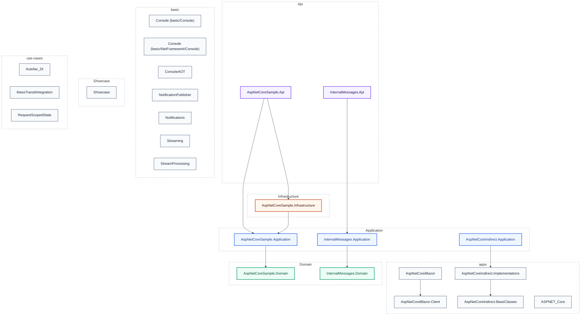

_Dashed boundaries group projects into layers. Projects are grouped by Clean Architecture naming convention (Domain / Application / Infrastructure / Api / Web / UI); projects matching no convention are grouped by their top-level folder._

## CQRS Map

**Legend:** blue = command · teal = query · violet = other request · gray stadium = handler · amber = validator. Amber dashed request = `CommandWithoutValidator` finding.

_Requests are grouped by declaring project. Handler and validator nodes are shown where linked and may be declared in a different project._

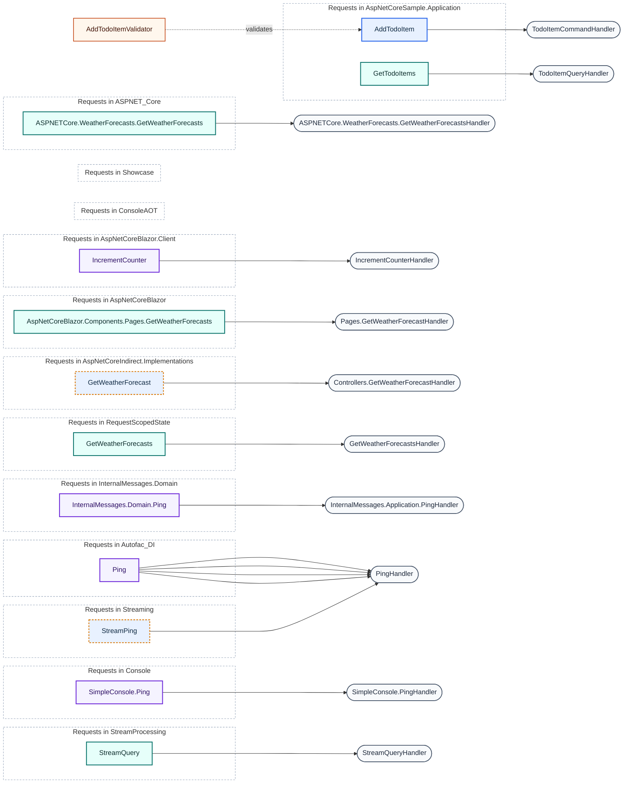

_15 requests · 11 handlers · 1 validator · 2 CommandWithoutValidator findings_


## Validation Coverage

_The share of requests with a linked validator (the model's request→validator linkage). A request with no linked validator is also reported individually by the command-without-validator check._

| Project | Requests | With linked validator | Coverage | Validators |
| --- | ---: | ---: | ---: | ---: |
| AspNetCoreBlazor | 1 | 0 | 0.0% | 0 |
| AspNetCoreBlazor.Client | 1 | 0 | 0.0% | 0 |
| AspNetCoreIndirect.Implementations | 1 | 0 | 0.0% | 0 |
| AspNetCoreSample.Application | 2 | 1 | 50.0% | 1 |
| ASPNET_Core | 1 | 0 | 0.0% | 0 |
| Autofac_DI | 1 | 0 | 0.0% | 0 |
| Console | 2 | 0 | 0.0% | 0 |
| ConsoleAOT | 1 | 0 | 0.0% | 0 |
| InternalMessages.Domain | 1 | 0 | 0.0% | 0 |
| RequestScopedState | 1 | 0 | 0.0% | 0 |
| Showcase | 1 | 0 | 0.0% | 0 |
| Streaming | 1 | 0 | 0.0% | 0 |
| StreamProcessing | 1 | 0 | 0.0% | 0 |
| **All projects** | **15** | **1** | **6.7%** | **1** |

## Flow

_18 resolved flow edges across 11 feature/project diagrams (endpoint → request → handler and onward; DbContext nodes appear only when a handler directly references a discovered DbContext type; every flow edge appears in exactly one diagram). 2 unresolved dispatch call(s) are not drawn as edges._

**Legend:** blue stadium = endpoint · blue = request · gray = handler · fuchsia = notification · green = DbContext.

### ASPNET_Core — ASPNETCore — flow

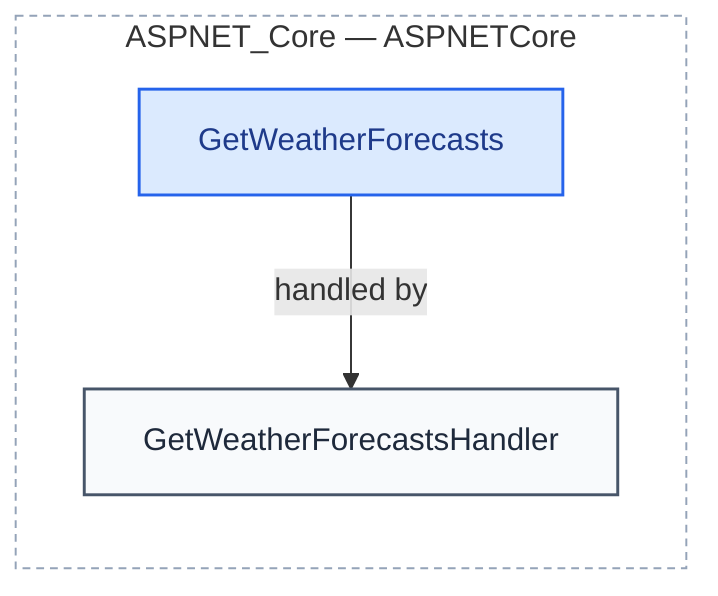

_1 edge · 1 connected flow_

### AspNetCoreBlazor — Components — flow

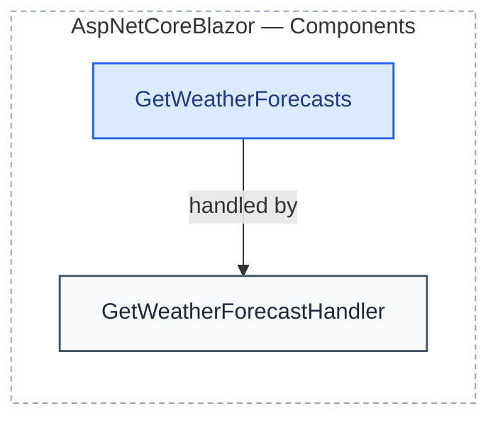

_1 edge · 1 connected flow_

### AspNetCoreBlazor.Client — Pages — flow

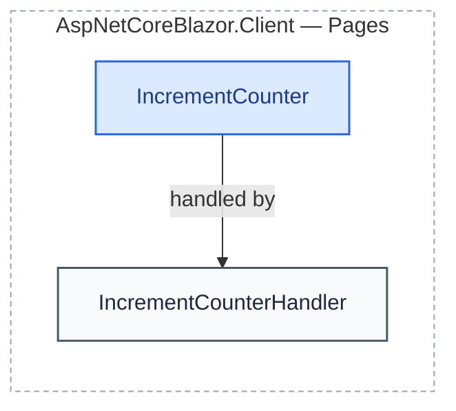

_1 edge · 1 connected flow_

### AspNetCoreIndirect.Implementations — flow

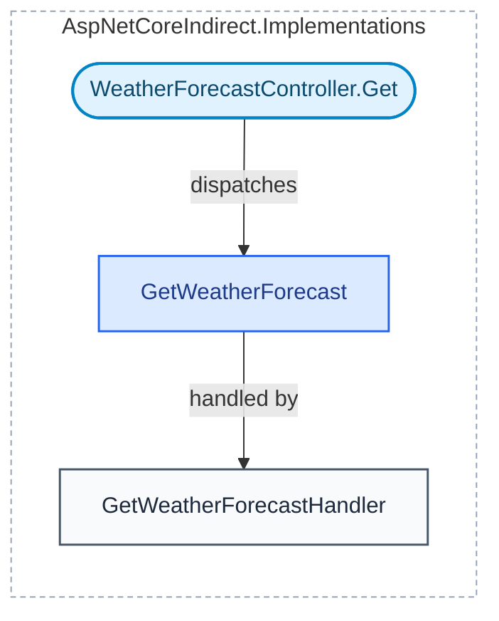

_2 edges · 1 connected flow_

### AspNetCoreSample.Application — flow

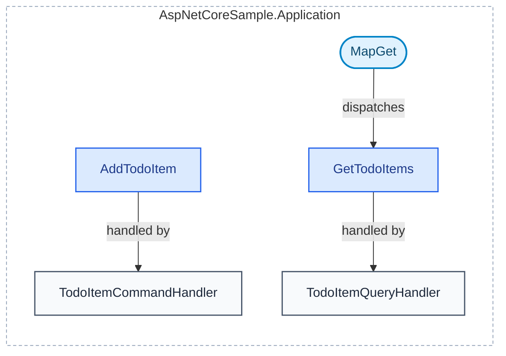

_3 edges · 2 connected flows_

### Console — flow

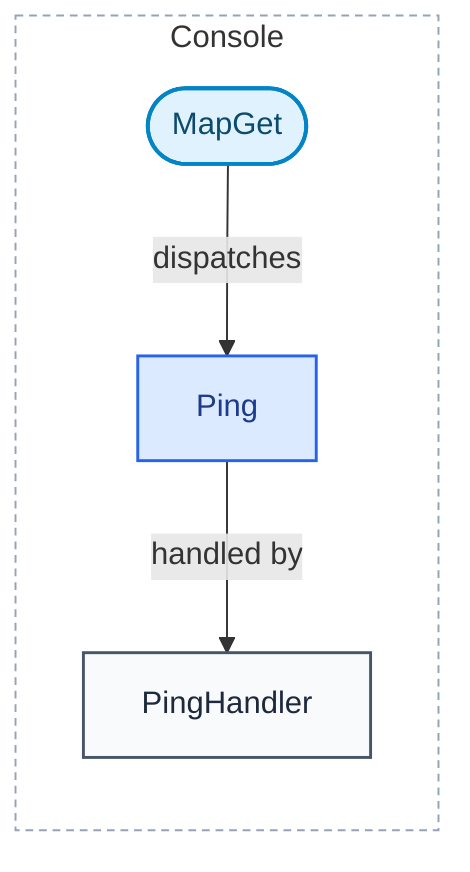

_2 edges · 1 connected flow_

### Console — SimpleConsole — flow

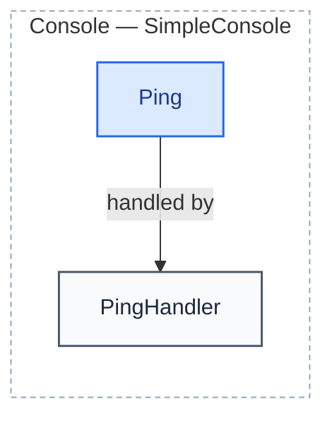

_1 edge · 1 connected flow_

### InternalMessages.Domain — flow

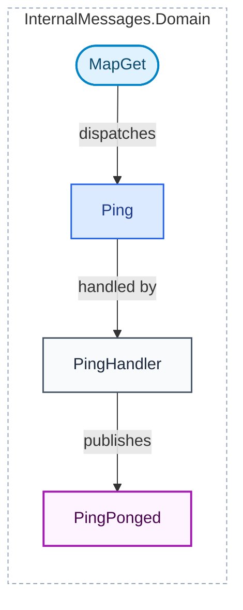

_3 edges · 1 connected flow_

### RequestScopedState — flow

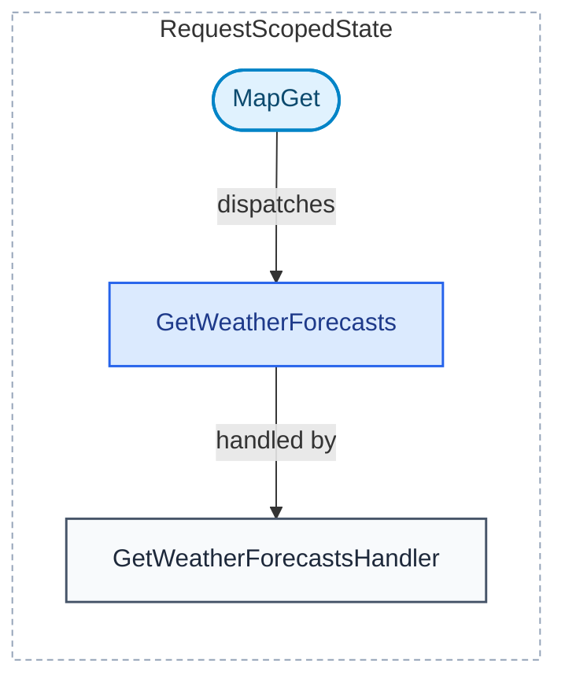

_2 edges · 1 connected flow_

### StreamProcessing — flow

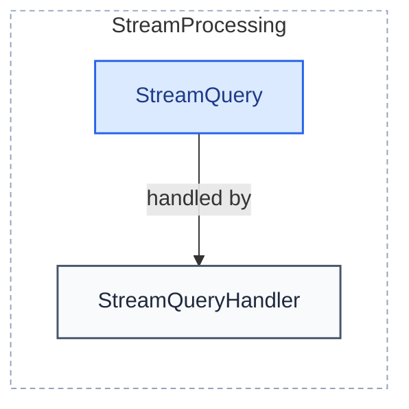

_1 edge · 1 connected flow_

### Streaming — flow

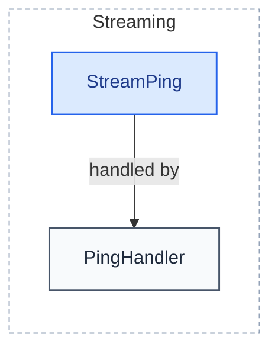

_1 edge · 1 connected flow_

## Request sequences

_One sequence diagram per request with a resolved handler, built only from data the scan model holds. Participants: endpoint → mediator → pipeline behaviors (registered order) → handler → DbContext → published notifications. A DbContext participant appears only when the model holds a handler → DbContext edge; behavior order is registered order, not execution order._

### AddTodoItem

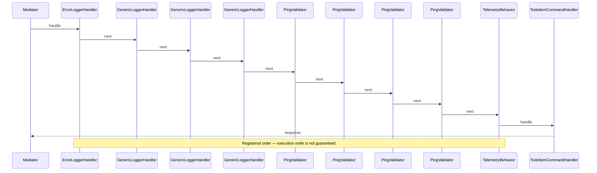

_Sequence for AddTodoItem: mediator → handler (no endpoint edge in the model). Behaviors shown in registered order (9); execution order is not guaranteed._

### GetTodoItems

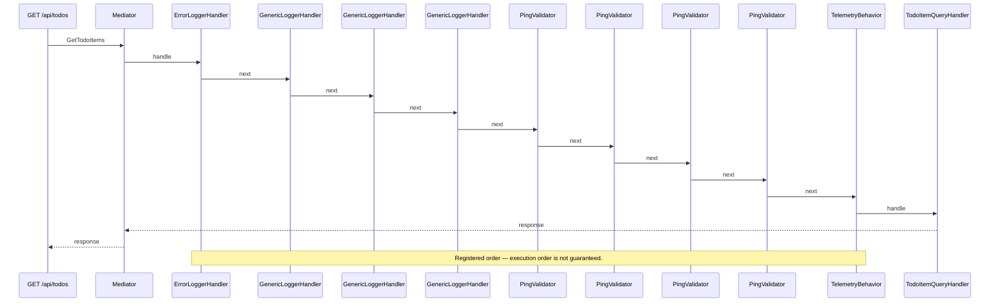

_Sequence for GetTodoItems: GET /api/todos → mediator → handler. Behaviors shown in registered order (9); execution order is not guaranteed._

### GetWeatherForecast

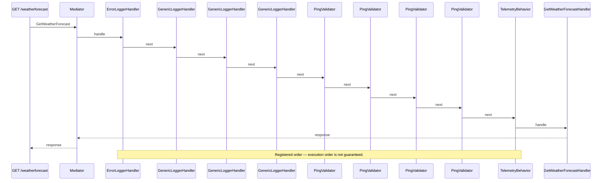

_Sequence for GetWeatherForecast: GET /weatherforecast → mediator → handler. Behaviors shown in registered order (9); execution order is not guaranteed._

### GetWeatherForecasts

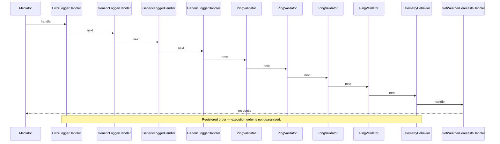

_Sequence for GetWeatherForecasts: mediator → handler (no endpoint edge in the model). Behaviors shown in registered order (9); execution order is not guaranteed._

### GetWeatherForecasts

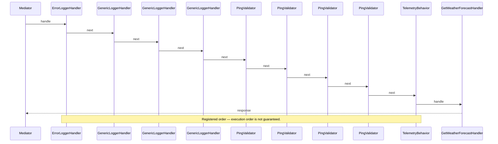

_Sequence for GetWeatherForecasts: mediator → handler (no endpoint edge in the model). Behaviors shown in registered order (9); execution order is not guaranteed._

### GetWeatherForecasts

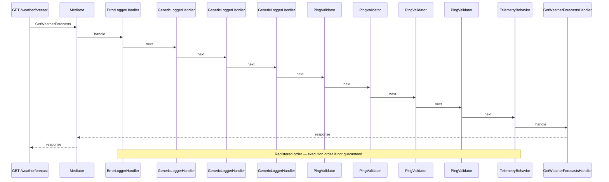

_Sequence for GetWeatherForecasts: GET /weatherforecast → mediator → handler. Behaviors shown in registered order (9); execution order is not guaranteed._

### IncrementCounter

```mermaid
sequenceDiagram
    %% Request sequence: IncrementCounter
    participant m as Mediator
    participant b1 as ErrorLoggerHandler
    participant b2 as GenericLoggerHandler
    participant b3 as GenericLoggerHandler
    participant b4 as GenericLoggerHandler
    participant b5 as PingValidator
    participant b6 as PingValidator
    participant b7 as PingValidator
    participant b8 as PingValidator
    participant b9 as TelemetryBehavior
    participant h1 as IncrementCounterHandler
    m->>b1: handle
    b1->>b2: next
    b2->>b3: next
    b3->>b4: next
    b4->>b5: next
    b5->>b6: next
    b6->>b7: next
    b7->>b8: next
    b8->>b9: next
    b9->>h1: handle
    h1-->>m: response
    Note over b1,b9: Registered order — execution order is not guaranteed.
```

_Sequence for IncrementCounter: mediator → handler (no endpoint edge in the model). Behaviors shown in registered order (9); execution order is not guaranteed._

### Ping

```mermaid
sequenceDiagram
    %% Request sequence: Ping
    participant ep as GET /ping
    participant m as Mediator
    participant b1 as ErrorLoggerHandler
    participant b2 as GenericLoggerHandler
    participant b3 as GenericLoggerHandler
    participant b4 as GenericLoggerHandler
    participant b5 as PingValidator
    participant b6 as PingValidator
    participant b7 as PingValidator
    participant b8 as PingValidator
    participant b9 as TelemetryBehavior
    participant h1 as PingHandler
    participant n1 as PingPonged
    participant nh1 as PingPongedHandler
    ep->>m: Ping
    m->>b1: handle
    b1->>b2: next
    b2->>b3: next
    b3->>b4: next
    b4->>b5: next
    b5->>b6: next
    b6->>b7: next
    b7->>b8: next
    b8->>b9: next
    b9->>h1: handle
    h1->>n1: publish
    n1->>nh1: handle
    h1-->>m: response
    m-->>ep: response
    Note over b1,b9: Registered order — execution order is not guaranteed.
```

_Sequence for Ping: GET /ping → mediator → handler. Behaviors shown in registered order (9); execution order is not guaranteed._

### Ping

```mermaid
sequenceDiagram
    %% Request sequence: Ping
    participant ep as GET /ping
    participant m as Mediator
    participant b1 as ErrorLoggerHandler
    participant b2 as GenericLoggerHandler
    participant b3 as GenericLoggerHandler
    participant b4 as GenericLoggerHandler
    participant b5 as PingValidator
    participant b6 as PingValidator
    participant b7 as PingValidator
    participant b8 as PingValidator
    participant b9 as TelemetryBehavior
    participant h1 as PingHandler
    ep->>m: Ping
    m->>b1: handle
    b1->>b2: next
    b2->>b3: next
    b3->>b4: next
    b4->>b5: next
    b5->>b6: next
    b6->>b7: next
    b7->>b8: next
    b8->>b9: next
    b9->>h1: handle
    h1-->>m: response
    m-->>ep: response
    Note over b1,b9: Registered order — execution order is not guaranteed.
```

_Sequence for Ping: GET /ping → mediator → handler. Behaviors shown in registered order (9); execution order is not guaranteed._

### Ping

```mermaid
sequenceDiagram
    %% Request sequence: Ping
    participant ep as GET /ping
    participant m as Mediator
    participant b1 as ErrorLoggerHandler
    participant b2 as GenericLoggerHandler
    participant b3 as GenericLoggerHandler
    participant b4 as GenericLoggerHandler
    participant b5 as PingValidator
    participant b6 as PingValidator
    participant b7 as PingValidator
    participant b8 as PingValidator
    participant b9 as TelemetryBehavior
    participant h1 as PingHandler
    ep->>m: Ping
    m->>b1: handle
    b1->>b2: next
    b2->>b3: next
    b3->>b4: next
    b4->>b5: next
    b5->>b6: next
    b6->>b7: next
    b7->>b8: next
    b8->>b9: next
    b9->>h1: handle
    h1-->>m: response
    m-->>ep: response
    Note over b1,b9: Registered order — execution order is not guaranteed.
```

_Sequence for Ping: GET /ping → mediator → handler. Behaviors shown in registered order (9); execution order is not guaranteed._

### Ping

```mermaid
sequenceDiagram
    %% Request sequence: Ping
    participant ep as GET /ping
    participant m as Mediator
    participant b1 as ErrorLoggerHandler
    participant b2 as GenericLoggerHandler
    participant b3 as GenericLoggerHandler
    participant b4 as GenericLoggerHandler
    participant b5 as PingValidator
    participant b6 as PingValidator
    participant b7 as PingValidator
    participant b8 as PingValidator
    participant b9 as TelemetryBehavior
    participant h1 as PingHandler
    ep->>m: Ping
    m->>b1: handle
    b1->>b2: next
    b2->>b3: next
    b3->>b4: next
    b4->>b5: next
    b5->>b6: next
    b6->>b7: next
    b7->>b8: next
    b8->>b9: next
    b9->>h1: handle
    h1-->>m: response
    m-->>ep: response
    Note over b1,b9: Registered order — execution order is not guaranteed.
```

_Sequence for Ping: GET /ping → mediator → handler. Behaviors shown in registered order (9); execution order is not guaranteed._

### Ping

```mermaid
sequenceDiagram
    %% Request sequence: Ping
    participant ep as GET /ping
    participant m as Mediator
    participant b1 as ErrorLoggerHandler
    participant b2 as GenericLoggerHandler
    participant b3 as GenericLoggerHandler
    participant b4 as GenericLoggerHandler
    participant b5 as PingValidator
    participant b6 as PingValidator
    participant b7 as PingValidator
    participant b8 as PingValidator
    participant b9 as TelemetryBehavior
    participant h1 as PingHandler
    ep->>m: Ping
    m->>b1: handle
    b1->>b2: next
    b2->>b3: next
    b3->>b4: next
    b4->>b5: next
    b5->>b6: next
    b6->>b7: next
    b7->>b8: next
    b8->>b9: next
    b9->>h1: handle
    h1-->>m: response
    m-->>ep: response
    Note over b1,b9: Registered order — execution order is not guaranteed.
```

_Sequence for Ping: GET /ping → mediator → handler. Behaviors shown in registered order (9); execution order is not guaranteed._

### Ping

```mermaid
sequenceDiagram
    %% Request sequence: Ping
    participant m as Mediator
    participant b1 as ErrorLoggerHandler
    participant b2 as GenericLoggerHandler
    participant b3 as GenericLoggerHandler
    participant b4 as GenericLoggerHandler
    participant b5 as PingValidator
    participant b6 as PingValidator
    participant b7 as PingValidator
    participant b8 as PingValidator
    participant b9 as TelemetryBehavior
    participant h1 as PingHandler
    m->>b1: handle
    b1->>b2: next
    b2->>b3: next
    b3->>b4: next
    b4->>b5: next
    b5->>b6: next
    b6->>b7: next
    b7->>b8: next
    b8->>b9: next
    b9->>h1: handle
    h1-->>m: response
    Note over b1,b9: Registered order — execution order is not guaranteed.
```

_Sequence for Ping: mediator → handler (no endpoint edge in the model). Behaviors shown in registered order (9); execution order is not guaranteed._

### StreamPing

```mermaid
sequenceDiagram
    %% Request sequence: StreamPing
    participant m as Mediator
    participant b1 as ErrorLoggerHandler
    participant b2 as GenericLoggerHandler
    participant b3 as GenericLoggerHandler
    participant b4 as GenericLoggerHandler
    participant b5 as PingValidator
    participant b6 as PingValidator
    participant b7 as PingValidator
    participant b8 as PingValidator
    participant b9 as TelemetryBehavior
    participant h1 as PingHandler
    m->>b1: handle
    b1->>b2: next
    b2->>b3: next
    b3->>b4: next
    b4->>b5: next
    b5->>b6: next
    b6->>b7: next
    b7->>b8: next
    b8->>b9: next
    b9->>h1: handle
    h1-->>m: response
    Note over b1,b9: Registered order — execution order is not guaranteed.
```

_Sequence for StreamPing: mediator → handler (no endpoint edge in the model). Behaviors shown in registered order (9); execution order is not guaranteed._

### StreamQuery

```mermaid
sequenceDiagram
    %% Request sequence: StreamQuery
    participant m as Mediator
    participant b1 as ErrorLoggerHandler
    participant b2 as GenericLoggerHandler
    participant b3 as GenericLoggerHandler
    participant b4 as GenericLoggerHandler
    participant b5 as PingValidator
    participant b6 as PingValidator
    participant b7 as PingValidator
    participant b8 as PingValidator
    participant b9 as TelemetryBehavior
    participant h1 as StreamQueryHandler
    m->>b1: handle
    b1->>b2: next
    b2->>b3: next
    b3->>b4: next
    b4->>b5: next
    b5->>b6: next
    b6->>b7: next
    b7->>b8: next
    b8->>b9: next
    b9->>h1: handle
    h1-->>m: response
    Note over b1,b9: Registered order — execution order is not guaranteed.
```

_Sequence for StreamQuery: mediator → handler (no endpoint edge in the model). Behaviors shown in registered order (9); execution order is not guaranteed._

## API Endpoints

_The HTTP surface and the request each endpoint dispatches to. `inferred` marks a route or verb guessed from naming rather than read from source; an `unresolved` target has no matching request in the model._

**5 endpoint(s)** across 5 project(s).

| Method | Route | Endpoint | Project | Target request | Handler | Inferred |
| --- | --- | --- | --- | --- | --- | :---: |
| GET | /weatherforecast | WeatherForecastController.Get | AspNetCoreIndirect.Implementations | GetWeatherForecast | GetWeatherForecastHandler | — |
| GET | /api/todos | MapGet | AspNetCoreSample.Api | GetTodoItems | TodoItemQueryHandler | — |
| GET | /ping | MapGet | Autofac_DI | Ping | PingHandler | — |
| GET | /ping | MapGet | InternalMessages.Api | Ping | PingHandler | — |
| GET | /weatherforecast | MapGet | RequestScopedState | GetWeatherForecasts | GetWeatherForecastsHandler | — |

## Requests

| Request | Type | Response | Handler | Validators | Dispatched by | Project |
| --- | --- | --- | --- | --- | --- | --- |
| AddTodoItem | Command | TodoItem | TodoItemCommandHandler | AddTodoItemValidator | — | AspNetCoreSample.Application |
| GetTodoItems | Query | IEnumerable&lt;TodoItem&gt; | TodoItemQueryHandler | — | TodoApi | AspNetCoreSample.Application |
| GetWeatherForecast | Command | IReadOnlyList&lt;WeatherForecast&gt; | GetWeatherForecastHandler | — | — | AspNetCoreIndirect.Implementations |
| GetWeatherForecasts | Query | IEnumerable&lt;WeatherForecast&gt; | GetWeatherForecastsHandler | — | WeatherForecastController | ASPNET_Core |
| GetWeatherForecasts | Query | WeatherForecast | GetWeatherForecastHandler | — | — | AspNetCoreBlazor |
| GetWeatherForecasts | Query | — | GetWeatherForecastsHandler | — | — | RequestScopedState |
| IncrementCounter | Request | long | IncrementCounterHandler | — | — | AspNetCoreBlazor.Client |
| Ping | Request | Pong | PingHandler | — | — | InternalMessages.Domain |
| Ping | Request | Pong | PingHandler | — | — | Console |
| Ping | Request | Pong | PingHandler | — | — | ConsoleAOT |
| Ping | Request | Pong | PingHandler | — | — | Showcase |
| Ping | Request | Pong | PingHandler | — | — | Autofac_DI |
| Ping | Request | Pong | PingHandler | — | Program | Console |
| StreamPing | Command | Pong | PingHandler | — | — | Streaming |
| StreamQuery | Query | StreamResult | StreamQueryHandler | — | — | StreamProcessing |
## Domain Events & Notifications

**Legend:** fuchsia = notification · amber dashed = orphan notification (`OrphanNotification` finding) · gray stadium = handler · indigo parallelogram = publisher.

```mermaid
flowchart LR
    accTitle: Domain events and notifications map
    accDescr: 7 notifications, 8 handlers, 2 publishers, 1 OrphanNotification.
    subgraph prj_InternalMessages_Domain["Notifications in InternalMessages.Domain"]
        ntf_PingPonged["PingPonged"]:::clsNotification
    end
    subgraph prj_MassTransitIntegration["Notifications in MassTransitIntegration"]
        ntf_WeatherUpdated["WeatherUpdated"]:::clsNotification
    end
    subgraph prj_NotificationPublisher["Notifications in NotificationPublisher"]
        ntf_Notification["Notification"]:::clsNotification
    end
    subgraph prj_Notifications["Notifications in Notifications"]
        ntf_INotification["INotification"]:::clsNotification
        ntf_Notification["Notification"]:::clsNotification
    end
    subgraph prj_Showcase["Notifications in Showcase"]
        ntf_ErrorMessage["ErrorMessage"]:::clsNotification
        ntf_SuccessfulMessage["SuccessfulMessage"]:::clsOrphanNotification
    end
    nhd_WeatherUpdateLogger(["WeatherUpdateLogger"]):::clsHandler
    nhd_WeatherUpdateStorage(["WeatherUpdateStorage"]):::clsHandler
    nhd_CatchAllNotificationHandler(["CatchAllNotificationHandler"]):::clsHandler
    nhd_ConcreteNotificationHandler(["ConcreteNotificationHandler"]):::clsHandler
    nhd_ErrorNotificationHandler(["ErrorNotificationHandler"]):::clsHandler
    nhd_PingPongedHandler(["PingPongedHandler"]):::clsHandler
    nhd_MyNotificationHandler(["MyNotificationHandler"]):::clsHandler
    nhd_StatsNotificationHandler(["StatsNotificationHandler"]):::clsHandler
    pub_ErrorLoggerHandler[/"ErrorLoggerHandler"/]:::clsPublisher
    pub_PingHandler[/"PingHandler"/]:::clsPublisher
    pub_PingHandler -->|publishes| ntf_PingPonged
    ntf_PingPonged -->|handled by| nhd_PingPongedHandler
    ntf_WeatherUpdated -->|handled by| nhd_WeatherUpdateLogger
    ntf_WeatherUpdated -->|handled by| nhd_WeatherUpdateStorage
    ntf_Notification -->|handled by| nhd_MyNotificationHandler
    ntf_INotification -->|handled by| nhd_CatchAllNotificationHandler
    ntf_INotification -->|handled by| nhd_StatsNotificationHandler
    ntf_Notification -->|handled by| nhd_ConcreteNotificationHandler
    pub_ErrorLoggerHandler -->|publishes| ntf_ErrorMessage
    ntf_ErrorMessage -->|handled by| nhd_ErrorNotificationHandler
    pub_ErrorLoggerHandler -->|publishes| ntf_SuccessfulMessage
    style prj_InternalMessages_Domain fill:none,stroke:#94a3b8,stroke-dasharray:4 3
    style prj_MassTransitIntegration fill:none,stroke:#94a3b8,stroke-dasharray:4 3
    style prj_NotificationPublisher fill:none,stroke:#94a3b8,stroke-dasharray:4 3
    style prj_Notifications fill:none,stroke:#94a3b8,stroke-dasharray:4 3
    style prj_Showcase fill:none,stroke:#94a3b8,stroke-dasharray:4 3
    classDef clsNotification fill:#fdf4ff,stroke:#a21caf,stroke-width:2px,color:#4a044e
    classDef clsHandler fill:#f8fafc,stroke:#475569,stroke-width:1.5px,color:#1e293b
    classDef clsPublisher fill:#eef2ff,stroke:#4f46e5,stroke-width:2px,color:#312e81
    classDef clsOrphanNotification fill:#fffbeb,stroke:#d97706,stroke-width:2px,stroke-dasharray:4 3,color:#78350f
```

### Notifications

| Notification | Marker | Handlers | Project | Source |
| --- | --- | --- | --- | --- |
| ErrorMessage | INotification | ErrorNotificationHandler | Showcase | `Showcase/Program.cs:83:22` |
| INotification | INotification | CatchAllNotificationHandler, StatsNotificationHandler | Notifications | `basic/Notifications/Program.cs:50:21` |
| Notification | INotification | MyNotificationHandler | NotificationPublisher | `basic/NotificationPublisher/Program.cs:82:22` |
| Notification | INotification | ConcreteNotificationHandler | Notifications | `basic/Notifications/Program.cs:37:22` |
| PingPonged | INotification | PingPongedHandler | InternalMessages.Domain | `apps/InternalMessages/InternalMessages.Domain/Ping.cs:9:24` |
| SuccessfulMessage | INotification | — | Showcase | `Showcase/Program.cs:85:22` |
| WeatherUpdated | INotification | WeatherUpdateLogger, WeatherUpdateStorage | MassTransitIntegration | `use-cases/MassTransitIntegration/Program.cs:52:26` |

## Pipeline Behaviors

_Behaviors are listed in registered order — the order of their DI registration expressions in the scanned source. Execution order is not guaranteed and is not proven by the scan._

```mermaid
flowchart LR
    accTitle: Pipeline behavior chain
    accDescr: 9 behaviors in registered order. Execution order is not guaranteed and is not proven by the scan. 9 behaviors have no resolvable registration site and are appended after the registered ones. Their order is not determinable.
    req(["Request"]):::clsChainRequest
    bhv_ErrorLoggerHandler["ErrorLoggerHandler"]:::clsChainBehavior
    req --> bhv_ErrorLoggerHandler
    bhv_GenericLoggerHandler["GenericLoggerHandler"]:::clsChainBehavior
    bhv_ErrorLoggerHandler --> bhv_GenericLoggerHandler
    bhv_GenericLoggerHandler_2["GenericLoggerHandler"]:::clsChainBehavior
    bhv_GenericLoggerHandler --> bhv_GenericLoggerHandler_2
    bhv_GenericLoggerHandler_3["GenericLoggerHandler"]:::clsChainBehavior
    bhv_GenericLoggerHandler_2 --> bhv_GenericLoggerHandler_3
    bhv_PingValidator["PingValidator"]:::clsChainBehavior
    bhv_GenericLoggerHandler_3 --> bhv_PingValidator
    bhv_PingValidator_2["PingValidator"]:::clsChainBehavior
    bhv_PingValidator --> bhv_PingValidator_2
    bhv_PingValidator_3["PingValidator"]:::clsChainBehavior
    bhv_PingValidator_2 --> bhv_PingValidator_3
    bhv_PingValidator_4["PingValidator"]:::clsChainBehavior
    bhv_PingValidator_3 --> bhv_PingValidator_4
    bhv_TelemetryBehavior["TelemetryBehavior"]:::clsChainBehavior
    bhv_PingValidator_4 --> bhv_TelemetryBehavior
    bhv_TelemetryBehavior --> hdl(["Handler"]):::clsChainHandler
    classDef clsChainRequest fill:#dbeafe,stroke:#2563eb,stroke-width:1.5px,color:#1e3a8a
    classDef clsChainBehavior fill:#fef3c7,stroke:#d97706,stroke-width:1.5px,color:#78350f
    classDef clsChainHandler fill:#f8fafc,stroke:#475569,stroke-width:1.5px,color:#1e293b
```

### Registration site not found — order not determinable

| Behavior | Project | Source |
| --- | --- | --- |
| ErrorLoggerHandler | Showcase | `Showcase/Program.cs:87:21` |
| GenericLoggerHandler | Console | `basic/Console/Program.cs:48:21` |
| GenericLoggerHandler | Console | `basic/NetFramework/Console/Program.cs:72:25` |
| GenericLoggerHandler | ConsoleAOT | `basic/ConsoleAOT/Program.cs:47:21` |
| PingValidator | Console | `basic/Console/Program.cs:72:21` |
| PingValidator | Console | `basic/NetFramework/Console/Program.cs:96:25` |
| PingValidator | ConsoleAOT | `basic/ConsoleAOT/Program.cs:71:21` |
| PingValidator | Showcase | `Showcase/Program.cs:68:21` |
| TelemetryBehavior | RequestScopedState | `use-cases/RequestScopedState/Program.cs:66:23` |

## Data Access (DbContexts)

_No DbContext classes found._

## Analysis Diagnostics

No analysis diagnostics.

## Architecture Checks

0 error(s), 12 warning(s):

### ⚠️ UnreachableRequest (5)

- ℹ️ _2 unresolved dispatch call(s) in the solution could not be resolved and are not counted as call sites. (×5)_
- ⚠️ Warning **UnreachableRequest** — Request `AspNetCoreBlazor.Client.Pages.IncrementCounter` has 1 handler(s) but no production call site. `apps/ASPNET_CORE_Blazor/AspNetCoreBlazor.Client/Pages/Counter.cs:5:22`
- ⚠️ Warning **UnreachableRequest** — Request `AspNetCoreBlazor.Components.Pages.GetWeatherForecasts` has 1 handler(s) but no production call site. `apps/ASPNET_CORE_Blazor/AspNetCoreBlazor/Components/Pages/Weather.cs:6:24`
- ⚠️ Warning **UnreachableRequest** — Request `AspNetCoreSample.Application.AddTodoItem` has 1 handler(s) but no production call site. `apps/ASPNET_Core_CleanArchitecture/AspNetCoreSample.Application/Todos/AddTodoItem.cs:17:22`
- ⚠️ Warning **UnreachableRequest** — Request `StreamPing` has 1 handler(s) but no production call site. `basic/Streaming/Program.cs:40:22`
- ⚠️ Warning **UnreachableRequest** — Request `StreamQuery` has 1 handler(s) but no production call site. `basic/StreamProcessing/Program.cs:50:22`

### ⚠️ UnpublishedNotification (4)

- ℹ️ _2 unresolved dispatch call(s) in the solution could not be resolved and are not counted as call sites. (×4)_
- ⚠️ Warning **UnpublishedNotification** — Notification `App.WeatherUpdated` has 2 handler(s) but no production publisher. `use-cases/MassTransitIntegration/Program.cs:52:26`
- ⚠️ Warning **UnpublishedNotification** — Notification `INotification` has 2 handler(s) but no production publisher. `basic/Notifications/Program.cs:50:21`
- ⚠️ Warning **UnpublishedNotification** — Notification `Notification` has 1 handler(s) but no production publisher. `basic/NotificationPublisher/Program.cs:82:22`
- ⚠️ Warning **UnpublishedNotification** — Notification `Notification` has 1 handler(s) but no production publisher. `basic/Notifications/Program.cs:37:22`

### ⚠️ CommandWithoutValidator (2)

- ⚠️ Warning **CommandWithoutValidator** — Command `AspNetCoreIndirect.Application.GetWeatherForecast` has no validator. `apps/ASPNET_Core_Indirect/AspNetCoreIndirect.Implementations/GetWeatherForecast.cs:5:15`
- ⚠️ Warning **CommandWithoutValidator** — Command `StreamPing` has no validator. `basic/Streaming/Program.cs:40:22`

### ⚠️ OrphanNotification (1)

- ⚠️ Warning **OrphanNotification** — Notification `SuccessfulMessage` has no handler. `Showcase/Program.cs:85:22`


**Findings summary:** 12 finding(s) — 0 error(s), 12 warning(s) across 10 module(s) and 10 cluster(s).

### Findings by rule

| Rule | Errors | Warnings | Total |
| --- | ---: | ---: | ---: |
| UnreachableRequest | 0 | 5 | 5 |
| UnpublishedNotification | 0 | 4 | 4 |
| CommandWithoutValidator | 0 | 2 | 2 |
| OrphanNotification | 0 | 1 | 1 |

### Findings by module

| Module | Errors | Warnings | Total |
| --- | ---: | ---: | ---: |
| Notifications | 0 | 2 | 2 |
| Streaming | 0 | 2 | 2 |
| AspNetCoreBlazor | 0 | 1 | 1 |
| AspNetCoreBlazor.Client | 0 | 1 | 1 |
| AspNetCoreIndirect.Implementations | 0 | 1 | 1 |
| AspNetCoreSample.Application | 0 | 1 | 1 |
| MassTransitIntegration | 0 | 1 | 1 |
| NotificationPublisher | 0 | 1 | 1 |
| Showcase | 0 | 1 | 1 |
| StreamProcessing | 0 | 1 | 1 |

### Findings by module and feature

_Each row is one module (project) and feature cluster; every finding is counted exactly once. Findings whose target has no resolvable feature appear under `(unassigned)`._

| Module | Feature | Rules | Errors | Warnings | Total |
| --- | --- | --- | ---: | ---: | ---: |
| AspNetCoreBlazor | Components | UnreachableRequest 1 | 0 | 1 | 1 |
| AspNetCoreBlazor.Client | Pages | UnreachableRequest 1 | 0 | 1 | 1 |
| AspNetCoreIndirect.Implementations | AspNetCoreIndirect.Implementations | CommandWithoutValidator 1 | 0 | 1 | 1 |
| AspNetCoreSample.Application | AspNetCoreSample.Application | UnreachableRequest 1 | 0 | 1 | 1 |
| MassTransitIntegration | App | UnpublishedNotification 1 | 0 | 1 | 1 |
| NotificationPublisher | (unassigned) | UnpublishedNotification 1 | 0 | 1 | 1 |
| Notifications | (unassigned) | UnpublishedNotification 2 | 0 | 2 | 2 |
| Showcase | (unassigned) | OrphanNotification 1 | 0 | 1 | 1 |
| StreamProcessing | (unassigned) | UnreachableRequest 1 | 0 | 1 | 1 |
| Streaming | (unassigned) | CommandWithoutValidator 1, UnreachableRequest 1 | 0 | 2 | 2 |

---
_Generated by CqrsLens 0.9.0 in 203 ms — 45 files scanned._
_Report generated by [CqrsLens](https://github.com/AbdullahHakima/cqrslens) — static analysis only; the target solution was not built._
