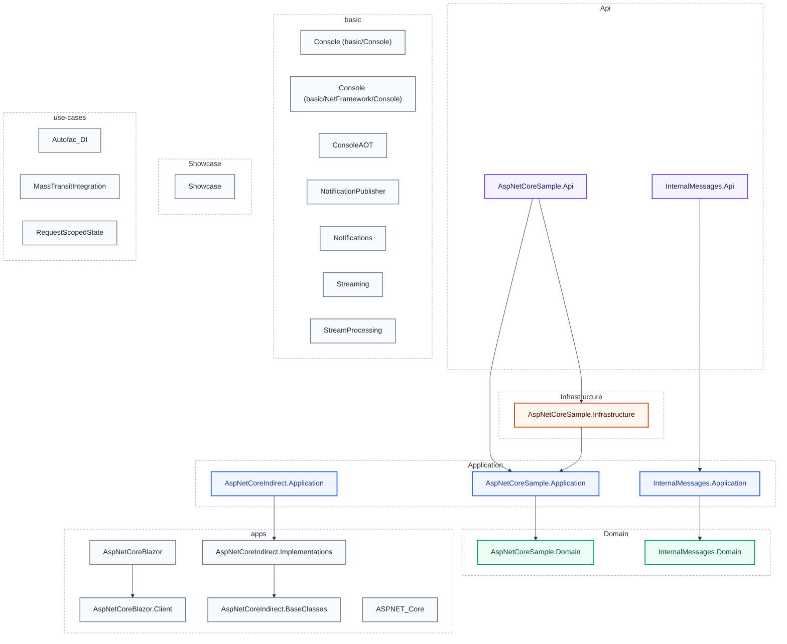
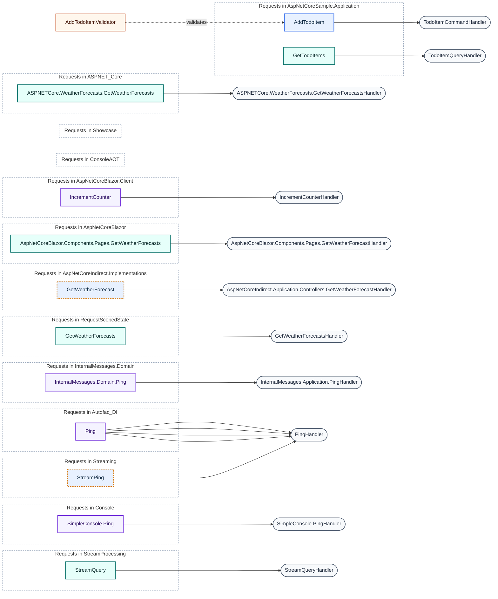

# Architecture Report

Generated by **CqrsLens 0.6.0** on 2026-10-25 18:33:25 UTC · text scanner · Source: `samples` · Conventions: Mediator

```text
╔═══════════════════════════════════════════════════╗
║  █   █ █████ ████   ███   ███  █████  ███  ████   ║
║  ██ ██ █     █   █   █   █   █   █   █   █ █   █  ║
║  █ █ █ ████  █   █   █   █████   █   █   █ ████   ║
║  █   █ █     █   █   █   █   █   █   █   █ █  █   ║
║  █   █ █████ ████   ███  █   █   █    ███  █   █  ║
║                                                   ║
║      ████  ███  █   █ ████  █     █████  ████     ║
║     █     █   █ ██ ██ █   █ █     █     █         ║
║      ███  █████ █ █ █ ████  █     ████   ███      ║
║         █ █   █ █   █ █     █     █         █     ║
║     ████  █   █ █   █ █     █████ █████ ████      ║
╟───────────────────────────────────────────────────╢
║         ◈ WATERMARK · MEDIATOR SAMPLES ◈          ║
╚═══════════════════════════════════════════════════╝
```

## Overview

| Metric | Count |
| --- | ---: |
| Projects | 24 |
| Requests (commands + queries) | 15 |
| Handlers | 15 |
| Validators | 1 |
| Pipeline behaviors | 9 |
| DbContexts | 0 |

## Project Dependency Graph

```mermaid
flowchart TD
    accTitle: Project dependency graph
    accDescr: 24 projects, 9 references.
    prj_AspNetCoreBlazor["AspNetCoreBlazor"]:::clsLayerOther
    prj_AspNetCoreBlazor_Client["AspNetCoreBlazor.Client"]:::clsLayerOther
    prj_AspNetCoreIndirect_Application["AspNetCoreIndirect.Application"]:::clsLayerApplication
    prj_AspNetCoreIndirect_BaseClasses["AspNetCoreIndirect.BaseClasses"]:::clsLayerOther
    prj_AspNetCoreIndirect_Implementations["AspNetCoreIndirect.Implementations"]:::clsLayerOther
    prj_AspNetCoreSample_Api["AspNetCoreSample.Api"]:::clsLayerApi
    prj_AspNetCoreSample_Application["AspNetCoreSample.Application"]:::clsLayerApplication
    prj_AspNetCoreSample_Domain["AspNetCoreSample.Domain"]:::clsLayerDomain
    prj_AspNetCoreSample_Infrastructure["AspNetCoreSample.Infrastructure"]:::clsLayerInfrastructure
    prj_ASPNET_Core["ASPNET_Core"]:::clsLayerOther
    prj_Autofac_DI["Autofac_DI"]:::clsLayerOther
    prj_Console__basic_Console_["Console (basic/Console)"]:::clsLayerOther
    prj_Console__basic_NetFramework_Console_["Console (basic/NetFramework/Console)"]:::clsLayerOther
    prj_ConsoleAOT["ConsoleAOT"]:::clsLayerOther
    prj_InternalMessages_Api["InternalMessages.Api"]:::clsLayerApi
    prj_InternalMessages_Application["InternalMessages.Application"]:::clsLayerApplication
    prj_InternalMessages_Domain["InternalMessages.Domain"]:::clsLayerDomain
    prj_MassTransitIntegration["MassTransitIntegration"]:::clsLayerOther
    prj_NotificationPublisher["NotificationPublisher"]:::clsLayerOther
    prj_Notifications["Notifications"]:::clsLayerOther
    prj_RequestScopedState["RequestScopedState"]:::clsLayerOther
    prj_Showcase["Showcase"]:::clsLayerOther
    prj_Streaming["Streaming"]:::clsLayerOther
    prj_StreamProcessing["StreamProcessing"]:::clsLayerOther
    prj_AspNetCoreBlazor --> prj_AspNetCoreBlazor_Client
    prj_AspNetCoreIndirect_Application --> prj_AspNetCoreIndirect_Implementations
    prj_AspNetCoreIndirect_Implementations --> prj_AspNetCoreIndirect_BaseClasses
    prj_AspNetCoreSample_Api --> prj_AspNetCoreSample_Application
    prj_AspNetCoreSample_Api --> prj_AspNetCoreSample_Infrastructure
    prj_AspNetCoreSample_Application --> prj_AspNetCoreSample_Domain
    prj_AspNetCoreSample_Infrastructure --> prj_AspNetCoreSample_Application
    prj_InternalMessages_Api --> prj_InternalMessages_Application
    prj_InternalMessages_Application --> prj_InternalMessages_Domain
    classDef clsLayerDomain fill:#ecfdf5,stroke:#059669,stroke-width:2px,color:#064e3b
    classDef clsLayerApplication fill:#eff6ff,stroke:#2563eb,stroke-width:2px,color:#1e3a8a
    classDef clsLayerInfrastructure fill:#fff7ed,stroke:#c2410c,stroke-width:2px,color:#431407
    classDef clsLayerApi fill:#f5f3ff,stroke:#7c3aed,stroke-width:2px,color:#2e1065
    classDef clsLayerTests fill:#f8fafc,stroke:#64748b,stroke-width:1.5px,color:#1e293b
    classDef clsLayerOther fill:#f8fafc,stroke:#64748b,stroke-width:1.5px,color:#1e293b
```



_Project references are drawn only when the target name resolves to a single project; ambiguous duplicate names are reported under Architecture Checks._

**Layer colors:** green = Domain · blue = Application · amber = Infrastructure · purple = Api/Web/UI · gray = Tests/other.

## Layers



_Dashed boundaries group projects into layers. Projects are grouped by Clean Architecture naming convention (Domain / Application / Infrastructure / Api / Web / UI); projects matching no convention are grouped by their top-level folder._

## CQRS Map

**Legend:** blue = command · teal = query · violet = other request · gray stadium = handler · amber = validator. Amber dashed request = `CommandWithoutValidator` finding.

_Requests are grouped by declaring project. Handler and validator nodes are shown where linked and may be declared in a different project._



_15 requests · 11 handlers · 1 validator · 2 CommandWithoutValidator findings_

### Requests

| Request | Type | Response | Handler | Validators | Project |
| --- | --- | --- | --- | --- | --- |
| AddTodoItem | Command | TodoItem | TodoItemCommandHandler | AddTodoItemValidator | AspNetCoreSample.Application |
| GetTodoItems | Query | IEnumerable&lt;TodoItem&gt; | TodoItemQueryHandler | — | AspNetCoreSample.Application |
| GetWeatherForecast | Command | IReadOnlyList&lt;WeatherForecast&gt; | GetWeatherForecastHandler | — | AspNetCoreIndirect.Implementations |
| GetWeatherForecasts | Query | IEnumerable&lt;WeatherForecast&gt; | GetWeatherForecastsHandler | — | ASPNET_Core |
| GetWeatherForecasts | Query | WeatherForecast | GetWeatherForecastHandler | — | AspNetCoreBlazor |
| GetWeatherForecasts | Query | — | GetWeatherForecastsHandler | — | RequestScopedState |
| IncrementCounter | Request | long | IncrementCounterHandler | — | AspNetCoreBlazor.Client |
| Ping | Request | Pong | PingHandler | — | InternalMessages.Domain |
| Ping | Request | Pong | PingHandler | — | ConsoleAOT |
| Ping | Request | Pong | PingHandler | — | Console |
| Ping | Request | Pong | PingHandler | — | Showcase |
| Ping | Request | Pong | PingHandler | — | Autofac_DI |
| Ping | Request | Pong | PingHandler | — | Console |
| StreamPing | Command | Pong | PingHandler | — | Streaming |
| StreamQuery | Query | StreamResult | StreamQueryHandler | — | StreamProcessing |

## Pipeline Behaviors

- `ErrorLoggerHandler` — Showcase
- `GenericLoggerHandler` — ConsoleAOT
- `GenericLoggerHandler` — Console
- `GenericLoggerHandler` — Console
- `PingValidator` — ConsoleAOT
- `PingValidator` — Console
- `PingValidator` — Console
- `PingValidator` — Showcase
- `TelemetryBehavior` — RequestScopedState

## Data Access (DbContexts)

_No DbContext classes found._

## Analysis Diagnostics

No scan diagnostics.

## Architecture Checks

0 error(s), 3 warning(s):

- ⚠️ Warning **AmbiguousProjectName** — Project name `Console` is used by 2 projects; layer checks skip references to it. `basic/Console/Console.csproj:1:1`
- ⚠️ Warning **CommandWithoutValidator** — Command `AspNetCoreIndirect.Application.GetWeatherForecast` has no validator. `apps/ASPNET_Core_Indirect/AspNetCoreIndirect.Implementations/GetWeatherForecast.cs:5:8`
- ⚠️ Warning **CommandWithoutValidator** — Command `StreamPing` has no validator. `basic/Streaming/Program.cs:40:15`

---
_Generated by CqrsLens 0.6.0 in 268 ms — 45 files scanned._
_Report generated by [CqrsLens](https://github.com/AbdullahHakima/cqrslens) — static analysis only; the target solution was not built._
